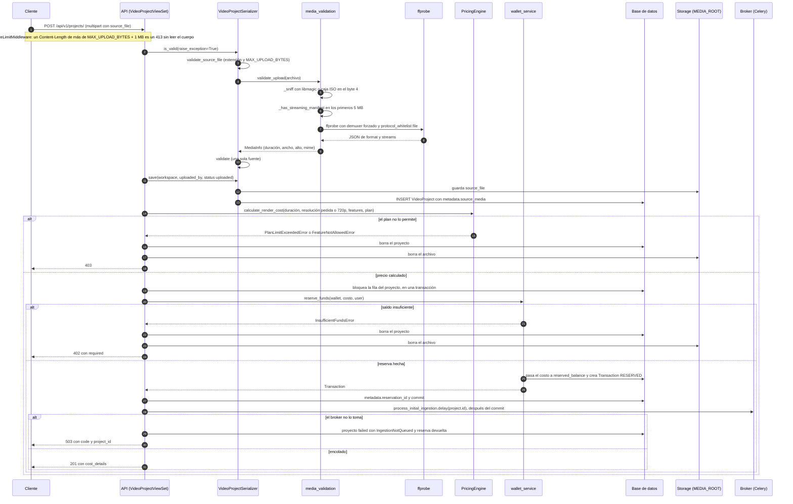
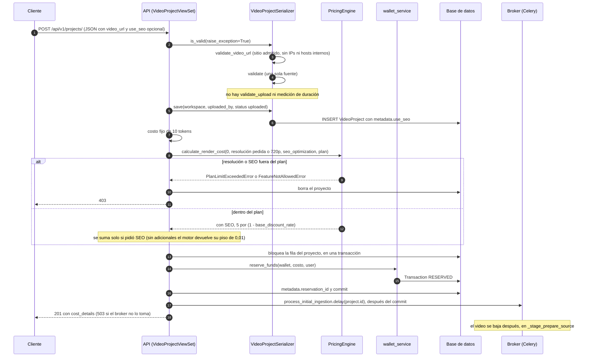
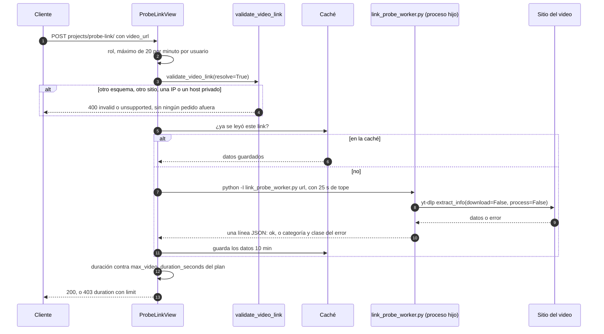
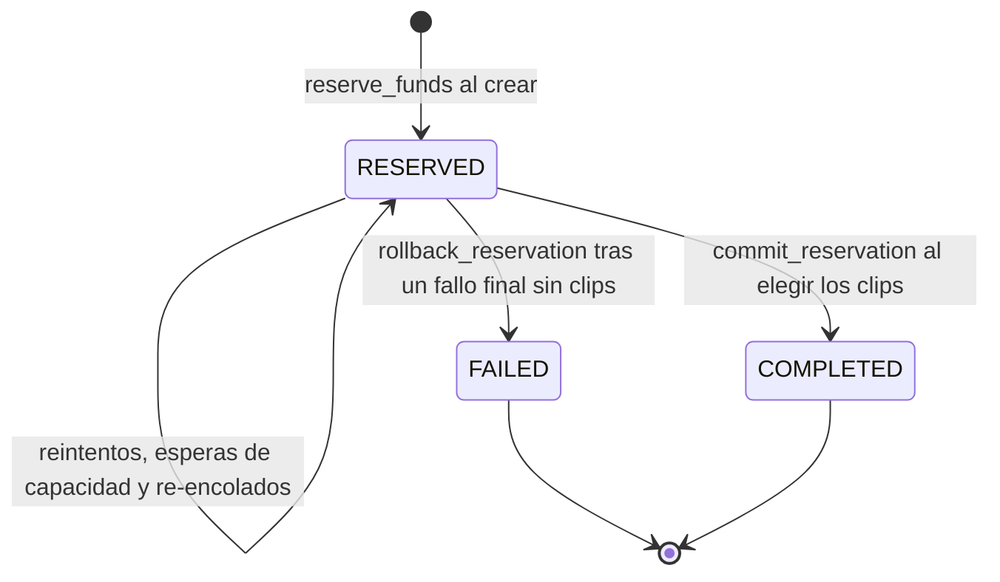
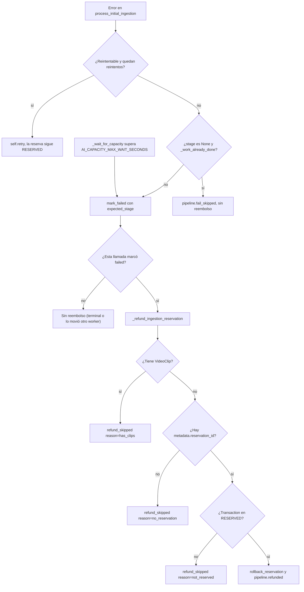

# Creación de proyecto

Un proyecto (`VideoProject`) nace en el request de creación de la API y ahí mismo se cobra: se valida la fuente, se calcula el precio con `PricingEngine`, se reservan los tokens en la billetera del workspace y se encola `process_initial_ingestion`. Hay tres formas de crearlo: subiendo un archivo, mandando una `video_url` o con `POST /api/v1/projects/from-prompt/` (cualquiera de las dos anteriores más un prompt). Este documento cubre el request y el ciclo de vida de la reserva de tokens hasta que se devuelve o queda tomada. Lo que pasa después del encolado está en [02-pipeline-de-ingesta](02-pipeline-de-ingesta.md).

## Componentes

| Componente | Archivo | Rol |
|------------|---------|-----|
| `VideoProjectViewSet.create` | [views.py](../../back/apps/videos/views.py) | Orquesta la creación: serializer, precio, reserva, `metadata['reservation_id']` y encolado |
| `_discard_new_project`, `_queue_ingestion`, `_fail_unqueued_project` | [views.py](../../back/apps/videos/views.py) | Borran la fila y el archivo de una creación rechazada; encolan la ingesta después del commit y, si el broker no la toma, fallan el proyecto y devuelven la reserva |
| `delete_upload` | [services/storage_service.py](../../back/apps/videos/services/storage_service.py) | Borra el archivo subido de un proyecto que no se creó (best effort) |
| `check_seat_limit`, `check_workspace_member_limit`, `SeatLimitFormSet` | [users/seats.py](../../back/apps/users/seats.py), [users/signals.py](../../back/apps/users/signals.py), [users/admin.py](../../back/apps/users/admin.py) | Lugares del plan al crear un `WorkspaceMember`, en la señal y en el admin ([ver abajo](#workspace-activo-y-roles)) |
| `resolve_active_workspace`, `WorkspaceRolePermission` | [core/workspace.py](../../back/apps/core/workspace.py), [core/permissions.py](../../back/apps/core/permissions.py) | Workspace activo del request (`X-Workspace-Id`) y rol que el usuario tiene ahí ([ver abajo](#workspace-activo-y-roles)) |
| `VideoProjectViewSet.from_prompt` | [views.py](../../back/apps/videos/views.py) | Valida `prompt` y delega en `create` (ver [04-prompt-to-edit](04-prompt-to-edit.md)) |
| `VideoProjectViewSet.get_serializer_context` | [views.py](../../back/apps/videos/views.py) | Pasa `pte_prompt` al serializer cuando la creación viene de `from_prompt` |
| `_pricing_resolution` | [views.py](../../back/apps/videos/views.py) | Tier de resolución que se cobra: `metadata['render_resolution']` si es válido, si no `720p` |
| `VideoProjectSerializer` | [serializers.py](../../back/apps/videos/serializers.py) | `validate`, `validate_source_file`, `validate_video_url`, `validate_aspect_ratio`, `create`, `update`; campos `selection_criteria` y `use_seo` (solo escritura) |
| `validate_video_link`, `LINK_PROVIDERS` | [services/link_validation.py](../../back/apps/videos/services/link_validation.py) | Qué links se aceptan: sitios admitidos, sin IPs ni direcciones internas ([ver abajo](#links-admitidos)) |
| `ProbeLinkView`, `probe_link` | [views_project_data.py](../../back/apps/videos/views_project_data.py), [services/link_probe.py](../../back/apps/videos/services/link_probe.py) | `POST /api/v1/projects/probe-link/`: sitio, título y duración de un link antes de crear ([ver abajo](#revisar-un-link-antes-de-crear-probe-link)) |
| `validate_upload`, `MediaInfo`, `InvalidUploadError` | [services/media_validation.py](../../back/apps/videos/services/media_validation.py) | Comprueba que los bytes sean un video procesable (CORE-05) |
| `PricingEngine.calculate_render_cost` | [payments/services/pricing_engine.py](../../back/apps/payments/services/pricing_engine.py) | Límites del plan y precio en tokens |
| `reserve_funds`, `commit_reservation`, `rollback_reservation` | [payments/services/wallet_service.py](../../back/apps/payments/services/wallet_service.py) | Movimientos de la billetera con `select_for_update`. `reserve_funds` guarda el proyecto y la categoría de la reserva (`project`, `category`) |
| `price_new_project` | [services/render_pricing.py](../../back/apps/videos/services/render_pricing.py) | Precio de un proyecto nuevo, el mismo para la creación y para `POST pricing/estimate/` |
| `Wallet`, `Transaction`, `SubscriptionPlan` | [payments/models.py](../../back/apps/payments/models.py) | Saldo, reservas y límites del plan |
| `WalletView`, `WalletUsageView`, `TransactionListView`, `TransactionExportView`, `PricingView`, `EstimateView` | [payments/views.py](../../back/apps/payments/views.py), [payments/services/movements.py](../../back/apps/payments/services/movements.py), [payments/services/estimate.py](../../back/apps/payments/services/estimate.py) | Saldo, consumo, movimientos, precios y estimado ([ver abajo](#billetera-movimientos-y-precios)) |
| `_record_pipeline_failure`, `_refund_ingestion_reservation`, `_work_already_done` | [tasks/ingestion.py](../../back/apps/videos/tasks/ingestion.py) | Devuelven la reserva cuando la ingesta falla sin entregar clips |

Las tres formas usan la misma vista y el mismo serializer. `validate` exige exactamente una fuente: sin ninguna responde `Debes proporcionar un 'source_file' o una 'video_url'.` y con las dos `No puedes enviar archivo y URL al mismo tiempo.`.

## Workspace activo y roles

Cada request de proyectos, brand kits y vistas previas trabaja en un solo workspace, el activo. Lo resuelve `resolve_active_workspace` y queda guardado en el request:

- **Con el header `X-Workspace-Id`** (el frontend lo manda en cada pedido): ese workspace, si el usuario es su dueño (`Workspace.owner`) o tiene un `WorkspaceMember` en `active`. Una invitación `pending` no cuenta. Un id mal formado, un workspace que no existe, uno ajeno y una invitación pendiente reciben la misma respuesta: 404 `{"detail": "No encontramos ese espacio de trabajo."}`. Así no se pueden adivinar workspaces.
- **Sin el header** (o vacío): el workspace más viejo del que el usuario es dueño y, si no tiene, su membresía `active` más vieja. Es para los clientes que no son el frontend (scripts, curl). Antes era `user.workspaces.first()`, que contaba invitaciones pendientes y dependía del orden de los UUID.

`GET /api/v1/me/` no usa el header. Su `active_workspace_id` es el último workspace que eligió el usuario (`User.last_workspace`, lo guarda `PATCH /api/v1/me/` con `active_workspace_id`), mientras siga siendo su dueño o miembro `active`. Si no, es el mismo default de arriba. Así un header viejo en el navegador nunca deja la sesión en 404 ([users/views.py](../../back/apps/users/views.py), `_me_payload`).

El proyecto o el brand kit nuevo se guarda en ese workspace, su billetera es la que reserva y cobra, y las listas, el detalle y las acciones solo ven sus objetos: un proyecto de otro workspace es 404 aunque el usuario sea miembro de los dos. El `brand_kit` de un proyecto tiene que ser del mismo workspace (si no, 400). `CORS_ALLOW_HEADERS` suma `x-workspace-id`: sin eso el navegador corta el preflight.

`WorkspaceRolePermission` decide con el rol del usuario en ese workspace. El dueño siempre es Dueño, aunque tenga además una fila en `WorkspaceMember`. `ROLE_MATRIX` copia la tabla 1.7 del [mapa de pantallas](../producto/mapa-de-pantallas.md#17-roles-y-permisos) y `MATRIX` de `front/src/lib/permissions.ts`. Lo que hoy tiene endpoint:

| Acción | Endpoint | Dueño | Admin | Editor | Lector |
|--------|----------|:-:|:-:|:-:|:-:|
| Ver proyectos, revisión y brand kits | `GET`, `paper-edit-data` | ✓ | ✓ | ✓ | ✓ |
| Pedir y ver la vista previa gratis | `clips/<id>/preview/` | ✓ | ✓ | ✓ | ✓ |
| Crear proyectos (gasta tokens) | `POST projects/`, `from-prompt` | ✓ | ✓ | ✓ | — |
| Editar proyectos | `PATCH` y `PUT projects/<id>/` | ✓ | ✓ | ✓ | — |
| Aprobar y renderizar | `approve-paper-edit` | ✓ | ✓ | ✓ | — |
| Borrar proyectos | `DELETE projects/<id>/` | ✓ | ✓ | solo los que subió | — |
| Crear, editar, duplicar y borrar brand kits | `brand-kits/`, `brand-kits/<id>/duplicate/` | ✓ | ✓ | ✓ | — |
| Ver el saldo y estimar un costo (`wallet.view`) | `GET wallet/`, `POST pricing/estimate/` | ✓ | ✓ | ✓ | ✓ |
| Ver el consumo y los movimientos, exportarlos (`billing.manage`) | `wallet/usage/`, `transactions/`, `transactions/export/` | ✓ | ✓ | — | — |

Una escritura que la vista no asigna a una acción (`workspace_actions`) queda para Dueño y Admin. Un `HEAD` pide la acción del `GET`: Django lo responde con el mismo handler, así que un Lector recibe el mismo 403 (lo prueba `test_head_requests.py` para todas las vistas). Un método que la vista no tiene responde 405 para cualquier rol. Lo que el rol no permite responde 403 con un `detail` en castellano, por ejemplo `Con el rol Lector podés ver, pero no crear ni cambiar nada. Pedile acceso a un admin.`. No hay endpoints de invitación: una invitación pasa a `active` desde el admin de Django.

**Lugares del plan.** `check_seat_limit` cuenta los miembros del workspace, invitaciones `pending` incluidas, y rechaza con `ValidationError` lo que no entra en `plan.max_members` (`Tu plan '<plan>' solo permite N miembros...`). Sin plan hay un solo lugar (`Este workspace no tiene un plan activo...`). La membresía del dueño en su propio workspace siempre entra. Lo usan:

- `check_workspace_member_limit`, la señal `pre_save` de `WorkspaceMember`, al crear una fila (`_state.adding`). Cambiar el rol o el estado de un miembro que ya existe no cuenta.
- `SeatLimitFormSet`, el formset de los dos inlines de miembros del admin (en el workspace y en el usuario). Cuenta juntas las filas nuevas de un mismo workspace y descuenta las que el mismo guardado borra. Lo que no entra es un error del formulario, no un 500 de la señal.

Pendiente: `members.add()` y `bulk_create` no pasan por la señal (hoy no los usa nadie), contar y crear no es atómico (dos altas a la vez pueden pasar el límite por uno) y `loaddata` también corre la señal.

El esquema OpenAPI declara el header en cada operación de una vista con `WorkspaceRolePermission` (`WorkspaceAutoSchema`, en [core/schema.py](../../back/apps/core/schema.py)).

## Brand kits: default único y duplicar

**Un solo default por workspace.** `BrandKitViewSet._save_one_default` guarda el kit en `perform_create` y `perform_update`. Con `is_default: true` abre una transacción, bloquea la fila del workspace (`brand_kit_service.lock_workspace_default`), desmarca los demás (`demote_other_defaults`) y guarda. Dos pedidos a la vez corren uno después del otro y gana el último. La restricción única parcial `one_default_brand_kit_per_workspace` es la última línea para quien escriba sin pasar por la vista. La migración `0019_un_solo_brand_kit_default` deja antes un solo default (el kit más viejo) donde había varios.

- `is_default: false` sobre el default se acepta: el workspace queda sin default.
- Borrar el default tampoco promueve otro kit. Los proyectos nuevos salen sin kit preseleccionado.
- Un pedido que no manda `is_default` no toca el default de nadie.

**Archivos.** Cada kit guarda sus archivos en una carpeta propia (`upload_to`: `assets/fonts/<id del kit>/`, `assets/logos/<id del kit>/`, `assets/videos/<id del kit>/`), así el archivo conserva el nombre con el que se subió. Los archivos guardados antes siguen en `assets/fonts/`, `assets/logos/` y `assets/videos/`: no se mueven.

- Borrar un kit borra sus archivos después del commit (`signals.delete_brand_kit_files` → `brand_kit_service.delete_files_on_commit`). También al borrar el workspace o desde el admin.
- `PATCH` que reemplaza o quita un archivo borra el anterior igual (`BrandKitViewSet.perform_update`). Antes de guardar bloquea la fila del kit y la vuelve a leer: un pedido que cargó el kit antes de que otro reemplazara un archivo no vuelve a escribir el nombre viejo. Orden de bloqueos: la fila del workspace y después la del kit. Borrar el workspace sigue el mismo orden: `require_workspace_role(lock=True)` bloquea la fila del workspace antes de todo, y los kits se borran después, en la cascada. Un kit que se marca default mientras tanto espera y después responde 404.
- Un archivo que otro kit todavía usa no se borra (datos viejos o seeds pueden compartir nombre).
- Un error del storage no falla el pedido: queda `brand_kit.file_cleanup_failed` con el id del kit y la clase del error.

**Duplicar.** `POST brand-kits/<id>/duplicate/` (`brandkit.manage`, sin cuerpo) llama a `brand_kit_service.duplicate_brand_kit`:

1. Copia cada archivo (fuentes, logo, intro, outro) a la carpeta del kit nuevo, con el mismo nombre de archivo (`assets/logos/<id del kit>/logo.png`), con `storage_service.copy_stored_file`. La carpeta es nueva: el storage no agrega sufijo y el nombre nunca es el del original. Un `FileSystemStorage` copia el archivo bajo `MEDIA_ROOT`; cualquier otro storage es un bucket y se copia del lado del servidor con `CloudflareR2Manager.copy_object` (`CopyObject`). Hoy los archivos de un kit viven en `MEDIA_ROOT`, también con `USE_R2=True`. Si el destino fuera el nombre del original, `copy_stored_file` no copia nada y lanza `StoredFileCopyError`: los dos kits no comparten archivo.
2. Crea la fila al final, con la fila del workspace bloqueada. El nombre lo da `brand_kit_service.copy_name`: «Copia de {nombre}», o «Copia 2 de {nombre}», «Copia 3 de {nombre}»… si el workspace ya tiene ese nombre (cortado a 100 caracteres). Mismo workspace, `user` de quien la pide, `is_default=False`. Los demás campos se copian todos, también los que se agreguen al modelo.
3. Responde 201 con el kit nuevo.

| Caso | Respuesta |
|------|-----------|
| Kit de otro workspace | 404 |
| Lector | 403 `{detail}` |
| Falla la copia de un archivo (o el archivo original no está) | 502 `{"error", "code": "brand_kit_copy_failed"}`. Se borran las copias ya hechas y no se crea la fila. La limpieza nunca borra un nombre que usa el kit original. No es 503: la web lee cualquier 503 como mantenimiento |

Los dos kits no comparten archivos: borrar o reemplazar los de uno no toca los del otro. Borrar un kit no borra sus archivos del storage (igual que antes).

## Flujo: creación con archivo

1. `create` usa el [workspace activo](#workspace-activo-y-roles). Sin workspace responde 400.
2. Antes de la vista, `UploadSizeLimitMiddleware` ([core/upload_limits.py](../../back/apps/core/upload_limits.py)) mira el `Content-Length`: si pasa `MAX_UPLOAD_BYTES` (2 GB) más `UPLOAD_FORM_OVERHEAD_BYTES` (1 MB para los demás campos y los separadores del multipart), responde 413 `{error, code: "file_too_large", limit_bytes}` sin leer el cuerpo, antes de la autenticación y en cualquier ruta. Django nunca lee más que el `Content-Length`, ni nada sin él: un pedido no puede hacer leer más que eso. Log `upload.too_large method=<método> content_length=<bytes> limit=<bytes>`.
3. `validate_source_file` corta primero por extensión (`.mp4`, `.mov`, `.avi`) y después por el peso del archivo: más de `MAX_UPLOAD_BYTES` es el mismo 413 (`UploadTooLarge`), antes de ffprobe, del storage y de la reserva. Es el archivo apenas más pesado que el tope que entró en el margen del formulario. Después llama a `validate_upload`, que trabaja sobre los bytes y no sobre el nombre ni el header del cliente:
   - `_sniff` lee los primeros 8 KB con libmagic. Pasan los mime de `_DEMUXER_BY_MIME` (MP4, M4V, QuickTime, 3GPP y AVI), cada uno con su demuxer (`mov` o `avi`). Un `application/octet-stream` pasa como `video/quicktime` si tiene una caja ISO (`ftyp`, `moov`, `mdat`, `free`, `skip`, `wide`, `pnot`) en el byte 4: son archivos reales de cámara que libmagic no reconoce.
   - `_has_streaming_manifest` rechaza un manifiesto DASH en los primeros 5 MB, o un archivo que empiece como playlist HLS (`#EXTM3U`) o concat (`ffconcat`). ffmpeg elige el demuxer por contenido y con un manifiesto pediría sus URLs desde el servidor.
   - `_probe` corre `ffprobe` con el demuxer del contenedor forzado (`-f mov` o `-f avi`), `-protocol_whitelist file` y un timeout de 60 s. Si Django tiene el archivo en memoria, se escribe antes a un temporal.
   - `_describe` toma la pista de video más grande (descarta las `attached_pic`), exige ancho, alto y duración, y compara con los límites `AI_UPLOAD_*`. Devuelve un `MediaInfo`.
4. Un rechazo es `InvalidUploadError` con un código estático. El serializer lo convierte en un 400 sobre `source_file` con el mensaje fijo de `MESSAGES` (tabla de errores más abajo). Ni el nombre del archivo ni la salida de `ffprobe` llegan al log o a la respuesta.
5. `create` del serializer guarda el proyecto y escribe en `metadata` lo que vino del pedido (`max_clips`, `selection_criteria`, `subtitle_size`, `use_seo`) y `source_media` (`MediaInfo.as_metadata()`: `duration_s`, `width`, `height`, `mime`). También copia campos crudos del pedido a columnas (`render_layout` o su alias `layout`, posiciones de cámara, subtítulos, `use_facetracking`, `remove_silences`, `auto_render_bypass`). Con `speaker_tracking=true` y sin `render_layout` ni `layout`, deja `render_layout='active'`: seguir a quien habla es ese layout ([06](06-render-caras-y-hablante.md#flujo-layouts)). Los booleanos crudos (`speaker_tracking`, `auto_render_bypass`, `add_subtitles`, `use_facetracking`, `remove_silences`) son verdaderos con `true`, `1`, `t`, `y`, `yes` u `on` (`_raw_bool`), como en DRF. Uno vacío (`""`) cuenta como no enviado (`_raw_bool_sent`): queda el default del modelo. En un multipart, DRF lee como falso un booleano que no viaja (un checkbox sin marcar). Por eso todos los booleanos del modelo son `_NotSentBooleanField` en el serializer: el que no viaja no se envió. Al crear queda el default del modelo y un PUT lo deja como estaba (lo mismo pasa con `is_default` de un brand kit). Los números crudos que no son campos del serializer (`max_clips`, `subtitle_scale_factor`) se leen en `validate` (`_raw_number`): vacíos o `null` no cuentan, y un valor que no es un número finito es un 400 en el campo. Las posiciones de cámara y `subtitle_words_per_segment` llegan ya leídas por DRF: uno vacío en un multipart no se envió. Todo `create` corre en una transacción: si algo falla después del INSERT, no queda la fila (la reserva de tokens viene después). El rollback no llega al storage, así que `_store_upload` guarda el archivo antes del INSERT (lo mismo que haría `FileField.pre_save`) y, si el INSERT o el resto de `create` fallan, `delete_upload` lo borra por su nombre. `selection_criteria` se normaliza con `normalize_selection_criteria`.
6. La vista calcula el precio con la duración de `metadata['source_media']['duration_s']` (truncada a entero). Solo si falta mide de nuevo con MoviePy. Ver [Precio](#precio).
7. Desde acá, cada rechazo pasa por `_discard_new_project`: borra la fila y, con `delete_upload`, el archivo. Es lo mismo para el 403 del plan, el 400 del precio o de un link en otra resolución, el 402 y el 500 del pago. `delete_upload` borra con el storage del campo (`MEDIA_ROOT`), también con `USE_R2`: en el request el archivo no llegó a R2, eso lo hace la ingesta (`_stage_prepare_source`). Si no se puede borrar, loguea `upload.cleanup_failed` y la respuesta no cambia.
8. La transacción de la reserva bloquea primero la fila del proyecto y después la billetera: el mismo orden que la aprobación, los renders pagos y el borrado del workspace (que bloquea el workspace, los proyectos y después la billetera). Al revés, un borrado que ya tenía la fila del proyecto nuevo y esperaba la billetera se trababa con esta reserva, cuya `Transaction` necesita esa fila (su clave foránea), y Postgres cortaba una de las dos (la creación respondía 500). Ahora la reserva espera al borrado, que ve el proyecto nuevo en `uploaded` y responde 409 `project_processing`. `reserve_funds` bloquea la billetera con `select_for_update`, resta el costo de `available_balance`, lo suma a `reserved_balance` y crea una `Transaction` `SPEND` en `RESERVED` con la descripción `Procesamiento: <título>`. Si el workspace no tiene billetera, la vista la crea antes con `get_or_create` (con saldo 0). La vista le pasa `project` y `category=project`, que quedan en la misma fila (`Transaction.project`, `Transaction.category`). Cada reserva de después hace lo mismo: la aprobación, el render automático y los renders que pide el usuario con `render`, el re-despacho con `project`. El `project_id` de `reserve_funds` es otra cosa: se acepta por compatibilidad y se ignora (ver abajo).
9. En la misma transacción la vista guarda el id de la reserva en `metadata['reservation_id']`: el pipeline lo usa para devolverla ([ciclo de vida](#flujo-ciclo-de-vida-de-la-reserva)). Nunca queda una reserva sin su vínculo: si falla el `UPDATE`, se deshacen los dos y el pedido es un 500 sin nada reservado.
10. Encola con `process_initial_ingestion.delay(project.id)` en `transaction.on_commit` (`_queue_ingestion`): el worker siempre encuentra la reserva y el vínculo. Hoy no hay `ATOMIC_REQUESTS`, así que el envío sale apenas la reserva hace commit, antes de responder. Si el request corriera dentro de otra transacción, el envío (y el manejo de su fallo, abajo) pasaría después de responder 201: el proyecto igual quedaría `failed` y devuelto.
11. **Si el broker no toma el mensaje** (`delay` lanza, por ejemplo con el broker caído), nadie levantaría el proyecto y los tokens quedarían reservados. Log `project.ingestion_not_queued` con la clase del error. `_fail_unqueued_project` hace tres cosas en una sola transacción, con la fila del proyecto bloqueada: lo marca `failed` (solo si sigue en `uploaded`), escribe `pipeline_error_code=IngestionNotQueued` y devuelve la reserva con `rollback_reservation`. Nadie ve el proyecto fallado sin la devolución, ni devuelto y corriendo. Hay tres resultados:
    - **Devuelto** (`project.not_queued_refunded`): 503 `{"error": "No pudimos empezar a procesar el video y no se cobró nada. Probá de nuevo en unos minutos.", "code": "IngestionNotQueued", "project_id": ..., "refunded": true}`. El proyecto queda en la lista con su archivo, y el frontend traduce el código (`front/src/lib/error-messages.ts`).
    - **El mensaje salió igual y un worker ya movió el proyecto:** es del worker, con su reserva. Responde 201.
    - **No se pudo escribir** (un error de base, `project.not_queued_not_recorded`): no cambia nada, el proyecto sigue en `uploaded` con la reserva tomada. 503 con `"refunded": false` y un texto que no dice que no se cobró: `No pudimos empezar a procesar el video. Probá de nuevo en unos minutos; si quedan tokens reservados por este proyecto, escribinos.` Como su mensaje nunca corrió, `recover_stuck_renders` lo re-encola cuando lleva 30 min sin avanzar, y si tampoco así arranca lo falla y devuelve la reserva ([02](02-pipeline-de-ingesta.md#flujo-ingestas-que-no-avanzan)).

    **Entrega tardía.** `delay` puede lanzar aunque Redis haya guardado el mensaje (por ejemplo, un reinicio de Valkey más largo que los reintentos de Celery). Cuando un worker lo lee, `_run_ingestion` encuentra el proyecto `failed` con `IngestionNotQueued` y no lo reabre (`pipeline.redispatch_skipped reason=not_queued`): un re-despacho correría todas las etapas pagas sin cobrar. El usuario crea el proyecto de nuevo. Un worker que lo leyó todavía en `uploaded`, antes del commit de la falla, choca con el compare-and-set de la primera etapa (`advance`) y se detiene; como mucho corrió el lector del prompt de Prompt-to-Edit.

    Se eligió esto y no esperar a un barrido que lo re-encole: así el usuario sabe enseguida si se le cobró algo y puede reintentar, y `docker-compose.yml` no levanta beat. El barrido existe para lo que el request no ve: un mensaje que el broker aceptó y después perdió, o el caso en que tampoco se pudo escribir el fallo (`recover_stuck_renders`, [02](02-pipeline-de-ingesta.md#flujo-ingestas-que-no-avanzan)).
12. Responde 201 con los datos del serializer, `cost_details` (`tokens_reserved`, `transaction_id`) y `message`.

`reserve_funds` acepta un `project_id` por compatibilidad y lo ignora: no encola nada. Antes encolaba `process_video_pipeline`, que habría arrancado una segunda ingesta del mismo proyecto. La creación encola una sola tarea, la suya.

### Precio

`PricingEngine.calculate_render_cost(duration_seconds, resolution, features_requested, plan)`:

1. **Chequeos del plan** (solo si el workspace tiene `subscription_plan`):
   - `duration_seconds > plan.max_video_duration_seconds` → `PlanLimitExceededError`.
   - Resolución pedida por encima de `plan.max_resolution` (`720p` < `1080p` < `4K`) → `PlanLimitExceededError`.
   - `seo_optimization` sin `has_seo_optimization`, o `ai_thumbnail` sin `has_thumbnail_engine` → `FeatureNotAllowedError`.
2. **Base:** `duración × BASE_COST_PER_SECOND_720P (0,5) × RESOLUTION_MULTIPLIERS` (`720p` 1,0, `1080p` 1,5, `4K` 3,0).
3. **Adicionales** (`FEATURE_COSTS`, fijos): `seo_optimization` 5, `ai_thumbnail` 15.
4. **Descuento:** `(base + adicionales) × (1 − plan.base_discount_rate)`. Sin plan, no hay descuento ni límites.
5. Mínimo 0,01 y redondeo a dos decimales (`ROUND_HALF_UP`).

Ejemplo: un archivo de 600 s con `use_seo=true` en un plan con 20 % de descuento cuesta `(600 × 0,5 × 1,0 + 5) × 0,8 = 244,00` tokens.

**Resolución.** El pedido puede mandar `render_resolution` (`720p`, `1080p` o `4K`; un valor distinto da 400). Un proyecto por link solo acepta `720p` (400 con otra), porque su precio fijo no conoce la duración y no puede cobrar un tier mayor. El serializer la guarda en `metadata['render_resolution']`, `_pricing_resolution` la usa para el precio y `calculate_render_cost` la compara con `plan.max_resolution` (403 si la supera). Sin el campo, el proyecto se cobra y se renderiza en `720p` (`RenderEngine.DEFAULT_HEIGHT`). Prompt-to-Edit puede escribirla después solo si no sube el precio (ver [04](04-prompt-to-edit.md)). No se puede cambiar con un PATCH, porque ya se cobró. `use_ai_thumbnail` no se puede pedir al crear: el serializer no tiene ese campo y `metadata` es de solo lectura.

**Tipo de proyecto.** `project_type` es `repurpose` (sacar clips, por defecto) o `single_edit` (editar el video completo, ver [02](02-pipeline-de-ingesta.md)). Para `single_edit`, el serializer da 400 en `project_type` antes de crear nada en estos casos:

- Con `video_url`: el precio fijo del link no conoce la duración, y el video entero se renderizaría sin revisión ni límite del plan.
- Si el archivo dura más de `AI_SINGLE_EDIT_MAX_DURATION_SECONDS` (600 s por defecto; código `too_long`). Un solo render tiene el video entero, con sus subtítulos, así que es para videos cortos.

`project_type` no se puede cambiar con un PATCH: el pipeline y el precio dependen de él. El archivo de un video completo tampoco (400 en `source_file`). Para cualquier archivo subido, la vista guarda en `metadata.priced_duration_s` los segundos que cobró. Un PATCH que reemplaza el archivo de un proyecto de clips cambia `metadata.source_media`, pero no ese dato. Los campos `pipeline_stage`, `pipeline_stage_status`, `pipeline_attempts`, `pipeline_error_code` y `pipeline_error_at` son de solo lectura.

## Flujo: creación con URL

1. La duración de un video por URL no se conoce en el request, así que se cobra una tarifa fija de 10 tokens.
2. Si el pedido trae `use_seo=true`, se suma el adicional `seo_optimization` calculado con `duration_seconds=0`: solo se chequea el plan para el SEO y se cobra `5 × (1 − base_discount_rate)` (ADR-013). Sin plan, se cobra 5.
3. La reserva, `reservation_id`, el encolado y el 503 sin broker son iguales al flujo con archivo. Un rechazo después del INSERT borra la fila (no hay archivo).
4. La URL no pasa por `validate_upload` ni por el límite de duración del plan al crear: esa duración la mira `probe-link` antes ([ver abajo](#revisar-un-link-antes-de-crear-probe-link)) y la descarga la hace obligatoria (`LinkTooLongError` si pasa el plan, `LinkTooLongForAppError` si pasa las 3 h de la app, [02](02-pipeline-de-ingesta.md)). `validate_video_url` la pasa por `validate_video_link` (sin consultar DNS) y guarda la URL normalizada; un link de otro sitio o a una dirección interna da 400 en `video_url` ([links admitidos](#links-admitidos)). El archivo se baja con `download_from_youtube` en `_stage_prepare_source` (ver [02-pipeline-de-ingesta](02-pipeline-de-ingesta.md)).

### Links admitidos

yt-dlp está hecho para bajar lo que sea que apunte una página, así que sin control es un SSRF: el worker pediría `http://169.254.169.254/...`, `http://localhost:8000/admin/` o un host de la red interna. Un caso real: la página de consentimiento de YouTube (`consent.youtube.com/m?continue=<url>`) le pasa su `continue` a cualquiera de sus ~1.800 extractores, y uno de ellos pedía esa URL desde el worker. Por eso hay dos capas.

**`validate_video_link`** ([services/link_validation.py](../../back/apps/videos/services/link_validation.py)) revisa el link al crear el proyecto (`validate_video_url`), en `probe-link`, justo antes de bajarlo (`download_from_youtube`, también para las filas guardadas antes de esta regla) y en cada salto que sigue yt-dlp:

- Solo `http` y `https`, sin usuario ni contraseña en la URL y con el puerto por defecto (80 o 443).
- El host es exactamente uno de `LINK_HOSTS`: `youtube.com`, `www.`, `m.` y `music.youtube.com`, `youtu.be`; `vimeo.com`, `www.` y `player.vimeo.com`; `twitch.tv`, `www.`, `m.`, `clips.` y `player.twitch.tv`; `drive.google.com`. Ningún otro subdominio (tampoco `consent.youtube.com`) y nunca una IP. Cada parte del host son solo letras, dígitos y guiones: `evil.com;.youtube.com`, `*.youtube.com` o `127.0.0.1%23.youtube.com` no pasan. La web nombra los mismos hosts (`LINK_HOSTS` de `front/src/features/proyectos/project-view.ts`).
- El link tiene que nombrar un solo video y queda como la URL de ese video: en YouTube, `https://www.youtube.com/watch?v=<id>` (sin lista, tiempo ni parámetros; `youtu.be/<id>` y `/shorts/<id>` también); en Twitch, `www.twitch.tv/videos/<id>` o `clips.twitch.tv/<clip>`; en Vimeo, con su id numérico; en Drive, `drive.google.com/file/d/<id>/view`. Un canal, una lista, una carpeta o el canal de Twitch (que es su vivo) dan 400 `Pegá el link de un solo video...`.
- Con `resolve=True` (probe-link, la descarga y cada salto), cada dirección a la que resuelve el host tiene que ser pública: ni loopback, privada, link-local, multicast ni reservada. Una IPv6 que lleva una IPv4 adentro (mapeada, NAT64 `64:ff9b::/96`, compatible `::/96`, 6to4 o Teredo) se juzga por esa IPv4: `64:ff9b::a00:5` es `10.0.0.5`.

**`ytdlp_safe`** ([services/ytdlp_safe.py](../../back/apps/videos/services/ytdlp_safe.py)) es la única forma en que el backend corre yt-dlp, en el probe y en la descarga:

- Solo corren los extractores de esos sitios (`ALLOWED_EXTRACTORS`: `youtube`, `vimeo`, `twitch:vod`, `twitch:clips`, `googledrive`). Sin el genérico, sin la página de consentimiento y sin los de canales o listas.
- La primera lectura es con `process=False`. Un resultado que apunta a otro link se sigue a lo sumo dos veces, solo con uno de esos extractores forzado por clave, después de pasar `validate_video_link` otra vez y con la URL canónica que devuelve, no la que dio la página.
- Tiene que quedar un solo video que no esté en vivo (`is_live`, `is_upcoming` o `post_live`). Recién ahí se procesa: el probe lee los datos y la descarga elige los formatos y baja.
- `GuardedYoutubeDL` revisa cada pedido de yt-dlp (`urlopen`) e `install_guards` cada redirección: si va a una IP o a un host que resuelve a una dirección no pública, se corta (`blocked non-public address`).
- Y la dirección a la que el socket se conecta se revisa otra vez justo antes del `connect` (`_guarded_create_connection`): un nombre que responde una IP pública al chequeo y una interna a la conexión (DNS rebinding) también se corta. Por eso solo queda el handler `Urllib` de yt-dlp, cuyas conexiones pasan por esa función. El proxy configurado es la única dirección no pública permitida: el destino lo resuelve él.

Un link rechazado en la descarga lanza `UnsupportedLinkError`, que no se reintenta; un host que no resuelve lanza su `OSError`, que sí. Los mensajes son en español (`No reconocemos este sitio. Pegá un link de YouTube, Vimeo, Twitch o Google Drive.`, `UNSUPPORTED_MESSAGE`: los proveedores de `LINK_HOSTS`, ninguno más) y el link nunca va a un log.

Queda abierto, para la infraestructura: ffmpeg, si yt-dlp lo usa para un stream que no baja solo, hace sus propios pedidos (lo cierra un firewall de salida en los workers). Detrás de un proxy, el DNS rebinding del destino lo tiene que frenar el proxy.

## Revisar un link antes de crear (`probe-link`)

`POST /api/v1/projects/probe-link/` con `{"video_url": "..."}` responde, sin bajar el video, `video_url` (normalizada), `provider` (`YouTube`, `Vimeo`, `Twitch` o `Google Drive`), `title`, `duration_seconds` y `thumbnail_url` (solo si es `https`, si no `null`). La web la usa en C1 › Pegar link y manda al crear la `video_url` que vuelve. Revisar un link es parte de crear: lo pueden hacer Dueño, Admin y Editor (`project.create`); el Lector recibe 403.

1. `ProbeLinkView` valida el cuerpo (`video_url` obligatoria, hasta 500 caracteres) y cuenta los pedidos del usuario en la caché (`probe-link-rate:<id>`): pasado `PROBE_MAX_PER_MINUTE` (20) responde 429. Si la caché falla o no responde, no cuenta y deja pasar.
2. `probe_link` pasa el link por `validate_video_link(resolve=True)`. Si no resuelve, 502 `provider_error`.
3. Un link ya leído sale de la caché (`link-probe:v1:<sha256 de la URL>`, `LINK_PROBE_CACHE_SECONDS`).
4. Si no, `run_worker` corre [link_probe_worker.py](../../back/apps/videos/services/link_probe_worker.py) como script aparte (`sys.executable -I`), en su propio grupo de procesos (`start_new_session`) y con un entorno mínimo (`child_environment`: `PATH`, `HOME`, el idioma, el proxy de salida y su CA). Nunca ve `SECRET_KEY`, la base de datos ni las keys de R2 o de los proveedores. Al pasar `LINK_PROBE_TIMEOUT_SECONDS` se mata el grupo entero, con lo que el hijo haya lanzado (yt-dlp puede correr un runtime de JavaScript), y la respuesta es 504 `timeout`. Su stderr va a `/dev/null`.
5. El hijo corre yt-dlp con `ytdlp_safe` ([links admitidos](#links-admitidos)) más `skip_download`, `socket_timeout=10` y sin reintentos, y lee solo los datos.
6. El texto del sitio no sale del hijo: `categorize` lo reduce a `unavailable` (privado, borrado, con login o restricción), `unsupported` (sin extractor, o un pedido a una dirección no pública) o `provider_error`, más la clase de la excepción.
7. Un resultado que no es un video (lista, canal, vivo o sin duración) da 400 `unsupported`. La `video_url` de la respuesta es la página canónica del video si es del mismo sitio; si no, el link como llegó.
8. La duración se juzga con `link_too_long_error`, la misma regla de la descarga, y decide la duración del video, en el orden de una subida (primero el tope de la app, después el del plan):
   - Más larga que `AI_UPLOAD_MAX_DURATION_SECONDS` (3 h), con cualquier plan: 400 `{error, code: "duration_app", limit}` (`El video dura 4 h 00 min y podemos procesar videos de hasta 3 h 00 min. Probá con uno más corto.`). Ningún plan lo toma, así que el mensaje no nombra el plan. Es 400, como `unsupported` y como un archivo subido que pasa las 3 h (`too_long`): es algo del link, no un permiso.
   - Dentro de las 3 h pero más larga que `max_video_duration_seconds` del plan: 403 `{error, code: "duration", limit}` (por ejemplo `El video dura 45 min y tu plan permite hasta 10 min.`). Un plan con videos más largos lo toma.
   - Crear no pasa por el probe, así que la descarga vuelve a aplicar la regla, con el código de cada caso (`LinkTooLongForAppError` o `LinkTooLongError`, [02](02-pipeline-de-ingesta.md)).

| Respuesta | Cuándo |
|-----------|--------|
| 200 | El link es un video de un sitio admitido |
| 400 `invalid` | No es una URL web |
| 400 `unsupported` | Otro sitio, una IP, un host interno, una lista, un canal o un vivo |
| 400 `unavailable` | Privado, borrado, con login o con restricción |
| 400 `duration_app` | La duración supera las 3 h que procesa la app, con cualquier plan (`limit` en segundos) |
| 400 `{video_url: [...]}` | Falta o pasa los 500 caracteres |
| 403 | La duración supera el plan pero no las 3 h de la app (`code: "duration"`, `limit`), o el rol es Lector (`{detail}`) |
| 404 | El workspace de `X-Workspace-Id` no es del usuario |
| 429 | Más de 20 links en un minuto |
| 502 `provider_error` | El sitio respondió con un error, o el host no resuelve |
| 503 `unavailable_tool` | yt-dlp no está instalado |
| 504 `timeout` | El sitio tardó más de `LINK_PROBE_TIMEOUT_SECONDS` |

Logs: `probe_link.ok`, `probe_link.rejected` (`code`), `probe_link.failed` (`provider`, `code`, clase del error) y `probe_link.dns_failed`, con el id del usuario y nunca el link.

## Flujo: creación desde un prompt

`POST /api/v1/projects/from-prompt/` acepta lo mismo que una creación normal (archivo o `video_url`, y los mismos campos) más `prompt`:

1. `from_prompt` rechaza con 400 un `prompt` ausente o en blanco (`Este campo es obligatorio.`) o más largo que `prompt_max_chars()` (`Máximo N caracteres.`). En los dos casos no se crea el proyecto ni se reserva nada.
2. Guarda el texto limpio (`clean_prompt`) en `self._pte_prompt` y llama a `create`. `get_serializer_context` lo pasa al serializer como `pte_prompt`, y `create` del serializer lo escribe en `metadata['pte_prompt']` junto con `metadata['pte_explicit']`.
3. Validación, precio, reserva y encolado son los de la creación con archivo o con URL. El prompt no cambia el precio: se cobra lo mismo que sin prompt.
4. Si la respuesta es 201, agrega `prompt_config` con `status: "pending"`. El prompt se parsea al empezar la ingesta y el resultado queda en `metadata['pte']`.

El detalle está en [04-prompt-to-edit](04-prompt-to-edit.md).

## Flujo: ciclo de vida de la reserva

`Transaction.Status` tiene `PENDING`, `RESERVED`, `COMPLETED` y `FAILED`. No existe un estado "reembolsado": `rollback_reservation` deja la transacción en `FAILED` (el tipo sigue siendo `SPEND`; `Transaction.Type.REFUND` existe pero no se usa en este flujo). `PENDING` es el default del modelo y `reserve_funds` no lo usa.

1. **Mientras el pipeline reintenta,** la reserva sigue en `RESERVED`. Tampoco cambia en una espera de capacidad, un re-encolado por lock ocupado o un reintento del lector de prompts.
2. **Fallo final sin clips:** `_record_pipeline_failure` llama a `mark_failed`. Si esa llamada fue la que dejó el proyecto en `failed` (`failed_now`), llama a `_refund_ingestion_reservation`, que devuelve la reserva con `rollback_reservation`. Pasa con cualquier causa de fallo final:
   - contenido bloqueado por la moderación (`UnsafeContentError`) o moderación sin veredicto después de los reintentos (ADR-011 D-M5);
   - espera de capacidad vencida (`CapacityTimeoutError`, desde `_wait_for_capacity`; ADR-012 D-C4);
   - un error no reintentable (por ejemplo `AINoSpeechDetectedError`, `AIEmptySelectionError`, `AIInvalidRequestError`, `SoftTimeLimitExceeded`) o un error reintentable que agotó `PIPELINE_MAX_RETRIES`.
3. **Clips elegidos: se cobra.** Cuando el pipeline llega a `clips_selected`, `_commit_ingestion_reservation` pasa la reserva a `COMPLETED` con `commit_reservation` (log `pipeline.charged`). También corre al retomar un proyecto en `render_dispatched`, por si un worker murió entre el despacho y el cobro. Es idempotente y nunca lanza: una reserva ya liquidada se saltea, y un `PaymentError` solo deja `pipeline.charge_failed` sin frenar el pipeline. Por eso un proyecto con clips nunca se devuelve: `_refund_ingestion_reservation` también mira si hay algún `VideoClip` y en ese caso loguea `reason=has_clips`.
4. **Fallo antes de leer el proyecto:** si el fallo final llega sin etapa conocida (`stage=None`, por ejemplo al tomar el lock de un mensaje re-entregado) y `_work_already_done` dice que el proyecto ya llegó a `clips_selected` o más, no se marca `failed` ni se devuelve nada (`pipeline.fail_skipped reason=work_done`).
5. **Otro worker movió el proyecto:** `mark_failed` con `expected_stage` no escribe y devuelve `False`. Solo la llamada que falló el proyecto devuelve la reserva.
6. **Re-despacho manual de un proyecto devuelto:** corre sin reserva, salvo uno con `IngestionNotQueued`, que no se reabre (ver el paso 11 de la creación con archivo). Si vuelve a fallar, `_refund_ingestion_reservation` encuentra la transacción en `FAILED` y loguea `reason=not_reserved`. Si termina bien, no se vuelve a cobrar.

`_refund_ingestion_reservation` es idempotente y nunca lanza: un `PaymentError`, un error de base o un proyecto borrado solo dejan `pipeline.refund_failed`, para no tapar el error original.

**Reserva del render en `approve_paper_edit`.** Aprobar el paper edit primero toma el proyecto con un `UPDATE` condicional (`awaiting_approval` → `rendering`). Si otra aprobación ya lo tomó, responde 409 sin reservar ni encolar; si después no hay saldo (402) o falla el pago, sigue en `awaiting_approval`. La toma, la reserva y la aprobación son una sola transacción: si el proceso muere antes del commit, la base deshace todo y no queda una reserva sin proyecto. Después reserva el costo del render de los segmentos aprobados, sin adicionales porque SEO y miniatura se cobraron al crear (ADR-013), con `reserve_funds` (descripción `Render de los clips aprobados: <título>`), y guarda el id en `metadata['render_reservation_id']`, junto con los clips que paga (`render_clip_ids`) y sus segundos (`render_seconds`). Cada segmento aprobado es un clip que se renderiza con `render_clip_task` ([02](02-pipeline-de-ingesta.md#aprobación-de-la-revisión-approve-paper-edit)), y la reserva se liquida como la del render automático:

- **Clips entregados:** `finalize_project_render` cobra la parte de los segundos de los clips `completed` o `published` y devuelve el resto (`commit_partial_reservation`, log `render.charged`).
- **Nada entregado:** se devuelve toda (`render.refunded`).
- **Un clip todavía `rendering`:** espera.
- **Si la aprobación no se puede guardar después de reservar** (el proyecto dejó la revisión mientras tanto): la reserva se deshace con la transacción, así que no queda ninguna (`render.approval_failed`). Un error después de guardarla no la devuelve.
- **Un render automático reservado y nunca despachado** (el usuario apagó "Renderizar sin revisar" antes de su despacho): la aprobación lo devuelve en su misma transacción, así se cobra una sola vez ([02](02-pipeline-de-ingesta.md#aprobación-de-la-revisión-approve-paper-edit)).
- **Un clip que no se encoló o cuyo worker murió:** lo vuelve a encolar un re-despacho que la aprobación pide sola o, si tampoco entra o se queda sin reintentos, `recover_stuck_renders`; la reserva espera a esos clips ([07](07-capacidad-costos-y-operacion.md#operación-renders-trabados)).
- Una reserva que quedó `RESERVED` de todos modos (por ejemplo, un cobro que falló por un error de base) la liquida `settle_stale_reservations` ([07](07-capacidad-costos-y-operacion.md#operación-reservas-de-tokens-que-quedaron-reserved)) con la misma regla.

Una aprobación anterior a los clips por segmento (sin `render_clip_ids`, todavía en curso al desplegar) la renderiza `render_video_segments` como una sola exportación y la liquida `_settle_render_reservation`: la cobra entera cuando se entrega y la devuelve si falla del todo ([06, Paper edit](06-render-caras-y-hablante.md)).

## Actividad del proyecto

`GET /api/v1/projects/<id>/activity/` (D1 › Actividad) dice quién hizo qué y cómo se movieron los tokens del proyecto, de lo más nuevo a lo más viejo. No hay un registro de eventos: `build_activity` ([services/project_activity.py](../../back/apps/videos/services/project_activity.py)) lo arma con lo que ya está guardado, en cinco consultas sea cual sea el tamaño del proyecto. La ven todos los roles, Lector incluido (`project.view`), con los movimientos de tokens.

| Ítem (`type`) | De dónde sale | Hora | Quién (`actor`) |
|---------------|---------------|------|-----------------|
| `project_created` | El proyecto | `created_at` | `uploaded_by` |
| `prompt_applied` | `metadata['pte']`: aplicado, vacío o fallido | El último `AIUsageRecord` de `prompt_parse`, si no la creación | Sistema |
| `review_ready` | Un proyecto en revisión o con la revisión aprobada (no un video completo). Cantidad: `ai_rationale_log['suggestions_count']` | El último `AIUsageRecord` exitoso de `selection`, si no el primer clip | Sistema |
| `review_approved` | La reserva de `metadata['render_reservation_id']`. Cantidad: `render_clip_ids` | `created_at` de la reserva | `created_by` de la reserva |
| `tokens_reserved` | Cada reserva del proyecto (`Transaction` `SPEND`): las que tienen `project` y, sin proyecto, las que nombra la metadata (cada clave `*reservation_id` y `replaced_reservation_ids`). Solo de la billetera de su workspace, nunca una vinculada a otro proyecto. Monto: `-reserved_amount`. Trae `reservation_state`, igual que su cobro y su devolución | `created_at` | `created_by` |
| `tokens_charged` | La misma, en `COMPLETED`. Monto: `-amount` | `settled_at` | Sistema |
| `tokens_refunded` | En `FAILED`, todo lo reservado; en `COMPLETED` con `reserved_amount` mayor que `amount`, la diferencia | `settled_at` | Sistema |
| `render_finished` | Un proyecto `completed` o `partial`, con los clips listos y fallidos | `settled_at` de la última reserva que pagó un render (aprobación, render automático, render o reintento de un clip, renderizar todo de nuevo o, en un video completo, la del procesamiento) | Sistema |
| `project_failed` | Un proyecto `failed` | `pipeline_error_at` | Sistema |
| `post_scheduled`, `post_published`, `post_failed` | Los `ScheduledPost` de sus clips, salvo los `DRAFT`, con `platform` | `created_at`; publicado o fallido, `updated_at` | Sistema |

- Cada ítem tiene un id estable: `uuid5` del proyecto, el tipo y la fila de donde sale.
- Los montos son decimales con signo, en texto (`"-20.0000000000"`): negativo es reservado o cobrado.
- La reserva, su cobro y su devolución son ítems de un solo movimiento del saldo. Los tres traen `reservation_state`, cómo terminó la reserva: `reserved` (sigue reservada), `charged`, `partially_charged` (se cobró menos de lo reservado) o `refunded`. Con eso la web los muestra como un grupo cuyos montos con signo suman lo que se movió el saldo: en `charged` y `partially_charged` solo el cobro lleva signo; en `refunded`, la reserva y su devolución. Como están todas las reservas del proyecto, también las que otra reemplazó en su clave (un segundo render de un clip, un re-despacho), los grupos suman lo que el proyecto movió el saldo en total.
- Qué pagó cada reserva sale de la descripción con que la escribe el código: `Procesamiento: …`, `Render de los clips aprobados: …`, `Render automático: …`, `Render de clip: …`, `Reintento de clip: …` o `Render con otro estilo: …`. Si no, de su clave en la metadata o de su categoría. La primera del procesamiento es la de la creación; otra después es la de un re-despacho («Reserva por volver a procesar»).
- A lo sumo `MAX_ITEMS` (200). Entran primero los movimientos del saldo, cada reserva entera (su reserva, su cobro y su devolución), de la más nueva a la más vieja. El resto de los ítems completa lo que queda, los más nuevos. Así el corte no deja afuera ningún cobro: «Cómo se calculó» los suma en la web.
- Los otros ítems guardan `EVENT_ROOM` (20) lugares para los más nuevos (una falla, un post): los movimientos usan como mucho el resto. Solo un proyecto con más ítems de tokens de los que entran (decenas de renders pagos) pierde sus reservas más viejas, enteras.
- `review_ready` dice los clips que se sugirieron, no los que quedan: aprobar la revisión borra los que se dejaron afuera. Sin `suggestions_count` (o con uno que no es un entero) usa los clips que hay.
- Una reserva liquidada antes de la migración `0012` de payments no tiene `settled_at` ni `reserved_amount`: se usan `created_at` y `amount`.

No aparece lo que no se guarda: los renombres (`project_renamed`), las ediciones y los reintentos de un clip (`clip_edited`, `clip_retried`), quién programó un post (`ScheduledPost` no tiene autor) y una reserva de antes de la migración `0015` de payments que la `0016` no pudo vincular (el render automático liquidado de un proyecto que después se aprobó: la aprobación borra sus claves).

## Billetera, movimientos y precios

Los endpoints de `apps/payments` que muestran Uso (G1, G2) y la creación (C1). Los de la billetera trabajan en el workspace activo: uno ajeno es 404 y, sin ningún workspace, también. Los montos salen como texto decimal exacto (`"12.5000000000"`), nunca como float.

| Endpoint | Rol | Qué devuelve |
|----------|-----|--------------|
| `GET /api/v1/wallet/` | Todos (`wallet.view`) | Saldos, `spent_this_month`, `low_balance_threshold` y cada reserva abierta con su proyecto, de la más nueva a la más vieja |
| `GET /api/v1/wallet/usage/?month=AAAA-MM` | Dueño y Admin (`billing.manage`) | Cada día del mes (sin `month`, el actual) con lo cobrado en `projects`, `renders` y `seo` |
| `GET /api/v1/transactions/` | Dueño y Admin | Movimientos paginados (25, hasta 100), filtros `kind`, `month` y `project`, y `totals` por tipo |
| `GET /api/v1/transactions/export/` | Dueño y Admin | Los mismos movimientos en CSV, sin páginas |
| `GET /api/v1/pricing/` | Público | Números de `PricingEngine` y topes de subida |
| `POST /api/v1/pricing/estimate/` | Todos (`wallet.view`): no escribe nada | Costo, descuento, saldo después y `eta_seconds` de una configuración |

**Tipo de movimiento (`kind`).** Sale del tipo y el estado de la `Transaction` (`KINDS` en `services/movements.py`):

- `DEPOSIT` + `COMPLETED` es `purchase`.
- `SPEND` + `RESERVED` es `reserved`; `SPEND` + `COMPLETED`, `charged`.
- `SPEND` + `FAILED` es `released` («Devuelto»): la reserva volvió entera.
- `REFUND` + `COMPLETED` es `refund`. Hoy no lo escribe nada.
- `DEPOSIT` o `REFUND` en `PENDING` es `pending`.

Una fila sin tipo no movió el saldo y no sale (una compra que falló). Un cobro parcial no tiene fila propia para lo devuelto: el `SPEND` queda con lo cobrado en `amount` y lo reservado en `reserved_amount`. La API muestra los dos, y `settled_at`.

**Proyecto y categoría.** `Transaction.project` y `Transaction.category` (migración `0015` de payments) los escribe `reserve_funds` al reservar, en la misma fila. Un proyecto borrado deja `project` en null (`SET_NULL`). La categoría arma las columnas del consumo: `render` va a `renders`, `seo` a `seo` y el resto a `projects`. Hoy nada escribe `seo`: el adicional se cobra dentro de la creación, así que cuenta en `projects`.

**Fechas.** El mes y los días son los de `WORKSPACE_TIME_ZONE`. Cada fila de los movimientos tiene la fecha en que movió el saldo por última vez (`MOVED_AT`, `COALESCE(settled_at, created_at)`): un cobro o una devolución cuando se liquidó, una reserva abierta o una compra cuando se hizo. La lista se ordena por esa fecha, y `month` y `totals` la usan. El consumo y `spent_this_month` también: un cobro reservado el 31 de octubre y cobrado el 1 de noviembre es de noviembre en las dos pantallas. Las filas liquidadas antes de la migración `0012` no tienen `settled_at` y usan `created_at`.

**Totales.** `totals` cuenta los movimientos de cada tipo con los mismos `month` y `project`, sin `kind` ni página. Un tipo sin movimientos no aparece. `released.amount` suma también lo que devolvieron los cobros parciales (`reserved_amount − amount`), y `released.partial_count` dice cuántos son; `released.count` sigue siendo las filas devueltas, las que lista su filtro. Así lo reservado es siempre lo cobrado más lo devuelto más lo que sigue reservado.

**Consultas.** La vista busca la billetera y filtra por `wallet_id`, sin unir la tabla. El índice de la migración `0015`, `(wallet, COALESCE(settled_at, created_at) DESC)`, sirve la primera página y un mes sin ordenar todo. La página son cuatro consultas (la billetera, los totales, la cantidad y las filas con `select_related` del creador y del proyecto), sea cual sea su tamaño.

**CSV.** Es el libro de la billetera: una fila por cada cambio del saldo (`ledger` en `services/movements.py`), así que sus montos suman lo que hizo el saldo en el mes exportado.

- Cada `SPEND` es su reserva (`Reserva`, −`reserved_amount`, en `created_at`) y, si volvió algo, su devolución (`Devuelto`, en `settled_at`): todo en una reserva que se cayó, `reserved_amount − amount` en un cobro parcial.
- Un cobro entero no agrega fila: el saldo bajó al reservar.
- Una compra es `Compra` y un `REFUND`, `Devolución`. Una compra pendiente no movió el saldo y no sale.
- Con `month`, solo los cambios de ese mes. `kind` y `project` eligen las transacciones como en la lista.

Columnas `fecha,concepto,proyecto,tipo,monto,estado,transaccion`: la fecha en ISO con la zona del workspace, la descripción, el título del proyecto, qué fue el cambio, el monto con su signo (dos decimales cuando alcanzan, si no todos), el tipo de la transacción hoy («Cobrado», «Devuelto»…) y su id, que une una reserva con su devolución. Un texto que empieza con `=`, `+`, `-` o `@` lleva un apóstrofo adelante, para que una planilla no lo ejecute.

**Estimado.** El precio y sus rechazos son los de la creación: las dos llaman a `price_new_project`.

- Un archivo se cobra por sus segundos enteros con `calculate_render_cost` y el plan del workspace. Más largo que `AI_UPLOAD_MAX_DURATION_SECONDS`, el 400 de la subida (`source_file`, `too_long`). Sin `duration_seconds`, 400.
- Un link cuesta `LINK_FLAT_COST` más el SEO con descuento, y solo en `720p`: con otra, el 400 `{"error": …}` de la creación.
- Un límite del plan es 403 con `code` (`duration`, `resolution` o `seo`) y `limit`. El motor lo marca en el `code` de su error.
- `eta_seconds` es la mediana de lo que tardaron, por segundo de video, los últimos 50 proyectos de los últimos 30 días que llegaron a la revisión (`metadata['stage_durations']`, de `audio_extracted` a `clips_selected`), por la duración pedida. No cuenta la espera en la cola. Es null para un link, para 0 s y mientras ningún proyecto llegó a la revisión. La mediana queda 5 minutos en el cache por defecto (`ETA_CACHE_SECONDS`): un estimado no lee los proyectos en cada pedido. El `eta_seconds` de un proyecto que se está procesando (`VideoProjectSerializer`, en `services/project_summary.py`) usa la misma mediana (`review_seconds_per_second`) menos lo que tardaron sus etapas terminadas. La lee una vez por respuesta: si el cache no la tiene, la lista de proyectos hace una sola consulta. Una duración que no es finita o pasa de `MAX_SECONDS` no se usa.

**Saldo bajo.** `low_balance_threshold` es un video promedio: 1200 s en `720p` con el descuento del plan (`LOW_BALANCE_REFERENCE_SECONDS`).

**Filas de antes.** La migración `0016` de payments vincula las transacciones que ya existían con lo que guarda la metadata de cada proyecto:

- Lee `reservation_id`, `render_reservation_id`, `auto_render_reservation_id`, `clip_render_reservation_id` y `replaced_reservation_ids`.
- Solo vincula una transacción del mismo workspace y nunca pisa un vínculo: si dos proyectos nombran la misma, gana el más viejo.
- La categoría sale de esa clave o, si no, de la descripción: `Procesamiento: …` es `project`; `Render …` y `Reintento de clip: …`, `render`. Un `DEPOSIT` es `purchase`.
- Lo que no se puede saber queda sin proyecto y `other`. Un render automático cuyas claves borró la aprobación queda `render`, sin proyecto.
- Una metadata que no se puede leer se saltea: la migración no se corta.
- Corre en una sola transacción, y la `0015` crea sus índices sin `CONCURRENTLY`. Alcanza con el tamaño de hoy; con muchas filas habría que partirlas.

## Errores, reintentos y casos borde

| Situación | Qué pasa | Dónde |
|-----------|----------|-------|
| `X-Workspace-Id` mal formado, de un workspace que no existe, ajeno o con la invitación pendiente | 404 `{"detail": "No encontramos ese espacio de trabajo."}`. No se guarda ni se reserva nada | `resolve_active_workspace` |
| Sin header, sin workspace propio y sin membresía activa | 400 `{"error": "El usuario no tiene un Workspace asignado."}`, también al crear un brand kit | `create`, `BrandKitViewSet.perform_create` |
| El rol no puede crear (Lector) | 403 `{"detail": "Con el rol Lector podés ver, pero no crear ni cambiar nada. Pedile acceso a un admin."}`. No se guarda ni se reserva nada | `WorkspaceRolePermission` |
| `brand_kit` de otro workspace | 400 en `brand_kit` | `VideoProjectSerializer.get_fields` |
| Sin fuente, o archivo y URL juntos | 400 con el mensaje de `validate` | `VideoProjectSerializer.validate` |
| `video_url` de otro sitio, con otro esquema, a una IP o a un host interno | 400 en `video_url` (`No reconocemos este sitio...` o `Ingresá una URL válida...`). No se guarda ni se reserva nada | `validate_video_url`, `validate_video_link` |
| Extensión distinta de `.mp4`, `.mov`, `.avi` | 400 `Solo se permiten archivos de video (.mp4, .mov, .avi)` | `validate_source_file` |
| Pedido de más de `MAX_UPLOAD_BYTES` + 1 MB (por su `Content-Length`) | 413 `{"error": "El archivo pesa más de 2 GB, el máximo que podemos recibir.", "code": "file_too_large", "limit_bytes": 2147483648}`, sin leer el cuerpo. No se guarda ni se reserva nada. Log `upload.too_large` | `UploadSizeLimitMiddleware` |
| Archivo de más de `MAX_UPLOAD_BYTES` | El mismo 413, antes de ffprobe, del storage y de la reserva. También al reemplazar el archivo con un `PATCH` | `validate_source_file` (`UploadTooLarge`) |
| `not_a_video` | 400 `El archivo no es un video válido. Formatos admitidos: MP4, MOV y AVI.` Lo dispara libmagic o un manifiesto de streaming. Log `upload.rejected code=not_a_video` o `code=streaming_manifest` | `validate_upload` |
| `unreadable` | 400 `No pudimos leer el video. Probá exportarlo de nuevo en MP4 (H.264).` `ffprobe` falló, tardó más de 60 s o devolvió algo que no es JSON. Log `upload.probe_failed error=<clase>` | `_probe` |
| `no_video_stream` | 400 `El archivo no tiene una pista de video.` | `_describe` |
| `no_duration` | 400 `No pudimos determinar la duración del video.` | `_duration` |
| `too_long` | 400 `El video supera la duración máxima que podemos procesar ({limit}).` Con el default, `3 h 00 min` | `_describe` |
| `too_large` / `too_small` | 400 con el límite en px de lado (`AI_UPLOAD_MAX_LONG_SIDE_PX` / `AI_UPLOAD_MIN_SHORT_SIDE_PX`) | `_describe` |
| `aspect_ratio` con `1:Post` | Se acepta y se guarda `1:1` (`LEGACY_ASPECT_RATIOS`) | `validate_aspect_ratio` |
| `selection_criteria` de más de 300 caracteres | 400 de DRF (`max_length=MAX_SELECTION_CRITERIA_CHARS`) | `VideoProjectSerializer` |
| Número crudo que no es un número (`max_clips`, `subtitle_scale_factor`, cámara, `subtitle_words_per_segment`) | 400 en el campo. No se guarda ni se reserva nada | `_raw_number`, DRF |
| Falla `serializer.save` (guardar el archivo, el INSERT o lo que sigue en `create`) | 500 `{"error": "No pudimos guardar el proyecto. Probá de nuevo en unos minutos."}`, sin el texto del error (puede traer rutas del storage y detalles de la base). Log `project.save_failed` con la clase. La transacción de `create` deshace el INSERT y `delete_upload` borra el archivo: no queda nada, y todavía no hay reserva | `create`, `VideoProjectSerializer.create` |
| Duración o resolución fuera del plan, o adicional que el plan no incluye | 403 con el mensaje de `PlanLimitExceededError` / `FeatureNotAllowedError`. Se borran el proyecto y el archivo | `create`, `calculate_render_cost` |
| Otro error al calcular el precio | 400 `Error interno al procesar el presupuesto del video.` Se borran el proyecto y el archivo. Log `Error calculando costo V3` con la clase del error | `create` |
| Saldo insuficiente | 402 `{"error": "Insufficient funds. Required: X, Available: Y", "required": <costo>}`. Se borran el proyecto y el archivo | `reserve_funds`, `create` |
| Otro error al reservar, o al guardar `reservation_id` | 500 `Error procesando el pago.` La transacción deshace la reserva y se borran el proyecto y el archivo. Log `Error reserving funds on create` con la clase del error | `create` |
| No se puede borrar el archivo de una creación rechazada | `upload.cleanup_failed` con la clase del error. La respuesta es la del rechazo | `delete_upload` |
| Falla `process_initial_ingestion.delay` (broker caído) | 503 con `code: IngestionNotQueued` y `refunded: true`. El proyecto queda `failed` con ese `pipeline_error_code` y la reserva se devuelve, en la misma transacción. Logs `project.ingestion_not_queued` y `project.not_queued_refunded` | `_queue_ingestion`, `_fail_unqueued_project` |
| Ese mensaje llega igual más tarde | El worker no reabre el proyecto (`pipeline.redispatch_skipped reason=not_queued`) | `_run_ingestion` |
| Falla también marcar ese fallo o la devolución (error de base) | `project.not_queued_not_recorded` y 503 con `refunded: false`, sin decir que no se cobró. No cambia nada: el proyecto sigue en `uploaded` con la reserva tomada. `recover_stuck_renders` lo re-encola cuando lleva 30 min sin avanzar y, si no arranca, lo falla con `IngestionStuck` y devuelve la reserva ([02](02-pipeline-de-ingesta.md#flujo-ingestas-que-no-avanzan)) | `_fail_unqueued_project`, `recover_stuck_renders` |
| PATCH que reemplaza el archivo | Pasa por `validate_upload` y reemplaza `metadata['source_media']`. No vuelve a cobrar (hueco anotado en ADR-011 D-M8). `selection_criteria` y `use_seo` se ignoran | `VideoProjectSerializer.update` |
| PATCH mientras se renderiza | 409 (`project_rendering`) salvo que cambie solo `title`: lo que el render lee no cambia debajo de él. Un PATCH bloquea la fila y guarda solo sus propios campos, así nunca pisa el `status`, la `metadata` ni los segmentos que escribió una aprobación que corrió al mismo tiempo | `VideoProjectSerializer.update` |
| `layout` en el pedido | No es un campo del serializer. Vacío o `null` cuenta como no enviado. Cualquier otro valor tiene que ser una opción de `VideoProject.Layout`: si no, 400 en `layout` antes de guardar o reservar nada (`_validate_layout_alias`) | `VideoProjectSerializer.validate` |
| `subtitle_scale_factor` en el pedido | Se convierte a `float` pero no es columna del modelo: no se guarda | `VideoProjectSerializer.create` |
| Fallo final de la ingesta | Reembolso según el [ciclo de vida](#flujo-ciclo-de-vida-de-la-reserva) | `_record_pipeline_failure` |

## Datos que escribe

**`VideoProject`** (en el request):

- `workspace`, `uploaded_by`, `status=uploaded` y `pipeline_stage` en su default (`uploaded`).
- `source_file` o `video_url`, y las columnas del pedido.
- `metadata`:
  - `source_media`: `duration_s` (3 decimales), `width`, `height` y `mime` medidos por `validate_upload`. Solo con archivo.
  - `use_seo`: solo si vino en el pedido. Lo leen el precio y, más tarde, la generación de SEO ([05-seo-y-publicacion](05-seo-y-publicacion.md)).
  - `selection_criteria`: normalizado; solo si no queda vacío.
  - `max_clips` y `subtitle_size`: copiados del pedido.
  - `pte_prompt` y `pte_explicit`: solo desde `from_prompt` ([04-prompt-to-edit](04-prompt-to-edit.md)).
  - `reservation_id`: id de la `Transaction`, escrito en la transacción de la reserva, antes de encolar.
- `pipeline_error_code=IngestionNotQueued`, `status` y `pipeline_stage` en `failed`: solo si el broker no tomó la ingesta.

**Billetera y transacción:**

- `Wallet.available_balance` baja y `Wallet.reserved_balance` sube en el costo.
- `Transaction`: `transaction_type=SPEND`, `status=RESERVED`, `amount`, `reserved_amount` (lo mismo que `amount`), `created_by`, `description=Procesamiento: <título>`, `project` (el proyecto) y `category=project`.
- Al devolver: `Transaction.status=FAILED`, `settled_at`, y el monto vuelve de `reserved_balance` a `available_balance`. Al cobrar, `status=COMPLETED` y `settled_at`. Un cobro parcial (`commit_partial_reservation`) reemplaza `amount` por lo cobrado y deja `reserved_amount` como estaba. Las filas de antes de la migración `0012` de payments tienen las dos columnas en `null`; si una de ellas se cobra en parte, `reserved_amount` se completa con el monto antes de pisarlo, así la actividad muestra la devolución.

**Respuesta 201:** los campos del serializer (sin `selection_criteria` ni `use_seo`, que son de solo escritura), `cost_details.tokens_reserved`, `cost_details.transaction_id` y `message` (`Video subido. Iniciando ingesta multimodal...`). Desde `from_prompt` se suma `prompt_config`.

**Logs:**

- Validación: `upload.too_large method=<método> content_length=<bytes> limit=<bytes>`, `upload.rejected code=<código>` y `upload.probe_failed error=<clase>`.
- Archivo de una creación rechazada: `upload.deleted` y `upload.cleanup_failed error=<clase>`.
- Guardado: `project.save_failed error=<clase>`.
- Encolado: `project.ingestion_not_queued error=<clase>`, `project.not_queued_refunded`, `project.not_queued_not_recorded error=<clase>` y, si el mensaje llega tarde, `pipeline.redispatch_skipped reason=not_queued`.
- Reembolso: `pipeline.refunded`, `pipeline.refund_skipped reason=has_clips|no_reservation|not_reserved`, `pipeline.refund_failed error=<clase>`, `pipeline.fail_skipped reason=work_done` y `pipeline.mark_failed_skipped`.

## Configuración

| Setting | Default | Efecto |
|---------|---------|--------|
| `AI_UPLOAD_MAX_DURATION_SECONDS` | `10800` (3 h) | Duración máxima del archivo subido; si la supera, `too_long`. También del video de un link: si la supera, `LinkTooLongForAppError` en la descarga |
| `AI_UPLOAD_MAX_LONG_SIDE_PX` | `4096` | Lado mayor máximo del video; si lo supera, `too_large` |
| `AI_UPLOAD_MIN_SHORT_SIDE_PX` | `240` | Lado menor mínimo del video; si no llega, `too_small` |
| `MAX_UPLOAD_BYTES` | `2147483648` (2 GB) | Peso máximo del archivo subido: 413 `file_too_large` (`core/upload_limits.py`). `GET pricing/` lo da como `upload_max_size_bytes` y la web revisa el archivo antes de subirlo. El proxy de adelante deja pasar lo mismo más 1 MB (`docker/demo/nginx.conf`: `client_max_body_size 2049m`): si cambia uno, cambia el otro |
| `AI_PROMPT_MAX_CHARS` | `1000` | Largo máximo de `prompt` en `from_prompt` ([04-prompt-to-edit](04-prompt-to-edit.md)) |
| `LINK_PROBE_TIMEOUT_SECONDS` | `25` | Tope de `probe-link` para el proceso de yt-dlp; al vencer se mata y responde 504. La web espera 60 s. No está en `base.py`: se lee con `getattr` |
| `LINK_PROBE_CACHE_SECONDS` | `600` | Cuánto se guarda en la caché un link leído. También con `getattr` |
| `LINK_DOWNLOAD_MAX_BYTES` | `4294967296` (4 GB) | Tope del archivo que baja el worker de un link: más, `LinkTooLargeError`. También con `getattr` |
| `WORKSPACE_TIME_ZONE` | `America/Argentina/Buenos_Aires` | Zona de los meses y los días de la billetera (consumo, filtro `month`, `spent_this_month`). Una sola para todos los workspaces. Se valida al arrancar |
| `TOKEN_PRICE_USD` | `0.01` | Precio de referencia de un token en `GET pricing/` («≈ USD 9»). No cobra nada. Se valida al arrancar |

Valores fijos en el código (no son settings):

| Constante | Valor | Dónde |
|-----------|-------|-------|
| Extensiones | `.mp4`, `.mov`, `.avi` | `UPLOAD_EXTENSIONS` (`serializers.py`), la usa `validate_source_file` |
| Margen del formulario sobre el tope de peso | 1 MB | `UPLOAD_FORM_OVERHEAD_BYTES` (`core/upload_limits.py`), lo usa `UploadSizeLimitMiddleware` |
| `PROBE_TIMEOUT_SECONDS` | 60 s | `media_validation.py` |
| `_PROBE_WINDOW_BYTES` | 5 MB | `media_validation.py` |
| `BASE_COST_PER_SECOND_720P` | 0,5 | `PricingEngine` |
| `RESOLUTION_MULTIPLIERS` | `720p` 1,0, `1080p` 1,5, `4K` 3,0 | `PricingEngine` |
| `FEATURE_COSTS` | `seo_optimization` 5, `ai_thumbnail` 15 | `PricingEngine` |
| Tarifa de un proyecto por URL | 10 tokens | `PricingEngine.LINK_FLAT_COST` |
| Mínimo de un cobro | 0,01 | `PricingEngine.MIN_COST` |

Límites por plan (`SubscriptionPlan`, asignado en `Workspace.subscription_plan`): `max_video_duration_seconds`, `max_resolution`, `has_seo_optimization`, `has_thumbnail_engine` y `base_discount_rate`. `max_video_duration_seconds` y `max_members` valen al menos 1: lo dicen sus `MinValueValidator` (admin y formularios) y lo cumple la base con dos check constraints (`payments_plan_max_members_min_1` y `payments_plan_max_duration_min_1`, migración 0011).

**Plan de un workspace nuevo.** Empieza en el plan que nombra `DEFAULT_PLAN_NAME` (`Gratis` por defecto). Lo asigna `create_default_workspace` (users/signals.py) con `get_default_plan_id` (payments/services/plans.py), que lee solo `id` e `is_active` del plan, sin orden: así un registro anda aunque el código nuevo corra antes de una migración que agrega columnas al plan. El usuario siempre queda con su workspace. Si no hay un plan con ese nombre (`plans.default_plan_missing`), está inactivo (`plans.default_plan_inactive`) o la búsqueda falla (`plans.default_plan_lookup_failed`, con la clase del error; corre en un savepoint para no romper la transacción del registro), el workspace se crea sin plan y queda en el log. Sin plan no hay límites ni descuento: es el caso de los workspaces de antes del plan por defecto, hasta que se corre `assign_default_plan` ([ver 07](07-capacidad-costos-y-operacion.md#operación-workspaces-sin-plan)).

**Los cuatro planes.** Las migraciones `payments` 0005, 0007, 0009, 0013 y 0014 los siembran y `GET /api/v1/plans/` los lista (los activos con `is_public`, en `sort_order`). Ninguno pasa de `AI_UPLOAD_MAX_DURATION_SECONDS` (10800 s), el techo de cualquier subida. `max_members` cuenta al dueño y las invitaciones pendientes (`check_workspace_member_limit`, users/signals.py): en Gratis entran el dueño y una persona más; en Creador, cinco lugares; en Pro, diez.

| Plan | `max_video_duration_seconds` | `max_resolution` | `max_members` | `base_discount_rate` | Precio (USD/mes) |
|------|------------------------------|------------------|---------------|----------------------|------------------|
| Gratis | 600 | `720p` | 2 | 0,00 | 0 |
| Creador | 3600 | `1080p` | 5 | 0,05 | 19 |
| Pro (recomendado) | 10800 | `4K` | 10 | 0,10 | 49 |
| Estudio | 10800 | `4K` | 15 | 0,20 | 129 |

## Referencias

- [ADR-011, D-M8](../adrs/011-content-moderation.md): validación del archivo subido (CORE-05). D-M5: reembolso cuando la moderación bloquea.
- [ADR-012, D-C4](../adrs/012-model-profiles-and-capacity.md): espera de capacidad y su vencimiento.
- [ADR-013](../adrs/013-ai-social-metadata.md): adicional `seo_optimization`, también para proyectos por URL.
- [Runbook del piloto, sección 6.2](../runbooks/ai-core-pilot-runbook.md): códigos de fallo deterministas y reserva de tokens.
- Issue #12 (CORE-05): https://github.com/RomeKai/videoeditUTN/issues/12
- PR #90, validación de que el archivo subido sea un video procesable (CORE-05): https://github.com/RomeKai/videoeditUTN/pull/90
- PR #88, caption y hashtags al crear la publicación (`use_seo`): https://github.com/RomeKai/videoeditUTN/pull/88
- PR #94, formato cuadrado (`1:Post` → `1:1`) y resolución pedida (`_pricing_resolution`): https://github.com/RomeKai/videoeditUTN/pull/94
- PR #95, devolución de tokens ante cualquier fallo final de la ingesta: https://github.com/RomeKai/videoeditUTN/pull/95
