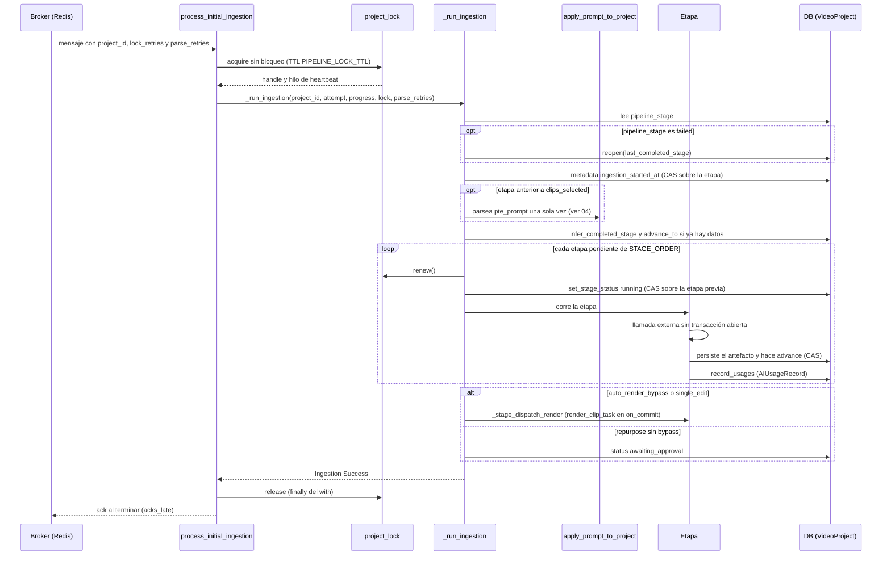
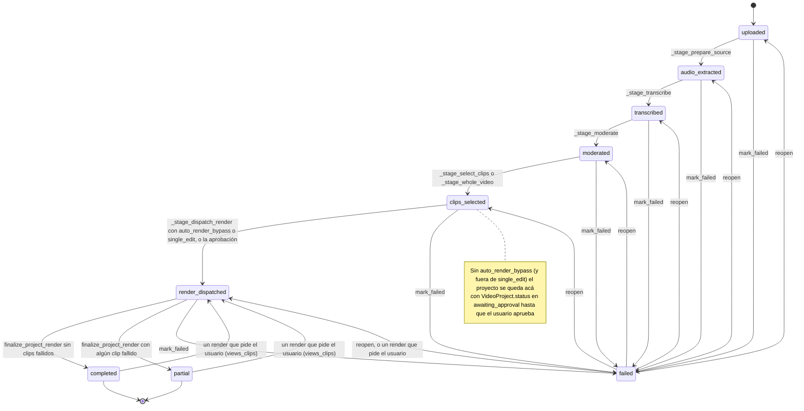
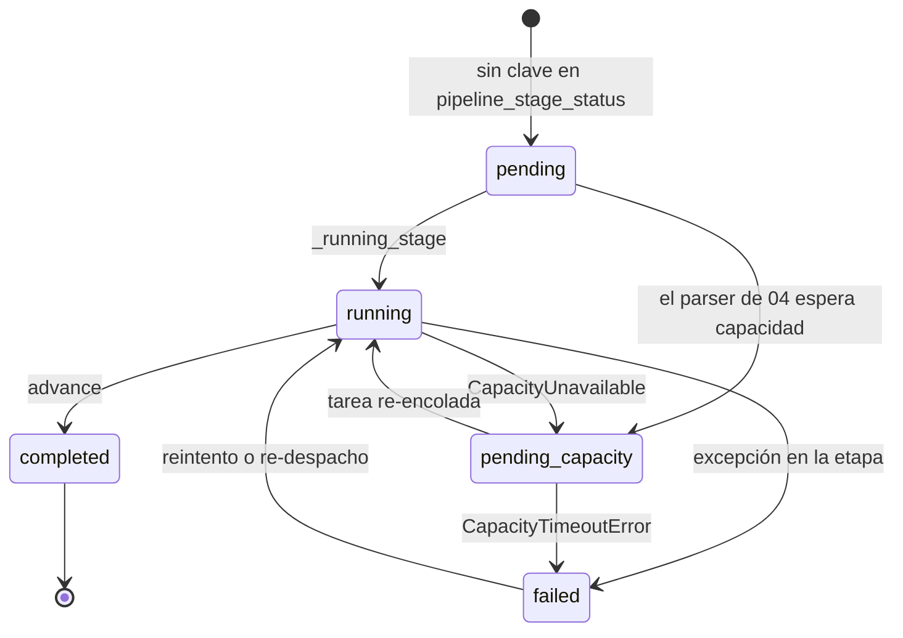
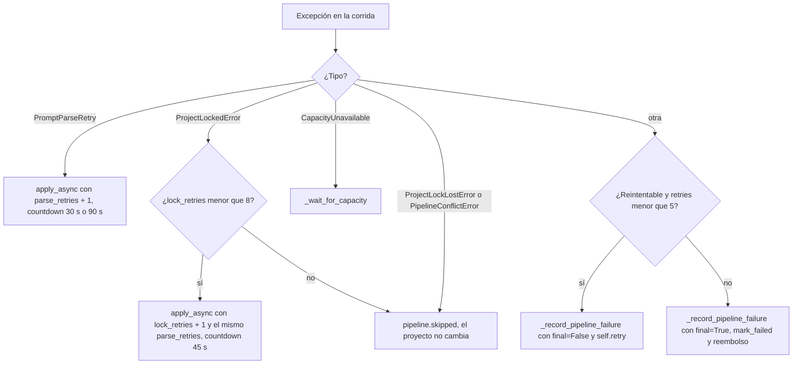
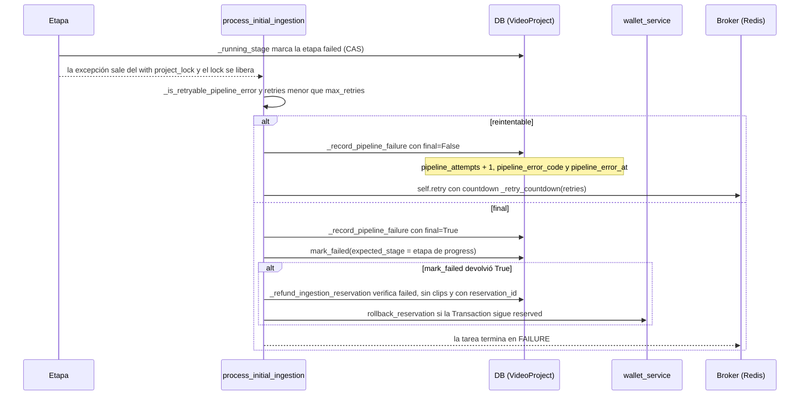

# Pipeline de ingesta

`process_initial_ingestion` lleva un proyecto desde el video subido hasta los clips sugeridos (y, con `auto_render_bypass`, hasta el despacho del render). Sin bypass, el despacho lo hace la aprobación de la revisión (`approve-paper-edit`): cada segmento aprobado es un clip. Un proyecto "Editar el video completo" (`project_type=single_edit`) no pasa por la selección: el video entero es su único clip y se renderiza sin revisión. Corre en Celery apenas se crea el proyecto y cada vez que alguien lo re-despacha. Está armado para sobrevivir a reintentos, re-entregas y workers muertos sin repetir llamadas pagas: cada etapa guarda su resultado antes de avanzar, las transiciones son compare-and-set y un lock en Redis impide que dos workers procesen el mismo proyecto. Este documento cubre la tarea, la máquina de etapas, los reintentos, la espera de capacidad, el fallo final con reembolso y la ingesta que no avanza porque se perdió su mensaje. Lo que pasa dentro de cada etapa de IA está en [03-transcripcion-moderacion-seleccion](03-transcripcion-moderacion-seleccion.md).

## Componentes

| Componente | Archivo | Rol |
|------------|---------|-----|
| `process_initial_ingestion` | [tasks/ingestion.py](../../back/apps/videos/tasks/ingestion.py) | Tarea Celery. Toma el lock, corre `_run_ingestion` y decide qué hacer con cada excepción (reintento, re-encolado, espera o fallo final) |
| `_run_ingestion` | [tasks/ingestion.py](../../back/apps/videos/tasks/ingestion.py) | Lee la etapa actual, reabre un proyecto `failed`, parsea el prompt y corre las etapas que faltan en orden |
| `_running_stage` | [tasks/ingestion.py](../../back/apps/videos/tasks/ingestion.py) | Context manager que marca el estado de la etapa (`running`, `failed`, `pending_capacity`) y loguea inicio y fin |
| `_stage_prepare_source`, `_stage_transcribe`, `_stage_moderate`, `_stage_select_clips`, `_stage_whole_video`, `_stage_dispatch_render` | [tasks/ingestion.py](../../back/apps/videos/tasks/ingestion.py) | Una función por etapa. Cada una persiste su artefacto antes de avanzar (transcripción, moderación, selección y despacho lo hacen en la misma transacción que el `advance`) |
| `_mark_render_dispatched`, `_queue_clip_renders`, `_dispatch_approved_clips` | [tasks/ingestion.py](../../back/apps/videos/tasks/ingestion.py) | El despacho en partes, que usan `_stage_dispatch_render` y la aprobación: la transición a `render_dispatched` con la fila bloqueada, el encolado de un `render_clip_task` por clip (prueba todos aunque uno falle) y, en la aprobación, un re-despacho si alguno no entró |
| `_resume_render_dispatch` | [tasks/ingestion.py](../../back/apps/videos/tasks/ingestion.py) | Vuelve a encolar los clips `draft` de un proyecto que quedó en `render_dispatched` (con una reserva clip por clip, solo los que esa reserva paga) |
| `PaidClipRender`, `AUTO_RENDER`, `APPROVED_RENDER`, `CLIP_RENDER`, `_paid_clip_renders`, `_clip_render_reserved`, `_clip_render_settlement`, `_settle_clip_render_reservations` | [tasks/ingestion.py](../../back/apps/videos/tasks/ingestion.py) | Las reservas que pagan un render clip por clip (render automático, aprobación y render que pide el usuario con el proyecto terminado): sus claves de `metadata`, la regla de cobro por segundos entregados y la liquidación |
| `_record_pipeline_failure`, `_refund_ingestion_reservation`, `_work_already_done` | [tasks/ingestion.py](../../back/apps/videos/tasks/ingestion.py) | Registro del fallo, fallo final y devolución de la reserva de tokens |
| `_wait_for_capacity` | [tasks/ingestion.py](../../back/apps/videos/tasks/ingestion.py) | Re-encola la tarea cuando no hay capacidad del proveedor, o falla el proyecto si la espera supera el máximo |
| `_is_retryable_pipeline_error`, `_retry_countdown`, `_merge_metadata`, `_persist_then_record_usage` | [tasks/shared.py](../../back/apps/videos/tasks/shared.py) | Política de reintentos, backoff, escritura de `metadata` sin pisar claves y escritura de las filas de uso después de persistir |
| `PipelineStage`, `StageStatus`, `advance`, `advance_to`, `mark_failed`, `reopen`, `set_stage_status`, `last_completed_stage`, `infer_completed_stage` | [services/ai/pipeline_state.py](../../back/apps/videos/services/ai/pipeline_state.py) | Máquina de estados: tabla de transiciones y escrituras compare-and-set |
| `project_lock`, `ProjectLockHandle.renew`, `ProjectLockedError`, `ProjectLockLostError` | [services/ai/project_lock.py](../../back/apps/videos/services/ai/project_lock.py) | Lock distribuido por proyecto en Redis, con TTL y heartbeat |
| `AIError` y subclases, `is_retryable_error`, `is_task_time_limit` | [services/ai/errors.py](../../back/apps/videos/services/ai/errors.py) | Separan errores reintentables de los deterministas |
| `v2_enabled_for` | [services/ai/rollout.py](../../back/apps/videos/services/ai/rollout.py) | Decide por proyecto si sus etapas de IA corren en V2 o en legacy |
| `process_video_pipeline` | [tasks/ingestion.py](../../back/apps/videos/tasks/ingestion.py) | Orquestador que solo delega en `process_initial_ingestion`. Nada lo encola: `wallet_service.reserve_funds` acepta `project_id` y lo ignora (antes encolaba esta tarea, una segunda ingesta del mismo proyecto). Queda registrada por los mensajes viejos |
| `decide_ingestion`, `_recover_ingestion`, `ingestion_stuck_after`, `ingestion_fail_after` | [tasks/render_recovery.py](../../back/apps/videos/tasks/render_recovery.py) | La parte de ingestas de `recover_stuck_renders`: re-encola o falla y devuelve una ingesta que no avanza (ver [abajo](#flujo-ingestas-que-no-avanzan)) |

## Flujo: una corrida de la tarea

1. La tarea se declara con `bind=True`, `max_retries=PIPELINE_MAX_RETRIES` (5), `acks_late=True`, `reject_on_worker_lost=True`, `soft_time_limit=PIPELINE_SOFT_TIME_LIMIT` y `time_limit=PIPELINE_TIME_LIMIT`. Los límites se leen de `settings` al importar el módulo. `attempt` es `self.request.retries + 1` y solo se usa en los logs.
2. `project_lock` toma la clave `lock:pipeline:project:<id>` sin bloquear. Si está tomada lanza `ProjectLockedError`; si Redis no responde lanza `RetryableAIError` (`provider="redis"`), que sigue el camino de los errores reintentables. Un hilo de heartbeat renueva el TTL cada `TTL / 3`.
3. `_run_ingestion` guarda en `progress['stage']` la etapa que cree que tiene el proyecto. Los handlers de error usan ese valor para escribir solo si el proyecto sigue ahí.
4. Si el proyecto está `failed` (re-despacho manual), `last_completed_stage` busca la última etapa `completed` y `reopen` lo mueve ahí, limpia `pipeline_error_code` y `pipeline_error_at`, y pone `status` en `ingesting` (o `rendering` si reabre en `render_dispatched`). Uno con `pipeline_error_code=IngestionNotQueued` no se reabre (`pipeline.redispatch_skipped reason=not_queued`): la creación lo falló y lo devolvió porque el broker no tomó su mensaje, y si ese mensaje llega tarde correría todo sin cobrar ([01](01-creacion-de-proyecto.md)). Solo lo reabre un mensaje de la cadena guardada en el proyecto ([cadenas de mensajes](#cadenas-de-mensajes)): el de un re-despacho o del override del admin. Una copia vieja que llega tarde (un re-encolado de `recover_stuck_renders`, el mensaje original) no lo reabre (`pipeline.redispatch_skipped reason=stale_chain`): correría gratis lo que se devolvió. Al reabrir, se borran `ingestion_recovery_requeues`, `ingestion_recovery_requeues_total` e `ingestion_recovery_requeued_at`: el re-despacho es una corrida nueva y tiene sus propios re-encolados.
5. En `completed` o `partial` no hace nada. En `render_dispatched` renueva el lock y llama a `_resume_render_dispatch`.
6. Desde `uploaded` hasta `clips_selected`, un mensaje de otra cadena que la guardada en el proyecto termina acá sin correr nada (`pipeline.chain_stale`, [cadenas de mensajes](#cadenas-de-mensajes)).
7. Desde `uploaded` hasta `clips_selected`, la corrida anota cuándo empezó en `metadata['ingestion_started_at']`, con el lock tomado y solo si el proyecto sigue en la etapa que leyó (`_merge_metadata` con `expected_stage`). Lo escribe cada entrega que corre la ingesta: la primera, un reintento, un re-encolado por capacidad o por el parser. Es lo que mira `recover_stuck_renders` para saber si la ingesta avanza.
8. Antes de `clips_selected` corre `apply_prompt_to_project` con `can_retry=parse_retries < PTE_PARSE_MAX_RETRIES` y la capacidad del parser reservada bajo la etapa que sigue. Es idempotente: un proyecto sin prompt o ya parseado no se toca. El detalle está en [04-prompt-to-edit](04-prompt-to-edit.md).
9. `infer_completed_stage` mira los datos persistidos (clips o `transcript_data`) de proyectos creados antes de la máquina de estados. Si están más adelante que `pipeline_stage`, `advance_to` avanza de a una transición hasta ahí, sin rehacer trabajo.
10. Mientras el proyecto está entre `uploaded` y `moderated`, `status` pasa a `ingesting`, solo si sigue en la etapa que leyó esta corrida (compare-and-set). Si se movió mientras tanto (por ejemplo, la creación lo falló con `IngestionNotQueued` mientras se parseaba el prompt), la corrida termina con `PipelineConflictError` (`pipeline.skipped`) y el proyecto no queda como "procesando". Después corren las etapas en orden. Antes de cada una se llama a `lock.renew()`, que lanza `ProjectLockLostError` si el lock ya no es de este worker.
11. En `moderated`, un proyecto `single_edit` corre `_stage_whole_video` en lugar de `_stage_select_clips` (ver abajo). En `clips_selected`, con `auto_render_bypass` o en un proyecto `single_edit` se despacha el render (`_stage_dispatch_render`). Con `auto_render_bypass`, antes de despachar se cobra la reserva de creación y se reserva el render de los clips (ver "Renderizar sin revisar" abajo); si no se puede pagar, el proyecto queda esperando la revisión como si el bypass estuviera apagado. Sin bypass, `status` pasa a `awaiting_approval` solo si estaba en `uploaded` o `ingesting`: una re-entrega no pisa una acción posterior del usuario.
12. El `with project_lock(...)` libera el lock en su `finally`, también cuando hay excepción. Los handlers de la tarea corren con el lock ya liberado.

## Flujo: máquina de etapas

`VideoProject.pipeline_stage` guarda la **última etapa terminada**. Las transiciones válidas están en `_TRANSITIONS` y `advance` las escribe con `UPDATE ... WHERE pipeline_stage = expected`: si otro worker ya avanzó, lanza `PipelineConflictError`.

| Transición | Quién la escribe | Qué deja persistido antes |
|------------|------------------|---------------------------|
| `uploaded` → `audio_extracted` | `_stage_prepare_source` | Fuente descargada (si vino por URL), `original_r2_key`, `proxy_r2_key` (opcional: si falla el proxy, sigue) y `metadata.duration` / `metadata.resolution` |
| `audio_extracted` → `transcribed` | `_stage_transcribe` | `transcript_data`, `metadata.full_text` y `metadata.transcription_usage`, en la misma transacción que el `advance` |
| `transcribed` → `moderated` | `_stage_moderate` | `metadata.moderation` |
| `moderated` → `clips_selected` | `_stage_select_clips` | Filas `VideoClip` en `draft`, `ai_rationale_log`, `metadata.selection_usage` y `metadata.selection_reasoning_effort` |
| `moderated` → `clips_selected` (`single_edit`) | `_stage_whole_video` | Una fila `VideoClip` en `draft` de `0` a `metadata.duration`, en la misma transacción que el `advance` |
| `clips_selected` → `render_dispatched` | `_stage_dispatch_render` | `status=rendering`. Los `render_clip_task` se encolan con `transaction.on_commit` |
| `clips_selected` → `render_dispatched` (aprobación) | `approve_paper_edit`, con `_mark_render_dispatched` | Un clip `draft` por segmento aprobado, la reserva del render y los clips que paga, en la misma transacción. Los `render_clip_task` se encolan con `transaction.on_commit` (ver abajo) |
| `render_dispatched` → `completed` / `partial` | `finalize_project_render` en [tasks/render.py](../../back/apps/videos/tasks/render.py) | Ver [06-render-caras-y-hablante](06-render-caras-y-hablante.md) |
| cualquiera → `failed` | `mark_failed`, llamado por `_record_pipeline_failure` con `final=True` | `pipeline_error_code` y `status=failed`. No toca `completed` ni `partial` |
| `failed` → etapa de `STAGE_ORDER` | `reopen`, en un re-despacho | La etapa que devuelve `last_completed_stage` |
| `completed`, `partial` o `failed` → `render_dispatched` | `_start_paid_render` en [views_clips.py](../../back/apps/videos/views_clips.py): un clip desde su editor, el reintento de un clip fallido o un `rerender` | La reserva `CLIP_RENDER`, sus clips en `draft` y `status=rendering`, en la misma transacción. Ver [06](06-render-caras-y-hablante.md#renders-que-pide-el-usuario) |
| varias juntas | `advance_to` (proyectos viejos) | Camina de a una transición hasta lo que devuelve `infer_completed_stage` |

### Editar el video completo (`single_edit`)

Es la pantalla D5. `_is_whole_video` decide el camino: `project_type=single_edit` **y** `metadata.priced_duration_s`, que la vista de creación escribe solo para un archivo subido. Un `single_edit` sin ese dato (un link, un proyecto creado antes de este flujo o editado en el admin) nunca se cobró por un render entero, así que sigue el flujo de clips con revisión.

El proyecto pasa por las mismas etapas hasta `moderated`. Se transcribe (los subtítulos salen de ahí) y se modera igual, con una diferencia: si no hay habla (`AINoSpeechDetectedError`: música, gameplay, b-roll), `_persist_silent_transcript` guarda `transcript_data=[]`, `metadata.full_text=""` y `metadata.no_speech=true`, y sigue. La moderación revisa entonces solo el título, y el render sale sin subtítulos. En un proyecto de clips, sin habla sigue fallando: no hay de dónde elegir.

Después:

- `_stage_whole_video` crea un solo `VideoClip` de `0` a `metadata.duration` (la duración de MoviePy, la misma con la que corta el render), con el título del proyecto. Si falta, la mide con `_probe_video`. No llama al modelo de selección ni escribe filas de uso.
- `_check_whole_video_source` compara la duración con lo cobrado. Corre en `_stage_prepare_source`, apenas se mide la fuente y antes de transcribir, y otra vez en `_stage_whole_video`.
  - Si supera `priced_duration_s` + 1 s, lanza `WholeVideoSourceChangedError`: el archivo no es el que se cobró.
  - Si supera `AI_SINGLE_EDIT_MAX_DURATION_SECONDS` + 1 s, lanza `NonRetryableAIError` (`too_long`). Pasa con un proyecto largo de clips pasado a `single_edit` en el admin.
  - Una duración `0` también lanza `NonRetryableAIError`.
  - En todos los casos no hay clip, el proyecto falla y se reembolsa.
- Una re-entrega no crea otro clip: la etapa bloquea el proyecto y solo crea el clip si no hay ninguno.
- En `clips_selected` se despacha el render siempre, aunque `auto_render_bypass` esté apagado: no hay nada que revisar.
- **Cobro:** lo que se paga es el render, así que la reserva de creación no se cobra en `clips_selected`. Cada llamada a `finalize_project_render` corre `_settle_whole_video_reservation`, que decide por cómo terminó el proyecto y no por la transición. Así también liquida un proyecto que salió de `render_dispatched` por otro camino (marcado `failed` mientras renderizaba) o un worker que murió entre cerrar y cobrar.
  - Con el proyecto en `completed`, `partial` o `failed`: si un clip quedó `completed` o `published`, la cobra. Si sigue `rendering`, espera. Si no, la devuelve.
  - Antes de eso no toca nada.
  - La regla vive en `_whole_video_settlement` y la usa también `settle_stale_reservations` para las reservas de video completo que quedaron `RESERVED` ([07](07-capacidad-costos-y-operacion.md#operación-reservas-de-tokens-que-quedaron-reserved)).
- **Reembolso al fallar:** `_refund_ingestion_reservation` devuelve la reserva aunque exista el clip, salvo que esté `rendering` o `completed`.
- **Re-despacho:** la reserva tiene que seguir `reserved` (`_whole_video_is_paid`).
  - Al re-despachar un proyecto `failed` ya devuelto, no se reabre ni corre nada (`pipeline.redispatch_skipped`), y el proyecto conserva el código del error por el que falló. Así un override de moderación no crea un clip en un proyecto devuelto: hay que crear uno nuevo.
  - Antes de despachar el render y al reanudar en `render_dispatched`, `_ensure_whole_video_paid` lanza `WholeVideoNotPaidError` si ya no está reservada.
- **Mensajes de render que quedaron en la cola:** `render_clip_task` pregunta `_whole_video_render_allowed` antes de reclamar el clip y otra vez apenas lo reclama: el proyecto tiene que estar en `render_dispatched` y la reserva seguir `reserved`. Si no, marca el clip `failed`, llama a `finalize_project_render` y no renderiza (`render.skipped_unpaid`). Solo falla un clip que es suyo o de nadie: antes del claim, uno `draft` sin dueño (o uno `rendering` si el mensaje es una re-entrega, que lo toma); después, solo si todavía tiene el claim. Una copia que perdió el clip no lo entrega ([dueño del claim](06-render-caras-y-hablante.md#dueño-del-claim-y-renders-que-no-terminan)).
- **API:** el archivo de un video completo no se puede cambiar con un PATCH (400 en `source_file`). No tiene vista previa (409): su render real se despacha enseguida. Los campos `pipeline_*` son de solo lectura para cualquier proyecto.
- El precio de creación ya es el del video entero a su resolución, que es justo lo que se renderiza. No se cobra nada más.
- Solo se crea con un archivo subido de hasta `AI_SINGLE_EDIT_MAX_DURATION_SECONDS` (600 s por defecto). Ver [01](01-creacion-de-proyecto.md).

`last_completed_stage` tiene dos ajustes. Si `clips_selected` figura `completed` pero el proyecto no tiene clips, reanuda en `transcribed` para volver a correr la selección. Y si `moderated` no tiene estado pero `clips_selected` sí está `completed` (proyectos anteriores a la etapa de moderación), la saltea (`_predates_moderation`).

### Renderizar sin revisar (`auto_render_bypass`)

Es la opción "Renderizar sin revisar" de C1. Los clips elegidos se renderizan sin pasar por la revisión, así que su render se paga igual que una aprobación:

- **Reserva:** en `clips_selected`, después de cobrar la reserva de creación (el trabajo de IA ya está entregado), `_reserve_auto_render` reserva el render de los clips `draft` con el mismo precio que `approve-paper-edit` (`render_cost`, en `services/render_pricing.py`, sobre la suma de sus segundos; el límite de duración del plan se compara con esa suma, igual que en la aprobación). Guarda las claves de `AUTO_RENDER`, `metadata['auto_render_reservation_id']`, `auto_render_seconds` y `auto_render_clip_ids` (los clips que paga), en la misma transacción que la reserva, y recién después se despacha el render. `reserve_funds` guarda en la misma fila el proyecto y la categoría `render`.
- **Solo mientras se ingesta:** con el proyecto en `uploaded` o `ingesting`. Un mensaje de ingesta re-entregado que encuentra que el usuario ya aprobó un paper edit (u otro estado) no reserva ni despacha nada. Al reanudar en `render_dispatched`, una revisión aprobada (`_renders_per_clip`) tampoco reserva: la paga la aprobación (`pipeline.auto_render_not_needed`).
- **Reservado y nunca despachado:** si una corrida reservó el render automático, el despacho no llegó y el usuario apagó el bypass (se puede cambiar mientras el proyecto no está `rendering`), la corrida siguiente en `clips_selected` toma el camino de la revisión y devuelve esa reserva (`_refund_undispatched_auto_render`, `pipeline.auto_render_refunded reason=not_dispatched`). Si esa devolución falla por un error de base (`pipeline.auto_render_refund_failed`) o nadie vuelve a correr, la devuelve `settle_stale_reservations` (`not_dispatched`), y si el usuario aprueba antes, la aprobación.
- **Sin saldo o sobre el límite del plan:** no despacha nada. Guarda `metadata['auto_render_skipped']` (`insufficient_funds` o `plan_limit`) y el proyecto pasa a `awaiting_approval`: el usuario revisa y aprueba (y paga) lo que quiera.
- **Re-entregas:** una reserva que sigue `reserved` se reusa. Si ya se liquidó (el proyecto falló y se re-despacha), se reserva de nuevo solo lo que falta renderizar, también al reanudar en `render_dispatched` (`resuming=True`).
  - Si al reanudar no se puede pagar, el proyecto vuelve a `failed` (código `AutoRenderNotPaid`, `pipeline.redispatch_skipped`) con sus clips intactos: se puede re-despachar cuando el workspace tenga tokens. No escribe `auto_render_skipped`, que es el aviso de la revisión.
  - Un proyecto despachado antes de que el render automático se cobrara no tiene la clave: se reanuda como empezó, sin reserva.
- **Liquidación con lock:** `_settle_clip_render_reservation` bloquea la fila del proyecto mientras lee cómo terminó y liquida, así un re-despacho no se cuela en el medio.
- **Cobro:** `_settle_clip_render_reservations` corre en cada `finalize_project_render` y cuando el pipeline marca el proyecto `failed`, y decide por cómo terminó (`_clip_render_settlement`). La misma regla liquida la [aprobación](#aprobación-de-la-revisión-approve-paper-edit):
  - con el proyecto en `completed`, `partial` o `failed` y ningún clip pagado `rendering`: se cobra la parte de los segundos entregados (clips de `auto_render_clip_ids` en `completed` o `published`) y se devuelve el resto (`commit_partial_reservation`). Si no se entregó nada, se devuelve todo. Un clip que paga otra reserva, o uno renderizado antes, no cuenta;
  - antes de eso, o con un clip todavía `rendering`, espera.
- **Mensajes de render en la cola:** `render_clip_task` no renderiza un clip de un proyecto con render automático si el proyecto ya no está en `render_dispatched` o esa reserva ya no está `reserved` (`_whole_video_render_allowed`, que cubre los casos pagos: video completo, render automático y aprobación). Tampoco uno que ninguna reserva paga: la tarea le pasa el id del clip y tiene que estar en `auto_render_clip_ids` (o en `render_clip_ids` de una aprobación). Decide la reserva que paga el clip, no todas las del proyecto. Un re-despacho reserva solo los clips `draft`, así que un mensaje viejo de un clip que había fallado lo encuentra fuera de la lista, no lo renderiza y el clip sigue `failed`. Además, `_claim_clip_for_render` nunca reclama un clip `failed`: un mensaje duplicado o tardío de un clip que falló del todo no lo renderiza aunque su reserva siga `reserved`.

### Aprobación de la revisión (`approve-paper-edit`)

Es el botón **Renderizar** de D2. Cada segmento aprobado se renderiza como su propio clip (D3), con el mismo camino que el render automático: un `render_clip_task` por clip y el cobro por segundos entregados. La vista es `approve_paper_edit` en [views.py](../../back/apps/videos/views.py) y el trabajo bajo el lock está en `_approve_clips`.

1. **Validación y precio, como siempre.** Aprueban el Dueño, un Admin o un Editor del workspace activo: un Lector recibe 403 y un proyecto de otro workspace, 404 ([01](01-creacion-de-proyecto.md#workspace-activo-y-roles)). El proyecto tiene que estar en `awaiting_approval` (si no, 400). Un video completo (`_is_whole_video`) nunca llega acá: 400. Los segmentos pasan por `validate_approved_segments` (400 si no) y el precio sale de `render_cost` sobre la suma de sus segundos. Cada segmento se renderiza como un clip, así que ninguno puede durar más de lo que un render termina antes de `RENDER_CLIP_SOFT_TIME_LIMIT`: ese límite dividido por `RENDER_CLIP_SECONDS_PER_SECOND` (`max_render_segment_seconds`, 1800 s por defecto). Uno más largo es un 400 (`check_segment_lengths`: "Los segmentos aprobados son inválidos: cada segmento puede durar hasta 1800 segundos. Dividí los más largos en varios.") antes de reservar nada; si no, fallaría por el soft limit después de reservado. Un límite del plan es un 400 ("Error en el motor de precios: ...").
2. **Toma y reserva, en la misma transacción que los pasos 3 y 4.** Un `UPDATE` condicional `awaiting_approval` → `rendering` toma el proyecto (409 si otra aprobación ganó: el lock de fila de la toma la hace esperar). Después `reserve_funds` reserva el render; sin saldo, 402 y la transacción se deshace, así que el proyecto sigue en `awaiting_approval`. Todo esto pasa antes de tocar un clip. Si el proceso muere antes del commit (un worker que se mata por timeout, una conexión que se corta), la base deshace la toma, la reserva y los clips: no queda un proyecto `rendering` sin aprobación ni una reserva sin proyecto (`unlinked` en `settle_stale_reservations`). Un error de la billetera responde 500 (`render.approval_reserve_failed`, con la clase).
3. **Clips, con la fila bloqueada** (`_approve_clips`). Si el proyecto tiene un render automático todavía `reserved`, se devuelve en la misma transacción (`_refund_undispatched_auto_render`): en `clips_selected` no se encoló nada para él, porque el despacho pasa el proyecto a `render_dispatched` antes de encolar. Pasa cuando se reservó, el despacho no llegó (un reintento, un worker muerto) y el usuario apagó "Renderizar sin revisar" en el medio. Si la aprobación no se guarda, esa devolución tampoco. Después, igual que el mock del frontend:
   - un segmento cuyo `clip_id` es un clip `draft` del proyecto actualiza ese clip: `start_time`, `end_time` y el título si vino uno. Si cambian sus bordes, se borran sus vistas previas (fila y archivo): muestran los de antes. Si solo cambia el título, quedan;
   - cualquier otro segmento (sin `clip_id`, con uno que no existe, de otro proyecto, de un clip que no es `draft` o repetido) crea un clip `draft` con su título o `Clip N`;
   - los clips `draft` que no se aprobaron se borran, con sus vistas previas y los archivos de esas vistas previas (`delete_preview_files`, después del commit). La revisión es el punto de decisión; el razonamiento de la IA queda en `ai_rationale_log`;
   - un `draft` no aprobado que tiene posts programados (`ScheduledPost`) o capas (`ClipLayer`) no se borra: el borrado en cascada se los llevaría. Ninguna API los crea sobre un borrador, pero el admin sí. Queda como estaba (`render.approval_draft_kept`, con los ids): no está en `render_clip_ids`, así que nada lo encola, lo renderiza ni lo cobra, y el cierre del fan-out no lo espera. Los borradores se leen con `select_for_update` antes de mirar si tienen posts o capas: un post o una capa que el admin guarda en ese momento espera el commit de la aprobación y falla (el clip ya no existe). Nunca se guarda y se borra después en cascada;
   - las vistas previas que se borran se leen con `select_for_update`. Un `render_preview` que guarda su archivo en ese momento espera el commit, no encuentra su fila y borra su propio archivo; uno que lo guardó antes ya está en la lista. Así ningún archivo queda en el storage sin fila. Si la fila desaparece justo después de que `render_preview` la toma, no renderiza nada;
   - la limpieza de vistas previas vencidas (`cleanup_expired_previews_now`) sigue la misma regla. Vuelve a leer cada fila con `select_for_update` (`skip_locked`) y solo la borra si sigue vencida. Un `render_preview` que tardó más que su `expires_at` provisorio y termina antes queda `ready` con su vencimiento nuevo y no se borra; uno que termina después espera, no encuentra su fila y borra su propio archivo;
   - un clip en otro estado nunca se toca. El `text` de los segmentos se acepta y se ignora: los subtítulos salen de la transcripción del proyecto ([06](06-render-caras-y-hablante.md)).
4. **Despacho.** `_mark_render_dispatched` pasa el proyecto a `render_dispatched` (y `rendering`). Un proyecto anterior a la máquina de etapas que llegó a la revisión camina primero hasta `clips_selected` (`advance_to`). En la misma transacción se guardan `approved_segments`, `metadata['render_reservation_id']`, `render_clip_ids` (los clips que paga, en el orden de los segmentos), `render_seconds` y `final_duration`, y se borran `auto_render_skipped` y las claves de un render automático ya liquidado (`auto_render_reservation_id`, `auto_render_clip_ids`, `auto_render_seconds`): queda la aprobación como única reserva. Después del commit, `_dispatch_approved_clips` encola un `render_clip_task` por clip.
5. **Si algo falla antes del commit** (el proyecto dejó `clips_selected` mientras tanto, un error de base): la transacción se deshace entera (`render.approval_failed`). No queda nada escrito ni reservado (ninguna `Transaction`) y el proyecto sigue en `awaiting_approval`. Un cambio de etapa responde 409; otro error, 500. Un error después del commit (en el encolado) no deshace nada: la aprobación queda guardada y paga, y la respuesta es 200 (`render.approval_after_commit_failed`).
6. **Cobro y cierre.** `finalize_project_render` cierra el proyecto `completed` o `partial` y liquida la reserva con la regla del render automático (`APPROVED_RENDER`): cobra la parte de los segundos entregados de `render_clip_ids` y devuelve el resto; si no se entregó nada, la devuelve toda; mientras un clip está `rendering`, espera. El cierre mira solo los clips de `render_clip_ids`: un clip que falló en un render automático anterior no deja el proyecto `partial`.
7. **Mensajes en la cola.** `_whole_video_render_allowed` renderiza un clip solo si la reserva que lo paga (la que lo tiene en sus ids) sigue `reserved` y el proyecto está en `render_dispatched`. Un clip fuera de `render_clip_ids` no se renderiza, y una reserva que no paga el clip no decide nada. Un clip que ya falló del todo tampoco: mientras los demás siguen, su reserva está `reserved`, pero `_claim_clip_for_render` no reclama un clip `failed` ([06](06-render-caras-y-hablante.md)).
8. **Un `delay` que falla** después del commit se loguea (`render.dispatch_failed`) y los demás clips se encolan igual. Después se encola un re-despacho de `process_initial_ingestion` a `RENDER_REDISPATCH_SECONDS` (60 s, `render.redispatch_queued`): en `render_dispatched` vuelve a encolar los clips `draft` que paga la aprobación (`_resume_render_dispatch`) y, si el broker sigue sin aceptar, reintenta con el backoff del pipeline. Si se queda sin reintentos, no falla el proyecto ni devuelve la reserva (`pipeline.render_not_queued`): un render que nunca empezó no se falla, la misma regla que `recover_stuck_renders`, que vuelve a encolar esos clips. Un re-encolado que entra (el del re-despacho o el de esa rutina) borra el `pipeline_error_code` que dejó el broker. Si esa rutina llega a su tope de re-encolados sin que los clips empiecen, falla los que nunca empezaron, cierra el proyecto (`partial`, con `render_stuck`) y liquida la reserva por lo entregado: nunca queda reservada para siempre. Si tampoco ese re-despacho se puede encolar (`render.redispatch_not_queued`), `recover_stuck_renders` encuentra los clips cuando el proyecto lleva `RENDER_STUCK_AFTER_SECONDS` sin novedades ([07](07-capacidad-costos-y-operacion.md#operación-renders-trabados)). Un re-despacho con la reserva ya liquidada no renderiza gratis: el clip falla (`render.skipped_unpaid`).
9. **Ningún re-despacho reserva un render automático para una revisión aprobada** (`_renders_per_clip`, en `_run_ingestion` y en `_reserve_auto_render`): la aprobación paga sus clips.

Una aprobación anterior a este cambio no tiene `render_clip_ids`: sigue `rendering` en `clips_selected` y la renderiza `render_video_segments` como una sola exportación ([06, Paper edit](06-render-caras-y-hablante.md)). Las aprobaciones nuevas nunca usan esa tarea.

### Estado por etapa (`pipeline_stage_status`)

Además de la etapa, cada etapa de trabajo (`STAGE_ORDER` menos `uploaded`) tiene un estado en el JSON `pipeline_stage_status`. `set_stage_status` lo escribe con la fila bloqueada y, si recibe `expected_stage`, solo mientras el proyecto siga en esa etapa. Un estado `completed` nunca se degrada.

| Estado | Lo escribe | Cuándo |
|--------|------------|--------|
| `pending` | Nadie | Existe en `StageStatus`, pero ningún código lo escribe: una etapa sin clave en el JSON está pendiente |
| `running` | `_running_stage` | Al entrar a la etapa, guardado por la etapa anterior (`expected_stage`) |
| `completed` | `advance` | Al pasar a una etapa de trabajo (también en `reopen` y `advance_to`) |
| `failed` | `_running_stage`, `_wait_for_capacity` | Excepción dentro de la etapa, o espera de capacidad vencida |
| `pending_capacity` | `_running_stage`, `_run_ingestion` | `CapacityUnavailable` en la etapa o en el parser del prompt |

Si la excepción es una `PipelineStateError` (otro worker es dueño del proyecto), `_running_stage` no escribe nada: la etapa no falló.

## Flujo: fallo, reintentos y reembolso

La tarea reparte las excepciones así:

1. `_is_retryable_pipeline_error` decide. Un `AIError` respeta su `is_retryable`. Fuera de eso reintentan: `TimeoutError` y `ConnectionError`; una `ModerationError` con `retryable=True`; `OperationalError` e `InterfaceError` de Django; `ClientError` de R2 con HTTP 5xx, 408, 429 o un código de `_TRANSIENT_S3_ERROR_CODES`; un `S3UploadFailedError` de boto3 (lo que lanza `upload_file`), salvo que envuelva un `ClientError` que no reintenta (por ejemplo, `AccessDenied`); cualquier `BotoCoreError`; un `DownloadError` de yt-dlp sin ninguna marca de `_PERMANENT_DOWNLOAD_MARKERS`; errores del broker o de Redis; y un `OSError` que no sea de `_DETERMINISTIC_OS_ERRORS`. Todo lo demás es final, incluidos `UnsafeContentError`, `ImproperlyConfigured`, `ValueError` y `SoftTimeLimitExceeded`.
2. `_record_pipeline_failure` corre en **todo** fallo, se reintente o no: suma 1 a `pipeline_attempts` y guarda la clase del error en `pipeline_error_code` (`record_error`). Con `final=True` llama a `mark_failed(expected_stage=stage)`: si el proyecto ya no está en esa etapa (otro worker lo movió), no escribe nada.
3. `_retry_countdown(retries)` es backoff exponencial con "equal jitter": techo `min(30 × 2^retries, 600)` y espera entre la mitad del techo y el techo. Para los 5 reintentos: 15–30 s, 30–60 s, 60–120 s, 120–240 s y 240–480 s (entre ~8 y ~15 min en total).
4. Si el fallo final llega antes de leer el proyecto (`stage` es `None`, por ejemplo Redis caído al tomar el lock) y el proyecto ya está en `clips_selected` o más adelante (`_work_already_done`), no se lo marca `failed` (`pipeline.fail_skipped`).
5. Solo la llamada que efectivamente pasó el proyecto a `failed` (`mark_failed` devuelve `True`) llama a `_refund_ingestion_reservation`. En la misma transacción que `mark_failed`, esa llamada le pone al proyecto una cadena nueva (`_fail_with_new_chain`): ninguna copia de un mensaje anterior, ni siquiera de la entrega que lo falló, lo reabre ([cadenas de mensajes](#cadenas-de-mensajes)). El reembolso exige que el proyecto siga `failed`, que no tenga ningún `VideoClip` (en un video completo, ninguno `rendering` ni `completed`), que tenga `metadata.reservation_id` y que esa `Transaction` siga `reserved`. Nunca lanza: un error de pagos se loguea como `pipeline.refund_failed`. El ciclo de la reserva está en [01-creacion-de-proyecto](01-creacion-de-proyecto.md).

### Los tres contadores

| Contador | Dónde viaja | Lo incrementa | Tope | Al agotarse |
|----------|-------------|---------------|------|-------------|
| `self.request.retries` | En el mensaje de Celery. Los re-encolados por lock, parser y capacidad lo pasan con `retries=` | `self.retry` tras un error reintentable | `PIPELINE_MAX_RETRIES` = 5 | El error pasa a final: `mark_failed` y reembolso |
| `lock_retries` | kwarg de la tarea | Re-encolado por `ProjectLockedError` (cada `PIPELINE_LOCK_RETRY_SECONDS` = 45 s) | `PIPELINE_LOCK_MAX_RETRIES` = 8 | `pipeline.skipped`: se asume que un worker vivo tiene el proyecto. No falla ni cobra |
| `parse_retries` | kwarg de la tarea | Re-encolado por `PromptParseRetry` (30 s y después 90 s, `PTE_PARSE_RETRY_SECONDS`) | `PTE_PARSE_MAX_RETRIES` = 2 | `can_retry=False`: el parser guarda `pte.status=failed` y el proyecto sigue con su configuración |

Los tres son independientes: esperar el lock o reintentar el parser no gasta los reintentos de las etapas. Los re-encolados llevan también la cadena del mensaje (`chain`, ver [cadenas de mensajes](#cadenas-de-mensajes)). `parse_retries` viaja en todos los re-encolados (lock, capacidad y parser), así que una espera nunca le devuelve reintentos al parser. El re-encolado por capacidad empieza `lock_retries` de nuevo en 0: el lock ya se había tomado. Ocho esperas de 45 s (360 s) superan el TTL del lock (300 s), así que el lock de un worker muerto vence antes de que se agoten. `pipeline_attempts` (en la DB) no es un presupuesto: cuenta fallos registrados y se usa como `attempt` en `AIUsageRecord` y para invalidar esperas de capacidad viejas.

## Flujo: espera de capacidad

Con `AI_CAPACITY_ENABLED=True`, cada llamada a Groq y al LLM reserva capacidad antes de salir. Si no hay lugar, `CapacityGate.reserve` lanza `CapacityUnavailable` con `wait_seconds` y la etapa. Los buckets están en [07-capacidad-costos-y-operacion](07-capacidad-costos-y-operacion.md); acá solo importa qué hace el pipeline.

1. `_running_stage` marca la etapa `pending_capacity` (si la espera viene del parser, la marca `_run_ingestion` sobre la etapa siguiente). La excepción sale del lock y el handler de la tarea llama a `_wait_for_capacity`.
2. `_wait_for_capacity` lee `metadata.capacity_wait`. Si es de otra etapa o de otro `pipeline_attempts` (`_is_current_wait`), empieza una espera nueva: `{stage, since, planned_s: 0.0, attempts}`.
3. Si `planned_s + wait_seconds` supera `AI_CAPACITY_MAX_WAIT_SECONDS`, loguea `pipeline.capacity_timeout`, marca la etapa `failed`, borra `capacity_wait` y llama a `_record_pipeline_failure` con `CapacityTimeoutError` y `final=True`: el proyecto queda `failed` y se reembolsa como cualquier fallo final.
4. Si no, `_capacity_countdown` calcula la demora (el déficit del bucket, entre 1 s y `AI_CAPACITY_MAX_COUNTDOWN_SECONDS`, más 0–20 % de jitter), la suma a `planned_s` y re-encola la tarea con `apply_async(countdown=..., retries=self.request.retries)`. No es un intento fallido: no toca `pipeline_attempts` ni escribe filas de uso, y el worker queda libre.
5. Cuando la reserva por fin entra, `_capacity_granted` borra `capacity_wait` y acumula los segundos esperados en `metadata.capacity_waited_s[<etapa>]` (log `pipeline.capacity_granted`).
6. Para el parser del prompt la regla cambia: si la espera vencería, `_prompt_capacity_exhausted` lo detecta, `give_up_prompt` guarda `pte.status=failed` con `CapacityTimeoutError` y el proyecto sigue sin el prompt, sin fallar.
7. Si estacionar la tarea falla (por ejemplo, la DB), ese error se trata como cualquier error de etapa: nunca queda un proyecto en `pending_capacity` sin mensaje en la cola. Si lo que falla es publicar el re-encolado (broker caído), `_restore_capacity_wait` devuelve `capacity_wait` a como estaba (salvo que otra entrega lo haya cambiado) y el mismo mensaje vuelve al broker (`_publish_requeue`): la re-entrega planifica esa espera una sola vez y no cuenta un intento fallido.

## Flujo: ingestas que no avanzan

Un proyecto `uploaded` o `ingesting` con su reserva de creación `reserved` puede quedar sin nada que lo traiga de vuelta:

- **El mensaje nunca corrió.** El broker lo perdió (un Valkey que reinicia sin persistencia), o la creación no lo pudo encolar y tampoco pudo marcar el proyecto fallado (`project.not_queued_not_recorded`, el 503 con `refunded: false` de [01](01-creacion-de-proyecto.md)).
- **El worker murió con el mensaje ya confirmado.** El hard limit (`PIPELINE_TIME_LIMIT`) mata al worker y Celery hace ack de ese mensaje: no vuelve. Si muere todo el host, el mensaje vuelve recién después de `visibility_timeout` (4 h).

Sin esto, el usuario lo ve "procesando" con los tokens reservados hasta que lo borra, y borrar solo funciona después de `RENDER_STUCK_AFTER_SECONDS` (3 h 20 min por defecto). `recover_stuck_renders` lo resuelve cada 15 min, en la misma tarea de beat que los renders (`kind=ingestion`). El código está en [tasks/render_recovery.py](../../back/apps/videos/tasks/render_recovery.py). También toma un proyecto que quedó `ingesting` en `clips_selected` con la creación ya cobrada: su worker murió entre el cobro y el pase a la revisión, y nada más lo movería.

**La regla: sin avance por N minutos.** Una ingesta no avanza cuando ningún worker tiene el lock del proyecto y no pasó nada en `ingestion_stuck_after()` (30 min por defecto). "Algo" es cualquiera de estos momentos:

| Momento | De dónde sale |
|---------|---------------|
| La creación y su reserva | `created_at` del proyecto y de la `Transaction` |
| Una entrega de la cadena actual que empezó | `metadata['ingestion_started_at']` (paso 7 de la corrida) |
| Un error registrado, que programa su reintento | `pipeline_error_at` |
| Un re-encolado de esta rutina | `metadata['ingestion_recovery_requeued_at']` |

El pipeline nunca espera tanto por su cuenta: un reintento espera como mucho `PIPELINE_RETRY_CAP_SECONDS` (10 min) y una espera de capacidad se re-encola cada `AI_CAPACITY_MAX_COUNTDOWN_SECONDS` (5 min, más 20 % de jitter), y cada vuelta es una entrega nueva que anota su inicio. Por eso el umbral nunca es menor que el doble de la más larga de esas dos esperas: si alguien sube `AI_CAPACITY_MAX_COUNTDOWN_SECONDS`, el umbral sube con él. Mientras una entrega corre, su heartbeat mantiene el lock tomado, así que una etapa larga nunca cuenta como trabada. Un lock que nadie renueva vence en `PIPELINE_LOCK_TTL` (5 min): sin lock, el worker de la última entrega está muerto.

**Qué hace**, decidiendo de nuevo con el lock del proyecto y el lock de fila tomados:

| Situación | Acción (`reason`) |
|-----------|-------------------|
| Lock tomado | Nada (`skip`, `lock_held`) |
| Algo pasó hace menos de `ingestion_stuck_after()` | Nada (`skip`, `recent`) |
| Antes de `clips_selected` sin la reserva de creación `reserved` | Nada (`skip`, `reservation_settled` o `no_reservation`): no es esta rutina la que la liquida |
| Menos de `INGESTION_RECOVERY_MAX_REQUEUES` (2) re-encolados seguidos sin que empiece ninguno, menos de `INGESTION_RECOVERY_MAX_REQUEUES_TOTAL` (4) en toda la corrida, y nada que gaste con una reserva de más de un día | Re-encola `process_initial_ingestion` con una cadena nueva (`requeue`). `never_started`: nada empezó desde el último traspaso (la creación, un error o un re-encolado). `worker_lost`: lo último que pasó es un inicio y su lock venció |
| Si no, en `clips_selected` y menos de `ingestion_fail_after()` sin avanzar | Solo reporta (`report`, `clips_selected`): una entrega todavía podría estar viva |
| Si no, en `clips_selected`, un video completo | Falla con `IngestionStuck` y liquida la reserva de creación con la regla del pipeline (`_whole_video_settlement`): su render nunca se despachó, así que se devuelve (`fail`, `requeue_cap` o `too_old`) |
| Si no, en `clips_selected` (una revisión, con o sin render automático) | Lo pasa a la revisión sin renderizar (`handoff`, `requeue_cap` o `too_old`; `_hand_to_review`, lo mismo que hace una corrida sin `auto_render_bypass`): cobra la reserva de creación si sigue `reserved` (los clips se entregaron), devuelve un render automático reservado que nunca se despachó y pasa el proyecto a `awaiting_approval` |
| Si no, antes de `clips_selected` con algún clip (filas de antes de la máquina de etapas) | Solo reporta (`report`, `clips_selected`): nunca se devuelve |
| Si no, y menos de `ingestion_fail_after()` sin avanzar | Solo reporta (`report`, `requeue_cap`, o `too_old` si la reserva tiene más de un día): una entrega todavía podría estar viva |
| Si no (`ingestion_fail_after()` sin avanzar: `PIPELINE_TIME_LIMIT` + 15 min, 2 h 20 min por defecto) | Falla el proyecto con `pipeline_error_code=IngestionStuck` y devuelve la reserva de creación (`fail`, `no_progress`, o `too_old`) |

- **Re-encolados seguidos y en total.** Un inicio posterior al último re-encolado (`ingestion_started_at` igual o más nuevo que `ingestion_recovery_requeued_at`) vuelve a 0 los seguidos, como hace la rutina con los renders: una ingesta que avanza, se traba de nuevo y vuelve a avanzar no gasta sus re-encolados. El total (`metadata['ingestion_recovery_requeues_total']`) nunca vuelve a 0 en la corrida y acota la que empieza y muere cada vez (el hard limit).
- **Nunca después de un día lo que gasta.** Un re-encolado gasta si corre etapas pagas (antes de `clips_selected`) o un render (en `clips_selected`, un video completo o un render automático). Si la reserva se hizo hace más de un día (`INGESTION_REQUEUE_MAX_AGE_SECONDS`; sin reserva, desde la creación del proyecto), no se re-encola: antes de `clips_selected` se falla y se devuelve; en `clips_selected`, pasado `ingestion_fail_after()`, un render automático pasa a la revisión sin renderizar y un video completo se falla y se devuelve. Es lo que pasa con los proyectos trabados de antes la primera vez que corre la rutina después del deploy, o después de un corte largo: nunca se le cobra al usuario un trabajo que dejó de esperar. Una revisión en `clips_selected` sí se re-encola a cualquier edad: solo falta cobrar los clips elegidos (si no se cobraron) y pasar a la revisión.
- **Re-encolado.** Suma 1 a `metadata['ingestion_recovery_requeues']` y al total, anota `ingestion_recovery_requeued_at`, guarda una cadena nueva en `metadata['ingestion_chain']` y publica el mensaje con esa cadena (`chain`) dentro de la misma transacción: si el broker no lo acepta, no queda anotado y la próxima corrida lo intenta de nuevo. Es una entrega nueva, con todos sus reintentos. Si llega mientras la rutina todavía tiene el lock, se re-encola como cualquier copia que encuentra el lock tomado. Retoma desde la última etapa terminada, como cualquier re-entrega.
- **El mensaje original puede seguir vivo.** "Nunca empezó" o "su worker murió" no prueban que se perdió: puede estar sin ack en un host muerto (vuelve a las 4 h), como countdown en un worker ocupado, o en una cola atrasada. Por eso cada re-encolado empieza una cadena nueva ([abajo](#cadenas-de-mensajes)): el original pertenece a la anterior y, cuando llega, no corre nada. Sin eso, si la copia re-encolada fallaba en forma final y se devolvía la reserva, el original reabría el proyecto fallado y entregaba los clips sin cobrar.
- **Nunca dos a la vez.** Dos corridas de la rutina (la de beat y el comando) deciden con el lock del proyecto: la segunda ve `lock_held`. Aunque los dos locks de Redis no se vieran, el lock de fila las ordena y la segunda lee el re-encolado de la primera (`recent`). La reserva se cobra una vez: `commit_reservation` solo pasa de `RESERVED` a `COMPLETED` con la `Transaction` bloqueada.
- **Fallo y devolución.** `mark_failed`, `IngestionStuck`, una cadena nueva que ningún mensaje tiene y `rollback_reservation` van en una sola transacción, con la fila bloqueada, como `_fail_unqueued_project` en la creación: nadie ve el proyecto fallado sin la devolución, ni devuelto y corriendo. Si la reserva ya se había liquidado, no se escribe nada (`already_settled`). La espera es más larga que el hard limit, así que ninguna entrega puede seguir viva, ni siquiera una que perdió el lock. Una copia de cualquier mensaje anterior que llega después no corre nada (`pipeline.redispatch_skipped reason=stale_chain`). El usuario ve "El proceso se trabó y te devolvimos los tokens" y puede re-despacharlo: reserva de nuevo, con su propia cadena, y corre.
- **Sin escribir.** Sin `--apply` (el comando en modo reporte) no escribe nada ni toma locks. Un proyecto creado hace menos del umbral ni siquiera es candidato.

Fuera de esta regla quedan: un proyecto `failed` con la reserva `reserved` (lo devuelve `settle_stale_reservations`), uno que ya está en revisión o renderizando, y un render (las otras partes de `recover_stuck_renders`, [07](07-capacidad-costos-y-operacion.md#operación-renders-trabados)).

### Cadenas de mensajes

Varias cosas mandan un mensaje nuevo a un proyecto que todavía puede tener uno viejo vivo: un re-encolado de `recover_stuck_renders`, un re-despacho (`ProjectRedispatchView`) y el override de moderación del admin. Cada una guarda un token nuevo en `metadata['ingestion_chain']` (`new_ingestion_chain`) y lo pasa como kwarg `chain` de la tarea. Todo lo que esa entrega vuelve a publicar lleva el mismo `chain`: el re-encolado por lock, por el parser del prompt y por capacidad; `self.retry` conserva los kwargs solo.

- Un mensaje de otra cadena no reabre un proyecto `failed` (`pipeline.redispatch_skipped reason=stale_chain`) ni corre una etapa de ingesta (`pipeline.chain_stale`): termina antes de anotar su inicio, de parsear el prompt, de reservar capacidad o de gastar un reintento. Así dos cadenas vivas nunca planifican dos veces la espera de capacidad (`capacity_wait.planned_s`) ni gastan dos presupuestos de reintentos.
- La cadena solo cambia con el lock del proyecto tomado (la rutina), mientras el proyecto está `failed` (el re-despacho y el admin, con la fila bloqueada, la misma que lee la reapertura) o en la transacción que lo falla: una entrega que corre ve siempre la misma. En un doble click de re-despacho, el segundo pedido guarda otra cadena y el primer mensaje no corre nada.
- Cada fallo final del pipeline (`_record_pipeline_failure`, también el `AutoRenderNotPaid` del re-despacho de un render automático) guarda una cadena nueva en la misma transacción que `mark_failed`, como el fallo de `recover_stuck_renders`. Un re-encolado que llegó al broker y lanzó igual deja dos copias de la misma cadena (`_publish_requeue` devuelve el mensaje con `Reject(requeue=True)`): si una falla el proyecto y se devuelve la reserva, la otra no lo reabre. Solo lo reabre un token creado después (un re-despacho o el override).
- Si el mensaje de un re-despacho no se puede encolar y ese pedido no reservó nada (reusó la reserva de un re-despacho anterior, un doble click), la vista vuelve a poner la cadena anterior, solo si el proyecto sigue `failed` y la suya sigue guardada (compare-and-set con la fila bloqueada, `_restore_chain`, la misma regla que `_give_back`): el mensaje del primer pedido, que sí se encoló, corre. Si el mensaje del segundo llegó igual y un worker ya reabrió el proyecto, esa corrida conserva su cadena (`pipeline.redispatch_chain_kept`). Si reservó, devuelve lo reservado con `RedispatchNotQueued` como siempre.
- El admin guarda su cadena solo si el proyecto sigue `failed` (`_merge_metadata` con `expected_stage`): si un re-despacho lo reabrió mientras tanto, no la pisa, no encola nada y avisa que ya no está en FAILED.
- Un mensaje sin token (el de la creación, y cualquiera encolado antes de que existieran las cadenas) es la cadena de un proyecto que todavía no tiene una guardada. Así siguen andando los mensajes que estaban en la cola al desplegar. La migración `videos.0017` guarda una cadena nueva en cada proyecto que ya estaba `failed` y no tenía una: una copia sin token que seguía en vuelo no reabre gratis uno devuelto. Saltea las filas cuyo `metadata` no es un objeto, escribe con un compare-and-set sobre el `metadata` que leyó y al revertirse no hace nada.
- En `render_dispatched` y en un proyecto terminado no se mira la cadena: reanudar el render es idempotente (el claim de cada clip es un compare-and-set) y lo paga su propia reserva. El re-despacho de clips que pide una aprobación (`_dispatch_approved_clips`) no lleva token.

## Flujo: re-entregas, idempotencia y re-despacho manual

Correr la tarea dos veces sobre el mismo proyecto es seguro. Las piezas:

| Mecanismo | Dónde | Qué evita |
|-----------|-------|-----------|
| `acks_late` + `reject_on_worker_lost` | Decorador de la tarea | Que un worker muerto por OOM (MoviePy, Whisper) pierda el mensaje: vuelve a la cola |
| Lock por proyecto con TTL y heartbeat | `project_lock` | Dos workers sobre el mismo proyecto. El TTL corto (300 s) solo define cuánto bloquea el lock de un worker muerto |
| Transiciones compare-and-set | `advance`, `mark_failed`, `set_stage_status` y `_merge_metadata` con `expected_stage` | Que un worker que perdió la carrera escriba sobre un proyecto que ya avanzó: recibe `PipelineConflictError` y termina con `pipeline.skipped` |
| Artefacto antes del avance | Cada `_stage_*` | Repetir trabajo pago: una etapa que falla reanuda en sí misma y las anteriores no se vuelven a correr. La transcripción no se recalcula si falla la selección |
| Claves de `metadata` de una sola escritura | `_WRITE_ONCE_METADATA_KEYS` (`duration`, `resolution`, `full_text`) | Que un worker lento o duplicado pise datos de la fuente |
| Chequeos de lo ya hecho | `original_r2_key`, `proxy_r2_key`, clips existentes, `metadata.pte` | Volver a subir a R2, duplicar clips o parsear otra vez el prompt |
| Render en `on_commit` y CAS por clip | `_stage_dispatch_render`, `_resume_render_dispatch`, `render_clip_task` | Encolar renders de una transición que no se confirmó; un clip encolado dos veces se renderiza una vez |
| `AIUsageRecord` solo de inserción | `record_usages` | Ocultar un segundo cobro: una ejecución repetida deja dos filas |
| Reembolso solo por quien falló el proyecto | `_record_pipeline_failure` | Devolver dos veces o devolver la reserva de un proyecto que otro worker sacó adelante |

**Re-entrega tras un worker muerto.** El mensaje vuelve a la cola (si muere todo el host, recién después de `visibility_timeout`, 4 h por defecto). Si la nueva entrega llega antes de que venza el TTL, encuentra el lock del muerto y se re-encola cada 45 s hasta que vence. Después retoma desde la última etapa terminada.

**Límite de tiempo.** El soft limit lanza `SoftTimeLimitExceeded`, que no es reintentable: el proyecto falla con ese código y el lock se libera, en vez de quedar renovado para siempre por un worker colgado. Los proveedores lo re-lanzan sin envolverlo (`is_task_time_limit`), así que nunca dispara un fallback ni un reintento. El hard limit solo mata a un worker que ignoró el soft.

**Re-despacho manual de un proyecto `failed`.** Encolar de nuevo `process_initial_ingestion` para un proyecto `failed`, con la cadena que se guardó para eso, lo reabre en `last_completed_stage` y sigue desde ahí, con el presupuesto de reintentos completo. Lo hacen dos caminos: guardar un `ModerationOverride` en el admin (ver [03](03-transcripcion-moderacion-seleccion.md#override-de-moderación)) y `POST projects/:id/redispatch/` (`ProjectRedispatchView` en [views_clips.py](../../back/apps/videos/views_clips.py)). La tarea no reserva de nuevo una reserva devuelta al fallar; el endpoint sí:

- Solo el Dueño y un Admin del workspace activo (`members.manage`, como el mock del frontend). Otro workspace, 404.
- Solo un proyecto `failed`, en estado y etapa (si no, 409 `not_failed`). Uno que falló con `IngestionStuck` sí: reserva de nuevo y corre. Cada pedido guarda una cadena nueva y la manda con su mensaje: solo ese mensaje reabre el proyecto ([cadenas de mensajes](#cadenas-de-mensajes)). Uno cuyo contenido frenó la moderación (`UnsafeContentError`) tampoco: moderarlo de nuevo lo frena igual, y para eso está el override (409 `moderation_blocked`). `ModerationBlockedError` no es eso: es una key inválida o una cuota agotada, y el proyecto se re-despacha cuando operación la arregla. Uno que falló porque su ingesta nunca se encoló al crearlo (`IngestionNotQueued`) se crea de nuevo (409 `not_queued`). Uno cuyo link dura más de lo que procesa la app (`LinkTooLongForAppError`) tampoco: volvería a reservar para fallar y devolver igual (409 `duration_app`). `LinkTooLongError` sí se re-despacha: el plan pudo cambiar.
- Si lo que falta se había devuelto (una etapa antes de `clips_selected`, o un video completo, que paga su render con la reserva de creación), reserva otra vez el mismo monto, con el lock de fila tomado, y lo guarda en `metadata['reservation_id']` (402 sin saldo). La reserva anterior queda en `metadata['replaced_reservation_ids']`. Después el pipeline la cobra o la devuelve como al crear. Una reserva que sigue `reserved` se reusa: un doble click no reserva dos veces.
- Un proyecto de clips con los clips ya elegidos sigue gratis: la ingesta se cobró y su render se paga solo (el render automático vuelve a reservar; una revisión espera su aprobación). Si quedó en `render_dispatched` con una aprobación o un render pedido después ya liquidados, la reanudación solo fallaría sus clips como impagos: 409 `render_settled`, y cada clip se reintenta desde Clips.
- Un video completo cuyo clip ya se entregó o falló se vuelve a renderizar con `rerender` (409 `use_rerender`). Sin reserva de creación, 409 `no_reservation`.
- La vista no reabre el proyecto: sigue `failed` hasta que la tarea lo reabre. Si la tarea no se puede encolar (`pipeline.redispatch_not_queued`), devuelve lo que reservó y, en la misma transacción, guarda `pipeline_error_code=RedispatchNotQueued` (el código anterior queda en `metadata['redispatch_previous_error_code']`), y responde 503. Una copia del mensaje que llega igual más tarde no corre nada: `_run_ingestion` lee el código con la fila bloqueada, la misma que toma `reopen`, y no lo reabre (`pipeline.redispatch_skipped reason=redispatch_not_queued`). Si el mensaje sí entró y la tarea ya lo reabrió antes de la devolución, la reserva se queda: paga esa corrida, y la respuesta es 202. Un re-despacho nuevo reserva otra vez y vuelve al código anterior. Si el mensaje se pierde después de encolarse, `settle_stale_reservations` devuelve esa reserva: el proyecto sigue `failed` sin clips entregados.

**V2 o legacy por etapa.** No se decide una vez por proyecto: la transcripción y la selección llaman cada una a `v2_enabled_for(project)` cuando corren (`AI_CORE_V2_ENABLED` como kill switch y `AI_CORE_V2_ALLOWLIST` por usuario). Los settings se leen al arrancar el worker; después de reiniciarlo, el cambio aplica a la próxima etapa de un proyecto en curso, y cada fila de uso registra el camino que efectivamente corrió en `pipeline_version`. Detalle por etapa en [03](03-transcripcion-moderacion-seleccion.md).

## Errores, reintentos y casos borde

| Situación | Qué pasa | Dónde |
|-----------|----------|-------|
| Redis caído al tomar el lock | `RetryableAIError` → reintento con backoff. Nunca se procesa sin lock | `project_lock` |
| El link del proyecto no es un video de un sitio admitido, o resuelve a una dirección interna (una fila guardada antes de que crear lo revisara) | `download_from_youtube` lanza `UnsupportedLinkError` antes de llamar a yt-dlp; también si yt-dlp encuentra una lista, un canal, un vivo o un salto a otro sitio, o si un pedido o una redirección van a una dirección no pública (`blocked non-public address`). No reintenta: el proyecto falla con ese código y se devuelve la reserva. Un host que no resuelve lanza su `OSError`, que reintenta. Reglas en [01](01-creacion-de-proyecto.md#links-admitidos) | `download_from_youtube`, `ytdlp_safe` |
| El video del link dura más que `AI_UPLOAD_MAX_DURATION_SECONDS` (3 h), o que el plan | `link_too_long_error(duration, workspace)` decide por la duración del video, en el orden de una subida: más de 3 h es `LinkTooLongForAppError` con cualquier plan (ningún plan lo toma); dentro de las 3 h y más que `max_video_duration_seconds` del plan es `LinkTooLongError` (un plan con videos más largos lo toma). Es la misma regla que `probe-link` usa antes de crear (400 `duration_app` o 403 `duration`, [01](01-creacion-de-proyecto.md#revisar-un-link-antes-de-crear-probe-link)). Si el sitio dice la duración, `download_from_youtube` lanza ese error antes de bajar; si no, `_stage_prepare_source` la mide con `_probe_video` apenas baja el archivo, antes de subirlo a R2 y de pedir el proxy, y lanza lo mismo. No reintenta: el proyecto falla con ese código y se devuelve la reserva. Uno con `LinkTooLongForAppError` no se re-despacha (409 `duration_app`) | `download_from_youtube`, `_stage_prepare_source` |
| El archivo del link pasa `LINK_DOWNLOAD_MAX_BYTES` | El tope es para todos los formatos juntos (video y audio se suman). yt-dlp corta (por `Content-Length` o mientras baja) y `download_from_youtube` lanza `LinkTooLargeError`, sin dejar partes en la carpeta. No reintenta | `ytdlp_safe.download_video` |
| Lock tomado por otro worker | Re-encolado con `lock_retries` hasta 8 veces; después `pipeline.skipped` | `process_initial_ingestion` |
| El mensaje de la ingesta se pierde (el broker, o la creación que no pudo encolar ni marcar el fallo), o el worker muere con el mensaje confirmado (hard limit) | `recover_stuck_renders` lo re-encola con una cadena nueva hasta 2 veces seguidas (4 en total) cuando lleva `ingestion_stuck_after()` sin avanzar (si la reserva tiene menos de un día); después lo falla con `IngestionStuck` y devuelve la reserva, salvo que ya tenga clips ([arriba](#flujo-ingestas-que-no-avanzan)) | `decide_ingestion`, `_recover_ingestion` |
| Una copia vieja del mensaje (otra cadena) llega tarde: el original después de un re-encolado, el primero de un doble re-despacho | No reabre un proyecto `failed` (`pipeline.redispatch_skipped reason=stale_chain`) ni corre etapas (`pipeline.chain_stale`): ni una entrega gratis de lo devuelto ni dos esperas de capacidad | `_run_ingestion`, `_chain_current` |
| Un re-encolado no se puede publicar (broker caído): por lock, por el parser del prompt o por capacidad | `pipeline.requeue_not_published` con `requeue=lock`, `prompt_parse` o `capacity`, pausa de `REQUEUE_NOT_PUBLISHED_PAUSE_SECONDS` (5 s) y `Reject(requeue=True)`: el mismo mensaje vuelve al broker con sus kwargs sin cambios (`lock_retries`, `parse_retries`, `retries`), así que el re-encolado perdido no gasta nada. En capacidad, además, se devuelve la espera que se había sumado a `planned_s`. Con `acks_late`, volver a lanzar el error lo perdería (Celery hace ack de una tarea que falló), y `self.retry` publica otro mensaje que falla igual y termina en `Reject(requeue=False)`. Detalle en [06, Paper edit](06-render-caras-y-hablante.md) | `_publish_requeue`, `_restore_capacity_wait` |
| Lock perdido a mitad de la corrida | El heartbeat loguea `pipeline.lock_lost`; el próximo `renew()` lanza `ProjectLockLostError` y la tarea termina con `pipeline.skipped` sin marcar fallo | `ProjectLockHandle.renew` |
| Error transitorio de Redis al renovar | Solo `pipeline.lock_renew_failed`: el TTL restante cubre unas renovaciones perdidas | `ProjectLockHandle.renew` |
| Otro worker avanzó el proyecto | `PipelineConflictError` → `pipeline.skipped`. Las filas de uso de la llamada ya cobrada se escriben igual | `advance`, `_persist_then_record_usage` |
| Transición fuera de la tabla | `InvalidTransitionError`: no es reintentable, falla el proyecto | `advance` |
| Error transitorio de proveedor, R2, DB o descarga | `self.retry` con backoff, hasta 5 veces | `_is_retryable_pipeline_error` |
| Error determinista (4xx, sin habla, contenido bloqueado, config) | Fallo final en el primer intento | `_is_retryable_pipeline_error` |
| Falla el proxy web | Se loguea y la ingesta sigue: el proxy es opcional | `_generate_proxy` |
| Selección sin clips | `AIEmptySelectionError`: el proyecto no avanza a `clips_selected`, falla y se reembolsa. Un re-despacho reanuda en `moderated` | `_stage_select_clips` |
| Bypass sin clips `draft` | `NonRetryableAIError` en el despacho | `_stage_dispatch_render` |
| Falla `.delay()` de un clip | El proyecto queda en `render_dispatched` y la próxima corrida (reintento o re-despacho) re-encola los `draft` con `_resume_render_dispatch`. En la aprobación, los demás clips se encolan igual, la respuesta es 200 y se encola un re-despacho a los 60 s; si tampoco entra, los recupera `recover_stuck_renders` | `_stage_dispatch_render`, `_dispatch_approved_clips`, `_resume_render_dispatch` |
| El re-despacho se queda sin reintentos porque el broker no acepta los clips | Con una aprobación o un render automático todavía `reserved`, no es un fallo final (`pipeline.render_not_queued`): el proyecto sigue en `render_dispatched` con la reserva tomada y `recover_stuck_renders` re-encola sus clips cuando lleva `RENDER_STUCK_AFTER_SECONDS` sin novedades, como a cualquier render que nunca empezó. Un video completo (o un render automático de antes, sin reserva) falla y se reembolsa como siempre: esa rutina no lo recupera | `process_initial_ingestion`, `_resume_render_dispatch`, `_clip_render_recoverable` |
| Parser del prompt con error transitorio | `PromptParseRetry`, hasta 2 re-encolados; después sigue con la configuración del proyecto | `apply_prompt_to_project` |
| Sin capacidad | `pending_capacity` y re-encolado; `CapacityTimeoutError` al pasar `AI_CAPACITY_MAX_WAIT_SECONDS` | `_wait_for_capacity` |
| Soft time limit | `SoftTimeLimitExceeded`, fallo final, lock liberado | Decorador de la tarea |
| Fallo final antes de leer el proyecto, con clips ya elegidos | No se marca `failed` (`pipeline.fail_skipped`) | `_record_pipeline_failure` |
| Falla la escritura del estado de la etapa | `pipeline.status_write_failed`; se re-lanza el error original | `_running_stage` |
| Falla registrar el fallo en la DB | `pipeline.failure_not_recorded` y no hay reembolso en esa llamada | `_record_pipeline_failure` |
| Falla el reembolso | `pipeline.refund_failed`; nunca tapa el error original | `_refund_ingestion_reservation` |
| Proyecto `completed` o `partial` re-entregado | "Nothing to do" | `_run_ingestion` |

## Datos que escribe

**`VideoProject`**

- `pipeline_stage`, `pipeline_stage_status`, `pipeline_attempts`, `pipeline_error_code` (clase del error, hasta 100 caracteres) y `pipeline_error_at`.
- `status`: `ingesting`, `awaiting_approval`, `rendering` o `failed`.
- `source_file` (descarga por URL), `original_r2_key`, `proxy_r2_key`, `transcript_data` y `ai_rationale_log` (`suggestions_count`, `raw_ai_output`).

**Claves de `metadata`**

| Clave | Etapa | Contenido |
|-------|-------|-----------|
| `duration`, `resolution` | Fuente | Probe del video. Una sola escritura |
| `full_text` | Transcripción | Texto completo. Una sola escritura |
| `transcription_usage` | Transcripción | `ProviderUsage` de la llamada |
| `moderation` | Moderación | `outcome`, `latency_s`, `checked_at` (sin texto) |
| `selection_usage`, `selection_reasoning_effort` | Selección | Uso de la llamada y nivel de razonamiento enviado (`default` si no se envió) |
| `capacity_wait` | Espera de capacidad | `stage`, `since`, `planned_s`, `attempts`. Se borra al obtener capacidad o al vencer |
| `capacity_waited_s` | Espera de capacidad | Segundos esperados por etapa |
| `reservation_id` | Lo escribe la vista de creación | Se lee para el reembolso |
| `ingestion_started_at` | Cada entrega que corre la ingesta | Cuándo empezó la última (ISO). Lo lee `recover_stuck_renders` |
| `ingestion_recovery_requeues`, `ingestion_recovery_requeues_total`, `ingestion_recovery_requeued_at` | `recover_stuck_renders` | Cuántas veces re-encoló la ingesta de esta corrida (seguidas sin empezar y en total) y cuándo. Un re-despacho los borra |
| `ingestion_chain` | Un re-encolado de `recover_stuck_renders`, su fallo, un re-despacho y el override del admin | La cadena de mensajes que puede correr la ingesta ([cadenas de mensajes](#cadenas-de-mensajes)) |

**`VideoClip`**: una fila `draft` por clip sugerido (ver [03](03-transcripcion-moderacion-seleccion.md)).

**`AIUsageRecord`**: filas de `transcription` y `selection` (y `prompt_parse`, ver [04](04-prompt-to-edit.md)). La columna `attempt` es el `pipeline_attempts` del momento: 0 en la primera corrida. Detalle en [03](03-transcripcion-moderacion-seleccion.md#datos-que-escribe) y costos en [07](07-capacidad-costos-y-operacion.md).

**Logs** (sin texto del usuario): `pipeline.started`, `pipeline.stage_started`, `pipeline.stage_completed`, `pipeline.stage_failed`, `pipeline.advanced`, `pipeline.failed`, `pipeline.fail_skipped`, `pipeline.mark_failed_skipped`, `pipeline.failure_not_recorded`, `pipeline.status_write_skipped`, `pipeline.status_write_failed`, `pipeline.refunded`, `pipeline.refund_skipped` (`reason=has_clips`, `no_reservation` o `not_reserved`), `pipeline.refund_failed`, `pipeline.lock_busy_retrying`, `pipeline.requeue_not_published`, `pipeline.skipped`, `pipeline.lock_lost`, `pipeline.lock_renew_failed`, `pipeline.lock_not_owned`, `pipeline.lock_release_failed`, `pipeline.pending_capacity`, `pipeline.capacity_granted`, `pipeline.capacity_timeout`, `pipeline.render_redispatched`, `pipeline.render_not_queued`, `render.dispatch_failed`, `prompt_parse.retrying` y `prompt_parse.capacity_timeout`. De `recover_stuck_renders`: `pipeline.recovery_requeued`, `pipeline.recovery_failed` y `pipeline.recovery_reported` (con `reason`, `requeues` y `requeues_total`). De una cadena vieja: `pipeline.chain_stale` y `pipeline.redispatch_skipped reason=stale_chain`.

## Configuración

| Setting | Default | Efecto |
|---------|---------|--------|
| `PIPELINE_SOFT_TIME_LIMIT` | 7200 (2 h) | Soft limit de una corrida. Se lee al importar el módulo de tareas |
| `PIPELINE_TIME_LIMIT` | soft + 300 | Hard limit; mata al worker que ignoró el soft |
| `PIPELINE_LOCK_TTL` | 300 | TTL del lock. El heartbeat lo renueva cada TTL/3, desde su propio hilo: por eso el lock se crea con `thread_local=False` |
| `CELERY_BROKER_TRANSPORT_OPTIONS['visibility_timeout']` (env `CELERY_VISIBILITY_TIMEOUT`) | 14400 (4 h) | Cuándo Redis re-entrega un mensaje sin ack. Debe superar los límites de tiempo y el TTL del lock |
| `REDIS_URL` | `redis://redis:6379/0` | Redis del lock (el mismo que el broker) |
| `AI_CORE_V2_ENABLED` | `False` | Master switch y kill switch de V2 |
| `AI_CORE_V2_ALLOWLIST` | `[]` | Usuarios (`uploaded_by`) con V2. Vacía = todos |
| `AI_CAPACITY_ENABLED` | `False` | Reserva de capacidad antes de cada llamada |
| `AI_CAPACITY_MAX_WAIT_SECONDS` | 3600 | Espera máxima por etapa antes de `CapacityTimeoutError` |
| `AI_CAPACITY_MAX_COUNTDOWN_SECONDS` | 300 | Tope de cada re-encolado por capacidad |

Constantes de la ingesta que no avanza, en [tasks/render_recovery.py](../../back/apps/videos/tasks/render_recovery.py): `INGESTION_STUCK_AFTER_SECONDS` = 1800 (el mínimo de `ingestion_stuck_after()`), `INGESTION_RECOVERY_MAX_REQUEUES` = 2 (seguidos sin empezar), `INGESTION_RECOVERY_MAX_REQUEUES_TOTAL` = 4, `INGESTION_FAIL_MARGIN_SECONDS` = 900 (lo que `ingestion_fail_after()` suma a `PIPELINE_TIME_LIMIT`) e `INGESTION_REQUEUE_MAX_AGE_SECONDS` = 86400 (después de un día desde la reserva, no se re-encola lo que gasta).

Constantes del código (no son settings): `PIPELINE_MAX_RETRIES` = 5, `PIPELINE_RETRY_BASE_SECONDS` = 30, `PIPELINE_RETRY_CAP_SECONDS` = 600, `PIPELINE_LOCK_RETRY_SECONDS` = 45, `PIPELINE_LOCK_MAX_RETRIES` = 8, `REQUEUE_NOT_PUBLISHED_PAUSE_SECONDS` = 5 ([tasks/shared.py](../../back/apps/videos/tasks/shared.py); los del lock los usa también el render del paper edit); `PTE_PARSE_MAX_RETRIES` = 2, `PTE_PARSE_RETRY_SECONDS` = (30, 90) ([tasks/ingestion.py](../../back/apps/videos/tasks/ingestion.py)). `CELERY_WORKER_PREFETCH_MULTIPLIER` = 1 en `settings/base.py`.

## Referencias

- [ADR-008: Transcripción remota con Groq Whisper](../adrs/008-groq-whisper-migration.md): sin fallback silencioso a Whisper local; errores tipados que decide Celery.
- [ADR-011: Moderación de contenido](../adrs/011-content-moderation.md): D-M4 (sin modo degradado, reintentos del pipeline) y D-M5 (reembolso del proyecto bloqueado).
- [ADR-012: Perfiles de modelos y capacidad](../adrs/012-model-profiles-and-capacity.md): D-C4, espera de capacidad y `CapacityTimeoutError`.
- [Runbook del piloto](../runbooks/ai-core-pilot-runbook.md): §5.5 (rate limiting propio), §6 (fallo inducido y códigos deterministas), §7 (rollback).
- Issues: [#60](https://github.com/RomeKai/videoeditUTN/issues/60) (AICORE-11, capacidad), [#65](https://github.com/RomeKai/videoeditUTN/issues/65) (etapa de moderación y reembolso), [#70](https://github.com/RomeKai/videoeditUTN/issues/70) (AICORE-18, separación de las tareas y `lock_retries`), [#73](https://github.com/RomeKai/videoeditUTN/issues/73) (PTE-01b, parser en la ingesta).
