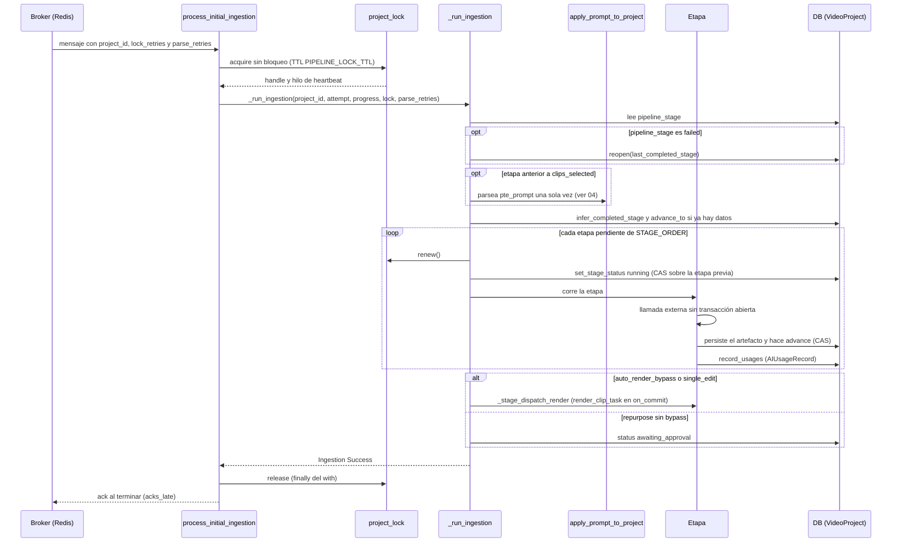
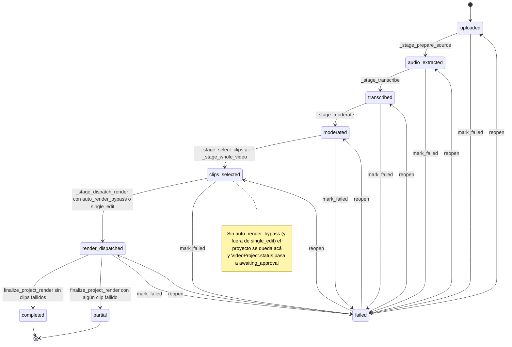
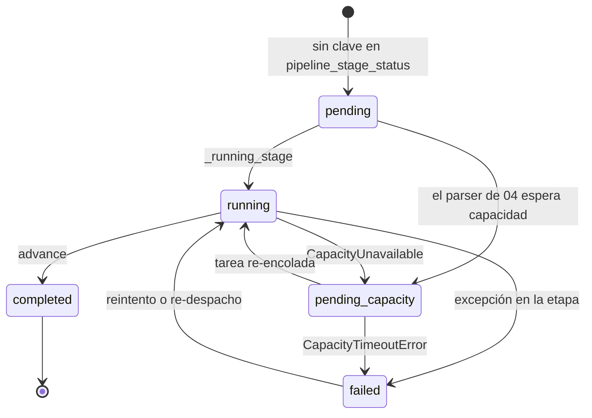
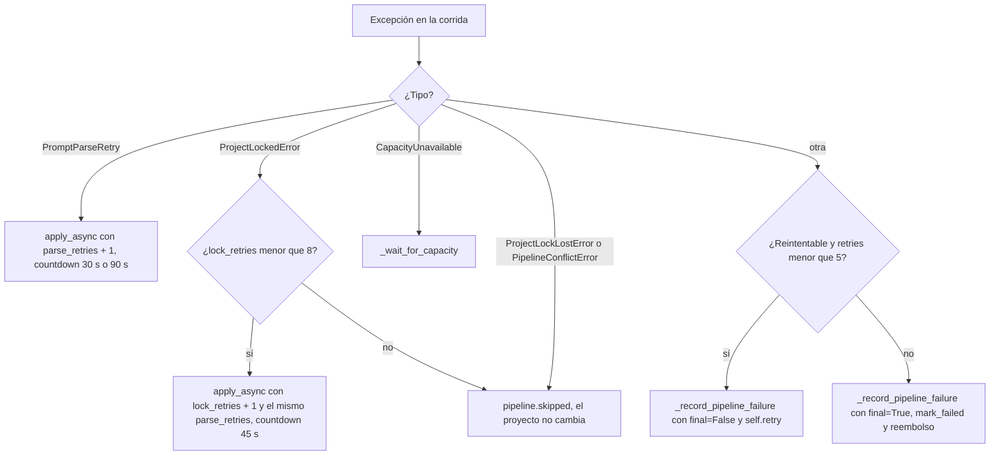
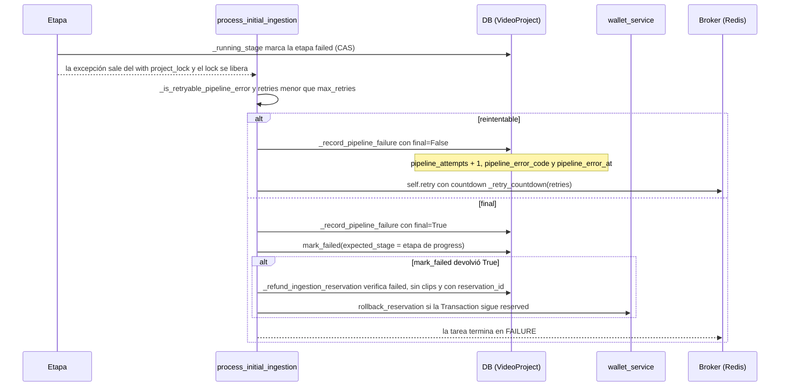

# Pipeline de ingesta

`process_initial_ingestion` lleva un proyecto desde el video subido hasta los clips sugeridos (y, con `auto_render_bypass`, hasta el despacho del render). Un proyecto "Editar el video completo" (`project_type=single_edit`) no pasa por la selección: el video entero es su único clip y se renderiza sin revisión. Corre en Celery apenas se crea el proyecto y cada vez que alguien lo re-despacha. Está armado para sobrevivir a reintentos, re-entregas y workers muertos sin repetir llamadas pagas: cada etapa guarda su resultado antes de avanzar, las transiciones son compare-and-set y un lock en Redis impide que dos workers procesen el mismo proyecto. Este documento cubre la tarea, la máquina de etapas, los reintentos, la espera de capacidad y el fallo final con reembolso. Lo que pasa dentro de cada etapa de IA está en [03-transcripcion-moderacion-seleccion](03-transcripcion-moderacion-seleccion.md).

## Componentes

| Componente | Archivo | Rol |
|------------|---------|-----|
| `process_initial_ingestion` | [tasks/ingestion.py](../../back/apps/videos/tasks/ingestion.py) | Tarea Celery. Toma el lock, corre `_run_ingestion` y decide qué hacer con cada excepción (reintento, re-encolado, espera o fallo final) |
| `_run_ingestion` | [tasks/ingestion.py](../../back/apps/videos/tasks/ingestion.py) | Lee la etapa actual, reabre un proyecto `failed`, parsea el prompt y corre las etapas que faltan en orden |
| `_running_stage` | [tasks/ingestion.py](../../back/apps/videos/tasks/ingestion.py) | Context manager que marca el estado de la etapa (`running`, `failed`, `pending_capacity`) y loguea inicio y fin |
| `_stage_prepare_source`, `_stage_transcribe`, `_stage_moderate`, `_stage_select_clips`, `_stage_whole_video`, `_stage_dispatch_render` | [tasks/ingestion.py](../../back/apps/videos/tasks/ingestion.py) | Una función por etapa. Cada una persiste su artefacto antes de avanzar (transcripción, moderación, selección y despacho lo hacen en la misma transacción que el `advance`) |
| `_resume_render_dispatch` | [tasks/ingestion.py](../../back/apps/videos/tasks/ingestion.py) | Vuelve a encolar los clips `draft` de un proyecto que quedó en `render_dispatched` |
| `_record_pipeline_failure`, `_refund_ingestion_reservation`, `_work_already_done` | [tasks/ingestion.py](../../back/apps/videos/tasks/ingestion.py) | Registro del fallo, fallo final y devolución de la reserva de tokens |
| `_wait_for_capacity` | [tasks/ingestion.py](../../back/apps/videos/tasks/ingestion.py) | Re-encola la tarea cuando no hay capacidad del proveedor, o falla el proyecto si la espera supera el máximo |
| `_is_retryable_pipeline_error`, `_retry_countdown`, `_merge_metadata`, `_persist_then_record_usage` | [tasks/shared.py](../../back/apps/videos/tasks/shared.py) | Política de reintentos, backoff, escritura de `metadata` sin pisar claves y escritura de las filas de uso después de persistir |
| `PipelineStage`, `StageStatus`, `advance`, `advance_to`, `mark_failed`, `reopen`, `set_stage_status`, `last_completed_stage`, `infer_completed_stage` | [services/ai/pipeline_state.py](../../back/apps/videos/services/ai/pipeline_state.py) | Máquina de estados: tabla de transiciones y escrituras compare-and-set |
| `project_lock`, `ProjectLockHandle.renew`, `ProjectLockedError`, `ProjectLockLostError` | [services/ai/project_lock.py](../../back/apps/videos/services/ai/project_lock.py) | Lock distribuido por proyecto en Redis, con TTL y heartbeat |
| `AIError` y subclases, `is_retryable_error`, `is_task_time_limit` | [services/ai/errors.py](../../back/apps/videos/services/ai/errors.py) | Separan errores reintentables de los deterministas |
| `v2_enabled_for` | [services/ai/rollout.py](../../back/apps/videos/services/ai/rollout.py) | Decide por proyecto si sus etapas de IA corren en V2 o en legacy |
| `process_video_pipeline` | [tasks/ingestion.py](../../back/apps/videos/tasks/ingestion.py) | Orquestador que solo delega en `process_initial_ingestion`. Lo dispara `wallet_service.reserve_funds` cuando recibe `project_id`; las vistas de creación no se lo pasan y encolan `process_initial_ingestion` directo |

## Flujo: una corrida de la tarea

1. La tarea se declara con `bind=True`, `max_retries=PIPELINE_MAX_RETRIES` (5), `acks_late=True`, `reject_on_worker_lost=True`, `soft_time_limit=PIPELINE_SOFT_TIME_LIMIT` y `time_limit=PIPELINE_TIME_LIMIT`. Los límites se leen de `settings` al importar el módulo. `attempt` es `self.request.retries + 1` y solo se usa en los logs.
2. `project_lock` toma la clave `lock:pipeline:project:<id>` sin bloquear. Si está tomada lanza `ProjectLockedError`; si Redis no responde lanza `RetryableAIError` (`provider="redis"`), que sigue el camino de los errores reintentables. Un hilo de heartbeat renueva el TTL cada `TTL / 3`.
3. `_run_ingestion` guarda en `progress['stage']` la etapa que cree que tiene el proyecto. Los handlers de error usan ese valor para escribir solo si el proyecto sigue ahí.
4. Si el proyecto está `failed` (re-despacho manual), `last_completed_stage` busca la última etapa `completed` y `reopen` lo mueve ahí, limpia `pipeline_error_code` y `pipeline_error_at`, y pone `status` en `ingesting` (o `rendering` si reabre en `render_dispatched`).
5. En `completed` o `partial` no hace nada. En `render_dispatched` renueva el lock y llama a `_resume_render_dispatch`.
6. Antes de `clips_selected` corre `apply_prompt_to_project` con `can_retry=parse_retries < PTE_PARSE_MAX_RETRIES` y la capacidad del parser reservada bajo la etapa que sigue. Es idempotente: un proyecto sin prompt o ya parseado no se toca. El detalle está en [04-prompt-to-edit](04-prompt-to-edit.md).
7. `infer_completed_stage` mira los datos persistidos (clips o `transcript_data`) de proyectos creados antes de la máquina de estados. Si están más adelante que `pipeline_stage`, `advance_to` avanza de a una transición hasta ahí, sin rehacer trabajo.
8. Mientras el proyecto está entre `uploaded` y `moderated`, `status` pasa a `ingesting`. Después corren las etapas en orden. Antes de cada una se llama a `lock.renew()`, que lanza `ProjectLockLostError` si el lock ya no es de este worker.
9. En `moderated`, un proyecto `single_edit` corre `_stage_whole_video` en lugar de `_stage_select_clips` (ver abajo). En `clips_selected`, con `auto_render_bypass` o en un proyecto `single_edit` se despacha el render (`_stage_dispatch_render`). Sin bypass, `status` pasa a `awaiting_approval` solo si estaba en `uploaded` o `ingesting`: una re-entrega no pisa una acción posterior del usuario.
10. El `with project_lock(...)` libera el lock en su `finally`, también cuando hay excepción. Los handlers de la tarea corren con el lock ya liberado.

## Flujo: máquina de etapas

`VideoProject.pipeline_stage` guarda la **última etapa terminada**. Las transiciones válidas están en `_TRANSITIONS` y `advance` las escribe con `UPDATE ... WHERE pipeline_stage = expected`: si otro worker ya avanzó, lanza `PipelineConflictError`.

| Transición | Quién la escribe | Qué deja persistido antes |
|------------|------------------|---------------------------|
| `uploaded` → `audio_extracted` | `_stage_prepare_source` | Fuente descargada (si vino por URL), `original_r2_key`, `proxy_r2_key` (opcional: si falla el proxy, sigue) y `metadata.duration` / `metadata.resolution` |
| `audio_extracted` → `transcribed` | `_stage_transcribe` | `transcript_data`, `metadata.full_text` y `metadata.transcription_usage`, en la misma transacción que el `advance` |
| `transcribed` → `moderated` | `_stage_moderate` | `metadata.moderation` |
| `moderated` → `clips_selected` | `_stage_select_clips` | Filas `VideoClip` en `draft`, `ai_rationale_log`, `metadata.selection_usage` y `metadata.selection_reasoning_effort` |
| `moderated` → `clips_selected` (`single_edit`) | `_stage_whole_video` | Una fila `VideoClip` en `draft` de `0` a `metadata.duration`, en la misma transacción que el `advance` |
| `clips_selected` → `render_dispatched` | `_stage_dispatch_render` | `status=rendering`. Los `render_clip_task` se encolan con `transaction.on_commit` |
| `render_dispatched` → `completed` / `partial` | `finalize_project_render` en [tasks/render.py](../../back/apps/videos/tasks/render.py) | Ver [06-render-caras-y-hablante](06-render-caras-y-hablante.md) |
| cualquiera → `failed` | `mark_failed`, llamado por `_record_pipeline_failure` con `final=True` | `pipeline_error_code` y `status=failed`. No toca `completed` ni `partial` |
| `failed` → etapa de `STAGE_ORDER` | `reopen`, en un re-despacho | La etapa que devuelve `last_completed_stage` |
| varias juntas | `advance_to` (proyectos viejos) | Camina de a una transición hasta lo que devuelve `infer_completed_stage` |

### Editar el video completo (`single_edit`)

Es la pantalla D5. `_is_whole_video` decide el camino: `project_type=single_edit` **y** `metadata.priced_duration_s`, que la vista de creación escribe solo para un archivo subido. Un `single_edit` sin ese dato (un link, un proyecto creado antes de este flujo o editado en el admin) nunca se cobró por un render entero, así que sigue el flujo de clips con revisión.

El proyecto pasa por las mismas etapas hasta `moderated`. Se transcribe (los subtítulos salen de ahí) y se modera igual, con una diferencia: si no hay habla (`AINoSpeechDetectedError`: música, gameplay, b-roll), `_persist_silent_transcript` guarda `transcript_data=[]`, `metadata.full_text=""` y `metadata.no_speech=true`, y sigue. La moderación revisa entonces solo el título, y el render sale sin subtítulos. En un proyecto de clips, sin habla sigue fallando: no hay de dónde elegir.

Después:

- `_stage_whole_video` crea un solo `VideoClip` de `0` a `metadata.duration` (la duración de MoviePy, la misma con la que corta el render), con el título del proyecto. Si falta, la mide con `_probe_video`. No llama al modelo de selección ni escribe filas de uso.
- `_check_whole_video_source` compara la duración con lo cobrado. Corre en `_stage_prepare_source`, apenas se mide la fuente y antes de transcribir, y otra vez en `_stage_whole_video`.
  - Si supera `priced_duration_s` + 1 s, lanza `WholeVideoSourceChangedError`: el archivo no es el que se cobró.
  - Si supera `AI_SINGLE_EDIT_MAX_DURATION_SECONDS` + 1 s, lanza `NonRetryableAIError` (`too_long`). Pasa con un proyecto largo de clips pasado a `single_edit` en el admin.
  - Una duración `0` también lanza `NonRetryableAIError`.
  - En todos los casos no hay clip, el proyecto falla y se reembolsa.
- Una re-entrega no crea otro clip: la etapa bloquea el proyecto y solo crea el clip si no hay ninguno.
- En `clips_selected` se despacha el render siempre, aunque `auto_render_bypass` esté apagado: no hay nada que revisar.
- **Cobro:** lo que se paga es el render, así que la reserva de creación no se cobra en `clips_selected`. Cada llamada a `finalize_project_render` corre `_settle_whole_video_reservation`, que decide por cómo terminó el proyecto y no por la transición. Así también liquida un proyecto que salió de `render_dispatched` por otro camino (marcado `failed` mientras renderizaba) o un worker que murió entre cerrar y cobrar.
  - Con el proyecto en `completed`, `partial` o `failed`: si un clip quedó `completed` o `published`, la cobra. Si sigue `rendering`, espera. Si no, la devuelve.
  - Antes de eso no toca nada.
  - La regla vive en `_whole_video_settlement` y la usa también `settle_stale_reservations` para las reservas de video completo que quedaron `RESERVED` ([07](07-capacidad-costos-y-operacion.md#operación-reservas-de-tokens-que-quedaron-reserved)).
- **Reembolso al fallar:** `_refund_ingestion_reservation` devuelve la reserva aunque exista el clip, salvo que esté `rendering` o `completed`.
- **Re-despacho:** la reserva tiene que seguir `reserved` (`_whole_video_is_paid`).
  - Al re-despachar un proyecto `failed` ya devuelto, no se reabre ni corre nada (`pipeline.redispatch_skipped`), y el proyecto conserva el código del error por el que falló. Así un override de moderación no crea un clip en un proyecto devuelto: hay que crear uno nuevo.
  - Antes de despachar el render y al reanudar en `render_dispatched`, `_ensure_whole_video_paid` lanza `WholeVideoNotPaidError` si ya no está reservada.
- **Mensajes de render que quedaron en la cola:** `render_clip_task` pregunta `_whole_video_render_allowed` antes de reclamar el clip y otra vez apenas lo reclama: el proyecto tiene que estar en `render_dispatched` y la reserva seguir `reserved`. Si no, marca el clip `failed`, llama a `finalize_project_render` y no renderiza (`render.skipped_unpaid`).
- **API:** el archivo de un video completo no se puede cambiar con un PATCH (400 en `source_file`). No tiene vista previa (409): su render real se despacha enseguida. Los campos `pipeline_*` son de solo lectura para cualquier proyecto.
- El precio de creación ya es el del video entero a su resolución, que es justo lo que se renderiza. No se cobra nada más.
- Solo se crea con un archivo subido de hasta `AI_SINGLE_EDIT_MAX_DURATION_SECONDS` (600 s por defecto). Ver [01](01-creacion-de-proyecto.md).

`last_completed_stage` tiene dos ajustes. Si `clips_selected` figura `completed` pero el proyecto no tiene clips, reanuda en `transcribed` para volver a correr la selección. Y si `moderated` no tiene estado pero `clips_selected` sí está `completed` (proyectos anteriores a la etapa de moderación), la saltea (`_predates_moderation`).

### Estado por etapa (`pipeline_stage_status`)

Además de la etapa, cada etapa de trabajo (`STAGE_ORDER` menos `uploaded`) tiene un estado en el JSON `pipeline_stage_status`. `set_stage_status` lo escribe con la fila bloqueada y, si recibe `expected_stage`, solo mientras el proyecto siga en esa etapa. Un estado `completed` nunca se degrada.

| Estado | Lo escribe | Cuándo |
|--------|------------|--------|
| `pending` | Nadie | Existe en `StageStatus`, pero ningún código lo escribe: una etapa sin clave en el JSON está pendiente |
| `running` | `_running_stage` | Al entrar a la etapa, guardado por la etapa anterior (`expected_stage`) |
| `completed` | `advance` | Al pasar a una etapa de trabajo (también en `reopen` y `advance_to`) |
| `failed` | `_running_stage`, `_wait_for_capacity` | Excepción dentro de la etapa, o espera de capacidad vencida |
| `pending_capacity` | `_running_stage`, `_run_ingestion` | `CapacityUnavailable` en la etapa o en el parser del prompt |

Si la excepción es una `PipelineStateError` (otro worker es dueño del proyecto), `_running_stage` no escribe nada: la etapa no falló.

## Flujo: fallo, reintentos y reembolso

La tarea reparte las excepciones así:

1. `_is_retryable_pipeline_error` decide. Un `AIError` respeta su `is_retryable`. Fuera de eso reintentan: `TimeoutError` y `ConnectionError`; una `ModerationError` con `retryable=True`; `OperationalError` e `InterfaceError` de Django; `ClientError` de R2 con HTTP 5xx, 408, 429 o un código de `_TRANSIENT_S3_ERROR_CODES`; un `S3UploadFailedError` de boto3 (lo que lanza `upload_file`), salvo que envuelva un `ClientError` que no reintenta (por ejemplo, `AccessDenied`); cualquier `BotoCoreError`; un `DownloadError` de yt-dlp sin ninguna marca de `_PERMANENT_DOWNLOAD_MARKERS`; errores del broker o de Redis; y un `OSError` que no sea de `_DETERMINISTIC_OS_ERRORS`. Todo lo demás es final, incluidos `UnsafeContentError`, `ImproperlyConfigured`, `ValueError` y `SoftTimeLimitExceeded`.
2. `_record_pipeline_failure` corre en **todo** fallo, se reintente o no: suma 1 a `pipeline_attempts` y guarda la clase del error en `pipeline_error_code` (`record_error`). Con `final=True` llama a `mark_failed(expected_stage=stage)`: si el proyecto ya no está en esa etapa (otro worker lo movió), no escribe nada.
3. `_retry_countdown(retries)` es backoff exponencial con "equal jitter": techo `min(30 × 2^retries, 600)` y espera entre la mitad del techo y el techo. Para los 5 reintentos: 15–30 s, 30–60 s, 60–120 s, 120–240 s y 240–480 s (entre ~8 y ~15 min en total).
4. Si el fallo final llega antes de leer el proyecto (`stage` es `None`, por ejemplo Redis caído al tomar el lock) y el proyecto ya está en `clips_selected` o más adelante (`_work_already_done`), no se lo marca `failed` (`pipeline.fail_skipped`).
5. Solo la llamada que efectivamente pasó el proyecto a `failed` (`mark_failed` devuelve `True`) llama a `_refund_ingestion_reservation`. El reembolso exige que el proyecto siga `failed`, que no tenga ningún `VideoClip` (en un video completo, ninguno `rendering` ni `completed`), que tenga `metadata.reservation_id` y que esa `Transaction` siga `reserved`. Nunca lanza: un error de pagos se loguea como `pipeline.refund_failed`. El ciclo de la reserva está en [01-creacion-de-proyecto](01-creacion-de-proyecto.md).

### Los tres contadores

| Contador | Dónde viaja | Lo incrementa | Tope | Al agotarse |
|----------|-------------|---------------|------|-------------|
| `self.request.retries` | En el mensaje de Celery. Los re-encolados por lock, parser y capacidad lo pasan con `retries=` | `self.retry` tras un error reintentable | `PIPELINE_MAX_RETRIES` = 5 | El error pasa a final: `mark_failed` y reembolso |
| `lock_retries` | kwarg de la tarea | Re-encolado por `ProjectLockedError` (cada `PIPELINE_LOCK_RETRY_SECONDS` = 45 s) | `PIPELINE_LOCK_MAX_RETRIES` = 8 | `pipeline.skipped`: se asume que un worker vivo tiene el proyecto. No falla ni cobra |
| `parse_retries` | kwarg de la tarea | Re-encolado por `PromptParseRetry` (30 s y después 90 s, `PTE_PARSE_RETRY_SECONDS`) | `PTE_PARSE_MAX_RETRIES` = 2 | `can_retry=False`: el parser guarda `pte.status=failed` y el proyecto sigue con su configuración |

Los tres son independientes: esperar el lock o reintentar el parser no gasta los reintentos de las etapas. `parse_retries` viaja en todos los re-encolados (lock, capacidad y parser), así que una espera nunca le devuelve reintentos al parser. El re-encolado por capacidad empieza `lock_retries` de nuevo en 0: el lock ya se había tomado. Ocho esperas de 45 s (360 s) superan el TTL del lock (300 s), así que el lock de un worker muerto vence antes de que se agoten. `pipeline_attempts` (en la DB) no es un presupuesto: cuenta fallos registrados y se usa como `attempt` en `AIUsageRecord` y para invalidar esperas de capacidad viejas.

## Flujo: espera de capacidad

Con `AI_CAPACITY_ENABLED=True`, cada llamada a Groq y al LLM reserva capacidad antes de salir. Si no hay lugar, `CapacityGate.reserve` lanza `CapacityUnavailable` con `wait_seconds` y la etapa. Los buckets están en [07-capacidad-costos-y-operacion](07-capacidad-costos-y-operacion.md); acá solo importa qué hace el pipeline.

1. `_running_stage` marca la etapa `pending_capacity` (si la espera viene del parser, la marca `_run_ingestion` sobre la etapa siguiente). La excepción sale del lock y el handler de la tarea llama a `_wait_for_capacity`.
2. `_wait_for_capacity` lee `metadata.capacity_wait`. Si es de otra etapa o de otro `pipeline_attempts` (`_is_current_wait`), empieza una espera nueva: `{stage, since, planned_s: 0.0, attempts}`.
3. Si `planned_s + wait_seconds` supera `AI_CAPACITY_MAX_WAIT_SECONDS`, loguea `pipeline.capacity_timeout`, marca la etapa `failed`, borra `capacity_wait` y llama a `_record_pipeline_failure` con `CapacityTimeoutError` y `final=True`: el proyecto queda `failed` y se reembolsa como cualquier fallo final.
4. Si no, `_capacity_countdown` calcula la demora (el déficit del bucket, entre 1 s y `AI_CAPACITY_MAX_COUNTDOWN_SECONDS`, más 0–20 % de jitter), la suma a `planned_s` y re-encola la tarea con `apply_async(countdown=..., retries=self.request.retries)`. No es un intento fallido: no toca `pipeline_attempts` ni escribe filas de uso, y el worker queda libre.
5. Cuando la reserva por fin entra, `_capacity_granted` borra `capacity_wait` y acumula los segundos esperados en `metadata.capacity_waited_s[<etapa>]` (log `pipeline.capacity_granted`).
6. Para el parser del prompt la regla cambia: si la espera vencería, `_prompt_capacity_exhausted` lo detecta, `give_up_prompt` guarda `pte.status=failed` con `CapacityTimeoutError` y el proyecto sigue sin el prompt, sin fallar.
7. Si estacionar la tarea falla (por ejemplo, la DB), ese error se trata como cualquier error de etapa: nunca queda un proyecto en `pending_capacity` sin mensaje en la cola.

## Flujo: re-entregas, idempotencia y re-despacho manual

Correr la tarea dos veces sobre el mismo proyecto es seguro. Las piezas:

| Mecanismo | Dónde | Qué evita |
|-----------|-------|-----------|
| `acks_late` + `reject_on_worker_lost` | Decorador de la tarea | Que un worker muerto por OOM (MoviePy, Whisper) pierda el mensaje: vuelve a la cola |
| Lock por proyecto con TTL y heartbeat | `project_lock` | Dos workers sobre el mismo proyecto. El TTL corto (300 s) solo define cuánto bloquea el lock de un worker muerto |
| Transiciones compare-and-set | `advance`, `mark_failed`, `set_stage_status` y `_merge_metadata` con `expected_stage` | Que un worker que perdió la carrera escriba sobre un proyecto que ya avanzó: recibe `PipelineConflictError` y termina con `pipeline.skipped` |
| Artefacto antes del avance | Cada `_stage_*` | Repetir trabajo pago: una etapa que falla reanuda en sí misma y las anteriores no se vuelven a correr. La transcripción no se recalcula si falla la selección |
| Claves de `metadata` de una sola escritura | `_WRITE_ONCE_METADATA_KEYS` (`duration`, `resolution`, `full_text`) | Que un worker lento o duplicado pise datos de la fuente |
| Chequeos de lo ya hecho | `original_r2_key`, `proxy_r2_key`, clips existentes, `metadata.pte` | Volver a subir a R2, duplicar clips o parsear otra vez el prompt |
| Render en `on_commit` y CAS por clip | `_stage_dispatch_render`, `_resume_render_dispatch`, `render_clip_task` | Encolar renders de una transición que no se confirmó; un clip encolado dos veces se renderiza una vez |
| `AIUsageRecord` solo de inserción | `record_usages` | Ocultar un segundo cobro: una ejecución repetida deja dos filas |
| Reembolso solo por quien falló el proyecto | `_record_pipeline_failure` | Devolver dos veces o devolver la reserva de un proyecto que otro worker sacó adelante |

**Re-entrega tras un worker muerto.** El mensaje vuelve a la cola (si muere todo el host, recién después de `visibility_timeout`, 4 h por defecto). Si la nueva entrega llega antes de que venza el TTL, encuentra el lock del muerto y se re-encola cada 45 s hasta que vence. Después retoma desde la última etapa terminada.

**Límite de tiempo.** El soft limit lanza `SoftTimeLimitExceeded`, que no es reintentable: el proyecto falla con ese código y el lock se libera, en vez de quedar renovado para siempre por un worker colgado. Los proveedores lo re-lanzan sin envolverlo (`is_task_time_limit`), así que nunca dispara un fallback ni un reintento. El hard limit solo mata a un worker que ignoró el soft.

**Re-despacho manual de un proyecto `failed`.** Encolar de nuevo `process_initial_ingestion` para un proyecto `failed` lo reabre en `last_completed_stage` y sigue desde ahí, con el presupuesto de reintentos completo. En el código, el único camino que lo hace es guardar un `ModerationOverride` en el admin (ver [03](03-transcripcion-moderacion-seleccion.md#override-de-moderación)). Si la reserva ya se devolvió al fallar, la tarea no reserva de nuevo.

**V2 o legacy por etapa.** No se decide una vez por proyecto: la transcripción y la selección llaman cada una a `v2_enabled_for(project)` cuando corren (`AI_CORE_V2_ENABLED` como kill switch y `AI_CORE_V2_ALLOWLIST` por usuario). Los settings se leen al arrancar el worker; después de reiniciarlo, el cambio aplica a la próxima etapa de un proyecto en curso, y cada fila de uso registra el camino que efectivamente corrió en `pipeline_version`. Detalle por etapa en [03](03-transcripcion-moderacion-seleccion.md).

## Errores, reintentos y casos borde

| Situación | Qué pasa | Dónde |
|-----------|----------|-------|
| Redis caído al tomar el lock | `RetryableAIError` → reintento con backoff. Nunca se procesa sin lock | `project_lock` |
| Lock tomado por otro worker | Re-encolado con `lock_retries` hasta 8 veces; después `pipeline.skipped` | `process_initial_ingestion` |
| Lock perdido a mitad de la corrida | El heartbeat loguea `pipeline.lock_lost`; el próximo `renew()` lanza `ProjectLockLostError` y la tarea termina con `pipeline.skipped` sin marcar fallo | `ProjectLockHandle.renew` |
| Error transitorio de Redis al renovar | Solo `pipeline.lock_renew_failed`: el TTL restante cubre unas renovaciones perdidas | `ProjectLockHandle.renew` |
| Otro worker avanzó el proyecto | `PipelineConflictError` → `pipeline.skipped`. Las filas de uso de la llamada ya cobrada se escriben igual | `advance`, `_persist_then_record_usage` |
| Transición fuera de la tabla | `InvalidTransitionError`: no es reintentable, falla el proyecto | `advance` |
| Error transitorio de proveedor, R2, DB o descarga | `self.retry` con backoff, hasta 5 veces | `_is_retryable_pipeline_error` |
| Error determinista (4xx, sin habla, contenido bloqueado, config) | Fallo final en el primer intento | `_is_retryable_pipeline_error` |
| Falla el proxy web | Se loguea y la ingesta sigue: el proxy es opcional | `_generate_proxy` |
| Selección sin clips | `AIEmptySelectionError`: el proyecto no avanza a `clips_selected`, falla y se reembolsa. Un re-despacho reanuda en `moderated` | `_stage_select_clips` |
| Bypass sin clips `draft` | `NonRetryableAIError` en el despacho | `_stage_dispatch_render` |
| Falla `.delay()` de un clip | El proyecto queda en `render_dispatched` y la próxima corrida (reintento o re-despacho) re-encola los `draft` con `_resume_render_dispatch` | `_stage_dispatch_render`, `_resume_render_dispatch` |
| Parser del prompt con error transitorio | `PromptParseRetry`, hasta 2 re-encolados; después sigue con la configuración del proyecto | `apply_prompt_to_project` |
| Sin capacidad | `pending_capacity` y re-encolado; `CapacityTimeoutError` al pasar `AI_CAPACITY_MAX_WAIT_SECONDS` | `_wait_for_capacity` |
| Soft time limit | `SoftTimeLimitExceeded`, fallo final, lock liberado | Decorador de la tarea |
| Fallo final antes de leer el proyecto, con clips ya elegidos | No se marca `failed` (`pipeline.fail_skipped`) | `_record_pipeline_failure` |
| Falla la escritura del estado de la etapa | `pipeline.status_write_failed`; se re-lanza el error original | `_running_stage` |
| Falla registrar el fallo en la DB | `pipeline.failure_not_recorded` y no hay reembolso en esa llamada | `_record_pipeline_failure` |
| Falla el reembolso | `pipeline.refund_failed`; nunca tapa el error original | `_refund_ingestion_reservation` |
| Proyecto `completed` o `partial` re-entregado | "Nothing to do" | `_run_ingestion` |

## Datos que escribe

**`VideoProject`**

- `pipeline_stage`, `pipeline_stage_status`, `pipeline_attempts`, `pipeline_error_code` (clase del error, hasta 100 caracteres) y `pipeline_error_at`.
- `status`: `ingesting`, `awaiting_approval`, `rendering` o `failed`.
- `source_file` (descarga por URL), `original_r2_key`, `proxy_r2_key`, `transcript_data` y `ai_rationale_log` (`suggestions_count`, `raw_ai_output`).

**Claves de `metadata`**

| Clave | Etapa | Contenido |
|-------|-------|-----------|
| `duration`, `resolution` | Fuente | Probe del video. Una sola escritura |
| `full_text` | Transcripción | Texto completo. Una sola escritura |
| `transcription_usage` | Transcripción | `ProviderUsage` de la llamada |
| `moderation` | Moderación | `outcome`, `latency_s`, `checked_at` (sin texto) |
| `selection_usage`, `selection_reasoning_effort` | Selección | Uso de la llamada y nivel de razonamiento enviado (`default` si no se envió) |
| `capacity_wait` | Espera de capacidad | `stage`, `since`, `planned_s`, `attempts`. Se borra al obtener capacidad o al vencer |
| `capacity_waited_s` | Espera de capacidad | Segundos esperados por etapa |
| `reservation_id` | Lo escribe la vista de creación | Se lee para el reembolso |

**`VideoClip`**: una fila `draft` por clip sugerido (ver [03](03-transcripcion-moderacion-seleccion.md)).

**`AIUsageRecord`**: filas de `transcription` y `selection` (y `prompt_parse`, ver [04](04-prompt-to-edit.md)). La columna `attempt` es el `pipeline_attempts` del momento: 0 en la primera corrida. Detalle en [03](03-transcripcion-moderacion-seleccion.md#datos-que-escribe) y costos en [07](07-capacidad-costos-y-operacion.md).

**Logs** (sin texto del usuario): `pipeline.started`, `pipeline.stage_started`, `pipeline.stage_completed`, `pipeline.stage_failed`, `pipeline.advanced`, `pipeline.failed`, `pipeline.fail_skipped`, `pipeline.mark_failed_skipped`, `pipeline.failure_not_recorded`, `pipeline.status_write_skipped`, `pipeline.status_write_failed`, `pipeline.refunded`, `pipeline.refund_skipped` (`reason=has_clips`, `no_reservation` o `not_reserved`), `pipeline.refund_failed`, `pipeline.lock_busy_retrying`, `pipeline.skipped`, `pipeline.lock_lost`, `pipeline.lock_renew_failed`, `pipeline.lock_not_owned`, `pipeline.lock_release_failed`, `pipeline.pending_capacity`, `pipeline.capacity_granted`, `pipeline.capacity_timeout`, `pipeline.render_redispatched`, `render.dispatch_failed`, `prompt_parse.retrying` y `prompt_parse.capacity_timeout`.

## Configuración

| Setting | Default | Efecto |
|---------|---------|--------|
| `PIPELINE_SOFT_TIME_LIMIT` | 7200 (2 h) | Soft limit de una corrida. Se lee al importar el módulo de tareas |
| `PIPELINE_TIME_LIMIT` | soft + 300 | Hard limit; mata al worker que ignoró el soft |
| `PIPELINE_LOCK_TTL` | 300 | TTL del lock. El heartbeat lo renueva cada TTL/3 |
| `CELERY_BROKER_TRANSPORT_OPTIONS['visibility_timeout']` (env `CELERY_VISIBILITY_TIMEOUT`) | 14400 (4 h) | Cuándo Redis re-entrega un mensaje sin ack. Debe superar los límites de tiempo y el TTL del lock |
| `REDIS_URL` | `redis://redis:6379/0` | Redis del lock (el mismo que el broker) |
| `AI_CORE_V2_ENABLED` | `False` | Master switch y kill switch de V2 |
| `AI_CORE_V2_ALLOWLIST` | `[]` | Usuarios (`uploaded_by`) con V2. Vacía = todos |
| `AI_CAPACITY_ENABLED` | `False` | Reserva de capacidad antes de cada llamada |
| `AI_CAPACITY_MAX_WAIT_SECONDS` | 3600 | Espera máxima por etapa antes de `CapacityTimeoutError` |
| `AI_CAPACITY_MAX_COUNTDOWN_SECONDS` | 300 | Tope de cada re-encolado por capacidad |

Constantes del código (no son settings): `PIPELINE_MAX_RETRIES` = 5, `PIPELINE_RETRY_BASE_SECONDS` = 30, `PIPELINE_RETRY_CAP_SECONDS` = 600, `PIPELINE_LOCK_RETRY_SECONDS` = 45, `PIPELINE_LOCK_MAX_RETRIES` = 8 ([tasks/shared.py](../../back/apps/videos/tasks/shared.py); los dos del lock los usa también el render del paper edit); `PTE_PARSE_MAX_RETRIES` = 2, `PTE_PARSE_RETRY_SECONDS` = (30, 90) ([tasks/ingestion.py](../../back/apps/videos/tasks/ingestion.py)). `CELERY_WORKER_PREFETCH_MULTIPLIER` = 1 en `settings/base.py`.

## Referencias

- [ADR-008: Transcripción remota con Groq Whisper](../adrs/008-groq-whisper-migration.md): sin fallback silencioso a Whisper local; errores tipados que decide Celery.
- [ADR-011: Moderación de contenido](../adrs/011-content-moderation.md): D-M4 (sin modo degradado, reintentos del pipeline) y D-M5 (reembolso del proyecto bloqueado).
- [ADR-012: Perfiles de modelos y capacidad](../adrs/012-model-profiles-and-capacity.md): D-C4, espera de capacidad y `CapacityTimeoutError`.
- [Runbook del piloto](../runbooks/ai-core-pilot-runbook.md): §5.5 (rate limiting propio), §6 (fallo inducido y códigos deterministas), §7 (rollback).
- Issues: [#60](https://github.com/RomeKai/videoeditUTN/issues/60) (AICORE-11, capacidad), [#65](https://github.com/RomeKai/videoeditUTN/issues/65) (etapa de moderación y reembolso), [#70](https://github.com/RomeKai/videoeditUTN/issues/70) (AICORE-18, separación de las tareas y `lock_retries`), [#73](https://github.com/RomeKai/videoeditUTN/issues/73) (PTE-01b, parser en la ingesta).
