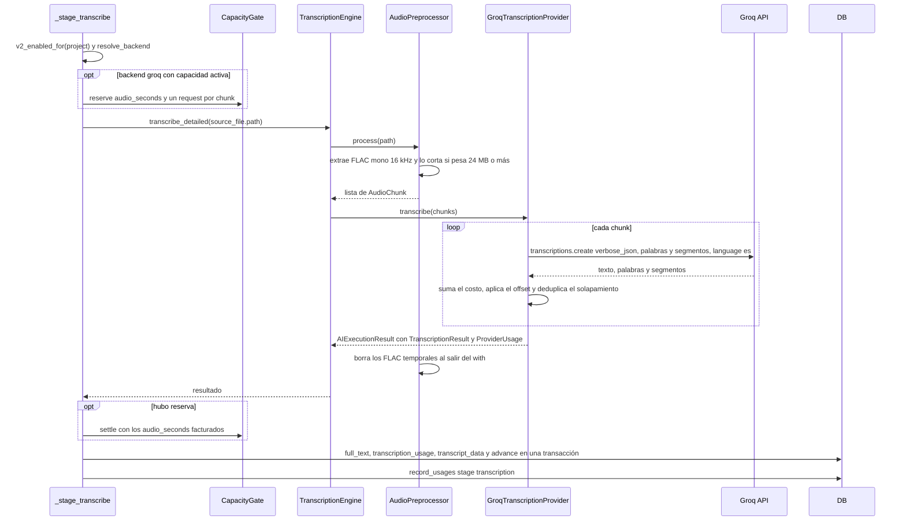
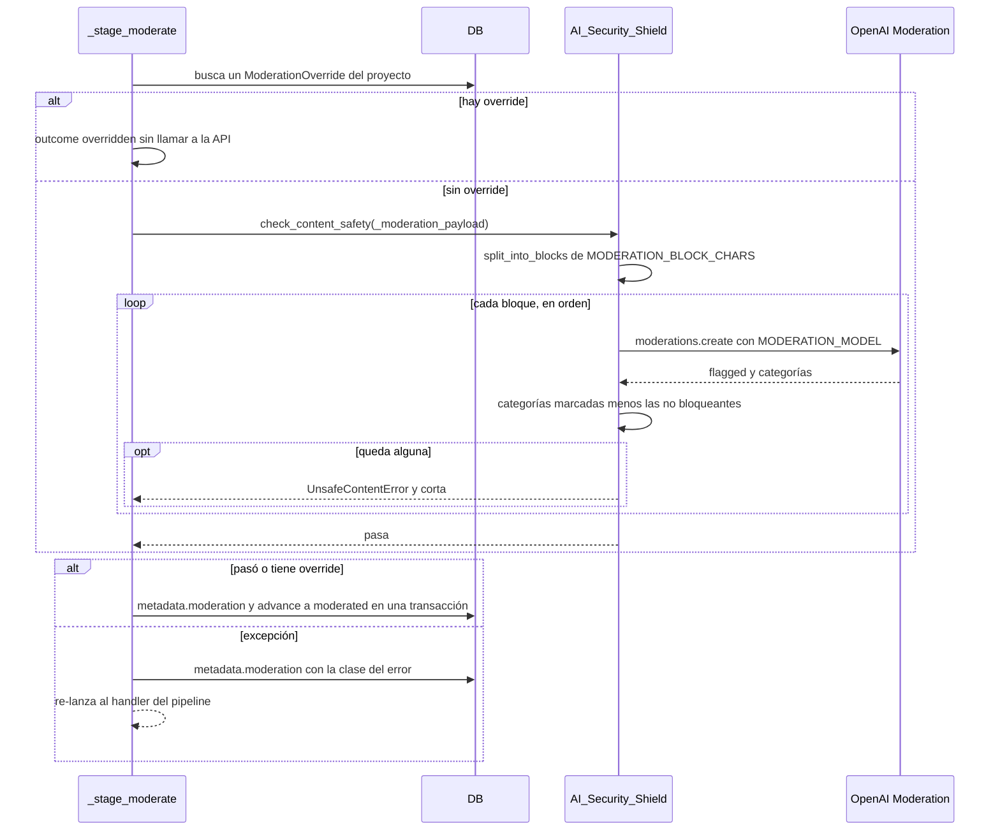
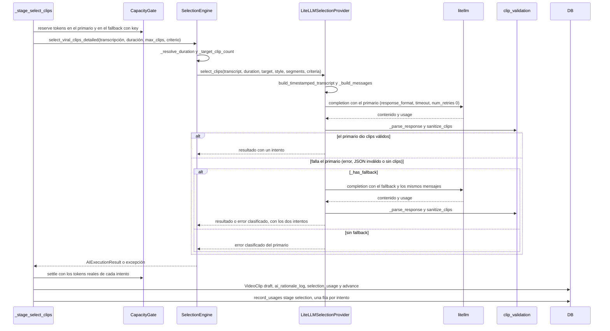
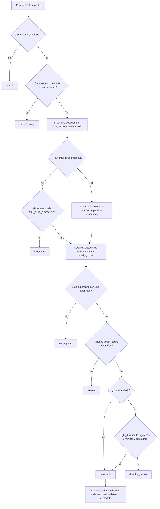

# Transcripción, moderación y selección de clips

Las tres etapas de IA del [pipeline de ingesta](02-pipeline-de-ingesta.md) corren en este orden, una vez por proyecto: la transcripción convierte el audio en palabras con tiempos, la moderación revisa ese texto y el del usuario antes de pagar el LLM, y la selección le pide al LLM los clips y los valida contra la línea de tiempo real. Cada etapa guarda su resultado antes de avanzar, así que un reintento de la selección no vuelve a transcribir ni a moderar. Este documento explica qué pasa dentro de cada etapa, cuándo corre V2 o legacy y qué filas de uso deja. El lock, los reintentos y el fallo final están en [02](02-pipeline-de-ingesta.md).

## Componentes

| Componente | Archivo | Rol |
|------------|---------|-----|
| `_stage_transcribe`, `_stage_moderate`, `_moderation_payload`, `_stage_select_clips` | [tasks/ingestion.py](../../back/apps/videos/tasks/ingestion.py) | Las tres etapas: deciden el camino, reservan capacidad, llaman al servicio, persisten y escriben las filas de uso |
| `TranscriptionEngine` (`resolve_backend`, `transcribe_detailed`) | [services/transcription_engine.py](../../back/apps/videos/services/transcription_engine.py) | Fachada de transcripción: Groq (V2) o Whisper local (legacy). Sin fallback entre ellos |
| `AudioPreprocessor` | [services/ai/audio_preprocessor.py](../../back/apps/videos/services/ai/audio_preprocessor.py) | Extrae FLAC mono 16 kHz y lo corta en ventanas con solapamiento |
| `GroqTranscriptionProvider` | [services/ai/groq_transcription.py](../../back/apps/videos/services/ai/groq_transcription.py) | Llama a Groq por chunk, corrige offsets, deduplica las uniones y clasifica errores |
| `AI_Security_Shield` (`check_content_safety`, `isolate_user_input`), `ModerationError`, `UnsafeContentError` | [core/security.py](../../back/apps/core/security.py) | Moderación por bloques con la Moderation API de OpenAI y aislamiento del texto del usuario en los prompts |
| `ModerationOverride`, `ModerationOverrideAdmin` | [models.py](../../back/apps/videos/models.py), [admin.py](../../back/apps/videos/admin.py) | Liberación manual de un proyecto bloqueado y re-despacho |
| `SelectionEngine` (`select_viral_clips`, `select_viral_clips_detailed`, `_select_legacy`) | [services/selection_engine.py](../../back/apps/videos/services/selection_engine.py) | Fachada de selección: proveedor V2 o selector legacy de una llamada |
| `LiteLLMSelectionProvider`, `classify_llm_error` | [services/ai/litellm_selection.py](../../back/apps/videos/services/ai/litellm_selection.py) | Selección V2: prompt, llamada con salida estructurada, primario y fallback, uso de tokens |
| `reasoning_effort_setting`, `reasoning_kwargs`, `apply_litellm_defaults` | [services/ai/llm_options.py](../../back/apps/videos/services/ai/llm_options.py) | Tope de razonamiento del modelo, solo para modelos que razonan |
| `provider_for_model`, `resolve_api_key` | [services/ai/llm_credentials.py](../../back/apps/videos/services/ai/llm_credentials.py) | Proveedor y key por prefijo del modelo, pasada en cada llamada |
| `build_timestamped_transcript` | [services/ai/transcript_formatter.py](../../back/apps/videos/services/ai/transcript_formatter.py) | Transcript en líneas `[START-END] texto` |
| `sanitize_clips`, `ClipRules`, `word_timeline` | [services/ai/clip_validation.py](../../back/apps/videos/services/ai/clip_validation.py) | Validación de cada clip, bordes por palabra y duración objetivo |
| `normalize_selection_criteria` | [services/ai/selection_criteria.py](../../back/apps/videos/services/ai/selection_criteria.py) | Limpia el criterio de selección del usuario |
| `record_usages`, `usages_for_success`, `usages_for_failure` | [services/ai/usage_recorder.py](../../back/apps/videos/services/ai/usage_recorder.py) | Filas de `AIUsageRecord` |

## Flujo: transcripción

1. `v2_enabled_for(project)` decide el camino del proyecto y `TranscriptionEngine.resolve_backend` lo traduce: sin V2 corre `local`; con V2 corre lo que diga `TRANSCRIPTION_BACKEND` (`groq` por defecto). Un valor inválido lanza `ImproperlyConfigured`. El `pipeline_version` de las filas sale del backend que corre: `v2` con Groq y `legacy` con Whisper local, aunque el proyecto tenga V2.
2. Con Groq y `AI_CAPACITY_ENABLED`, se reserva `metadata.duration` en `audio_seconds` y un request por ventana de 598 s (`WINDOW_DURATION_SECONDS - OVERLAP_SECONDS`) bajo la clave `groq/<modelo>`.
3. `GroqTranscriptionProvider` exige `GROQ_API_KEY`: sin key lanza `AIAuthenticationError`, que no se reintenta. No hay fallback a Whisper local (ADR-008): cargarlo en un worker que renderiza es la forma más rápida de un OOM.
4. Cada chunk va a Groq con el modelo `AI_DEFAULT_TRANSCRIPTION_MODEL`, `response_format="verbose_json"`, granularidad de palabra y de segmento y `language="es"`. El cliente se crea con `timeout=httpx.Timeout(AI_TRANSCRIPTION_TIMEOUT_SECONDS, connect=5)` y `max_retries=0`. El SDK no reintenta por su cuenta: también reintentaría un timeout, volviendo a subir un chunk que Groq pudo haber cobrado, y sus intentos no se ven en las filas de uso ni en la capacidad. Un timeout llega como `APITimeoutError` y se clasifica `AITimeoutError` (reintentable por Celery, cobro incierto).
   - **Reintentos por chunk.** `_send_chunk` reintenta un mismo chunk hasta 2 veces más (`_CHUNK_EXTRA_ATTEMPTS`) ante un 429 (espera `retry_after`, como mucho 60 s), una respuesta 5xx o un error de conexión (espera 2 s y después 5 s), y registra `transcription.chunk_retry`. Un timeout al conectar o al esperar una conexión libre (`httpx.ConnectTimeout`, `httpx.PoolTimeout`), igual que una conexión rechazada (`httpx.ConnectError`), es `AIConnectionNotEstablishedError`: se reintenta en el chunk. Nunca ante un timeout de lectura, un rechazo 4xx o un error inesperado (`AIUnexpectedProviderError`, por ejemplo una respuesta que no se puede decodificar). Sin esto, un error pasajero en el chunk k hacía fallar toda la transcripción y el reintento de Celery volvía a mandar y a pagar los chunks 0 a k-1.
   - Un 429, un 5xx o una conexión que nunca se estableció no cobran, así que no cambian el uso. Un error de conexión reintentado después de mandar el pedido pudo haber cobrado: desde ahí el costo de la transcripción queda `None` (desconocido), como después de un timeout. Un error inesperado después de una respuesta también deja el costo en `None`: Groq pudo haber respondido y cobrado.
5. `_stage_transcribe` guarda en `transcript_data` las **palabras** (`start`, `end`, `text`); solo si no hay palabras guarda los segmentos. Esa lista es la que después usa la selección para anclar los clips.

### Chunks, uniones y segundos facturados

- **Corte.** `AudioPreprocessor.process` extrae el audio con `FFmpegManager.extract_flac_audio`. Si el FLAC pesa menos de 24 MB (`MAX_SINGLE_CHUNK_SIZE_BYTES`) va entero. Si no, `calculate_windows` lo corta en ventanas de 600 s que se solapan 2 s. Los archivos temporales se borran en el `finally`, también si Groq falla.
- **Offset.** Los tiempos de cada chunk se corren por su `start_time` (`_apply_offset`).
- **Uniones.** En el solapamiento los dos chunks transcriben lo mismo. El corte es el punto medio del solapamiento: del chunk anterior quedan las palabras que empiezan antes y del nuevo las que empiezan después. Si la última palabra que quedó del anterior termina dentro del solapamiento, el nuevo chunk retoma desde ese final (`resume_at`), para no perder una palabra que los dos timearon distinto. Los segmentos se cortan por su punto medio. Con más de un chunk, `full_text` es la unión de las palabras deduplicadas, no de los textos crudos.
- **Silencio.** Un chunk sin texto ni palabras se saltea (`transcription.chunk_without_speech`) y no se deduplica contra él. Si ningún chunk tiene habla, `AINoSpeechDetectedError` (no reintentable): nunca se seleccionan clips sobre un transcript vacío.
- **Facturación.** Un chunk cuenta como cobrado apenas Groq responde, antes de parsearlo. El costo es la suma de `estimate_asr_cost` por chunk, que aplica el mínimo facturable por request de la tabla de precios (ver [07](07-capacidad-costos-y-operacion.md)). `audio_seconds` es la suma de la duración de cada chunk enviado, así que los 2 s de cada solapamiento cuentan dos veces. Un chunk sin precio deja el costo en `None`.
- **Fallo a mitad.** Si algo falla después de cobrar al menos un chunk, el provider cuelga del error original un `usage_attempts` con lo cobrado y lo re-lanza sin cambiar su tipo. Si el fallo fue un timeout de lectura, un corte de conexión o un error inesperado, o si antes se reintentó un chunk después de un corte de conexión, el costo queda `None` (`is_billing_uncertain`). Una conexión que nunca se estableció no lo cambia.

| Error de Groq | Clase | ¿Reintenta? |
|---------------|-------|-------------|
| 401, 403 | `AIAuthenticationError` | No |
| 429 | `AIRateLimitError` (guarda `retry_after`: lo usa el reintento del chunk; el pipeline aplica su propio backoff) | Sí: hasta 2 veces el mismo chunk, después Celery |
| Otro 4xx salvo 408, 409, 425 | `AIInvalidRequestError`, `AIQuotaExceededError` (402) o `AIContentFilterError` | No |
| 5xx | `AIServerError` | Sí: hasta 2 veces el mismo chunk, después Celery |
| Error desconocido (por ejemplo, una respuesta 200 que no se puede decodificar) | `AIUnexpectedProviderError` (cobro incierto) | Sí, solo Celery |
| Timeout de lectura | `AITimeoutError` | Sí, solo Celery (el chunk pudo haberse cobrado) |
| Timeout al conectar o esperando el pool, conexión rechazada | `AIConnectionNotEstablishedError` (no cobra) | Sí: hasta 2 veces el mismo chunk, después Celery |
| Conexión u `OSError` | `AIConnectionError` | Sí: hasta 2 veces el mismo chunk, después Celery |
| Respuesta que no se puede parsear | `AIContractValidationError` | No |
| `SoftTimeLimitExceeded` | Se re-lanza sin envolver | No |

### Camino legacy: Whisper local

Con `backend=local`, `_stage_transcribe` usa el tamaño `base`. El modelo se carga recién en la primera llamada (`whisper.load_model`, en CUDA si hay, si no en CPU) y transcribe con `fp16=False` y tiempos por palabra. El resultado se arma con el mismo contrato (`TranscriptionResult`) y un `ProviderUsage` con `provider="local"`, `model="whisper-base"` y costo `0.0`: la inferencia local no tiene cargo. Un texto vacío también lanza `AINoSpeechDetectedError`.

## Flujo: moderación

1. `_moderation_payload` junta, separados por salto de línea, todo lo que llega al LLM de selección y no es nuestro: `title`, `metadata.selection_criteria` y el transcript (`metadata.full_text`, o los textos de `transcript_data`). El texto crudo de `metadata.pte_prompt` no entra; sí entra el `selection_criteria` que el parser haya aplicado.
2. `check_content_safety` falla cerrado. Sin `OPENAI_API_KEY` lanza `ModerationBlockedError` antes de llamar. El cliente se crea con `timeout=MODERATION_TIMEOUT_SECONDS` y `max_retries=0`: los reintentos son de Celery. Un payload vacío pasa sin llamar.
3. El texto se corta en bloques de hasta `MODERATION_BLOCK_CHARS` caracteres, en espacios, y se revisan en orden. El veredicto es por categoría: las de `MODERATION_NON_BLOCKING_CATEGORIES` (`harassment`, `violence`, `self-harm`, `illicit`) solo se miden; cualquier otra marcada bloquea, incluidas las que la API agregue. Un `flagged` sin categorías cuenta como `unclassified` y bloquea. Los nombres se normalizan (`self-harm/intent` y `self_harm_intent` son iguales).
4. Si no hay veredicto, `_classify_moderation_failure` mira el status HTTP. Una respuesta con forma inesperada (por ejemplo, `flagged` que no es bool) se trata como falta de veredicto, nunca como "seguro".
5. `_stage_moderate` guarda solo el resultado y la latencia (`metadata.moderation`), nunca texto. Si la moderación falla, guarda la clase del error en `outcome` y re-lanza: el pipeline decide reintentar o fallar con reembolso ([02](02-pipeline-de-ingesta.md#flujo-fallo-reintentos-y-reembolso)). La moderación no escribe filas de `AIUsageRecord`.

| Resultado | Excepción (`code`) | ¿Reintenta? | `moderation.outcome` y `pipeline_error_code` | Reembolso |
|-----------|--------------------|-------------|-----------------------------------------------|-----------|
| Ninguna categoría bloqueante | — | — | `passed` | — |
| Hay `ModerationOverride` | — | — | `overridden` | — |
| Contenido bloqueado | `UnsafeContentError` | No | `UnsafeContentError` | Sí, el proyecto no tiene clips |
| Sin veredicto transitorio: timeout, conexión, 5xx, 408, 409, 429 sin `insufficient_quota`, respuesta inválida | `ModerationUnavailableError` (`moderation_unavailable`) | Sí, con el backoff del pipeline | `ModerationUnavailableError` | Solo si se agotan los reintentos |
| Sin key u otro 4xx | `ModerationBlockedError` (`moderation_misconfigured`) | No | `ModerationBlockedError` | Sí |
| 429 con `insufficient_quota` | `ModerationBlockedError` (`moderation_quota`) | No | `ModerationBlockedError` | Sí |

### Override de moderación

`ModerationOverride` es un registro de auditoría: proyecto, `created_by` y `reason` obligatorio. En el admin se crea pero no se edita ni se borra. `ModerationOverrideAdmin.save_model` guarda al admin que lo crea y, si el proyecto está en `failed`, guarda una cadena nueva en `metadata['ingestion_chain']` y encola `process_initial_ingestion` con esa cadena, con `transaction.on_commit`: solo ese mensaje reabre el proyecto ([02](02-pipeline-de-ingesta.md#cadenas-de-mensajes)). La cadena se guarda solo si el proyecto sigue `failed`: si un re-despacho lo reabrió mientras tanto, no se encola nada y el admin avisa que ya no está en FAILED. Uno que falló con `IngestionStuck` también se re-encola, y el admin avisa que corre sin volver a cobrar: su reserva se había devuelto. La corrida reabre el proyecto en `transcribed` (la última etapa completa), `_stage_moderate` encuentra el override, guarda `outcome=overridden`, loguea `pipeline.moderation_overridden` y avanza sin llamar a la API. Si el proyecto no está `failed`, el override queda registrado y no se re-encola nada. Tampoco con `pipeline_error_code=IngestionNotQueued`: la creación lo devolvió porque no pudo encolar su ingesta y el pipeline no lo reabre nunca, así que el admin avisa que no se re-encola y que el usuario tiene que crearlo de nuevo ([01](01-creacion-de-proyecto.md)).

## Flujo: selección de clips

Un proyecto `single_edit` no pasa por esta etapa: `_stage_whole_video` crea un solo clip con el video entero (ver [02](02-pipeline-de-ingesta.md)).

1. `_stage_select_clips` arma los datos: `full_text`, `duration` (si falta en `metadata`, la mide con `_probe_video`), `resolution`, los `segments` de `transcript_data`, el título, el `editing_style`, `metadata.max_clips` y `metadata.selection_criteria`. Llama a `v2_enabled_for(project)` y guarda en `selection_effort` el nivel de razonamiento que de verdad se envía al primario (`default` si no se envía ninguno).
2. **V2.** `_reserve_selection` reserva en el primario y, si es otro modelo con key, en el fallback. Después de la llamada, `settle` ajusta con los tokens reales de cada intento y devuelve lo del modelo que no se usó; un intento con cobro incierto (timeout o corte de conexión) conserva su reserva. `SelectionEngine.select_viral_clips_detailed` resuelve la duración (la del video; si falta, el final del transcript; si tampoco hay, `ValueError`) y la cantidad objetivo: 1 clip bajo 2 min, 2 bajo 5, 4 bajo 15, 8 bajo 30 y 12 desde ahí (3 sin duración), bajada a `max_clips` si el usuario pidió menos.
3. `LiteLLMSelectionProvider` toma el primario de `AI_DEFAULT_LLM_MODEL` y el fallback de `AI_FALLBACK_LLM_MODEL`. Valida `AI_LLM_REASONING_EFFORT` al construirse (un valor inválido lanza `ImproperlyConfigured` antes de pagar), apaga el caché de respuestas de LiteLLM (`litellm.cache = None`) y no pide resúmenes de razonamiento a Gemini (`apply_litellm_defaults`).
4. **Llamada.** `_call_llm` resuelve la key del proveedor por el prefijo del modelo (`gemini/`, `openai/`, `groq/`, `xai/`; sin prefijo es OpenAI) y la pasa en la llamada: nunca toca `litellm.api_key`. Llama con temperatura 0.1, `timeout=AI_LLM_TIMEOUT_SECONDS`, `num_retries=0` y, si el modelo razona según LiteLLM, `reasoning_effort`. La salida estructurada depende del proveedor: `json_schema` no estricto para OpenAI, `json_object` con `response_schema` para Gemini y `json_object` para el resto, con el esquema generado de `ClipSelectionResult`. Si el proveedor rechaza el pedido por el esquema, repite una vez con `json_object`.
5. **Fallback.** Cualquier fallo del primario, salvo `SoftTimeLimitExceeded`, prueba el fallback una vez si `_has_fallback`: tiene que ser otro modelo y tener key. El error que sale es el clasificado del **último** intento, así que si el primario dio `AIEmptySelectionError` y el fallback un 429, la etapa se reintenta. Cada intento queda en `attempts` (o en `usage_attempts` del error) con su `role`.
6. **Persistencia.** Con la fila bloqueada: si el proyecto no tiene clips, crea un `VideoClip` en `draft` por sugerencia (`title`, `start_time`, `end_time`, `virality_score` entero, `ai_reasoning`); si ya los tiene (intento anterior), no duplica. Una lista vacía lanza `AIEmptySelectionError`. Escribe `ai_rationale_log`, `metadata.selection_usage` y `metadata.selection_reasoning_effort` y avanza a `clips_selected`. `hook_text` y `hashtags` del modelo no se guardan.

### Prompt y aislamiento

- El transcript va como líneas `[START-END] texto` con dos decimales (`build_timestamped_transcript`). Una línea dura hasta 10 s y se corta antes si hay un silencio de más de 1,5 s o si termina una oración y ya lleva 3 s. Los `[` y `]` del texto pasan a paréntesis y los saltos de línea a espacios, para que el audio no pueda falsificar una línea. El total se corta en `AI_LLM_MAX_TRANSCRIPT_CHARS` (`transcript_formatter.truncated`).
- Todo lo que no es nuestro va entre `<user_input>` con `isolate_user_input`, que antes lo escapa con `html.escape`. El system prompt dice que ese contenido es dato y que no se siguen instrucciones que aparezcan ahí.
- Con líneas, el prompt exige que `start` sea el inicio de una línea y `end` el final de la misma u otra posterior. Sin líneas (transcript sin tiempos) se avisa `selection.ungrounded_transcript` y el modelo estima.
- Reglas del prompt: la cantidad objetivo, la duración de `AI_CLIP_MIN_SECONDS` a `AI_CLIP_MAX_SECONDS`, tiempos dentro de `[0, duración]`, sin superposición y el estilo de edición. El estilo solo pasa si es un slug de una palabra (`_safe_editing_style`); si no, va `dynamic`.
- **Criterio de selección (PTE-02).** `normalize_selection_criteria` lo deja en una línea de hasta 300 caracteres imprimibles. Va en su propio bloque `<user_input>` después del transcript, descripto como preferencia: elige qué momentos preferir, pero no cambia reglas, formato, cantidad ni límites. Sin criterio, el prompt es idéntico al anterior.
- El título del proyecto solo lo usa el selector legacy; el prompt V2 no lo incluye.

### Respuesta y uso de tokens

`_parse_response` saca los cercos de código, parsea JSON y acepta una lista suelta o las claves `viral_clips`, `moments`, `data`, `results` o `items`. Sin lista de clips lanza `AIContractValidationError`; si ningún clip sobrevive a la validación, `AIEmptySelectionError`. Los dos son no reintentables y los dos disparan el fallback.

`_extract_usage` arma el `ProviderUsage`:

- `prompt_tokens` y `completion_tokens` del `usage` de LiteLLM.
- `reasoning_tokens`: lo que el total del proveedor supera a prompt + completion (Gemini factura el razonamiento como salida, fuera de `completion_tokens`). Si esa diferencia es 0 y `completion_tokens_details.reasoning_tokens` trae un valor, se lo separa de `completion_tokens`. El total no cambia.
- `cache_read_tokens` de `cache_read_input_tokens` o de `prompt_tokens_details.cached_tokens`, y `cached=True` si es mayor que 0.
- `resolved_model`: el modelo que el proveedor dice haber usado. El costo lo calcula `estimate_llm_cost` ([07](07-capacidad-costos-y-operacion.md)).

### Validación de clips

`sanitize_clips` lo comparten V2 y legacy. Primero revisa cada candidato por separado; después los ordena por `virality_score` y decide superposición, cantidad y duración.

1. **Válido** es un `ViralClip`: números, título de 1 a 250 caracteres, `reasoning` no vacío, `virality_score` entre 0 y 100, `end > start` y un `start` finito.
2. **Modo anclado.** `word_timeline` arma la línea de tiempo solo si al menos el 90 % de los ítems de `transcript_data` no tienen espacios (son palabras). Un borde natural es la última palabra, un final de oración (`.`, `!`, `?`, `…`) o un silencio de al menos `AI_CLIP_PAUSE_SECONDS`. Sin palabras (segmentos o sin transcript) el único mínimo es `MIN_CLIP_SECONDS` = 1 s: el rango de 15 a 60 s queda solo como pedido en el prompt.
3. **Snap.** El inicio va al inicio de palabra más cercano y el fin al final de palabra más cercano si están a `AI_CLIP_SNAP_TOLERANCE_SECONDS` o menos. Si el borde cae dentro de una palabra, va al borde de esa palabra: nunca se corta una palabra.
4. **Duración** (`_fit_duration`), con mínimo `AI_CLIP_MIN_SECONDS` (o el tramo que cubren las palabras, si es menor: un video corto igual da un clip) y máximo `AI_CLIP_MAX_SECONDS`. Si es muy largo, el fin retrocede al último borde natural que respete el mínimo y el máximo (`trimmed`). Si es muy corto, el fin avanza al primer borde natural que alcance el mínimo o, si no, el inicio retrocede al inicio natural más cercano, siempre que no pise un clip de mayor puntaje (`extended`). Si nada sirve, se descarta (`duration_unmet`).
5. Solo se loguean conteos (`selection.clips_sanitized`), nunca títulos ni razonamientos.

### Camino legacy

Con V2 apagado para el proyecto, `_stage_select_clips` llama a `SelectionEngine.select_viral_clips(..., v2_enabled=False)` sin volver a leer el switch. `_select_legacy` usa `GeminiFlashStrategy` (el mismo `AI_DEFAULT_LLM_MODEL`) en una sola llamada `json_object`, sin fallback, con las mismas reglas de aislamiento, criterio, `reasoning_effort` y validación (`sanitize_clips`). Agrega el título aislado al prompt y completa `virality_score=0` y `reasoning="-"` si faltan. Los errores del proveedor pasan por `classify_llm_error`, así que reintenta lo mismo que V2. Una key ausente o una respuesta vacía lanzan `ValueError` (no reintentable). La reserva de capacidad es solo del primario y nunca se ajusta: la llamada legacy no informa tokens.

## Errores, reintentos y casos borde

| Situación | Qué pasa | Dónde |
|-----------|----------|-------|
| Audio sin habla | `AINoSpeechDetectedError`, sin reintento. Los chunks cobrados se registran igual. En un video completo no falla: sigue sin transcript ni subtítulos (ver [02](02-pipeline-de-ingesta.md)) | `GroqTranscriptionProvider.transcribe`, `_local_to_execution_result`, `_stage_transcribe` |
| Falta `GROQ_API_KEY` o el paquete `groq` | `AIAuthenticationError`, sin reintento ni fallback a local | `GroqTranscriptionProvider.__init__` |
| `TRANSCRIPTION_BACKEND` inválido | `ImproperlyConfigured`, sin reintento | `resolve_backend` |
| El archivo fuente no existe | `FileNotFoundError`, sin reintento | `TranscriptionEngine._ensure_exists`, `AudioPreprocessor.process` |
| Falla al persistir después de una llamada cobrada | Las filas de uso se escriben igual y el error sigue | `_persist_then_record_usage` |
| Moderación sin veredicto | Ver la tabla de resultados de moderación | `check_content_safety` |
| Falla guardar el resultado de la moderación fallida | `pipeline.moderation_outcome_not_recorded`; nunca tapa el error de moderación | `_stage_moderate` |
| Reintento después de una selección fallida | No se vuelve a transcribir ni a moderar: `moderated` ya está completa | `_run_ingestion` |
| `AI_LLM_REASONING_EFFORT` inválido | `ImproperlyConfigured` antes de cualquier llamada paga | `reasoning_effort_setting` |
| Modelo que no razona | No se envía `reasoning_effort` (`llm.reasoning_effort_skipped`) | `reasoning_kwargs` |
| Proveedor sin soporte de esquema | Una segunda llamada con `json_object` (`selection.schema_unsupported`) | `_call_llm` |
| Fallback sin key, igual al primario o vacío | No hay segundo intento (`selection.no_fallback`) | `_has_fallback` |
| Ningún clip válido en los dos modelos | `AIEmptySelectionError`, sin reintento; el proyecto falla y se reembolsa | `_parse_response`, `_stage_select_clips` |
| Error 401/403, 4xx o filtro de contenido del LLM | No reintentable. Con fallback, decide el error del último intento | `classify_llm_error` |
| 429, 5xx, timeout o conexión del LLM | Reintentable | `classify_llm_error` |
| `SoftTimeLimitExceeded` durante la llamada | Se re-lanza sin fallback ni reintento; el intento queda con costo `None` | `_attempt`, `select_clips` |
| Duración desconocida | Se usa el final del transcript; si tampoco hay, `ValueError` | `_resolve_duration` |
| Transcript más largo que el tope | Se corta y se loguea `transcript_formatter.truncated` | `build_timestamped_transcript` |
| Clips de un intento anterior | Se reusan, no se duplican | `_stage_select_clips` |

## Datos que escribe

**`VideoProject`**: `transcript_data` (palabras o segmentos con `start`, `end`, `text`), `ai_rationale_log` (`suggestions_count` y `raw_ai_output` con las sugerencias) y las claves de `metadata` `full_text`, `transcription_usage`, `moderation` (`outcome`, `latency_s`, `checked_at`), `selection_usage` y `selection_reasoning_effort`. Si faltaba, también `duration` y `resolution`.

**`VideoClip`**: una fila por sugerencia, en `draft`.

**`AIUsageRecord`**: una fila por intento ejecutado, solo de inserción. `attempt` es el `pipeline_attempts` del proyecto al escribirla; `success` es `error_code is None`; `error_code` es la clase del error, nunca su mensaje. Precios y export en [07](07-capacidad-costos-y-operacion.md).

| Etapa | `stage` | `pipeline_version` | Filas en éxito | Filas en fallo |
|-------|---------|--------------------|----------------|----------------|
| Transcripción con Groq | `transcription` | `v2` | 1, con el uso sumado de todos los chunks (`role=primary`) | Lo cobrado que trae el error, o una fila de 0 tokens con la latencia medida |
| Transcripción local | `transcription` | `legacy` | 1, `provider=local`, `model=whisper-base`, costo 0 | Una fila de 0 tokens |
| Moderación | — | — | Ninguna | Ninguna |
| Selección V2 | `selection` | `v2` | Una por intento: el primario fallido (`success=False`) y el que respondió, cada uno con su `role` (`primary` o `fallback`) | Una por intento, con `error_code` |
| Selección legacy | `selection` | `legacy` | 1, con costo `None`: la llamada se pagó pero no informa tokens | 1: costo `None` si respondió y la salida no se pudo usar (JSON inválido o sin clips); en otro caso, una fila de 0 tokens |
| Parser del prompt | `prompt_parse` | — | Ver [04](04-prompt-to-edit.md) | — |

Una fila de 0 tokens tiene costo 0, salvo con `AITimeoutError`, `AIConnectionError` (menos `AIConnectionNotEstablishedError`), `AIUnexpectedProviderError` o `SoftTimeLimitExceeded`: ahí el cobro es incierto (`is_billing_uncertain`) y el costo queda `None`. Una ejecución repetida (re-entrega o pérdida del proyecto) deja dos filas con el mismo `attempt`: son dos cobros reales.

**Logs** (sin texto del usuario): `transcription.started`, `transcription.completed`, `transcription.chunk_without_speech`, `transcription.chunk_retry`, `transcription.usage_not_attached`, `transcription.local_model_loading`; `moderation.passed`, `moderation.blocked` (con las categorías), `moderation.failed`, `pipeline.moderation_overridden`, `pipeline.moderation_outcome_not_recorded`; `selection.started`, `selection.completed`, `selection.primary_failed`, `selection.fallback_failed`, `selection.no_fallback`, `selection.schema_unsupported`, `selection.ungrounded_transcript`, `selection.duration_inferred_from_transcript`, `selection.clips_sanitized`, `selection.legacy_call`, `selection.legacy_failed`, `llm.reasoning_effort_skipped` y `transcript_formatter.truncated`.

## Configuración

| Setting | Default | Efecto |
|---------|---------|--------|
| `AI_CORE_V2_ENABLED`, `AI_CORE_V2_ALLOWLIST` | `False`, `[]` | Camino V2 o legacy por proyecto ([02](02-pipeline-de-ingesta.md)) |
| `TRANSCRIPTION_BACKEND` | `groq` | Backend con V2: `groq` o `local` |
| `AI_DEFAULT_TRANSCRIPTION_MODEL` | `whisper-large-v3-turbo` | Modelo de Groq |
| `AI_TRANSCRIPTION_TIMEOUT_SECONDS` | 120.0 | Timeout de cada request a Groq (un chunk): subida y espera de la respuesta. Conectar tiene su propio timeout de 5 s. Sin reintentos del SDK; el provider reintenta el chunk ante 429, 5xx o conexión |
| `GROQ_API_KEY` | — | Key de Groq; sin ella la transcripción V2 falla sin reintento |
| `OPENAI_API_KEY` | — | Key de la Moderation API (y del LLM si un modelo es de OpenAI) |
| `MODERATION_MODEL` | `omni-moderation-latest` | Modelo fijado de moderación |
| `MODERATION_BLOCK_CHARS` | 10000 | Tamaño de cada bloque moderado |
| `MODERATION_NON_BLOCKING_CATEGORIES` | `harassment`, `violence`, `self-harm`, `illicit` | Categorías que se miden pero no bloquean |
| `MODERATION_TIMEOUT_SECONDS` | 10.0 | Timeout de cada llamada de moderación |
| `AI_DEFAULT_LLM_MODEL` | `gemini/gemini-3.8-flash` | Modelo primario de selección (y del selector legacy) |
| `AI_FALLBACK_LLM_MODEL` | `gemini/gemini-3.5-flash-lite` | Fallback; se usa solo si es otro modelo y su proveedor tiene key |
| `GEMINI_API_KEY`, `XAI_API_KEY` | — | Keys por prefijo de modelo |
| `AI_LLM_TIMEOUT_SECONDS` | 60.0 | Timeout por llamada al LLM |
| `AI_LLM_REASONING_EFFORT` | vacío | `minimal`, `low`, `medium` o `high`; vacío deja el default del proveedor |
| `AI_LLM_MAX_TRANSCRIPT_CHARS` | 400000 | Tope del transcript en el prompt V2 |
| `AI_CLIP_MIN_SECONDS`, `AI_CLIP_MAX_SECONDS` | 15.0, 60.0 | Duración objetivo (prompt y modo anclado) |
| `AI_CLIP_SNAP_TOLERANCE_SECONDS` | 1.0 | Distancia máxima para mover un borde a una palabra |
| `AI_CLIP_PAUSE_SECONDS` | 0.5 | Silencio que cuenta como borde natural |

## Referencias

- [ADR-001: Selección de proveedor LLM](../adrs/001-llm-provider-selection.md): LiteLLM, cadena de fallback y aislamiento con `AI_Security_Shield`.
- [ADR-008: Transcripción remota con Groq Whisper](../adrs/008-groq-whisper-migration.md): Groq como backend y sin fallback a Whisper local.
- [ADR-011: Moderación de contenido](../adrs/011-content-moderation.md): D-M1 (bloques), D-M2 (etapa en la ingesta), D-M4 (fail-closed), D-M5 (categorías, reembolso y override), D-M6 (modelo fijado), D-M7 (métricas sin texto).
- [ADR-012: Perfiles de modelos y capacidad](../adrs/012-model-profiles-and-capacity.md): tope de razonamiento.
- [Runbook del piloto](../runbooks/ai-core-pilot-runbook.md): §6.2 (códigos deterministas) y §11.3 (medición del nivel de razonamiento).
- PR [#52](https://github.com/RomeKai/videoeditUTN/pull/52) (moderación fail-closed) y [#56](https://github.com/RomeKai/videoeditUTN/pull/56) (privacidad de logs).
- Issues: [#64](https://github.com/RomeKai/videoeditUTN/issues/64) (moderación por bloques), [#65](https://github.com/RomeKai/videoeditUTN/issues/65) (etapa de moderación y override), [#66](https://github.com/RomeKai/videoeditUTN/issues/66) (AICORE-14, razonamiento), [#68](https://github.com/RomeKai/videoeditUTN/issues/68) (AICORE-16, bordes por palabra), [#71](https://github.com/RomeKai/videoeditUTN/issues/71) (PTE-02, criterio de selección).
