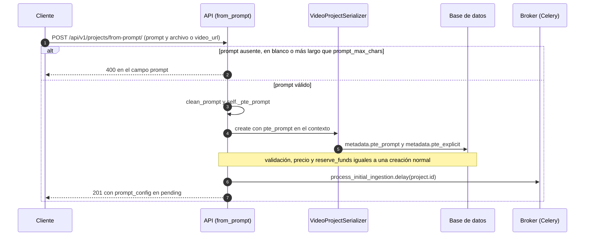
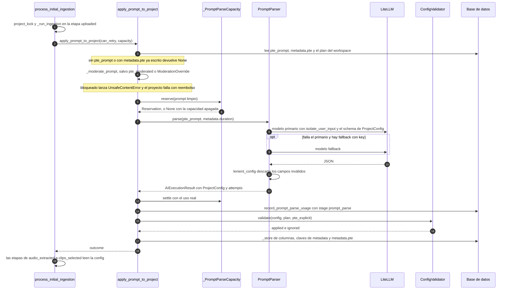
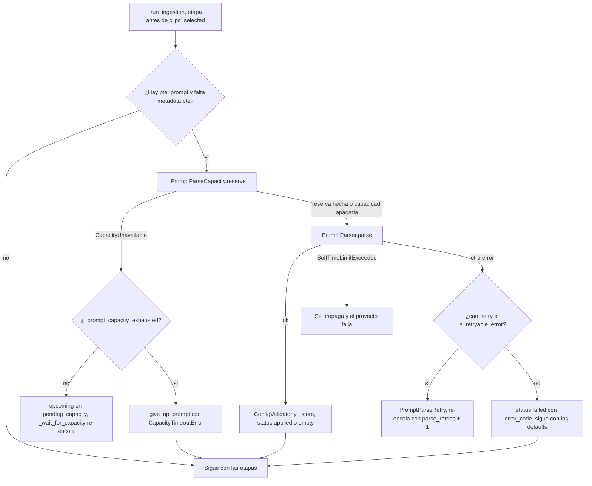

# Prompt-to-Edit

Prompt-to-Edit (PTE) convierte un pedido en lenguaje natural ("cortá los momentos de humor, subtítulos grandes amarillos, vertical con fondo borroso") en la configuración del proyecto. El cliente lo manda en `POST /api/v1/projects/from-prompt/`. El request solo guarda el texto: el parseo corre como primer paso de `process_initial_ingestion`, antes de cualquier etapa que lea la configuración. Así, crear un proyecto no depende de que el proveedor del LLM esté arriba. Lo que el plan y el precio permiten se aplica, lo demás se ignora con un motivo, y el resultado queda en `metadata['pte']`. Si el parser falla, el proyecto sigue con su configuración y nunca falla por el prompt.

## Componentes

| Componente | Archivo | Rol |
|------------|---------|-----|
| `VideoProjectViewSet.from_prompt` | [views.py](../../back/apps/videos/views.py) | Valida `prompt`, lo limpia y delega en `create` (misma validación, precio y reserva) |
| `VideoProjectSerializer.create` | [serializers.py](../../back/apps/videos/serializers.py) | Guarda `metadata['pte_prompt']` y `metadata['pte_explicit']` |
| `ProjectConfig`, `PLAN_GATED_FIELDS`, `LEGACY_ASPECT_RATIOS`, `PROJECT_CONFIG_MAX_CLIPS` | [services/ai/contracts.py](../../back/apps/videos/services/ai/contracts.py) | Contrato de lo que un prompt puede pedir |
| `PromptParser`, `lenient_config`, `clean_prompt`, `prompt_max_chars`, `record_prompt_parse_usage` | [services/ai/prompt_parser.py](../../back/apps/videos/services/ai/prompt_parser.py) | Llamada al LLM (primario y fallback) y validación campo por campo |
| `ConfigValidator`, `explicit_config_fields` | [services/ai/prompt_validator.py](../../back/apps/videos/services/ai/prompt_validator.py) | Recorta la config por campos explícitos, plan y precio |
| `apply_prompt_to_project`, `give_up_prompt`, `PromptParseRetry`, `_store` | [services/ai/prompt_validator.py](../../back/apps/videos/services/ai/prompt_validator.py) | Parsea una sola vez, aplica y guarda `metadata['pte']` |
| `_run_ingestion`, `_PromptParseCapacity`, `_prompt_capacity_exhausted`, `process_initial_ingestion` | [tasks/ingestion.py](../../back/apps/videos/tasks/ingestion.py) | Llaman al parser, reservan su capacidad y re-encolan con `parse_retries` |
| `LiteLLMSelectionProvider` | [services/ai/litellm_selection.py](../../back/apps/videos/services/ai/litellm_selection.py) | Camino de llamada que `PromptParser` hereda: key por llamada, timeout, clasificación de errores, uso por intento |
| `PricingEngine.calculate_render_cost` | [payments/services/pricing_engine.py](../../back/apps/payments/services/pricing_engine.py) | Chequeo de plan y comparación de precio para los campos con plan |

### Qué puede pedir un prompt

`ProjectConfig` solo tiene campos y claves de `metadata` que ya existen en `VideoProject`, con las mismas opciones. `None` significa "no lo pidió" y deja el default. No hay campos de precio, plan, tier ni aprobación, y cualquier campo que no esté en el contrato se ignora (`extra="ignore"`).

| Campo | Valores | Se guarda en | Lo lee |
|-------|---------|--------------|--------|
| `editing_style` | `dynamic`, `minimalist`, `vlog`, `hormozi`, `custom` | columna | selección y render |
| `aspect_ratio` | `9:16`, `1:1`, `16:9` (`1:Post` se lee como `1:1`) | columna | render |
| `render_layout` | `fill`, `fit`, `blurred`, `split`, `pip`, `versus`, `active` | columna | render |
| `gameplay_position`, `camera_selection_position` | `left`, `center`, `right` | columna | render (`split`; [06](06-render-caras-y-hablante.md#cámara-región-y-encuadre-manual)) |
| `use_facetracking`, `remove_silences`, `add_subtitles` | bool | columna | render |
| `subtitle_color` | `#RRGGBB` (se pasa a mayúsculas) | columna | render |
| `subtitle_size` | `small`, `medium`, `large` | columna | render |
| `subtitle_position` | `top`, `center`, `bottom` | columna | render |
| `subtitle_words_per_segment` | 1 a 10 | columna | render |
| `speaker_tracking` | bool | columna | `ConfigValidator`: en `true` y sin layout en el prompt, aplica también `render_layout='active'` |
| `subtitle_with_emojis` | bool | columna | ninguna etapa: los emojis no están en el MVP |
| `max_clips` | 1 a `PROJECT_CONFIG_MAX_CLIPS` (20) | `metadata` | selección |
| `selection_criteria` | texto de hasta 300 caracteres, normalizado | `metadata` | moderación y selección |
| `render_resolution` | `720p`, `1080p`, `4K` (con plan) | `metadata` | `_pricing_resolution` y render |
| `use_seo` | bool (con plan) | `metadata` | `seo_requested` y precio de `approve_paper_edit` |
| `use_ai_thumbnail` | bool (con plan) | `metadata` | precio de `approve_paper_edit` |

Los campos de `metadata` son los de `METADATA_FIELDS`. Los tres últimos son `PLAN_GATED_FIELDS`: el plan puede prohibirlos y cambian el precio, así que nunca se aplican sin pasar por `ConfigValidator`. El render está en [06-render-caras-y-hablante](06-render-caras-y-hablante.md) y la selección en [03-transcripcion-moderacion-seleccion](03-transcripcion-moderacion-seleccion.md).

## Flujo: creación desde un prompt



1. `from_prompt` exige `prompt` y lo rechaza si, sin espacios en los bordes, supera `prompt_max_chars()` (`AI_PROMPT_MAX_CHARS`). Sin proyecto ni reserva.
2. `clean_prompt` saca los caracteres no imprimibles (conserva saltos de línea, tabs y espacios), recorta los bordes y corta en `AI_PROMPT_MAX_CHARS`.
3. `create` corre igual que en [01-creacion-de-proyecto](01-creacion-de-proyecto.md). `get_serializer_context` agrega `pte_prompt`, y `VideoProjectSerializer.create` guarda:
   - `metadata['pte_prompt']`: el texto limpio.
   - `metadata['pte_explicit']`: los campos de `ProjectConfig` que el pedido mandó explícitamente (`explicit_config_fields`).
4. El prompt no cambia el precio: se reserva lo mismo que sin prompt.
5. La respuesta 201 es la de una creación normal más `prompt_config: {"status": "pending", "detail": "Se aplica al iniciar la ingesta; el resultado queda en metadata.pte."}`.

## Flujo: parseo y aplicación al iniciar la ingesta



1. `_run_ingestion` llama a `apply_prompt_to_project` con el lock del proyecto tomado, después de resolver los casos que no hacen trabajo (terminal, `render_dispatched`, re-despacho de un `failed`) y antes de cualquier etapa. No la llama si el proyecto ya está en `clips_selected`.
2. `apply_prompt_to_project` lee el proyecto con el plan del workspace. Si no hay `pte_prompt` o ya existe `metadata['pte']`, no hace nada.
3. **Moderación del prompt (ADR-011 D-M2):** antes de reservar capacidad o llamar al LLM, `_moderate_prompt` pasa el prompt crudo por `AI_Security_Shield.check_content_safety`.
   - Si lo bloquea, sale `UnsafeContentError` hacia el manejador de la ingesta: el proyecto falla con ese código y se devuelve la reserva, como en la etapa de moderación.
   - Sin veredicto sale un `ModerationError` (reintentable o no).
   - Un prompt que pasó queda marcado en `metadata['pte_moderated']`: un reintento del lector o una espera de capacidad no lo vuelven a moderar.
   - Con un `ModerationOverride` del proyecto no se modera.
   - Cada chequeo escribe una fila de `AIUsageRecord` con etapa `moderation` y costo 0.
4. **Capacidad:** si `AI_CAPACITY_ENABLED` está activo y el prompt limpio no está vacío, `_PromptParseCapacity.reserve` pide `ceil(caracteres / 4) + AI_CAPACITY_LLM_PROMPT_TOKENS + AI_CAPACITY_LLM_OUTPUT_TOKENS` tokens y un request en cada modelo de `_selection_models(True)`: el primario y el fallback si tiene key. La espera se registra en la etapa que viene (`upcoming`); para un proyecto en `uploaded` es `audio_extracted`. Detalle de los buckets en [07-capacidad-costos-y-operacion](07-capacidad-costos-y-operacion.md).
5. **Parser:** `PromptParser.parse` usa el camino de llamada de la selección V2 (`LiteLLMSelectionProvider`), sin importar el rollout V2 del proyecto:
   - Con un prompt limpio vacío devuelve `ProjectConfig()` sin llamar al LLM (`attempts` vacío).
   - El system prompt fija las reglas: llenar solo lo que el pedido pide claramente, usar los valores del schema, no inventar campos de precio o plan. El texto del usuario va aislado con `AI_Security_Shield.isolate_user_input`, después de `VIDEO DURATION`.
   - `response_format` sale del schema de `ProjectConfig`: `json_schema` para OpenAI, `json_object` con `response_schema` para Gemini y `json_object` para el resto.
   - Si el primario falla y `_has_fallback()` es verdadero (otro modelo con key), prueba una vez con el fallback. Cada intento queda en `attempts` o, si falla todo, en `usage_attempts` del error.
   - `lenient_config` valida campo por campo: un valor fuera de las opciones se descarta (ese campo queda en su default) en lugar de invalidar toda la config. Un prompt ambiguo da defaults, no un error.
6. `settle` ajusta la reserva de capacidad con los tokens reales, y `record_prompt_parse_usage` escribe una fila de `AIUsageRecord` por intento.
7. `ConfigValidator.validate` reparte lo pedido entre `applied` e `ignored` ([motivos](#por-qué-se-ignora-un-campo)). Si aplicó `speaker_tracking=true` y el prompt no pidió layout, `_speaker_layout` agrega `render_layout='active'`, como hace la creación ([06](06-render-caras-y-hablante.md#flujo-layouts)). Si el pedido mandó un layout explícito, ese gana y `render_layout` queda en `ignored` con `explicit`.
8. `_store` escribe, bajo lock de fila, las columnas aplicadas, las claves de `METADATA_FIELDS` aplicadas y `metadata['pte']`, todo en un solo `UPDATE`.
9. Las etapas leen la configuración ya aplicada. `_stage_moderate` incluye `selection_criteria` en lo que modera y `_stage_select_clips` pasa `editing_style`, `max_clips` y `selection_criteria` al selector. El render lee las columnas y `metadata['render_resolution']`.

### Por qué se ignora un campo

`ConfigValidator.validate` recorre los campos pedidos en este orden:

1. **`explicit`:** el campo está en `pte_explicit`. Lo que el usuario mandó en el pedido gana sobre el prompt, incluso para los campos con plan.
2. **`plan`:** para los `PLAN_GATED_FIELDS`, `calculate_render_cost` con el plan del workspace y duración 0 lanza `PlanLimitExceededError` o `FeatureNotAllowedError`. La duración ya se chequeó al crear.
3. **`cost`:** el plan lo permite, pero el precio de 60 s con lo pedido (sin plan) supera al de 60 s en `720p` sin adicionales. Los tokens se reservaron al crear, así que un prompt nunca cambia lo que paga el usuario.

En la práctica, hoy un campo con plan solo se aplica si no sube el precio: `render_resolution="720p"`, `use_seo=false` o `use_ai_thumbnail=false`. Cualquier mejora se ignora con `plan` o con `cost`. Un workspace sin plan pasa el chequeo de plan y cae en `cost`.

Ejemplos:

| Pedido | Prompt | Resultado |
|--------|--------|-----------|
| Plan Free (`max_resolution=720p`, sin SEO) | "en 4K y con SEO" | `render_resolution` y `use_seo` ignorados por `plan` |
| Plan con 4K y SEO incluidos | "en 4K y con SEO" | Los dos ignorados por `cost` (4K multiplica por 3 y el SEO suma 5) |
| `aspect_ratio=16:9` | "vertical" | `aspect_ratio` ignorado por `explicit`: queda `16:9` |
| `layout=fit` | "con fondo borroso" | `render_layout` ignorado por `explicit` (`layout` es el alias) |
| Sin campos explícitos | "subtítulos amarillos, 3 clips" | `subtitle_color=#FFFF00` y `max_clips=3` aplicados |
| Sin campos explícitos | "que la cámara siga a quien habla" | `speaker_tracking=true` y `render_layout=active` aplicados |
| `layout=split` | "que la cámara siga a quien habla" | `speaker_tracking=true` aplicado; `render_layout` ignorado por `explicit`: queda `split` |

### Campos explícitos

`explicit_config_fields(raw)` devuelve, ordenados, los nombres de `ProjectConfig` que aparecen como clave en el pedido crudo (`initial_data`); `layout` cuenta como `render_layout`. Cuenta la presencia de la clave, no el valor: un `"selection_criteria": ""` es explícito y bloquea el criterio del prompt aunque no se haya guardado nada.

### Criterio de selección

1. El modelo puede devolver `selection_criteria` (por ejemplo "momentos de humor"). `ProjectConfig` lo normaliza con `normalize_selection_criteria` y acepta hasta 300 caracteres.
2. Si se aplica, `_store` lo guarda en `metadata['selection_criteria']`, la misma clave que escribe el campo `selection_criteria` del pedido.
3. `_stage_moderate` lo modera junto con el título y el transcript (`_moderation_payload`).
4. `_stage_select_clips` lo pasa a `SelectionEngine`, que lo vuelve a normalizar y lo aísla como preferencia del usuario ([03-transcripcion-moderacion-seleccion](03-transcripcion-moderacion-seleccion.md)).

### Qué devuelve la API

- `POST /api/v1/projects/from-prompt/` responde con `prompt_config.status="pending"`: el prompt todavía no se parseó.
- El resultado aparece después en `metadata.pte` del detalle del proyecto (`GET /api/v1/projects/<id>/`, y también en `paper-edit-data`).
- Mientras el parser espera capacidad, `pipeline_stage_status` muestra la etapa que viene en `pending_capacity`.

```json
{
  "pte": {
    "status": "applied",
    "applied": {"render_layout": "blurred", "max_clips": 3, "selection_criteria": "momentos de humor"},
    "ignored": [
      {"field": "render_resolution", "reason": "plan"},
      {"field": "aspect_ratio", "reason": "explicit"}
    ]
  }
}
```

`status` puede ser `applied` (hubo llamada al LLM), `empty` (prompt vacío después de limpiarlo, sin llamada) o `failed`. Con `failed` se suma `error_code` (la clase del error o `CapacityTimeoutError`) y `applied` e `ignored` quedan vacíos.

### Idempotencia

`metadata['pte']` se escribe una sola vez, con `_store` o con `give_up_prompt`. Después, `apply_prompt_to_project` devuelve `None` sin llamar al LLM: una re-entrega del mensaje o un re-despacho manual no parsean de nuevo. Mientras queden reintentos del parser, un error transitorio no escribe `pte`, así que el próximo intento parsea otra vez y el prompt no se pierde. El lock del proyecto evita que dos workers parseen a la vez.

## Flujo: fallos del parser



1. **Error transitorio con reintentos:** `is_retryable_error` es verdadero para 429, 5xx, timeouts y cortes de conexión (`RetryableAIError`). Si `parse_retries < PTE_PARSE_MAX_RETRIES`, `apply_prompt_to_project` registra el uso del intento, loguea `prompt_parse.transient` y lanza `PromptParseRetry`. `process_initial_ingestion` la atrapa antes que el manejador general y se re-encola con `apply_async`:
   - `kwargs` con `lock_retries` igual y `parse_retries + 1`.
   - `countdown` de `PTE_PARSE_RETRY_SECONDS`: 30 s después del primer fallo, 90 s después del segundo.
   - `retries=self.request.retries`: el contador de Celery de las etapas no cambia. Tampoco se llama a `_record_pipeline_failure`, así que `pipeline_attempts` no sube.
2. **Error definitivo o último reintento:** con `can_retry` falso, o un error no reintentable (`AIAuthenticationError`, `AIInvalidRequestError`, `AIQuotaExceededError`, `AIContractValidationError`), se guarda `status=failed` con `error_code` y el proyecto sigue con su configuración. Con `PTE_PARSE_MAX_RETRIES=2`, el parser tiene hasta 3 intentos (cada uno puede usar primario y fallback).
3. **Sin capacidad:** `reserve` lanza `CapacityUnavailable`. Si `_prompt_capacity_exhausted` dice que todavía hay margen, `_run_ingestion` pone `upcoming` en `pending_capacity` y relanza. `process_initial_ingestion` llama a `_wait_for_capacity`, que guarda `metadata['capacity_wait']` y re-encola con el `countdown` del bucket. No cuenta como intento ni escribe filas de uso. Al volver, el parser corre de nuevo.
4. **Espera vencida:** si la espera prevista más la nueva supera `AI_CAPACITY_MAX_WAIT_SECONDS`, `_prompt_capacity_exhausted` loguea `prompt_parse.capacity_timeout`, limpia `capacity_wait` y devuelve verdadero. `give_up_prompt(project_id, 'CapacityTimeoutError')` guarda `status=failed` y la ingesta sigue. A diferencia de las etapas, el proyecto no falla: el prompt es opcional.
5. **Límite de tiempo de la tarea:** `SoftTimeLimitExceeded` no se reintenta ni se cubre con el fallback. `apply_prompt_to_project` la relanza y el pipeline falla el proyecto como con cualquier error no reintentable ([02-pipeline-de-ingesta](02-pipeline-de-ingesta.md)).

## Errores, reintentos y casos borde

| Situación | Qué pasa | Dónde |
|-----------|----------|-------|
| `prompt` ausente o en blanco | 400 `{"prompt": ["Este campo es obligatorio."]}`. No se crea el proyecto ni se reserva | `from_prompt` |
| `prompt` más largo que `AI_PROMPT_MAX_CHARS` | 400 `{"prompt": ["Máximo N caracteres."]}` | `from_prompt` |
| Sin fuente, plan excedido o saldo insuficiente | 400, 403 o 402, igual que una creación normal ([01](01-creacion-de-proyecto.md#errores-reintentos-y-casos-borde)) | `create` |
| Prompt con solo caracteres no imprimibles | `pte_prompt` queda vacío: sin reserva de capacidad ni llamada, `status=empty` | `clean_prompt`, `PromptParser.parse` |
| La respuesta no es JSON o no es un objeto | `AIContractValidationError` (no reintentable) con el uso del intento. Pasa al fallback si hay; si no, `status=failed` | `_parse_config`, `lenient_config` |
| Un campo con un valor fuera del schema | Se descarta solo ese campo. Log `prompt_parse.fields_dropped count=N` | `lenient_config` |
| `max_clips` más grande de lo que entra en el video | Se baja a `duración // 15` (mínimo 1), si la duración se conoce | `lenient_config` |
| Duración desconocida al parsear | En un proyecto nuevo el parser corre antes de `_stage_prepare_source`, que es quien escribe `metadata['duration']`. Recibe `None`, el prompt dice `VIDEO DURATION: unknown` y el tope de `max_clips` por duración no se aplica (queda el de 20) | `apply_prompt_to_project` |
| Error transitorio con reintentos del parser | `PromptParseRetry` y re-encolado a 30 o 90 s. Se escriben las filas de uso pero no `pte` | `apply_prompt_to_project`, `process_initial_ingestion` |
| Error transitorio en el último reintento | `status=failed` con `error_code`. La ingesta sigue con los defaults | `apply_prompt_to_project` |
| Error definitivo | `status=failed` en el primer intento, aunque queden reintentos | `apply_prompt_to_project` |
| Re-encolado por lock ocupado o por espera de capacidad | Los dos pasan el mismo `parse_retries`: el presupuesto del parser no se reinicia | `process_initial_ingestion`, `_wait_for_capacity` |
| Sin capacidad | `pending_capacity` en la etapa que viene y re-encolado. No es un intento fallido | `_run_ingestion`, `_wait_for_capacity` |
| Espera de capacidad vencida | `give_up_prompt` con `CapacityTimeoutError`. El proyecto sigue y no falla | `_prompt_capacity_exhausted` |
| `SoftTimeLimitExceeded` durante el parseo | Se relanza y el proyecto falla. La reserva de tokens vuelve según [01](01-creacion-de-proyecto.md#flujo-ciclo-de-vida-de-la-reserva) | `PromptParser.parse`, `apply_prompt_to_project` |
| Re-entrega o re-despacho manual | No se parsea otra vez: `metadata['pte']` ya existe | `apply_prompt_to_project` |
| Proyecto en `clips_selected` o más adelante | `_run_ingestion` no llama al parser | `_run_ingestion` |
| El prompt pide un adicional pago o más resolución | Se ignora con `plan` o `cost`. El precio no cambia | `ConfigValidator` |
| Moderación | El texto de `pte_prompt` se modera antes del parser. Si se bloquea, el proyecto falla con `UnsafeContentError` y se devuelve la reserva. El `selection_criteria` que resulte se modera además en `_stage_moderate` | `_moderate_prompt`, `_moderation_payload` |

## Datos que escribe

**En el request** (`VideoProjectSerializer.create`):

- `metadata['pte_prompt']`: el prompt limpio.
- `metadata['pte_explicit']`: lista ordenada de campos explícitos.

**Al iniciar la ingesta** (`_store` y `give_up_prompt`):

- Columnas de `VideoProject` aplicadas: las de `ProjectConfig` que no están en `METADATA_FIELDS`. Se escriben con `UPDATE`, sin `save()`.
- Claves de `metadata` aplicadas: `max_clips`, `selection_criteria`, `render_resolution`, `use_seo` y `use_ai_thumbnail`.
- `metadata['pte']`: `status`, `applied`, `ignored` y, si falló, `error_code`.

**Capacidad** (solo con `AI_CAPACITY_ENABLED`): `pipeline_stage_status[<etapa que viene>]=pending_capacity`, `metadata['capacity_wait']` mientras espera y `metadata['capacity_waited_s']` cuando se concede.

**`AIUsageRecord`:** una fila por intento (primario y fallback) con `stage=prompt_parse` y `pipeline_version=v2`, tanto si el parseo salió bien como si falló. Un fallo sin intentos registrados se anota con `usages_for_failure` sobre `AI_DEFAULT_LLM_MODEL`. El `attempt` es el `pipeline_attempts` actual del proyecto.

**Logs** (sin texto del usuario ni del modelo, solo conteos y clases de error):

- `prompt_parse.completed role=... model=... fields=N tokens=E/S latency_s=...`
- `prompt_parse.primary_failed` y `prompt_parse.fallback_failed`, con `model` y `error`.
- `prompt_parse.fields_dropped count=N`
- `prompt_parse.applied project_id=... applied=N ignored=M`
- `prompt_parse.transient`, `prompt_parse.retrying ... parse_retry=N countdown_s=S` y `prompt_parse.failed ... error=<clase>`
- `prompt_parse.capacity_timeout project_id=... planned_s=...`
- Los de capacidad de la ingesta: `pipeline.pending_capacity`, `pipeline.capacity_granted` y `pipeline.status_write_skipped`.

## Configuración

| Setting | Default | Efecto |
|---------|---------|--------|
| `AI_PROMPT_MAX_CHARS` | `1000` | Largo máximo del prompt: el endpoint rechaza uno más largo y `clean_prompt` corta en ese largo |
| `AI_DEFAULT_LLM_MODEL` | `gemini/gemini-3.8-flash` | Modelo primario del parser (el mismo de la selección V2) |
| `AI_FALLBACK_LLM_MODEL` | `gemini/gemini-3.5-flash-lite` | Fallback, solo si es otro modelo y tiene key |
| `AI_LLM_TIMEOUT_SECONDS` | `60.0` | Timeout de cada llamada al LLM |
| `AI_CAPACITY_ENABLED` | `False` | Activa la reserva de capacidad del parser |
| `AI_CAPACITY_LIMITS` | `{}` | Límites por modelo; con la capacidad activa, cada modelo que se reserva necesita los suyos |
| `AI_CAPACITY_LLM_PROMPT_TOKENS` | `1500` | Tokens fijos de prompt en la reserva |
| `AI_CAPACITY_LLM_OUTPUT_TOKENS` | `4000` | Tokens fijos de salida en la reserva |
| `AI_CAPACITY_MAX_WAIT_SECONDS` | `3600` | Espera máxima por capacidad; pasada, `give_up_prompt` |
| `AI_CAPACITY_MAX_COUNTDOWN_SECONDS` | `300` | Tope de cada re-encolado por capacidad |

Valores fijos en el código:

| Constante | Valor | Dónde |
|-----------|-------|-------|
| `PTE_PARSE_MAX_RETRIES` | 2 | `tasks/ingestion.py` |
| `PTE_PARSE_RETRY_SECONDS` | `(30, 90)` | `tasks/ingestion.py` |
| `PROJECT_CONFIG_MAX_CLIPS` | 20 | `contracts.py` |
| `_MIN_SECONDS_PER_CLIP` | 15 s | `prompt_parser.py` |
| `MAX_SELECTION_CRITERIA_CHARS` | 300 | `selection_criteria.py` |

## Referencias

- [ADR-012, D-C4](../adrs/012-model-profiles-and-capacity.md): capacidad propia con `pending_capacity` y vencimiento.
- [Runbook del piloto, sección 5.5](../runbooks/ai-core-pilot-runbook.md): reserva del lector de prompts en la tabla de capacidad.
- Issue #72, PTE-01a (`ProjectConfig` y `PromptParser`): https://github.com/RomeKai/videoeditUTN/issues/72
- Issue #73, PTE-01b (endpoint y validación contra el plan): https://github.com/RomeKai/videoeditUTN/issues/73
- PR #85, contrato `ProjectConfig` y `PromptParser` (PTE-01a): https://github.com/RomeKai/videoeditUTN/pull/85
- PR #86, endpoint de Prompt-to-Edit con validación contra el plan (PTE-01b): https://github.com/RomeKai/videoeditUTN/pull/86
- PR #92, reintentos de errores transitorios del parser y reserva de su capacidad: https://github.com/RomeKai/videoeditUTN/pull/92
- Issue #71, PTE-02 (criterio de selección): https://github.com/RomeKai/videoeditUTN/issues/71
