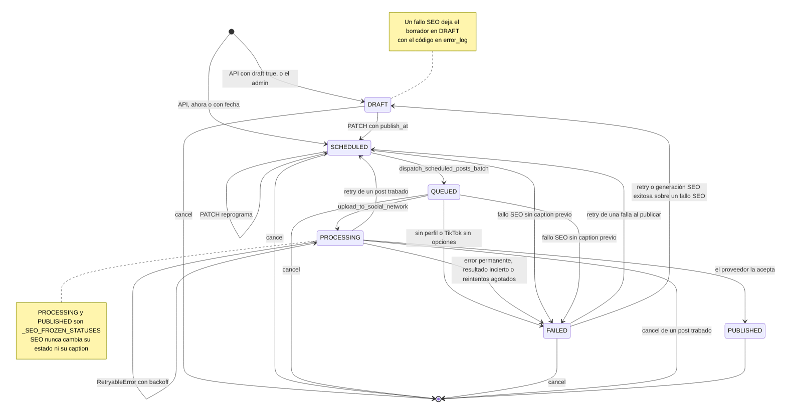
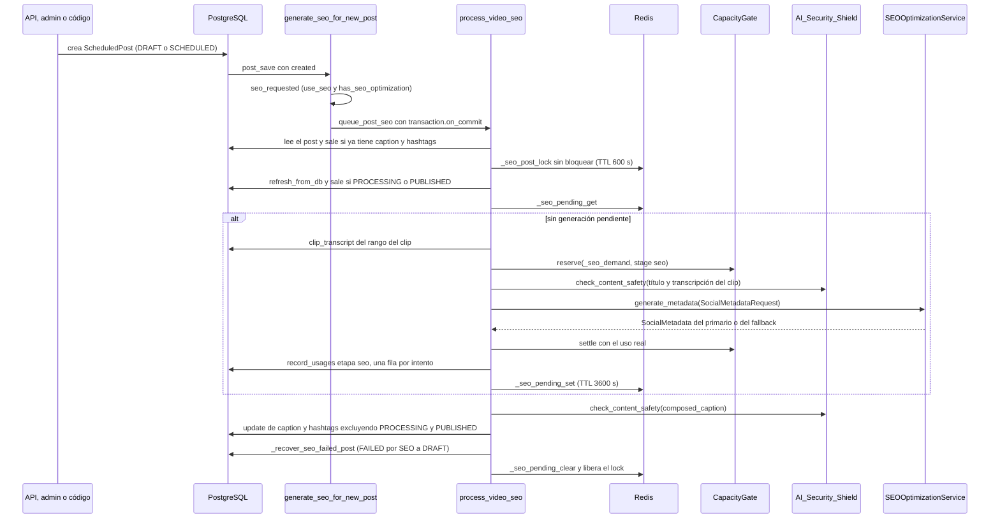
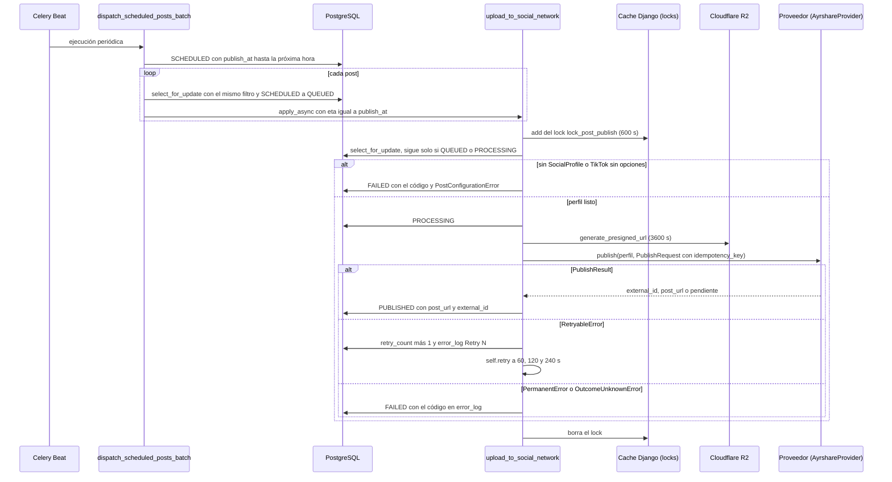

# SEO y publicación social

Este documento cubre la vida de una publicación (`ScheduledPost`): cómo la crea y la cambia la API, cómo se generan su caption y sus hashtags con IA (`process_video_seo`, [ADR-013](../adrs/013-ai-social-metadata.md)) y cómo se publica en TikTok, Instagram Reels o YouTube Shorts a través del proveedor de publicación del espacio (`upload_to_social_network` y la capa de proveedores `apps.integrations.social`, hoy con Ayrshare). La generación corre una vez por publicación, apenas se crea el `ScheduledPost`, y solo si el proyecto pagó el adicional de SEO; "Regenerar" la vuelve a pedir. La publicación corre cuando `dispatch_scheduled_posts_batch` encuentra posts `SCHEDULED` cuya `publish_at` ya llegó o cae dentro de la próxima hora. Ningún endpoint llama a la red.

## Componentes

| Componente | Archivo | Rol |
|------------|---------|-----|
| `ScheduledPost` (`Status`, `Platform`) | [models.py](../../back/apps/videos/models.py) | Estado de la publicación, `generated_caption`, `generated_hashtags`, `error_log`, `retry_count`, el texto del usuario (`caption`, `hashtags`, `tiktok`), `seo_requested_at`, lo que dejó el proveedor (`post_url`, `external_id`) y la versión de la clave de idempotencia (`publish_key_version`). `caption_to_publish` y `hashtags_to_publish` son la regla del texto que sale, la misma para la API y el publicador. |
| `PostIdempotencyKey` | [models.py](../../back/apps/videos/models.py) | Qué publicaciones creó un pedido con `Idempotency-Key`, por workspace. |
| `ScheduledPostViewSet` | [views_social.py](../../back/apps/videos/views_social.py) | `/api/v1/scheduled-posts/`: listar y ver, crear (una o en lote), editar, cancelar, reintentar y regenerar el texto. |
| `create_posts`, `update_post`, `cancel_post`, `retry_post`, `regenerate_seo` | [services/scheduled_posts.py](../../back/apps/videos/services/scheduled_posts.py) | Las reglas de cada escritura: estados, plan, cuenta, locks y la regla de un post trabado. |
| `ScheduledPostSerializer`, `CreatePostSerializer`, `UpdatePostSerializer` | [serializers_social.py](../../back/apps/videos/serializers_social.py) | Lo que muestra la API (`seo_status`, `error_code`, `error_message` derivados) y lo que acepta. |
| `generate_seo_for_new_post`, `seo_requested`, `queue_post_seo` | [signals.py](../../back/apps/videos/signals.py) | Receptor de `post_save`: encola la generación después del commit, solo con SEO contratado. |
| `VideosConfig.ready` | [apps.py](../../back/apps/videos/apps.py) | Importa `signals` (y `checks`) para registrar el receptor. |
| `ScheduledPostAdmin.regenerate_ai_metadata` | [admin.py](../../back/apps/videos/admin.py) | Acción "Regenerar caption y hashtags con IA": regeneración explícita. |
| `process_video_seo` y sus helpers | [tasks/social.py](../../back/apps/videos/tasks/social.py) | Tarea Celery: lock, capacidad, moderación, LLM, generación pendiente, persistencia, filas de uso. |
| `SEOOptimizationService`, `SocialMetadata`, `SocialMetadataRequest` | [services/seo_engine.py](../../back/apps/videos/services/seo_engine.py) | Llamada LiteLLM (primario y un fallback), prompt y contrato de salida. |
| `clip_transcript`, `niche_slug`, `caption_limit`, `compose_caption` | [services/seo_engine.py](../../back/apps/videos/services/seo_engine.py) | Helpers puros: texto del clip, nicho como slug, límite por plataforma, caption final. |
| `AI_Security_Shield.check_content_safety` | [core/security.py](../../back/apps/core/security.py) | Moderación de la entrada y de la salida ([ADR-011](../adrs/011-content-moderation.md)). |
| `dispatch_scheduled_posts_batch` | [tasks/social.py](../../back/apps/videos/tasks/social.py) | Pasa a `QUEUED` los posts de la próxima hora y encola la publicación con ETA. |
| `upload_to_social_network` | [tasks/social.py](../../back/apps/videos/tasks/social.py) | Publica a través del proveedor del espacio, con backoff ante errores reintentables y un código en `error_log` ante los demás. |
| `SocialProfile` | [integrations/models.py](../../back/apps/integrations/models.py) | El perfil del espacio en el proveedor: `provider` (el que publica sus posts) y `provider_ref` (para Ayrshare, la Profile-Key, una credencial). Reemplaza a `Workspace.ayrshare_profile_key`, que queda deprecada. |
| `SocialProvider`, `PublishRequest`, `PublishResult`, `TikTokOptions`, `idempotency_key` | [integrations/social/base.py](../../back/apps/integrations/social/base.py) | La interfaz de un proveedor, en nuestros términos (redes, opciones de TikTok) y los timeouts de publicar. |
| `RetryableError`, `PermanentError`, `OutcomeUnknownError` y los códigos | [integrations/social/errors.py](../../back/apps/integrations/social/errors.py) | Qué puede hacer el que llama después de un error, y por qué falló. |
| `provider_for`, `get_provider`, `ready_profile`, `has_ready_profile` | [integrations/social/\_\_init\_\_.py](../../back/apps/integrations/social/__init__.py) | El proveedor de un perfil y el perfil de un espacio, sin llamar al proveedor. |
| `AyrshareProvider` | [integrations/social/ayrshare.py](../../back/apps/integrations/social/ayrshare.py) | `https://api.ayrshare.com/api`: publicar, y crear, vincular, listar, desvincular y borrar perfiles. Lee la respuesta por el cuerpo, no solo por el HTTP. |

## Flujo: estados de `ScheduledPost`

1. Un post nace `DRAFT` (default del modelo, `draft: true` en la API, o el admin) o `SCHEDULED` (la API, para ahora o para una fecha). Cómo lo crea y lo cambia la API está en [Flujo: la API de publicaciones](#flujo-la-api-de-publicaciones).
2. `dispatch_scheduled_posts_batch` toma los `SCHEDULED` con `publish_at` hasta ahora + 1 h (los vencidos también: salen enseguida) y los pasa a `QUEUED` bajo `select_for_update`.
3. `upload_to_social_network` los pasa a `PROCESSING` y, si el proveedor la acepta, a `PUBLISHED`. Sin perfil del espacio (`SocialProfile`), o en TikTok sin `tiktok.privacy_level`, el post queda `FAILED` sin llamar al proveedor.
4. Un fallo de SEO (`_fail_seo_post`) deja `FAILED` con un código estático en `error_log`, salvo estas excepciones: el post está en `_SEO_FROZEN_STATUSES` (`PROCESSING`, `PUBLISHED`); ya tiene `generated_caption` no vacío y `generated_hashtags` (regeneración fallida: solo se registra `seo.regenerate_failed` y el post sigue publicable con el caption anterior); o es un `DRAFT` o tiene caption propio del usuario, que conservan su estado con el código en `error_log` (la API muestra `seo_status: "failed"`; el texto del usuario no necesita el de la IA). En todos los casos borra `seo_requested_at`.
5. Una generación exitosa llama a `_recover_seo_failed_post`: un post `FAILED` cuyo `error_log` es un código de SEO vuelve a `DRAFT` con `error_log` vacío, y un `DRAFT` con ese código pierde el código. Nunca se vuelve a programar solo: el usuario revisa el caption y lo programa de nuevo. Un `FAILED` de publicación no se toca.

## Flujo: disparo de la generación

1. **Gating.** `seo_requested(project)` es verdadero solo si `project.metadata['use_seo']` es exactamente `True` y el plan del workspace la incluye: `subscription_plan` es `None` (sin plan no hay límites, como en `PricingEngine`) o `has_seo_optimization` es verdadero. `use_seo` se guarda al crear el proyecto y se cobra como el adicional `seo_optimization` ([ver 01-creacion-de-proyecto](01-creacion-de-proyecto.md)). Prompt-to-Edit no lo puede encender: `ConfigValidator` descarta un `use_seo` que sube el precio ([ver 04-prompt-to-edit](04-prompt-to-edit.md)). El plan se evalúa en el momento del disparo, no al crear el proyecto.
2. **Señal.** `generate_seo_for_new_post` escucha `post_save` de `ScheduledPost` (`dispatch_uid='videos.scheduled_post_seo'`). Sale sin hacer nada si el post no es nuevo (`created` falso: editar nunca regenera), si viene de un fixture (`raw`), si lo creó la API (`seo_decided`: `create_posts` ya decidió), si ya trae `generated_caption` y `generated_hashtags`, si nace `PROCESSING`, `PUBLISHED` o `FAILED`, o si `seo_requested` es falso.
3. **Después del commit.** `queue_post_seo(post_id)` marca el pedido (`seo_requested_at`, ver abajo) y registra el envío con `transaction.on_commit`: si la transacción que creó el post hace rollback, la tarea nunca se encola, y cuando se encola siempre encuentra el post. Un error del broker se registra como `seo.dispatch_failed` y no deshace el post; el envío correcto registra `seo.dispatched`.
4. **Regeneración explícita.** `POST /api/v1/scheduled-posts/:id/regenerate-seo/` (`regenerate_seo`) y la acción del admin `regenerate_ai_metadata` llaman a `queue_post_seo(post_id, regenerate=True)`, que encola `process_video_seo` con `kwargs={'regenerate': True}`. Ambas excluyen los posts `PROCESSING` y `PUBLISHED` y piden `seo_requested`; la API excluye también `QUEUED`. Es también la forma de reintentar un post cuyo disparo falló.
5. **Pedido en camino (`seo_requested_at`).** Lo escribe `queue_post_seo`, la usen la señal, el admin o la API. Mientras está y tiene menos de `seo_request_window()` (`AI_CAPACITY_MAX_WAIT_SECONDS` + 15 min), la API responde `seo_status: "pending"` aunque haya un texto anterior, y otro "Regenerar" no encola nada (un doble clic no paga dos generaciones). Lo borran `_generate_post_metadata` al guardar el texto, `_fail_seo_post` al fallar, y `queue_post_seo` si el broker no tomó el mensaje.
6. **`bulk_create`.** Django no emite `post_save` en `bulk_create`: los posts creados así no disparan la generación. Quien los cree de esa forma tiene que llamar a `queue_post_seo` por cada uno. El endpoint `/bulk/` guarda cada post con `save()`, así que la señal corre para todos.

## Flujo: generación de caption y hashtags

1. **Idempotencia antes del lock.** Si el post ya tiene `generated_caption` y `generated_hashtags` y no es una regeneración, la tarea termina (`"SEO Already Generated"`) sin llamar al proveedor. Un reintento de Celery nunca paga dos veces una generación ya persistida.
2. **Lock por post.** `_seo_post_lock` toma un lock de Redis (`lock:seo:post:<post_id>`, `SEO_LOCK_TTL_SECONDS` = 600) sin bloquear. Si otro worker lo tiene, registra `seo.skipped reason=locked` y termina (`"SEO Busy"`). Si Redis no responde, levanta `RetryableAIError` y la tarea reintenta.
3. **Dentro del lock** relee el post: si ya está `PROCESSING` o `PUBLISHED` registra `seo.skipped reason=<estado>` y no hace nada. Vuelve a chequear la idempotencia (otro run pudo terminar antes del lock). En una regeneración nueva (`regenerate`, `retries == 0` y sin `capacity_waited_s`) borra cualquier generación pendiente vieja con `_seo_pending_clear`.
4. **Generación pendiente.** `_generate_post_metadata` busca primero `seo:pending:<post_id>` en Redis (`_seo_pending_get`). Si existe, la reutiliza y no llama al LLM: es el caso de un reintento después de que la moderación de salida no dio veredicto.
5. **Texto del clip.** `_generate_social_metadata` arma el texto con `clip_transcript(project.transcript_data, clip.start_time, clip.end_time)`: los ítems con tiempos que se superponen con el clip, ordenados por inicio. Sin texto, el post falla con `seo_no_clip_transcript`; la transcripción completa del proyecto nunca es un sustituto.
6. **Pedido.** `SocialMetadataRequest` lleva `clip_transcript`, `clip_title`, `platform`, `target_niche` (`metadata['niche']` o `general`; ningún endpoint lo escribe hoy) y `language` (`AI_SEO_LANGUAGE`).
7. **Capacidad primero.** Con `_capacity_gate()` activo, reserva `_seo_demand` en los modelos de `_selection_models(True)` (primario, y fallback si es otro modelo con key). La demanda es `ceil((len(transcripción) + len(título)) / 4)` + `AI_CAPACITY_LLM_PROMPT_TOKENS` + `AI_CAPACITY_LLM_OUTPUT_TOKENS` tokens y 1 request por modelo. Se reserva antes de moderar para que una espera nunca repita la llamada de moderación (ver abajo).
8. **Moderación de entrada.** `check_content_safety` sobre título + transcripción del clip (`_seo_moderation_payload`). Contenido bloqueado (`UnsafeContentError`): devuelve la reserva (`_release_seo_capacity`), registra `seo.input_blocked` y falla con `content_blocked`. Sin veredicto (`ModerationError`): devuelve la reserva y deja que el handler de la tarea decida el reintento. El detalle de la moderación por bloques está en [03-transcripcion-moderacion-seleccion](03-transcripcion-moderacion-seleccion.md).
9. **LLM.** `SEOOptimizationService().generate_metadata(request)` hereda de `LiteLLMSelectionProvider`: key por llamada, `AI_LLM_TIMEOUT_SECONDS`, `num_retries=0`, el mismo tope de razonamiento y temperatura `0.7`. Intenta `AI_DEFAULT_LLM_MODEL` y, si falla y `_has_fallback()`, un intento con `AI_FALLBACK_LLM_MODEL`. El prompt aísla título y transcripción con `isolate_user_input`, reduce el nicho con `niche_slug` y pide un caption de como máximo `max(100, caption_limit(platform) - 8 × 32)` caracteres.
10. **Validación local.** La respuesta pasa por `SocialMetadata` (`extra="forbid"`): caption no vacío y entre 5 y 8 hashtags normalizados (sin `#`, solo letras, dígitos o `_`, sin duplicados ignorando mayúsculas). Además `composed_caption()` no puede superar `caption_limit(platform)`. Cualquier violación es `AIContractValidationError` (no reintentable) y le da su oportunidad al fallback; el intento queda facturado en `usage_attempts`.
11. **Uso y capacidad.** Con éxito: `gate.settle` con `_llm_usage_by_model` y `record_usages` con etapa `seo`, versión `v2`, una fila por intento (`usages_for_success`). Con error: `gate.settle` con `_selection_failure_usage` y `_record_call_failure`; después se relanza. Las filas se escriben antes de la moderación de salida y de persistir: la llamada ya se pagó.
12. **Generación pendiente.** El resultado se guarda en Redis con `_seo_pending_set` (`SEO_PENDING_TTL_SECONDS` = 3600). Si no se puede guardar, se registra `seo.pending_not_saved` y el resultado se usa igual.
13. **Moderación de salida.** `check_content_safety(metadata.composed_caption())`. Bloqueado: borra la pendiente, registra `seo.output_blocked` y falla con `generated_content_blocked`. Sin veredicto: la pendiente queda en Redis y el reintento no paga una segunda generación.
14. **Persistencia.** Un `update` de `generated_caption` y `generated_hashtags` (y `seo_requested_at` vacío) que excluye `_SEO_FROZEN_STATUSES`. En una regeneración vacía también `caption` y `hashtags`: el texto nuevo reemplaza el que escribió el usuario. Si no actualiza ninguna fila (la publicación empezó mientras se generaba, o el post se borró), borra la pendiente, registra `seo.skipped reason=publishing` y deja el caption con el que se publicó. Si actualiza, llama a `_recover_seo_failed_post`, borra la pendiente y registra `seo.persisted`.
15. **Post borrado.** Si el post ya no existe al empezar o al releerlo dentro del lock (un borrador descartado, una publicación cancelada), registra `seo.skipped reason=deleted` y termina con `"Post Deleted"`, sin fallar la tarea.

### Espera de capacidad

Si `gate.reserve` levanta `CapacityUnavailable`, `_seo_wait_for_capacity` decide:

- Si `capacity_waited_s + wait_seconds` supera `AI_CAPACITY_MAX_WAIT_SECONDS`, registra `seo.capacity_timeout` y falla con `capacity_timeout`.
- Si no, vuelve a encolar `process_video_seo` con `countdown = _capacity_countdown(wait_seconds)` (el déficit, con tope `AI_CAPACITY_MAX_COUNTDOWN_SECONDS`, más hasta 20 % de jitter), `capacity_waited_s` acumulado y `retries` igual al actual. Registra `seo.pending_capacity`.
- Una regeneración conserva `regenerate=True` en el mensaje re-encolado: sin eso, el run siguiente vería el caption viejo y terminaría sin regenerar.
- El contador de reintentos de Celery viaja con el mensaje: una llamada que falla siempre se queda sin reintentos aunque haya esperas en el medio.
- A diferencia de la ingesta, la espera de SEO no escribe `metadata['capacity_wait']` en el proyecto: el tiempo esperado solo viaja en `capacity_waited_s`. Los token buckets están en [07-capacidad-costos-y-operacion](07-capacidad-costos-y-operacion.md).

## Flujo: la API de publicaciones

`ScheduledPostViewSet` ([views_social.py](../../back/apps/videos/views_social.py)) atiende `/api/v1/scheduled-posts/` sobre el workspace activo (`X-Workspace-Id`): un post de otro workspace es 404 y un clip de otro workspace es 400 (`"El clip no existe."`). Escribir pide `post.publish` (Dueño, Admin y Editor; un Lector recibe 403). Las reglas están en [services/scheduled_posts.py](../../back/apps/videos/services/scheduled_posts.py), y ninguna llama al proveedor de publicación: lo que tiene que salir queda `SCHEDULED` y lo encola el beat.

| Endpoint | Función | Qué hace |
|----------|---------|----------|
| `POST /` | `create_posts` | Un post. Con `draft: true` queda `DRAFT`; si no, `SCHEDULED` con su `publish_at` (ahora si es `null`, falta o cae a menos de `NOW_TOLERANCE` = 60 s). |
| `POST /bulk/` | `create_posts` | Hasta `BULK_MAX` = 60, todo o nada en una transacción. Un error dice cuál con `index`; un clip repetido en la misma red es 400. |
| `PATCH /:id/` | `update_post` | Texto, `tiktok` y `publish_at` de un `DRAFT` o un `SCHEDULED`. `publish_at` con fecha programa o reprograma, `null` lo deja para ahora, sin el campo un borrador sigue borrador. |
| `POST /:id/cancel/` | `cancel_post` | Borra un `DRAFT`, `SCHEDULED`, `QUEUED`, `FAILED` o un `PROCESSING` trabado. |
| `POST /:id/retry/` | `retry_post` | Un `FAILED`, o un `PROCESSING` trabado, vuelve a `SCHEDULED` para ahora, sin `error_log` y con una clave de idempotencia nueva. Si falló el texto con IA, vuelve a `DRAFT`. |
| `POST /:id/regenerate-seo/` | `regenerate_seo` | Pide otro texto a la IA (ver [disparo](#flujo-disparo-de-la-generación)). Responde 202 con `seo_status: "pending"`. |

1. **Validación (400).** El clip tiene que estar `completed` o `published`. El texto que sale (`compose_caption`) no puede pasar `caption_limit(platform)`, ni los hashtags `HASHTAGS_MAX` (30 en TikTok e Instagram, 15 en YouTube). Los hashtags llegan sin `#` y sin repetidos (`clean_hashtags`); uno con espacios u otros caracteres es 400. Un post de TikTok que sale necesita `tiktok.privacy_level` (`clean_tiktok`; las otras opciones faltantes son `false`). Una fecha más de 60 s en el pasado es 400.
2. **Plan (403).** Sin plan no hay límites. Programar (una fecha más de 60 s adelante) pide `allow_scheduling` (`code: "scheduling"`). Sin `allow_crossposting`, un clip sale en una sola red: se cuentan sus posts `SCHEDULED`, `QUEUED`, `PROCESSING` y `PUBLISHED` más los nuevos, no los borradores ni los fallidos (`code: "crossposting"`). Se mira al crear, al mandar un borrador y al reintentar.
3. **Cuenta (409).** Lo que sale necesita el perfil del espacio en el proveedor (`SocialProfile` con `provider_ref`, `has_ready_profile`; `code: "account_not_connected"`), sin llamar al proveedor. No se sabe red por red hasta que exista conectar cuentas (hueco 10 del mapa).
4. **Locks.** Cada escritura toma la fila del post con `select_for_update` y decide con el estado que lee bajo ese lock, como `dispatch_scheduled_posts_batch` y `upload_to_social_network`. Crear, mandar un borrador y reintentar toman antes el proyecto y el clip, en el orden de los renders de `views_clips` (crear y regenerar, antes que nada, el advisory lock del presupuesto de IA; nunca la fila del workspace); así dos pedidos del mismo clip cuentan las redes uno después del otro. Por eso:
   - un `PATCH` que llega mientras el despachador pasa el post a `QUEUED` espera y responde 409 `post_in_flight`: su tarea ya salió con la hora vieja;
   - un `cancel` que llega mientras el worker lo pasa a `PROCESSING` espera y responde 409 `post_in_flight`; uno que llega con el post `QUEUED` lo borra, y la tarea después no lo encuentra (`"Post Deleted"`);
   - dos `retry` a la vez: el segundo encuentra el post `SCHEDULED` y responde 409 `post_not_failed`.
5. **Post trabado.** Un `PROCESSING` se puede reintentar o cancelar (`_check_stuck`) cuando su último intento empezó (`updated_at`, que el worker escribe al pasarlo a `PROCESSING`) hace más de `stuck_after` y el worker no tiene `lock_post_publish_<post_id>` (`publish_lock_held`). `stuck_after` es `POST_STUCK_AFTER` = 15 min (un intento tiene el lock a lo sumo 600 s), salvo que el worker esté esperando un reintento: entre dos intentos escribe `error_log` `Retry n: …` con `update()` (no mueve `updated_at`), suelta el lock y su reintento espera un lugar libre en los workers, que los renders pueden ocupar por horas. Ese post está en camino: recién cuenta como trabado pasado el `visibility_timeout` del broker (4 h) más `LONGEST_RETRY_COUNTDOWN` (240 s). Antes es 409 `post_in_flight`; si la caché de locks no contesta, 409 `post_lock_unavailable`. Un post trabado, o uno que falló con `outcome_unknown` o `duplicate_content`, pudo haber salido: la UI lo avisa antes de reintentar o cancelar (cancelar lo saca de OneCreator, no de la red). Reintentar lo manda con una clave de idempotencia nueva (`publish_key_version` + 1): si había salido, sale otra vez.
6. **`Idempotency-Key`.** Crear y `/bulk/` la aceptan (hasta 255 caracteres). `PostIdempotencyKey` se inserta al empezar la transacción, con un índice único por workspace y clave: un pedido igual que llega a la vez espera ese índice y después devuelve los posts que creó el primero (como están ahora), sin crear nada. Con otro cuerpo (huella `fingerprint`) es 409 `idempotency_key_reused`, igual que si sus posts ya no existen. Un error deshace la fila, así que la misma clave vuelve a intentar. Las claves de más de 24 h (`IDEMPOTENCY_TTL`) se borran antes de cada pedido con clave.
7. **Texto con IA y lo que cuesta.** Cada texto es una llamada al LLM: no gasta tokens de la billetera (el SEO se cobra una vez al crear el proyecto, `seo_optimization` de `PricingEngine`), pero se paga al proveedor y usa la capacidad que comparte la ingesta de todos los espacios. Por eso `create_posts` decide por cada post nuevo, con el presupuesto del espacio bloqueado (`lock_ai_budget`):
   - sin texto con IA si el proyecto no tiene SEO o si el post trae caption y hashtags;
   - reusado (`reusable_ai_text`) si otro post del mismo clip y la misma red ya lo tiene, o si lo tenía un borrador descartado en las últimas 24 h (`remember_ai_text` lo guarda en la caché al cancelar, con el recorte del clip en la clave);
   - pedido (`queue_post_seo`) si queda lugar en `seo_budget`, contado bajo un advisory lock del espacio (`lock_ai_budget`: `pg_advisory_xact_lock` con un namespace propio), nunca bajo la fila del workspace: un render pago o un re-dispatch bloquean un proyecto y después su workspace, y borrar un workspace bloquea sus proyectos y después el workspace, así que nada puede bloquear la fila del workspace y después un proyecto. El límite es `AI_SEO_MAX_PER_WORKSPACE_PER_HOUR` (120) menos los pedidos en camino de la última hora y las filas `AIUsageRecord` de etapa `seo` (rol `primary`) de la última hora, que quedan aunque el post se borre;
   - sin lugar, el post se crea igual con `error_log` `seo_rate_limited` (`seo_status: "failed"`).
   "Regenerar" usa el mismo límite (429 `seo_rate_limited`) y además `THROTTLE_POST_SEO_REGENERATE` (30 por hora por usuario). Crear y `/bulk/` tienen `THROTTLE_POST_CREATE` (300 por hora por usuario, contando cada post del lote: `PostCreateThrottle`). Guardar el texto con `PATCH` escribe `text_edited_at` y deja `seo_requested_at` como está (el pedido sigue contando en `seo_budget`): `_generate_post_metadata` solo reemplaza el texto del usuario si el "Regenerar" se pidió después de esa edición. Las dos marcas salen del reloj de la base (`Now()`, que en PostgreSQL es `STATEMENT_TIMESTAMP()`) en una sentencia escrita con el lock de la fila del post tomado, así siguen el orden en que los dos pedidos tuvieron el post. El advisory lock es de transacción (`pg_advisory_xact_lock`): se suelta al terminar el pedido, también si se rechazó.

## Flujo: publicación

1. **Disparo periódico.** `CELERY_BEAT_SCHEDULE` (`dispatch-scheduled-posts`) lo corre cada 5 minutos, con el servicio `beat` de `docker-compose.yml`.
2. **Ventana.** Toma posts `SCHEDULED` con `publish_at` hasta ahora + 1 h, los vencidos incluidos (un "publicar ahora" de la API es uno). Cada post se re-lee con `select_for_update` y el mismo filtro (`SCHEDULED` y `publish_at` dentro de la ventana): si ya no coincide (se canceló, se borró o se reprogramó después de la consulta) se saltea; si coincide, pasa a `QUEUED` y se encola `upload_to_social_network` con `eta=publish_at`.
3. **Lock de publicación.** `caches['locks'].add(f"lock_post_publish_{post_id}", ..., PUBLISH_LOCK_TTL_SECONDS)` (600 s: el timeout de lectura de publicar, 300 s, más 300 s) en el alias `locks` de la caché de Django, que con `CACHE_REDIS_URL` es el Redis que comparten todos los workers: ahí `add` es un `SET NX` atómico ([07](07-capacidad-costos-y-operacion.md#cache-compartida)). Si ya existe, termina con `"Locked"`. Ese alias no ignora errores: si Redis no contesta, no publica sin lock. Loguea `publish.lock_unavailable` y reintenta con `self.retry` a 60, 120 y 240 s (`max_retries=3`); al agotarse, el post pasa a `FAILED` con `error_log` `Lock unavailable after N attempts: <clase>`, en vez de quedar `QUEUED` sin tarea (el despachador solo toma `SCHEDULED`). Se libera en el `finally`; si soltarlo falla, `publish.lock_release_failed` y lo libera el TTL. `PUBLISH_LOCK_TTL_SECONDS` también fija `POST_PROCESSING_WINDOW` del borrado del espacio.
4. **Validación, bajo el lock de la fila.** Un post `PUBLISHED` termina (`"Already Published"`). Uno que no está `QUEUED` ni `PROCESSING` termina con `"Skipped"` y `publish.skipped`: es un mensaje viejo de un post que siguió su camino (el usuario lo reintentó y el beat lo encola de nuevo, o falló su texto con IA), y nunca lo publica. Sin `SocialProfile` con `provider_ref` el post queda `FAILED` con `account_not_connected`; en TikTok, sin `tiktok.privacy_level`, con `tiktok_options_missing`. En los dos casos se levanta `PostConfigurationError` después del commit (no se reintenta) y no se llama al proveedor.
5. **Media.** `CloudflareR2Manager.generate_presigned_url(video_clip.s3_object_key, expiration_seconds=3600)`. El proveedor descarga el video desde esa URL.
6. **Texto.** `compose_caption(post.caption_to_publish(), post.hashtags_to_publish())`: el caption del usuario o, si está vacío, el de la IA; los hashtags del usuario o, si no hay, los de la IA (cada parte por su lado, como `caption` y `hashtags` de la API); una línea en blanco y los hashtags con `#`. Sin ninguno, el texto es vacío: las redes lo aceptan y no se inventa nada. YouTube pide un título: el del clip (o el del proyecto).
7. **Proveedor.** `provider_for(profile)`: el que dice `SocialProfile.provider`, no `SOCIAL_PROVIDER` (ese solo elige el de los perfiles nuevos). `publish(profile, PublishRequest)` recibe la red, la URL, el texto, el título, `TikTokOptions` y la clave de idempotencia. Ver [Capa de proveedores](#capa-de-proveedores).
8. **Resultado.** `PUBLISHED` con `post_url` (el link de la red) y `external_id` (el id del post en el proveedor; en Ayrshare, el `id` de su respuesta), y `error_log` vacío. TikTok acepta el video y lo procesa después (`id: "pending"`, sin `postUrl`): el post queda `PUBLISHED` con `post_url` nulo. Si TikTok después no lo puede procesar, hoy no se entera nadie: el aviso llega por webhook y todavía no se lee.

## Capa de proveedores

`apps.integrations.social` es lo único que habla con un servicio de publicación. El resto del backend usa sus tipos (`PublishRequest`, `PublishResult`, `Account`, `TikTokOptions`, las redes como `ScheduledPost.Platform`) y sus errores, nunca los nombres, ids ni mensajes de Ayrshare.

- **Interfaz (`SocialProvider`).** `create_profile(workspace)`, `connect_url(profile, platform, return_url)`, `accounts(profile)` (una `Account` por red: `connected`, `expired` o `disconnected`, con `username` y `connected_at`), `disconnect(profile, platform)`, `delete_profile(profile)` y `publish(profile, request)`. `profile` es el `SocialProfile` del espacio. Un segundo proveedor (Upload-Post) implementa la misma interfaz: su perfil es un `username`, su link es `generate-jwt`, su publicación es multipart con el header `Idempotency-Key`, y una subida asíncrona sería un `PublishResult` pendiente con su `request_id`.
- **Perfil (`SocialProfile`).** Uno por espacio (`OneToOneField`). `provider_ref` es la Profile-Key de Ayrshare: una credencial que nunca va a la web, ni a los logs, ni a `error_log`. La migración `0002_perfiles_desde_ayrshare_profile_key` copió las `Workspace.ayrshare_profile_key` que había. Esa columna queda sin uso y deprecada (el admin la oculta): un worker de la versión anterior todavía puede leerla durante un deploy, y se borra más adelante.
- **Errores.** `RetryableError`: no salió nada, o el proveedor rechaza la misma clave si salió (error de conexión, 429, un 5xx sin explicación, o una respuesta con `retryAvailable`); el worker reintenta con backoff y, si el proveedor pidió esperar (`Retry-After`), espera eso, hasta 240 s (`LONGEST_RETRY_COUNTDOWN`). `PermanentError`: no salió y mandarlo igual no cambia nada; falla con su código, sin reintento. `OutcomeUnknownError`: pudo haber salido (timeout de lectura, 504, una respuesta 2xx que no se puede leer); falla con `outcome_unknown` y nunca se reintenta solo. Cada error lleva `code` y `detail` (HTTP, los códigos numéricos del proveedor o la clase de la excepción), nunca el mensaje del proveedor: puede citar el caption.
- **Clave de idempotencia.** `idempotency_key(post_id, publish_key_version)` (`onecreator-post-<id>-v<n>`). Ayrshare rechaza una clave repetida para siempre, aunque el primer post haya fallado. Por eso:
  - los reintentos automáticos mandan la misma clave: si un intento llegó y se perdió la respuesta, el siguiente es rechazado y no se publica dos veces;
  - `retry_post` (el «Reintentar» del usuario) suma 1 a `publish_key_version`: la publicación puede volver a salir, que es lo que el usuario pidió después de que la web le avisó que un post trabado o incierto puede estar publicado;
  - una respuesta definitiva de que no salió y se puede reintentar (`key_spent`: un 429 o un 503 con cuerpo, o `retryAvailable`) también la suma, porque la clave ya está gastada;
  - el código del rechazo por clave repetida no está documentado: el proveedor lo reconoce por su mensaje, y un rechazo sin explicación en un reintento automático se guarda como `outcome_unknown`.
- **Ayrshare (`AyrshareProvider`).** `POST /post` con el header `Profile-Key`, `isVideo: true` (la URL firmada no termina en `.mp4`), `idempotencyKey`, `tikTokOptions` (`visibility`: `PUBLIC_TO_EVERYONE` → `public`, `FOLLOWER_OF_CREATOR` → `followers`, `MUTUAL_FOLLOW_FRIENDS` → `friends`, `SELF_ONLY` → `private`; `disableComments`, `disableDuet` y `disableStitch` son lo contrario de `allow_*`; `isBrandOrganic` e `isBrandedContent`) y, en YouTube, `youTubeOptions` con el título (hasta 100 caracteres, sin `<` ni `>`), `visibility: "public"` (el default de Ayrshare es privado) y `shorts: true`. El éxito lo decide el cuerpo: `status` y la línea de la red en `postIds` (un 400 puede traerla en éxito; un 200 puede decir error), también dentro de `posts` cuando la respuesta viene por perfil. Una llamada sin Profile-Key actuaría sobre el perfil principal de la cuenta: sin `provider_ref` no se manda nada.

| Código de Ayrshare | Nuestro código |
|--------------------|----------------|
| 156 (red no vinculada), 144 (perfil inexistente) | `account_not_connected` |
| 161, 129 (renovar la autorización) | `account_expired` |
| 106 (cuota mensual, HTTP 429) | `quota_exceeded` |
| 137 (contenido igual en las últimas 48 h) | `duplicate_content` |
| `retryAvailable: true`, 429 sin 106, 502 o 503 con cuerpo | reintentable con clave nueva |
| HTTP 401 o falta `AYRSHARE_API_KEY` | `provider_not_configured` |
| Cualquier otro rechazo | `provider_rejected` |

## Errores, reintentos y casos borde

### Códigos que `process_video_seo` escribe en `error_log`

Todos son estáticos: nunca llevan texto del proveedor, del usuario ni del modelo. Los que figuran en `_SEO_FAILURE_CODES` o empiezan con `seo_` o `moderation_` son recuperables por `_recover_seo_failed_post`.

| Código | Cuándo |
|--------|--------|
| `seo_no_clip_transcript` | No hay transcripción temporizada que se superponga con el clip. |
| `content_blocked` | La moderación bloqueó el título o la transcripción del clip. |
| `generated_content_blocked` | La moderación bloqueó el caption o los hashtags generados. |
| `capacity_timeout` | La espera de capacidad superó `AI_CAPACITY_MAX_WAIT_SECONDS`. |
| `seo_rate_limited` | No lo escribe la tarea: `create_posts` lo deja cuando el espacio ya pidió sus textos de la hora (`seo_budget`) y no llama al LLM. |
| `moderation_unavailable`, `moderation_misconfigured`, `moderation_quota` | `ModerationError` sin veredicto: no reintentable o reintentos agotados (`mod_exc.code`). |
| `seo_generation_failed:<clase>` | `AIError` no reintentable (auth, configuración, 4xx, contrato inválido) o reintentos agotados. Ej.: `seo_generation_failed:AIContractValidationError`. |
| `seo_failed:<clase>` | Cualquier otra excepción no reintentable o con reintentos agotados; además se relanza. |

### Códigos que `upload_to_social_network` escribe en `error_log`

Van primero en `error_log` (`<código>` o `<código> (<detalle>)`); `ScheduledPostSerializer` los devuelve en `error_code` con una frase en `error_message` que nombra la red. Entre dos intentos el `error_log` es `Retry N: <código> (<detalle>)`, que la API lee como un reintento en camino. Los `error_log` de antes de los códigos (`Error: Ayrshare Profile Key not configured…` y `Ayrshare did not answer in time…`) se leen como `account_not_connected` y `outcome_unknown`; el resto, como `publish_failed`.

| Código | Cuándo | Qué hace el usuario |
|--------|--------|---------------------|
| `account_not_connected` | El espacio no tiene perfil, o la red no está vinculada. | Conectar la cuenta y reintentar. |
| `account_expired` | La red pide autorizar de nuevo. | Reconectar y reintentar. |
| `tiktok_options_missing` | Un post de TikTok sin `tiktok.privacy_level`. | Cancelarlo y crearlo de nuevo (un `FAILED` no se edita). |
| `quota_exceeded` | Se usó la cuota mensual de posts del proveedor. | Esperar. |
| `duplicate_content` | La red ya tiene el mismo contenido de las últimas 48 h: puede ser este mismo post. | Revisar la red antes de reintentar. |
| `provider_rejected` | La red o el proveedor lo rechazaron por otra razón. | Revisar el video y el texto, y reintentar. |
| `provider_unavailable` | Se agotaron los reintentos de un error reintentable (`provider_unavailable (after N attempts; <detalle>)`). | Reintentar en unos minutos. |
| `outcome_unknown` | Pudo haber salido. | Revisar la red antes de reintentar. |
| `provider_not_configured` | Falta `AYRSHARE_API_KEY` o el perfil es de un proveedor que esta versión no conoce. La API muestra `publish_failed`. | Nada: es nuestro. |

### Situaciones

| Situación | Qué pasa | Dónde |
|-----------|----------|-------|
| Error reintentable (timeout, 429, 5xx, Redis caído, `ModerationError` reintentable) | `self.retry` con `_retry_countdown`: 30 s × 2^n con tope 600 s y jitter, hasta `max_retries=3`. | `process_video_seo` |
| Error no reintentable | Falla en el momento con el código de la tabla anterior. | `process_video_seo`, `_fail_seo_post` |
| Falla una regeneración | El post conserva caption, hashtags y estado; log `seo.regenerate_failed`. | `_fail_seo_post` |
| Falla SEO en un post `PROCESSING` o `PUBLISHED` | No se toca: el `filter` excluye `_SEO_FROZEN_STATUSES`. | `_fail_seo_post` |
| La publicación empieza durante la generación | El `update` no encuentra fila; log `seo.skipped reason=publishing`. El LLM ya se pagó y sus filas quedan. | `_generate_post_metadata` |
| El post se publica antes de que termine la generación | Sale con el texto del usuario si lo tiene; si no, sin texto (YouTube, con el título del clip). | `upload_to_social_network` |
| Post `FAILED` por SEO que estaba programado | Ya no está `SCHEDULED`: el despachador no lo toma. Al recuperarse, o al reintentarlo desde la API, vuelve a `DRAFT` y hay que programarlo otra vez. | `_recover_seo_failed_post`, `retry_post` |
| Falla el texto de un borrador | Sigue `DRAFT` con el código en `error_log` (`seo_status: "failed"`). Al mandarlo con `PATCH` se borra el código. | `_fail_seo_post`, `update_post` |
| Se borra el post antes o durante su generación | `seo.skipped reason=deleted` y `"Post Deleted"`, sin fallar la tarea. | `process_video_seo` |
| Dos mensajes para el mismo post a la vez | El segundo no obtiene el lock y termina (`"SEO Busy"`), sin reintento. | `_seo_post_lock` |
| El lock venció antes de terminar (más de 600 s) | Al liberar, `seo.lock_not_owned`. | `_seo_post_lock` |
| No se pudo guardar la generación pendiente | `seo.pending_not_saved`; el resultado se usa igual, pero un reintento de moderación volvería a pagar. | `_seo_pending_set` |
| Post creado con `bulk_create` | No hay señal: no se genera nada hasta llamar a `queue_post_seo`. | `generate_seo_for_new_post` |
| Broker caído al encolar | `seo.dispatch_failed`; el post queda sin caption. Se reintenta con la acción del admin. | `queue_post_seo` |
| Post con `publish_at` ya pasado | Se despacha en la próxima corrida y sale enseguida (es el caso de "publicar ahora"). | `dispatch_scheduled_posts_batch` |
| Se borra un post mientras el despachador recorre la ventana | Cada post se vuelve a leer bajo su lock con el mismo filtro (`SCHEDULED` y dentro de la ventana): uno que ya no está se saltea y la corrida sigue. Pasa con `cancel`, con el borrado de un clip y con el admin. | `dispatch_scheduled_posts_batch`, `test_scheduled_dispatch_races.py` |
| Se reprograma un post mientras el despachador recorre la ventana | El mismo filtro bajo el lock lo saltea si su `publish_at` nueva quedó fuera de la ventana: sigue `SCHEDULED` y editable, y sale en la corrida que le toca, nunca encolado días antes con una ETA que pasa el `visibility_timeout`. | `dispatch_scheduled_posts_batch`, `test_scheduled_dispatch_races.py` |
| Workspace sin `SocialProfile` (o sin `provider_ref`) | `FAILED` con `account_not_connected (no profile)` y `PostConfigurationError`, sin reintento ni llamada al proveedor. | `upload_to_social_network` |
| Post de TikTok sin `tiktok.privacy_level` (creado antes de la API, o en el admin) | `FAILED` con `tiktok_options_missing`, sin llamar al proveedor. | `upload_to_social_network` |
| Llega un mensaje viejo de un post que ya no está `QUEUED` ni `PROCESSING` | Termina con `"Skipped"` (`publish.skipped`) sin tocarlo: lo publica su mensaje nuevo, o nadie. | `upload_to_social_network` |
| El post se borró después de encolarse (con su clip, su proyecto o su workspace) | La tarea termina con `Post Deleted`, sin llamar al proveedor y sin fallar. Queda `publish.post_deleted` en el log. | `upload_to_social_network` |
| El post se borró mientras el proveedor respondía | La tarea guarda solo `status`, `post_url`, `external_id` y `error_log` (`save(update_fields=...)`), así que no vuelve a insertar la fila. Termina sin fallar y deja `publish.post_deleted` con `when=after_publishing`. | `upload_to_social_network` |
| Se borra el workspace con un post `QUEUED` o `PROCESSING` | El borrado responde 409 `posts_in_flight` mientras la tarea puede estar trabajando: `PROCESSING` con `updated_at` dentro de `POST_PROCESSING_WINDOW`, o `QUEUED` hasta `POST_QUEUED_GRACE` después de `publish_at`. Un post más viejo está trabado y no frena el borrado. Los `SCHEDULED` se borran con el workspace y no se publican. | `WorkspaceDetailView.delete` (`apps/users/views_workspaces.py`) |
| Clip sin `s3_object_key` u otro error inesperado | `FAILED` con `Critical: <mensaje>` y la excepción se relanza. | `upload_to_social_network` |
| Redis de la cache no contesta al tomar el lock | `publish.lock_unavailable` y reintento a 60, 120 y 240 s. Al agotarse, `FAILED` con `Lock unavailable after N attempts: <clase>`. Nunca publica sin lock. | `upload_to_social_network` |
| `RetryableError` | `retry_count` + 1, `error_log` `Retry N: <código> (<detalle>)`, reintento a 60, 120 y 240 s (`max_retries=3`) con la misma clave de idempotencia (o una nueva si `key_spent`). Al agotarse, el post pasa a `FAILED` con `provider_unavailable (after N attempts; <detalle>)` y la excepción se propaga. | `upload_to_social_network` |
| `PermanentError` | `retry_count` + 1 y `FAILED` con `<código> (<detalle>)`, sin reintento. Un `provider_rejected` en un reintento automático se guarda como `outcome_unknown`: el intento anterior pudo llegar y el rechazo puede ser el de la clave repetida. | `upload_to_social_network` |
| El proveedor no responde | `requests.request` usa `timeout=PUBLISH_TIMEOUT_SECONDS` (10 s para conectar, 300 s para leer). Si no conecta, es `RetryableError` y se reintenta como arriba. Si conectó pero no contestó a tiempo (`ReadTimeout`), o contestó 504, es `OutcomeUnknownError`: el post queda `FAILED` con `outcome_unknown` sin reintento automático, porque pudo haberse publicado. El lock del post dura el timeout de lectura más 300 s. | `AyrshareProvider.publish`, `upload_to_social_network` |

## Datos que escribe

- **`ScheduledPost`**
  - `generated_caption`: el caption sin hashtags.
  - `generated_hashtags`: lista JSON de 5 a 8 hashtags sin `#`.
  - `status`: transiciones del diagrama.
  - `error_log`: códigos de SEO de la tabla anterior; en la publicación, los códigos de su tabla con su detalle (nunca el mensaje del proveedor), `Retry N: …` entre intentos, `Lock unavailable after N attempts: <clase>` o `Critical: <mensaje>` ante un error inesperado. Al publicar queda vacío.
  - `post_url` y `external_id`: el link de la red (nulo mientras TikTok procesa) y el id del post en el proveedor.
  - `publish_key_version`: la versión de la clave de idempotencia; la suben `retry_post` y una respuesta con `key_spent`.
  - `retry_count`: intentos fallidos contra el proveedor.
- **`ScheduledPost` desde la API**: `status`, `publish_at`, `caption`, `hashtags`, `tiktok`, `seo_requested_at`, `text_edited_at`, al mandar un borrador o reintentar `error_log` vacío, y al reintentar una publicación `publish_key_version` + 1. `retry_count` no cambia.
- **`PostIdempotencyKey`**: workspace, clave, huella del pedido y los ids de los posts que creó.
- **Caché `default`**: `posts:ai_text:<clip>:<red>:<inicio>:<fin>` (24 h), el texto con IA de un post cancelado, para el próximo borrador.
- **`AIUsageRecord`**: una fila por intento con `stage='seo'`, `pipeline_version='v2'` (siempre, aunque el proyecto corra en legacy), `role` `primary` o `fallback`, `attempt` igual al `pipeline_attempts` del proyecto, tokens, costo estimado y `error_code` con la clase del error. Si la llamada falla sin intentos adjuntos, una fila de cero tokens con la latencia medida a nombre de `AI_DEFAULT_LLM_MODEL`. El export del piloto las suma aparte en `seo_records`, `seo_cost_usd` y `seo_cost_complete` ([runbook](../runbooks/ai-core-pilot-runbook.md)).
- **Redis**: `lock:seo:post:<post_id>` (600 s) y `seo:pending:<post_id>` (JSON de `SocialMetadata`, 3600 s). El alias `locks` de la caché de Django guarda `lock_post_publish_<post_id>` (600 s).
- **Capacidad**: reserva con `stage='seo'`, liquidada con el uso real o devuelta si la moderación cortó antes del LLM.
- **Claves de `VideoProject.metadata` que se leen**: `use_seo` y `niche`. La publicación ya no lee `metadata['caption']` (nada la escribía).
- **Logs** (sin caption, hashtags, título, transcripción, mensajes del proveedor ni Profile-Key): `publish.not_sent`, `publish.skipped`, `publish.published`, `publish.retryable`, `publish.rejected`, `publish.outcome_unknown`, `social.ayrshare.call`, `social.ayrshare.call_failed`, `social.ayrshare.published`, `social.ayrshare.publish_failed`, `social.ayrshare.no_answer`, `social.ayrshare.not_configured`, `posts.created` (con `seo` `none`, `reused`, `asked` o `limited`), `posts.updated`, `posts.cancelled`, `posts.retried`, `posts.lock_unknown`, `posts.ai_text_not_kept`, `posts.replayed`, `posts.seo_regenerate`, `seo.dispatched`, `seo.dispatch_failed`, `seo.skipped`, `seo.no_clip_transcript`, `seo.input_blocked`, `seo.output_blocked`, `seo.pending_capacity`, `seo.capacity_timeout`, `seo.completed`, `seo.primary_failed`, `seo.fallback_failed`, `seo.failed`, `seo.regenerate_failed`, `seo.persisted`, `seo.lock_not_owned`, `seo.pending_not_saved`, `seo.pending_not_cleared`.
- **Resultado de la tarea** (en el backend de resultados de Celery): `SEO Success`, `SEO Already Generated`, `SEO Busy`, `SEO Skipped`, `Post Deleted`, `No Transcript`, `Security Abort`, `Moderation Failed`, `SEO Failed`, `Waiting for capacity`, `Capacity Timeout`.

## Configuración

| Setting | Default | Efecto |
|---------|---------|--------|
| `AI_SEO_LANGUAGE` | `'es'` | Idioma del caption. Se reduce a `[a-z-]`, hasta 10 caracteres. |
| `AI_SEO_CAPTION_MAX_CHARS` | `{'TIKTOK': 2200, 'INSTAGRAM_REELS': 2200, 'YOUTUBE_SHORTS': 5000}` | Límite de caption + hashtags por plataforma (`caption_limit`); también fija el presupuesto del caption en el prompt. |
| `AI_DEFAULT_LLM_MODEL` | `'gemini/gemini-3.8-flash'` | Modelo primario, el mismo que la selección. |
| `AI_FALLBACK_LLM_MODEL` | `'gemini/gemini-3.5-flash-lite'` | Un intento de fallback, solo si es otro modelo y su key está configurada. |
| `AI_LLM_TIMEOUT_SECONDS` | `60.0` | Timeout de cada llamada. |
| `AI_LLM_REASONING_EFFORT` | `''` | Tope de razonamiento, compartido con la selección. |
| `AI_CAPACITY_ENABLED` | `False` | Sin capacidad no se reserva ni se espera. Límites en `AI_CAPACITY_LIMITS` ([ver 07](07-capacidad-costos-y-operacion.md)). |
| `AI_CAPACITY_LLM_PROMPT_TOKENS` | `1500` | Parte fija de `_seo_demand`. |
| `AI_CAPACITY_LLM_OUTPUT_TOKENS` | `4000` | Parte fija de `_seo_demand`. |
| `AI_CAPACITY_MAX_WAIT_SECONDS` | `3600` | Espera acumulada máxima; después, `capacity_timeout`. |
| `AI_CAPACITY_MAX_COUNTDOWN_SECONDS` | `300` | Tope de cada re-encolado por capacidad. |
| `OPENAI_API_KEY` | `None` | Moderación. Sin key, `moderation_misconfigured` (fail-closed). |
| `MODERATION_MODEL`, `MODERATION_BLOCK_CHARS`, `MODERATION_NON_BLOCKING_CATEGORIES`, `MODERATION_TIMEOUT_SECONDS` | `'omni-moderation-latest'`, `10000`, 4 categorías, `10.0` | Moderación por bloques ([ver 03](03-transcripcion-moderacion-seleccion.md)). |
| `REDIS_URL` | `'redis://redis:6379/0'` | Lock por post y generación pendiente. |
| `SOCIAL_PROVIDER` | `'ayrshare'` | El proveedor con el que se crean los perfiles nuevos. Un espacio con perfil sigue con el proveedor de su perfil. |
| `SOCIAL_PROFILE_TITLE_PREFIX` | `'onecreator'` | Prefijo del título del perfil en el proveedor (`<prefijo>-<id del espacio>`, único por cuenta): uno por entorno si comparten la cuenta. |
| `AYRSHARE_API_KEY` | `None` | Key de la cuenta de Ayrshare. Sin ella, publicar falla con `provider_not_configured`, sin llamar y sin reintento. |
| `THROTTLE_POST_SEO_REGENERATE` | `'30/hour'` | Pedidos de "Regenerar" por usuario. |
| `THROTTLE_POST_CREATE` | `'300/hour'` | Publicaciones creadas por usuario, contando cada una de un lote. |
| `AI_SEO_MAX_PER_WORKSPACE_PER_HOUR` | `120` | Textos con IA que la API pide por espacio y por hora (`seo_budget`). |

Constantes en código: `PUBLISH_TIMEOUT_SECONDS = (10, 300)`, `PUBLISH_LOCK_TTL_SECONDS = 600` y `ADMIN_TIMEOUT_SECONDS = (10, 30)` (`integrations/social/base.py`); `SEO_LOCK_TTL_SECONDS = 600` y `SEO_PENDING_TTL_SECONDS = 3600` (`tasks/social.py`); `MIN_HASHTAGS = 5`, `MAX_HASHTAGS = 8` y `_temperature = 0.7` (`seo_engine.py`); `POST_STUCK_AFTER` = 15 min, `NOW_TOLERANCE` = 60 s, `BULK_MAX = 60`, `IDEMPOTENCY_TTL` = 24 h y `HASHTAGS_MAX` (`services/scheduled_posts.py`).

## Referencias

- [ADR-013 — Generación de metadata social con IA](../adrs/013-ai-social-metadata.md)
- [ADR-011 — Moderación](../adrs/011-content-moderation.md), [ADR-005 — Publicación social](../adrs/005-social-publishing-strategy.md), [ADR-012 — Perfiles de modelos y capacidad](../adrs/012-model-profiles-and-capacity.md)
- [Runbook del piloto](../runbooks/ai-core-pilot-runbook.md) (columnas de SEO en el export)
- Issue #69 (AICORE-17): https://github.com/RomeKai/videoeditUTN/issues/69
- PR #82, metadata social por publicación sobre el núcleo de IA: https://github.com/RomeKai/videoeditUTN/pull/82
- PR #88, generar caption y hashtags al crear la publicación: https://github.com/RomeKai/videoeditUTN/pull/88
- Documentación de Ayrshare: https://www.ayrshare.com/docs/apis/post/post, https://www.ayrshare.com/docs/apis/post/overview (idempotencia), https://www.ayrshare.com/docs/errors/errors-ayrshare
- Tests: [test_seo_task.py](../../back/apps/videos/tests/test_seo_task.py), [test_seo_dispatch.py](../../back/apps/videos/tests/test_seo_dispatch.py), [test_publisher.py](../../back/apps/videos/tests/test_publisher.py), [test_ayrshare.py](../../back/apps/integrations/tests/test_ayrshare.py)
