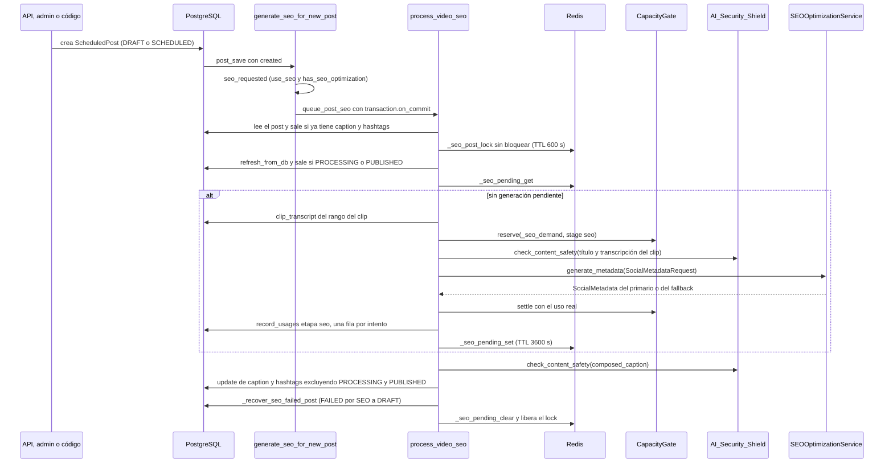
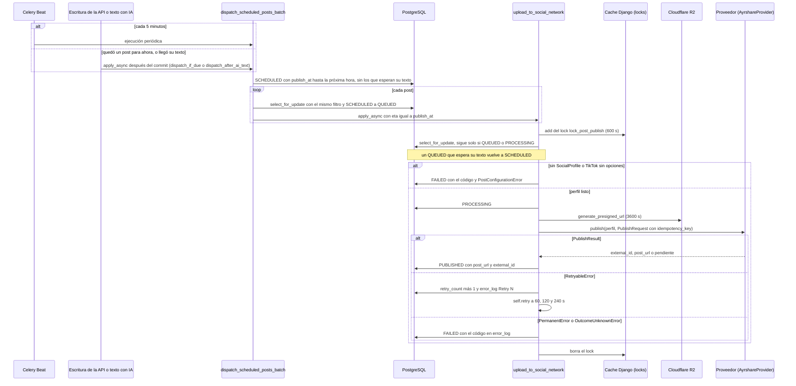

# SEO y publicación social

Este documento cubre la vida de una publicación (`ScheduledPost`): cómo la crea y la cambia la API, cómo se generan su caption y sus hashtags con IA (`process_video_seo`, [ADR-013](../adrs/013-ai-social-metadata.md)) y cómo se publica en TikTok, Instagram Reels o YouTube Shorts a través del proveedor de publicación del espacio (`upload_to_social_network` y la capa de proveedores `apps.integrations.social`, hoy con Ayrshare). La generación corre una vez por publicación, apenas se crea el `ScheduledPost`, y solo si el proyecto pagó el adicional de SEO; "Regenerar" la vuelve a pedir. La publicación corre cuando `dispatch_scheduled_posts_batch` encuentra posts `SCHEDULED` cuya `publish_at` ya llegó o cae dentro de la próxima hora. Lo corre el beat cada 5 minutos, y además una vez después de cada escritura de la API que deja un post para ahora. Ningún endpoint llama a la red.

## Componentes

| Componente | Archivo | Rol |
|------------|---------|-----|
| `ScheduledPost` (`Status`, `Platform`) | [models.py](../../back/apps/videos/models.py) | Estado de la publicación, `generated_caption`, `generated_hashtags`, `error_log`, `retry_count`, el texto del usuario (`caption`, `hashtags`, `tiktok`), `seo_requested_at` (con el índice parcial `post_seo_requested_idx`: solo las filas con un pedido), lo que dejó el proveedor (`post_url`, `external_id`) y la versión de la clave de idempotencia (`publish_key_version`). `caption_to_publish` y `hashtags_to_publish` son la regla del texto que sale, la misma para la API y el publicador. |
| `PostIdempotencyKey` | [models.py](../../back/apps/videos/models.py) | Qué publicaciones creó un pedido con `Idempotency-Key`, por workspace. |
| `ScheduledPostViewSet` | [views_social.py](../../back/apps/videos/views_social.py) | `/api/v1/scheduled-posts/`: listar y ver, crear (una o en lote), editar, cancelar, reintentar y regenerar el texto. |
| `create_posts`, `update_post`, `cancel_post`, `retry_post`, `regenerate_seo`, `dispatch_if_due` | [services/scheduled_posts.py](../../back/apps/videos/services/scheduled_posts.py) | Las reglas de cada escritura: estados, plan, cuenta, locks y la regla de un post trabado. `dispatch_if_due` corre el despachador después del commit cuando queda un post para ahora; `waits_for_ai_text` dice si un post espera su texto con IA, y `dispatch_after_ai_text` lo despacha cuando el texto llega. `_check_has_text` no deja salir vacío un post cuyo texto con IA falló, salvo `allow_empty_text`. |
| `VideoClipSerializer.posts`, `ClipPostSerializer`, `_response_posts`, `_read_once_per_response` | [serializers.py](../../back/apps/videos/serializers.py) | Las publicaciones de cada clip (`posts`), que cuentan las tarjetas de Clips (D3): leídas una vez por respuesta, nunca una consulta por clip. Las capas (`layers`, `_response_layers`) se leen igual. |
| `ScheduledPostSerializer`, `CreatePostSerializer`, `UpdatePostSerializer` | [serializers_social.py](../../back/apps/videos/serializers_social.py) | Lo que muestra la API (`seo_status`, `error_code`, `error_message` derivados) y lo que acepta. |
| `generate_seo_for_new_post`, `seo_requested`, `queue_post_seo` | [signals.py](../../back/apps/videos/signals.py) | Receptor de `post_save`: encola la generación después del commit, solo con SEO contratado. |
| `VideosConfig.ready` | [apps.py](../../back/apps/videos/apps.py) | Importa `signals` (y `checks`) para registrar el receptor. |
| `ScheduledPostAdmin.regenerate_ai_metadata` | [admin.py](../../back/apps/videos/admin.py) | Acción "Regenerar caption y hashtags con IA": regeneración explícita. |
| `process_video_seo` y sus helpers | [tasks/social.py](../../back/apps/videos/tasks/social.py) | Tarea Celery: lock, capacidad, moderación, LLM, generación pendiente, persistencia, filas de uso. |
| `SEOOptimizationService`, `SocialMetadata`, `SocialMetadataRequest` | [services/seo_engine.py](../../back/apps/videos/services/seo_engine.py) | Llamada LiteLLM (primario y un fallback), prompt y contrato de salida. |
| `clip_transcript`, `niche_slug`, `caption_limit`, `compose_caption` | [services/seo_engine.py](../../back/apps/videos/services/seo_engine.py) | Helpers puros: texto del clip, nicho como slug, límite por plataforma, caption final. |
| `AI_Security_Shield.check_content_safety` | [core/security.py](../../back/apps/core/security.py) | Moderación de la entrada y de la salida ([ADR-011](../adrs/011-content-moderation.md)). |
| `dispatch_scheduled_posts_batch` | [tasks/social.py](../../back/apps/videos/tasks/social.py) | Pasa a `QUEUED` los posts de la próxima hora y encola la publicación con ETA. Lo corren el beat y `dispatch_if_due`. |
| `upload_to_social_network` | [tasks/social.py](../../back/apps/videos/tasks/social.py) | Publica a través del proveedor del espacio, con backoff ante errores reintentables y un código en `error_log` ante los demás. |
| `SocialProfile` | [integrations/models.py](../../back/apps/integrations/models.py) | El perfil del espacio en el proveedor: `provider` (el que publica sus posts) y `provider_ref` (para Ayrshare, la Profile-Key, una credencial). Reemplaza a `Workspace.ayrshare_profile_key`, que queda deprecada. |
| `SocialProvider`, `PublishRequest`, `PublishResult`, `TikTokOptions`, `idempotency_key` | [integrations/social/base.py](../../back/apps/integrations/social/base.py) | La interfaz de un proveedor, en nuestros términos (redes, opciones de TikTok) y los timeouts de publicar. |
| `RetryableError`, `PermanentError`, `OutcomeUnknownError` y los códigos | [integrations/social/errors.py](../../back/apps/integrations/social/errors.py) | Qué puede hacer el que llama después de un error, y por qué falló. |
| `provider_for`, `get_provider`, `ready_profile` | [integrations/social/\_\_init\_\_.py](../../back/apps/integrations/social/__init__.py) | El proveedor de un perfil y el perfil de un espacio, sin llamar al proveedor. |
| `SocialAccountListView`, `SocialAccountConnectView`, `SocialAccountDetailView` | [views_social_accounts.py](../../back/apps/videos/views_social_accounts.py) | `/api/v1/social-accounts/`: las redes del espacio, conectar y desconectar (hueco 10). |
| `check_plan`, `check_can_connect`, `profiles_cap_reached`, `ensure_profile`, `connect_url`, `accounts`, `disconnect`, `network_status`, `has_connected_network`, `delete_orphan_profiles`, `delete_unlinked_profiles` | [integrations/social/accounts.py](../../back/apps/integrations/social/accounts.py) | Las redes de un espacio: quién conecta, el perfil creado la primera vez, la lista de cuentas con su copia corta y la última lectura guardada en el perfil, y la limpieza de los perfiles pagos que sobran. |
| `delete_orphan_social_profiles`, `clean_social_profiles` | [integrations/tasks.py](../../back/apps/integrations/tasks.py) | Borra en el proveedor el perfil de un espacio borrado; la corrida diaria, también los que nunca conectaron una red. |
| `social_smoke` | [integrations/management/commands/social_smoke.py](../../back/apps/integrations/management/commands/social_smoke.py) | Prueba con una key real ([runbook](../runbooks/redes-sociales-prueba.md)). Antes de llamar al proveedor mira el plan (`check_plan`) y, si va a crear el perfil, el tope (`profiles_cap_reached`): si no, termina con error. `--ignore-plan` saltea solo el plan. |
| `AyrshareProvider` | [integrations/social/ayrshare.py](../../back/apps/integrations/social/ayrshare.py) | `AYRSHARE_BASE_URL` (por defecto `https://api.ayrshare.com/api`): publicar, y crear, vincular, listar, desvincular y borrar perfiles. Lee la respuesta por el cuerpo, no solo por el HTTP. |

## Flujo: estados de `ScheduledPost`

1. Un post nace `DRAFT` (default del modelo, `draft: true` en la API, o el admin) o `SCHEDULED` (la API, para ahora o para una fecha). Cómo lo crea y lo cambia la API está en [Flujo: la API de publicaciones](#flujo-la-api-de-publicaciones).
2. `dispatch_scheduled_posts_batch` toma los `SCHEDULED` con `publish_at` hasta ahora + 1 h (los vencidos también: salen enseguida) y los pasa a `QUEUED` bajo `select_for_update`.
3. `upload_to_social_network` los pasa a `PROCESSING` y, si el proveedor la acepta, a `PUBLISHED`. Sin perfil del espacio (`SocialProfile`), o en TikTok sin `tiktok.privacy_level`, el post queda `FAILED` sin llamar al proveedor.
4. Un fallo de SEO (`_fail_seo_post`) deja `FAILED` con un código estático en `error_log`, salvo estas excepciones: el post está en `_SEO_FROZEN_STATUSES` (`PROCESSING`, `PUBLISHED`); ya tiene `generated_caption` no vacío y `generated_hashtags` (regeneración fallida: solo se registra `seo.regenerate_failed` y el post sigue publicable con el caption anterior); o es un `DRAFT` o tiene texto propio (caption o hashtags: `HAS_TEXT`, la misma regla que `has_text` de la API), que conservan su estado con el código en `error_log` (la API muestra `seo_status: "failed"`; el texto del usuario no necesita el de la IA); o es un `FAILED` al publicar (`outcome_unknown`, `account_not_connected`…), que conserva ese error, el aviso que el usuario tiene que ver antes de reintentar (`seo.failed_kept`). En todos los casos borra `seo_requested_at`. Cada caso es un solo `UPDATE` con todas sus condiciones; con `cutoff`, también la del pedido: el despachador termina solo uno vencido, y la tarea y el envío que el broker no tomó, solo el que atendieron (`seo_requested_at` como lo leyeron). Así un «Regenerar» o un texto que llega en el medio no se pisan. Ese borrador, mandado sin texto, es un 400 `post_text_missing` salvo `allow_empty_text` (ver [la API](#flujo-la-api-de-publicaciones), punto 1).
5. Una generación exitosa llama a `_recover_seo_failed_post`: un post `FAILED` cuyo `error_log` es un código de SEO vuelve a `DRAFT` con `error_log` vacío, y un `DRAFT` con ese código pierde el código. Nunca se vuelve a programar solo: el usuario revisa el caption y lo programa de nuevo. Un `FAILED` de publicación no se toca.

## Flujo: disparo de la generación

1. **Gating.** `seo_requested(project)` es verdadero solo si `project.metadata['use_seo']` es exactamente `True` y el plan del workspace la incluye: `subscription_plan` es `None` (sin plan no hay límites, como en `PricingEngine`) o `has_seo_optimization` es verdadero. `use_seo` se guarda al crear el proyecto y se cobra como el adicional `seo_optimization` ([ver 01-creacion-de-proyecto](01-creacion-de-proyecto.md)). Prompt-to-Edit no lo puede encender: `ConfigValidator` descarta un `use_seo` que sube el precio ([ver 04-prompt-to-edit](04-prompt-to-edit.md)). El plan se evalúa en el momento del disparo, no al crear el proyecto.
2. **Señal.** `generate_seo_for_new_post` escucha `post_save` de `ScheduledPost` (`dispatch_uid='videos.scheduled_post_seo'`). Sale sin hacer nada si el post no es nuevo (`created` falso: editar nunca regenera), si viene de un fixture (`raw`), si lo creó la API (`seo_decided`: `create_posts` ya decidió), si ya trae `generated_caption` y `generated_hashtags`, si nace `PROCESSING`, `PUBLISHED` o `FAILED`, o si `seo_requested` es falso.
3. **Después del commit.** `queue_post_seo(post_id)` marca el pedido (`seo_requested_at`, ver abajo) y registra el envío con `transaction.on_commit`: si la transacción que creó el post hace rollback, la tarea nunca se encola, y cuando se encola siempre encuentra el post. Un error del broker se registra como `seo.dispatch_failed` y no deshace el post; el envío correcto registra `seo.dispatched`.
4. **Regeneración explícita.** `POST /api/v1/scheduled-posts/:id/regenerate-seo/` (`regenerate_seo`) y la acción del admin `regenerate_ai_metadata` llaman a `queue_post_seo(post_id, regenerate=True)`, que encola `process_video_seo` con `kwargs={'regenerate': True}`. Ambas excluyen los posts `PROCESSING` y `PUBLISHED` y piden `seo_requested`; la API excluye también `QUEUED`. Es también la forma de reintentar un post cuyo disparo falló.
5. **Pedido en camino (`seo_requested_at`).** Lo escribe `queue_post_seo`, la usen la señal, el admin o la API. Mientras está y tiene menos de `seo_request_window()` (`AI_CAPACITY_MAX_WAIT_SECONDS` + 15 min), la API responde `seo_status: "pending"` aunque haya un texto anterior, y otro "Regenerar" no encola nada (un doble clic no paga dos generaciones). Lo borran `_generate_post_metadata` al guardar el texto, `_fail_seo_post` al fallar, `_end_seo_request` cuando la tarea no escribe nada porque el post ya se está publicando o salió, y `queue_post_seo` si el broker no tomó el mensaje. Mientras está, un post sin caption propio no sale (`waits_for_ai_text`, ver [la API](#flujo-la-api-de-publicaciones), punto 8).
   - **Un texto que nunca llega es una falla.** Si el broker no toma la tarea, `queue_post_seo` llama a `_fail_seo_post` con `seo_dispatch_failed` y, como `cutoff`, el pedido que marcó: un «Regenerar» que llegó después sigue en camino. Si el pedido pasa su ventana sin respuesta (el mensaje se perdió), el despachador llama a `fail_lost_ai_texts` antes de encolar nada y registra `seo_request_expired`. Esa consulta usa el índice parcial `post_seo_requested_idx` (migración `0024`, creado con `CREATE INDEX CONCURRENTLY`) y no recorre la tabla entera; un post `QUEUED` en ese estado lo frena el worker (`"AI text lost"`). Mientras tanto la API ya lo lee como falla (`ai_text_failed`). Un post que ya estaba `FAILED` conserva la falla que tiene (puede ser de la publicación, como `outcome_unknown`): solo termina su pedido. Antes, en los dos casos el post quedaba con `seo_status: "none"` y salía vacío en la corrida siguiente.
6. **`bulk_create`.** Django no emite `post_save` en `bulk_create`: los posts creados así no disparan la generación. Quien los cree de esa forma tiene que llamar a `queue_post_seo` por cada uno. El endpoint `/bulk/` guarda cada post con `save()`, así que la señal corre para todos.

## Flujo: generación de caption y hashtags

1. **Idempotencia antes del lock.** Si el post ya tiene `generated_caption` y `generated_hashtags` y no es una regeneración, la tarea termina (`"SEO Already Generated"`) sin llamar al proveedor. Un reintento de Celery nunca paga dos veces una generación ya persistida. Tampoco genera sin un pedido: todo mensaje sale de `queue_post_seo`, que lo marca (`seo_requested_at`), así que un post sin pedido es un mensaje entregado otra vez después de que su pedido terminó (las tareas usan `acks_late`). Termina con `seo.skipped reason=request_over` (`"SEO Skipped"`), antes del lock y otra vez después de releer el post adentro. Antes, un «Regenerar» que se entregaba dos veces pagaba una segunda generación, y un mensaje de un post que ya había fallado guardaba un texto que nadie esperaba.
2. **Lock por post.** `_seo_post_lock` toma un lock de Redis (`lock:seo:post:<post_id>`, `SEO_LOCK_TTL_SECONDS` = 600) sin bloquear. Su valor dice qué pedido atiende la tarea: `<token>|<seo_requested_at>` (vacío si no hay pedido). Si Redis no responde, levanta `RetryableAIError` y la tarea reintenta. Si otro worker tiene el lock, `_seo_lock_serves` lee ese pedido:
   - **Mismo pedido** (otro mensaje del que ya se genera), o un lock de una versión anterior que no lo dice: registra `seo.skipped reason=locked` y termina (`"SEO Busy"`). El que tiene el lock termina el pedido.
   - **Un pedido más nuevo** (un «Regenerar» que llegó mientras se generaba otro): espera (`_seo_wait_for_lock`). Se vuelve a encolar cada `SEO_BUSY_COUNTDOWN_SECONDS` (20 s, hasta 20 % más) con `lock_waited_s` (lo que lleva esperado) y `request_at` (el pedido con que espera), y registra `seo.waiting_for_lock` (`"Waiting for lock"`). Si al volver su pedido ya terminó (lo atendió el que tenía el lock, o lo reemplazó otro más nuevo, con su propio mensaje), termina con `seo.skipped reason=request_over` sin generar nada. Cuando ya esperó `AI_SEO_LOCK_WAIT_SECONDS` (240 s: más que una generación con el primario, el fallback y las dos moderaciones), su pedido termina como falla con `seo_busy` (`seo.lock_timeout`, `"Lock Timeout"`): el post muestra la falla y «Regenerar» vuelve a pedir. Antes el mensaje terminaba con `"SEO Busy"` y el pedido quedaba `pending` hasta pasar su ventana, con «Regenerar» rechazado.
3. **Dentro del lock** relee el post. Su `seo_requested_at` es el pedido que atiende: si la tarea falla, `_fail_seo_post` termina ese (`cutoff`), nunca un «Regenerar» que llegó mientras tanto. La tarea de ese pedido nuevo espera el lock (punto 2) y lo genera después. Si ya está `PROCESSING` o `PUBLISHED` registra `seo.skipped reason=<estado>`, termina el pedido (`_end_seo_request`: ningún texto va a llegar) y no hace nada más. Vuelve a chequear la idempotencia (otro run pudo terminar antes del lock). En una regeneración nueva (`regenerate`, `retries == 0` y sin `capacity_waited_s`) borra cualquier generación pendiente vieja con `_seo_pending_clear`.
4. **Generación pendiente.** `_generate_post_metadata` busca primero `seo:pending:<post_id>` en Redis (`_seo_pending_get`). Si existe, la reutiliza y no llama al LLM: es el caso de un reintento después de que la moderación de salida no dio veredicto.
5. **Texto del clip.** `_generate_social_metadata` arma el texto con `clip_transcript(project.transcript_data, clip.start_time, clip.end_time)`: los ítems con tiempos que se superponen con el clip, ordenados por inicio. Sin texto, el post falla con `seo_no_clip_transcript`; la transcripción completa del proyecto nunca es un sustituto.
6. **Pedido.** `SocialMetadataRequest` lleva `clip_transcript`, `clip_title`, `platform`, `target_niche` (`metadata['niche']` o `general`; ningún endpoint lo escribe hoy) y `language` (`AI_SEO_LANGUAGE`).
7. **Capacidad primero.** Con `_capacity_gate()` activo, reserva `_seo_demand` en los modelos de `_selection_models(True)` (primario, y fallback si es otro modelo con key). La demanda es `ceil((len(transcripción) + len(título)) / 4)` + `AI_CAPACITY_LLM_PROMPT_TOKENS` + `AI_CAPACITY_LLM_OUTPUT_TOKENS` tokens y 1 request por modelo. Se reserva antes de moderar para que una espera nunca repita la llamada de moderación (ver abajo).
8. **Moderación de entrada.** `check_content_safety` sobre título + transcripción del clip (`_seo_moderation_payload`). Contenido bloqueado (`UnsafeContentError`): devuelve la reserva (`_release_seo_capacity`), registra `seo.input_blocked` y falla con `content_blocked`. Sin veredicto (`ModerationError`): devuelve la reserva y deja que el handler de la tarea decida el reintento. El detalle de la moderación por bloques está en [03-transcripcion-moderacion-seleccion](03-transcripcion-moderacion-seleccion.md).
9. **LLM.** `SEOOptimizationService().generate_metadata(request)` hereda de `LiteLLMSelectionProvider`: key por llamada, `AI_LLM_TIMEOUT_SECONDS`, `num_retries=0`, el mismo tope de razonamiento y temperatura `0.7`. Intenta `AI_DEFAULT_LLM_MODEL` y, si falla y `_has_fallback()`, un intento con `AI_FALLBACK_LLM_MODEL`. El prompt aísla título y transcripción con `isolate_user_input`, reduce el nicho con `niche_slug` y pide un caption de como máximo `max(100, caption_limit(platform) - 8 × 32)` caracteres.
10. **Validación local.** La respuesta pasa por `SocialMetadata` (`extra="forbid"`): caption no vacío y entre 5 y 8 hashtags normalizados (sin `#`, solo letras, dígitos o `_`, sin duplicados ignorando mayúsculas). Además `composed_caption()` no puede superar `caption_limit(platform)`. Cualquier violación es `AIContractValidationError` (no reintentable) y le da su oportunidad al fallback; el intento queda facturado en `usage_attempts`.
11. **Uso y capacidad.** Con éxito: `gate.settle` con `_llm_usage_by_model` y `record_usages` con etapa `seo`, versión `v2`, una fila por intento (`usages_for_success`). Con error: `gate.settle` con `_selection_failure_usage` y `_record_call_failure`; después se relanza. Las filas se escriben antes de la moderación de salida y de persistir: la llamada ya se pagó.
12. **Generación pendiente.** El resultado se guarda en Redis con `_seo_pending_set` (`SEO_PENDING_TTL_SECONDS` = 3600). Si no se puede guardar, se registra `seo.pending_not_saved` y el resultado se usa igual.
13. **Moderación de salida.** `check_content_safety(metadata.composed_caption())`. Bloqueado: borra la pendiente, registra `seo.output_blocked` y falla con `generated_content_blocked`. Sin veredicto: la pendiente queda en Redis y el reintento no paga una segunda generación.
14. **Persistencia.** Un `update` de `generated_caption` y `generated_hashtags` que excluye `_SEO_FROZEN_STATUSES`. Vacía `seo_requested_at` solo si es el pedido que atendió la tarea: un «Regenerar» que llegó mientras tanto sigue en camino (`seo_status: "pending"`) y su mensaje genera otra vez, en vez de quedar absorbido por este texto. En una regeneración vacía también `caption` y `hashtags`: el texto nuevo reemplaza el que escribió el usuario, salvo que lo haya guardado después del pedido que atendió la tarea. Si no actualiza ninguna fila (la publicación empezó mientras se generaba, o el post se borró), borra la pendiente, termina el pedido (`_end_seo_request`), registra `seo.skipped reason=publishing` y deja el caption con el que se publicó. Si actualiza, llama a `_recover_seo_failed_post`, borra la pendiente, registra `seo.persisted` y llama a `dispatch_after_ai_text`: un post `SCHEDULED` para ahora que esperaba este texto sale enseguida, sin esperar al beat. `_fail_seo_post` también la llama al terminar el pedido: un post que sigue `SCHEDULED` (con su texto anterior o el suyo) sale enseguida, y uno sin ningún texto queda `FAILED` como siempre.
15. **Post borrado.** Si el post ya no existe al empezar o al releerlo dentro del lock (un borrador descartado, una publicación cancelada), registra `seo.skipped reason=deleted` y termina con `"Post Deleted"`, sin fallar la tarea.

### Espera de capacidad

Si `gate.reserve` levanta `CapacityUnavailable`, `_seo_wait_for_capacity` decide:

- Si `capacity_waited_s + wait_seconds` supera `AI_CAPACITY_MAX_WAIT_SECONDS`, registra `seo.capacity_timeout` y falla con `capacity_timeout`.
- Si no, vuelve a encolar `process_video_seo` con `countdown = _capacity_countdown(wait_seconds)` (el déficit, con tope `AI_CAPACITY_MAX_COUNTDOWN_SECONDS`, más hasta 20 % de jitter), `capacity_waited_s` acumulado y `retries` igual al actual. Registra `seo.pending_capacity`.
- Una regeneración conserva `regenerate=True` en el mensaje re-encolado: sin eso, el run siguiente vería el caption viejo y terminaría sin regenerar.
- El contador de reintentos de Celery viaja con el mensaje: una llamada que falla siempre se queda sin reintentos aunque haya esperas en el medio.
- A diferencia de la ingesta, la espera de SEO no escribe `metadata['capacity_wait']` en el proyecto: el tiempo esperado solo viaja en `capacity_waited_s`. Los token buckets están en [07-capacidad-costos-y-operacion](07-capacidad-costos-y-operacion.md).

### Nota de deploy (mensajes de SEO)

Esta versión le agrega a `process_video_seo` los argumentos `lock_waited_s` y `request_at`, y cambia el valor del lock (`<token>|<seo_requested_at>`). Antes de desplegarla, hay que vaciar los workers de SEO de la versión anterior: que no tomen mensajes nuevos y terminen los que tienen, o reemplazarlos todos a la vez.

- Un worker anterior que recibe un mensaje con esos argumentos falla con `TypeError` sin tocar el post. El pedido queda `pending` hasta que vence su ventana (`fail_lost_ai_texts`).
- Mientras quede un lock con el formato anterior, un «Regenerar» nuevo no sabe a qué pedido sirve ese lock y termina con `"SEO Busy"`, como antes de esta versión.

Desde esta versión la tarea ignora los argumentos que no conoce (`**unknown`, log `seo.unknown_arguments` con los nombres). Un argumento nuevo ya no rompe a un worker que todavía no se reemplazó.

## Flujo: conectar redes

Hueco 10 del mapa. `views_social_accounts.py` atiende `/api/v1/social-accounts/` sobre el espacio activo (`X-Workspace-Id`), y las reglas están en `apps/integrations/social/accounts.py`.

| Endpoint | Quién | Qué hace |
|----------|-------|----------|
| `GET /social-accounts/` | Cualquier miembro | Las tres redes en orden, con `status` (`connected`, `expired`, `disconnected`), `username`, `connected_at`, `limits` y `tiktok`. |
| `POST /social-accounts/connect/` | Dueño y Admin (`social.manage`), en un plan pago y con el email verificado | `{platform, return_url?}` → `{connect_url}`: la página del proveedor para autorizar esa red. |
| `DELETE /social-accounts/:platform/` | Dueño y Admin | Desvincula la red en el proveedor y deja en error lo que iba a salir por ella. |

0. **Quién conecta (`check_can_connect`).** Conectar y reconectar son de los planes pagos: `SubscriptionPlan.allow_social_accounts` (la migración `payments.0019` lo prende en Creador, Pro y Estudio; Gratis no). Sin plan no hay límites, como en las demás reglas de plan. Si el plan no lo incluye es 403 `{error, code: "social_accounts"}`, y sin el email verificado, 403 `email_not_verified`. Leer las cuentas y desconectar no miran el plan.
   - **Si el espacio baja a Gratis**, lo que ya estaba conectado queda: sigue publicando, se ve en H3 y se puede desconectar. Lo que no puede es conectar una red nueva ni reconectar una vencida (D6 y H3 muestran el candado con el plan que lo incluye). No se desvincula nada solo: cortar publicaciones programadas de alguien que bajó de plan sería una sorpresa peor que dejarlas salir.
1. **Perfil, la primera vez (`ensure_profile`).**
   - El primer «Conectar» crea el perfil del espacio en el proveedor que dice `SOCIAL_PROVIDER`, con el título `<SOCIAL_PROFILE_TITLE_PREFIX>-<id del espacio>`, único en Ayrshare.
   - Primero se reserva la fila de `SocialProfile`, una por espacio, en su propia transacción. Después, con el lock de esa fila, se llama al proveedor. Si dos «Conectar» llegan juntos, el segundo espera ese lock y encuentra el perfil hecho: nunca se crean dos perfiles pagos.
   - **Tope.** Cada perfil es un lugar pago de toda la cuenta de Ayrshare. Antes de crear uno se toma un advisory lock (uno solo para todos los espacios) y se cuentan los perfiles con key: con `SOCIAL_MAX_PROFILES` (10) o más, es 409 `social_profiles_limit` y el evento `social.profiles_limit` (error). Lo resuelve soporte: más lugares en Ayrshare y subir el número.
   - Si la creación falla, la fila queda sin `provider_ref` y el próximo intento la crea. Si se perdió la respuesta, el próximo intento recibe el código 146 (título tomado): es 409 `profile_title_taken` (no «probá de nuevo», porque no se arregla solo) y el evento `social.profile_title_taken` (error). Se arregla a mano ([runbook](../runbooks/redes-sociales-prueba.md)).
   - La key también se copia a `Workspace.ayrshare_profile_key` (deprecada), en otra sentencia sin locks, para un worker de la versión anterior durante un deploy.
2. **Link (`connect_url`).** `generateJWT` con `allowedSocial` de esa red y `language: "es"`. El link vale 5 minutos.
   - La web lo abre con `window.open`. Sin `return_url`, el botón «Close» del proveedor cierra esa ventana (es lo que hace D6: ve que se cerró y vuelve a leer las cuentas hasta que aparece la red, y ahí deja de preguntar). «Cancelar» en D6 cierra también esa ventana.
   - Con `return_url`, va como `redirect` y ese botón lleva la ventana ahí. Tiene que tener el esquema y el host de `FRONTEND_URL`, sin usuario en la URL; si no, es 400. Así la página del proveedor no sirve de redirección abierta.
   - Si el proveedor dice que el perfil no existe (144), se olvida su ref (`social.profile_lost`, error) y se crea otro, una vez. Solo al conectar, que lo hace un Dueño o un Admin: la key se recibe una sola vez y no se tira por una lectura.
   - Conectar borra la marca de desconexión de esa red (`disconnected_at`): desde ahí, un «conectada» del proveedor se cree.
   - Límite: `THROTTLE_SOCIAL_CONNECT` (30 por hora por usuario).
3. **Cuentas (`accounts`).** Sin perfil, las tres `disconnected` sin preguntar. Con perfil, `GET /user` del proveedor, con un timeout corto (`ACCOUNTS_TIMEOUT_SECONDS`, 3 s para conectar y 8 s para leer):
   - Se reusa `ACCOUNTS_CACHE_SECONDS` (15 s) en la caché `default` (`social:accounts:<espacio>`), y conectar y desconectar la borran. Ayrshare guarda su propia copia hasta 60 s y acepta 300 pedidos cada 5 minutos por perfil.
   - **Una lectura por espacio a la vez** (`cache.add` de `social:accounts_reading:<espacio>`, 30 s): mientras tanto los demás pedidos reciben la última lectura buena (`social:accounts_last:<espacio>`, 24 h), o 502 si no hay ninguna. Con Redis caído, la caché de producción (`FailOpenRedisCache`) responde `None` sin error: cada pedido lee el proveedor, porque no hay con quién compartir la lectura. Una falla del proveedor no se vuelve a intentar por `ACCOUNTS_FAILURE_SECONDS` (15 s): mientras, la última lectura o el 502. Así un Ayrshare lento no ocupa un worker web por cada pestaña abierta.
   - `expired` es una red cuyo `refreshRequired` ya pasó, o con `refreshDaysRemaining` en 0 o menos.
   - **Recién desconectada.** El proveedor puede seguir listando una red hasta 60 s después de desvincularla (su copia). Una red desconectada hace menos de `DISCONNECT_GRACE` (60 s, por `SocialProfile.disconnected_at`) se guarda `disconnected` diga lo que diga la lectura.
   - Cada lectura queda en `SocialProfile.networks` (`{red: estado}`) y `networks_read_at`, bajo el lock de la fila (así un desconectar que llega en el medio no se deshace). La primera red vinculada marca `linked_at`. Con eso deciden, sin llamar al proveedor, el 409 al publicar (`network_status`) y el paso de onboarding `has_social_account` (`has_connected_network`: alguna red `connected`).
   - **Perfil perdido en una lectura (144).** Las tres quedan `disconnected` y queda el evento `social.profile_not_found` (error), pero la key no se borra: una configuración equivocada (otra API key) no tiene que borrarle la key a cada espacio que alguien mire. No se publica hasta que un Dueño o un Admin conecta de nuevo, y eso arma otro perfil.
   - `limits` son nuestras reglas: `caption_limit`, `HASHTAGS_MAX` y la duración máxima de cada formato (TikTok 600 s, Reels 900 s, Shorts 180 s, de las guías de Ayrshare).
   - `tiktok` lleva un valor seguro (`PUBLIC_TO_EVERYONE`, `MUTUAL_FOLLOW_FRIENDS` y `SELF_ONLY`; nada apagado), porque Ayrshare no expone las opciones del creador.
   - Un error del proveedor es 502 `{error, code}` (`_provider_failure`), con el `code` de la falla (por ejemplo `provider_unavailable`) y un mensaje propio. Nunca 503: el 503 queda para el mantenimiento de OneCreator (K5), y las versiones anteriores de la web leían cualquier 503 así y lo mostraban hasta el próximo sondeo, un minuto.
4. **Desconectar (`disconnect` y `fail_network_posts`).** `DELETE /profiles/social` con la red (no es error si no estaba). Se guarda la red como `disconnected` y su hora en `disconnected_at`. Después, los posts del espacio en esa red en `SCHEDULED` o `QUEUED` pasan a `FAILED` con `account_not_connected (disconnected)`.
   - Se leen los ids primero, y después se bloquean en orden de pk (el mismo orden que el borrado del espacio, para que los dos no se traben) y se vuelve a mirar el estado bajo el lock: un post que el worker pasó a `PROCESSING` mientras tanto queda para su worker.
   - Los borradores no cambian.
   - Si el proveedor falla, es 502 y no cambia nada.
5. **Borrar el espacio.** Primero se marca la fila del perfil (`orphaned_at`). `SocialProfile.workspace` es `SET_NULL`: el borrado deja la fila sin espacio (después de su lock: espera a un «Conectar» que la esté creando), y después del commit encola `delete_orphan_social_profiles`.
   - La tarea borra en el proveedor solo los perfiles marcados por un borrado (`orphaned_at` y sin espacio), y después la fila. Un perfil que otra fila con espacio todavía usa no se borra en el proveedor (solo la fila, con `social.orphan_shared`, error).
   - Una fila sin `provider_ref` se borra sin llamar al proveedor (`social.orphan_without_ref`). Si era una creación cuya respuesta se perdió, ese perfil queda en Ayrshare y se busca por su título ([runbook](../runbooks/redes-sociales-prueba.md)).
   - Si falla, o si el broker no toma el mensaje, la fila queda para la corrida diaria (`clean_social_profiles`, beat `clean-social-profiles`, 05:10 UTC). Nunca frena el borrado.
6. **Perfiles que nunca conectaron.** Un «Conectar» abandonado deja un perfil pago sin redes. La corrida diaria también borra los perfiles de espacios vivos sin `linked_at` y con más de `SOCIAL_UNLINKED_PROFILE_DAYS` (7) días: primero le pregunta al proveedor, y uno que tiene alguna red se queda (y se marca `linked_at`). El espacio arma otro la próxima vez que conecte.
   - Cada «Conectar» marca la fila (`connect_requested_at`, migración `0004_pedido_de_conexion`). Un perfil con un link pedido en la última hora (`CONNECT_IN_PROGRESS`) no se toca: alguien puede estar vinculándolo, y la lista del proveedor tarda hasta 60 s.
   - Si un «Conectar» esperaba el lock de una fila que la limpieza borró, vuelve a reservar una fila (una vez) y crea otro perfil, en lugar de responder 404.
7. **Una fila por perfil.** `(provider, provider_ref)` es único cuando hay ref (`integrations_one_row_per_provider_profile`). La migración `0003_redes_por_espacio` deja la key compartida (dos espacios con la misma `ayrshare_profile_key`, que podían publicar en las cuentas del otro) solo en la fila del espacio más viejo (su `created_at`, y después su id); las demás quedan sin key y conectan de nuevo. No decide el `created_at` de la fila: `0002` creó las filas de una vez y sin orden, y dos pueden tener el mismo instante, así que la elegida podía cambiar entre corridas.
8. **Locks.** La fila de `SocialProfile` y, para crear un perfil, el advisory lock del tope (siempre después de la fila). Nada de esto bloquea la fila del workspace, ni toma un post mientras tiene la fila del perfil. El borrado del espacio marca la fila del perfil al principio y después borra proyectos, workspace, posts (en orden de pk) y billetera: no hay ciclo posible.
   - La migración `0003` no recrea la clave foránea de `workspace` (el `AlterField` de Django la borra y la vuelve a crear, con un lock ACCESS EXCLUSIVE sobre `users_workspace` mientras los contenedores viejos atienden): en PostgreSQL solo hace `DROP NOT NULL`.
   - `integrations.0003`, `integrations.0004` y `payments.0019` ponen `lock_timeout` de 5 s como primera operación, en las dos direcciones: una transacción larga sobre la tabla hace fallar la migración rápido en vez de encolar todos los pedidos detrás (`payments_subscriptionplan` se lee en cada pedido de un espacio).
   - Volver atrás `0003` borra las filas sin espacio: antes, correr la limpieza ([runbook](../runbooks/redes-sociales-prueba.md#antes-de-volver-atrás-las-migraciones)), o un perfil cuya limpieza no corrió queda en Ayrshare sin fila.

## Flujo: la API de publicaciones

`ScheduledPostViewSet` ([views_social.py](../../back/apps/videos/views_social.py)) atiende `/api/v1/scheduled-posts/` sobre el workspace activo (`X-Workspace-Id`): un post de otro workspace es 404 y un clip de otro workspace es 400 (`"El clip no existe."`). Escribir pide `post.publish` (Dueño, Admin y Editor; un Lector recibe 403). Las reglas están en [services/scheduled_posts.py](../../back/apps/videos/services/scheduled_posts.py), y ninguna llama al proveedor de publicación: lo que tiene que salir queda `SCHEDULED` y lo encola `dispatch_scheduled_posts_batch` (ver el punto 8).

| Endpoint | Función | Qué hace |
|----------|---------|----------|
| `POST /` | `create_posts` | Un post. Con `draft: true` queda `DRAFT`; si no, `SCHEDULED` con su `publish_at` (ahora si es `null`, falta o cae a menos de `NOW_TOLERANCE` = 60 s). |
| `POST /bulk/` | `create_posts` | Hasta `BULK_MAX` = 60, todo o nada en una transacción. Un error dice cuál con `index`; un clip repetido en la misma red es 400. |
| `PATCH /:id/` | `update_post` | Texto, `tiktok` y `publish_at` de un `DRAFT` o un `SCHEDULED`. `publish_at` con fecha programa o reprograma, `null` lo deja para ahora, sin el campo un borrador sigue borrador. Si su texto con IA falló y saldría sin texto, pide `allow_empty_text`. |
| `POST /:id/cancel/` | `cancel_post` | Borra un `DRAFT`, `SCHEDULED`, `QUEUED`, `FAILED` o un `PROCESSING` trabado. |
| `POST /:id/retry/` | `retry_post` | Un `FAILED`, o un `PROCESSING` trabado, vuelve a `SCHEDULED` para ahora, sin `error_log` y con una clave de idempotencia nueva. Si falló el texto con IA, vuelve a `DRAFT`. Si saldría sin texto en un proyecto con SEO y sin un texto en camino (su texto nunca llegó), también: `DRAFT` con `seo_text_missing` y una clave nueva, para que se escriba, se regenere o se confirme. |
| `POST /:id/regenerate-seo/` | `regenerate_seo` | Pide otro texto a la IA (ver [disparo](#flujo-disparo-de-la-generación)). Responde 202 con `seo_status: "pending"`. |

1. **Validación (400).** El clip tiene que estar `completed` o `published`. El texto que sale (`compose_caption`) no puede pasar `caption_limit(platform)`, ni los hashtags `HASHTAGS_MAX` (30 en TikTok e Instagram, 15 en YouTube). Los hashtags llegan sin `#` y sin repetidos (`clean_hashtags`); uno con espacios u otros caracteres es 400. Un post de TikTok que sale necesita `tiktok.privacy_level` (`clean_tiktok`; las otras opciones faltantes son `false`). Una fecha más de 60 s en el pasado es 400.
   - **Sin texto después de una falla de la IA (`_check_has_text`).** Un post que sale (mandar un borrador, crearlo para ahora o con fecha, o vaciarle el texto a uno `SCHEDULED`) cuyo texto con IA falló (un código de SEO en `error_log`, `seo_rate_limited` incluido) y que quedaría sin caption ni hashtags, ni del usuario ni de la IA, es 400 `{error, code: "post_text_missing"}` (con `index` en `/bulk/`), y no cambia nada. El mensaje sirve en cualquier pantalla que lo muestre («No pudimos generar el texto con IA y esta publicación no tiene texto: escribilo o regeneralo.»). Con `allow_empty_text: true` sale así: es la confirmación del panel E1, y la falla queda atrás (`error_log` vacío, también al crear). Lo encontró el ensayo 6: el texto falló en menos de un segundo y «Publicar ahora» mandó `post: ""` sin avisar.
   - Se mira al mandar un borrador y al cambiar el texto. Mover un post ya `SCHEDULED` a otra hora (el arrastre del calendario, solo `publish_at`) no pregunta: sale con el texto con el que se aceptó.
   - «Falló» es `ai_text_failed`: un código de SEO en `error_log`, o un pedido que pasó su ventana sin un texto anterior. Un texto todavía en camino (`seo_request_pending`, por ejemplo un «Regenerar» después de la falla) no es una falla: el post espera ese texto (punto 8). Un proyecto sin SEO no prometió texto: sus posts no se miran. En YouTube el título sale igual (el del clip).
2. **Plan (403).** Sin plan no hay límites. Programar (una fecha más de 60 s adelante) pide `allow_scheduling` (`code: "scheduling"`). Sin `allow_crossposting`, un clip sale en una sola red: se cuentan sus posts `SCHEDULED`, `QUEUED`, `PROCESSING` y `PUBLISHED` más los nuevos, no los borradores ni los fallidos (`code: "crossposting"`). Se mira al crear, al mandar un borrador y al reintentar.
3. **Cuenta (409).** Cada red de lo que sale tiene que estar conectada según la última lectura del proveedor (`network_status`, de `SocialProfile.networks`), sin llamarlo: desconectada es `code: "account_not_connected"` con «La cuenta de X no está conectada. Conectala para publicar.», y vencida el mismo código con «está vencida. Reconectala para publicar.». Un perfil copiado de `ayrshare_profile_key` que nunca se leyó cuenta como conectado. Ver [Flujo: conectar redes](#flujo-conectar-redes).
4. **Locks.** Cada escritura toma la fila del post con `select_for_update` y decide con el estado que lee bajo ese lock, como `dispatch_scheduled_posts_batch` y `upload_to_social_network`. Crear, mandar un borrador y reintentar toman antes el proyecto y el clip, en el orden de los renders de `views_clips` (crear y regenerar, antes que nada, el advisory lock del presupuesto de IA; nunca la fila del workspace); así dos pedidos del mismo clip cuentan las redes uno después del otro. Por eso:
   - un `PATCH` que llega mientras el despachador pasa el post a `QUEUED` espera y responde 409 `post_in_flight`: su tarea ya salió con la hora vieja;
   - un `cancel` que llega mientras el worker lo pasa a `PROCESSING` espera y responde 409 `post_in_flight`; uno que llega con el post `QUEUED` lo borra, y la tarea después no lo encuentra (`"Post Deleted"`);
   - dos `retry` a la vez: el segundo encuentra el post `SCHEDULED` y responde 409 `post_not_failed`.
5. **Post trabado.** Un `PROCESSING` se puede reintentar o cancelar (`_check_stuck`) cuando su último intento empezó (`updated_at`, que el worker escribe al pasarlo a `PROCESSING`) hace más de `stuck_after` y el worker no tiene `lock_post_publish_<post_id>` (`publish_lock_held`). `stuck_after` es `POST_STUCK_AFTER` = 15 min (un intento tiene el lock a lo sumo 600 s), salvo que el worker esté esperando un reintento: entre dos intentos escribe `error_log` `Retry n: …` con `update()` (no mueve `updated_at`), suelta el lock y su reintento espera un lugar libre en los workers, que los renders pueden ocupar por horas. Ese post está en camino: recién cuenta como trabado pasado el `visibility_timeout` del broker (4 h) más `LONGEST_RETRY_COUNTDOWN` (240 s). Antes es 409 `post_in_flight`; si la caché de locks no contesta, 409 `post_lock_unavailable`. Un post trabado, o uno que falló con `outcome_unknown` o `duplicate_content`, pudo haber salido: la UI lo avisa antes de reintentar o cancelar (cancelar lo saca de OneCreator, no de la red). Reintentar lo manda con una clave de idempotencia nueva (`publish_key_version` + 1): si había salido, sale otra vez.
6. **`Idempotency-Key`.** Crear y `/bulk/` la aceptan (hasta 255 caracteres). `PostIdempotencyKey` se inserta al empezar la transacción, con un índice único por workspace y clave: un pedido igual que llega a la vez espera ese índice y después devuelve los posts que creó el primero (como están ahora), sin crear nada. Con otro cuerpo (huella `fingerprint`) es 409 `idempotency_key_reused`, igual que si sus posts ya no existen. Un error deshace la fila, así que la misma clave vuelve a intentar. Las claves de más de 24 h (`IDEMPOTENCY_TTL`) se borran antes de cada pedido con clave.
7. **Texto con IA y lo que cuesta.** Cada texto es una llamada al LLM: no gasta tokens de la billetera (el SEO se cobra una vez al crear el proyecto, `seo_optimization` de `PricingEngine`), pero se paga al proveedor y usa la capacidad que comparte la ingesta de todos los espacios. Por eso `create_posts` decide por cada post nuevo, con el presupuesto del espacio bloqueado (`lock_ai_budget`):
   - sin texto con IA si el proyecto no tiene SEO o si el post trae caption y hashtags;
   - reusado (`reusable_ai_text`) si otro post del mismo clip y la misma red ya lo tiene, o si lo tenía un borrador descartado en las últimas 24 h (`remember_ai_text` lo guarda en la caché al cancelar, con el recorte del clip en la clave);
   - pedido (`queue_post_seo`) si queda lugar en `seo_budget`, contado bajo un advisory lock del espacio (`lock_ai_budget`: `pg_advisory_xact_lock` con un namespace propio), nunca bajo la fila del workspace: un render pago o un re-dispatch bloquean un proyecto y después su workspace, y borrar un workspace bloquea sus proyectos y después el workspace, así que nada puede bloquear la fila del workspace y después un proyecto. El límite es `AI_SEO_MAX_PER_WORKSPACE_PER_HOUR` (120) menos los pedidos en camino de la última hora y las filas `AIUsageRecord` de etapa `seo` (rol `primary`) de la última hora, que quedan aunque el post se borre;
   - sin lugar, el post se crea igual con `error_log` `seo_rate_limited` (`seo_status: "failed"`).
   "Regenerar" usa el mismo límite (429 `seo_rate_limited`) y además `THROTTLE_POST_SEO_REGENERATE` (30 por hora por usuario). Crear y `/bulk/` tienen `THROTTLE_POST_CREATE` (300 por hora por usuario, contando cada post del lote: `PostCreateThrottle`). Guardar el texto con `PATCH` escribe `text_edited_at` y deja `seo_requested_at` como está (el pedido sigue contando en `seo_budget`): `_generate_post_metadata` solo reemplaza el texto del usuario si el "Regenerar" se pidió después de esa edición. Las dos marcas salen del reloj de la base (`Now()`, que en PostgreSQL es `STATEMENT_TIMESTAMP()`) en una sentencia escrita con el lock de la fila del post tomado, así siguen el orden en que los dos pedidos tuvieron el post. El advisory lock es de transacción (`pg_advisory_xact_lock`): se suelta al terminar el pedido, también si se rechazó.
8. **Ahora, sin esperar al beat (`dispatch_if_due`).** Crear, `/bulk/`, `PATCH` y `retry` miran, dentro de su transacción, si dejaron algún post `SCHEDULED` para ahora (`publish_at` hasta `NOW_TOLERANCE` después del momento del pedido, lo mismo que `_when` llama «ahora»). Si es así, registran con `transaction.on_commit` una sola corrida de `dispatch_scheduled_posts_batch.delay()`, aunque el lote tenga 60 posts. Un borrador, una fecha más adelante o un reintento que vuelve a `DRAFT` no la piden, y un pedido que se deshace tampoco.
   - El pedido no encola el post: solo pide la corrida. El despachador vuelve a tomar cada post con `select_for_update` y el mismo filtro, así que dos corridas a la vez (dos pedidos, o un pedido y el beat) lo encolan una sola vez (`DispatchAfterCommitRacesTests`).
   - Si el broker no toma la corrida, el pedido responde igual: se loguea `posts.dispatch_not_queued` con la clase del error y el post sale en la próxima corrida del beat. El beat sigue siendo el respaldo.
   - La respuesta suele decir `SCHEDULED`; dice `QUEUED` si el despachador ya lo tomó antes de que el pedido leyera el post de nuevo.
   - **Espera su texto con IA.** Un post sin caption propio cuyo texto está en camino (`waits_for_ai_text`: `seo_requested_at` dentro de `seo_request_window()`) no pide la corrida: saldría sin texto y el texto que llega después se tiraría (la IA no toca un post que se publica). Al crear se sabe por el pedido que se acaba de hacer (`seo == 'asked'`); al editar y reintentar, por `seo_request_pending`. El despachador también los saltea (`waiting_for_ai_text`, en la consulta y bajo el lock), así que el beat tampoco los toma. Sale cuando el texto llega o el pedido termina (`dispatch_after_ai_text`). Si el pedido pasa su ventana, es una falla del texto (`fail_lost_ai_texts`), nunca un permiso para salir vacío.
   - Como un post "ahora" queda `QUEUED` en milisegundos, en la práctica ya no hay tiempo para editarlo o cancelarlo antes de que salga (`post_in_flight`).
   - Cada corrida es el despachador entero, de todos los espacios: mandar N borradores uno por uno son N corridas. Alcanza a esta escala.
9. **En el clip (`posts`).** Cada clip que manda la API (`VideoClipSerializer`: el proyecto, la lista de proyectos, `paper-edit-data` y `GET /clips/:id/`) trae `posts`: cada publicación suya, en cualquier estado (también borradores y fallidas), con `id`, `platform`, `status` y `publish_at`, por `publish_at`. Con eso las tarjetas de Clips (D3) dicen «Publicado» o «Programado» y cuentan sus filtros: el ensayo 6 vio «Publicados 0 · Programados 0» y el clip «Listo» después de publicarlo.
   - `_response_posts` las lee una vez para toda la respuesta: las de los proyectos (o de los clips) de la raíz, juntas, en una consulta, sin importar cuántos clips haya. Las capas del clip (`layers`) siguen la misma regla (`_read_once_per_response`): antes el proyecto hacía una consulta de capas por clip.
   - La web vuelve a pedir el proyecto cada 5 s mientras alguna publicación de sus clips sale (en cola, publicando o programada para ahora), así la tarjeta pasa sola a «Publicado».
   - En el modo híbrido de la demo los clips son del backend y las publicaciones de los mocks: los contadores de Clips solo ven las publicaciones del backend, no las que se hacen en la demo ([runbook de la demo](../runbooks/demo.md)).

## Flujo: publicación

1. **Disparo.** `CELERY_BEAT_SCHEDULE` (`dispatch-scheduled-posts`) lo corre cada 5 minutos, con el servicio `beat` de `docker-compose.yml`. Una escritura de la API que deja un post para ahora lo corre una vez más después de su commit (`dispatch_if_due`, punto 8 de la API): «publicar ahora» y reintentar no esperan al beat, que queda de respaldo.
2. **Ventana.** Toma posts `SCHEDULED` con `publish_at` hasta ahora + 1 h, los vencidos incluidos (un "publicar ahora" de la API es uno), salvo los que esperan su texto con IA (`waiting_for_ai_text`: sin caption propio y con el pedido en camino). Cada post se re-lee con `select_for_update` y el mismo filtro (`SCHEDULED`, `publish_at` dentro de la ventana y sin esperar texto): si ya no coincide (se canceló, se borró, se reprogramó o pidió otro texto después de la consulta) se saltea; si coincide, pasa a `QUEUED` y se encola `upload_to_social_network` con `eta=publish_at`.
3. **Lock de publicación.** `caches['locks'].add(f"lock_post_publish_{post_id}", ..., PUBLISH_LOCK_TTL_SECONDS)` (600 s: el timeout de lectura de publicar, 300 s, más 300 s) en el alias `locks` de la caché de Django, que con `CACHE_REDIS_URL` es el Redis que comparten todos los workers: ahí `add` es un `SET NX` atómico ([07](07-capacidad-costos-y-operacion.md#cache-compartida)). Si ya existe, termina con `"Locked"`. Ese alias no ignora errores: si Redis no contesta, no publica sin lock. Loguea `publish.lock_unavailable` y reintenta con `self.retry` a 60, 120 y 240 s (`max_retries=3`); al agotarse, el post pasa a `FAILED` con `error_log` `Lock unavailable after N attempts: <clase>`, en vez de quedar `QUEUED` sin tarea (el despachador solo toma `SCHEDULED`). Se libera en el `finally`; si soltarlo falla, `publish.lock_release_failed` y lo libera el TTL. `PUBLISH_LOCK_TTL_SECONDS` también fija `POST_PROCESSING_WINDOW` del borrado del espacio.
4. **Validación, bajo el lock de la fila.** Un post `PUBLISHED` termina (`"Already Published"`). Uno que no está `QUEUED` ni `PROCESSING` termina con `"Skipped"` y `publish.skipped`: es un mensaje viejo de un post que siguió su camino (el usuario lo reintentó y el beat lo encola de nuevo, o falló su texto con IA), y nunca lo publica. Un `QUEUED` que espera su texto con IA (`waits_for_ai_text`) vuelve a `SCHEDULED` sin mandar nada (`"Waiting for AI text"`): el despachador lo encola otra vez cuando llega el texto. Sin `SocialProfile` con `provider_ref` el post queda `FAILED` con `account_not_connected`; en TikTok, sin `tiktok.privacy_level`, con `tiktok_options_missing`. En los dos casos se levanta `PostConfigurationError` después del commit (no se reintenta) y no se llama al proveedor.
5. **Media.** `provider_media_url(video_clip.s3_object_key, expiration_seconds=3600)` ([storage_service.py](../../back/apps/videos/services/storage_service.py)): con R2, la URL firmada de `CloudflareR2Manager.generate_presigned_url`, como siempre. Sin R2 (`USE_R2=False`), la URL `/media/` con el origen de `MEDIA_PUBLIC_BASE_URL` o, si está vacío, el de `FRONTEND_URL` (solo el esquema y el host, sin su ruta: la demo sirve `/media/` en el mismo origen que la web). El worker no tiene un pedido del que tomar el origen, y el ensayo 6 vio que a un Ayrshare falso le llegaba la ruta relativa. El proveedor descarga el video desde esa URL.
6. **Texto.** `compose_caption(post.caption_to_publish(), post.hashtags_to_publish())`: el caption del usuario o, si está vacío, el de la IA; los hashtags del usuario o, si no hay, los de la IA (cada parte por su lado, como `caption` y `hashtags` de la API); una línea en blanco y los hashtags con `#`. Sin ninguno, el texto es vacío: las redes lo aceptan y no se inventa nada. Si fue porque falló el texto con IA, la API solo lo deja salir así con `allow_empty_text` (`_check_has_text`). YouTube pide un título: el del clip (o el del proyecto).
7. **Proveedor.** `provider_for(profile)`: el que dice `SocialProfile.provider`, no `SOCIAL_PROVIDER` (ese solo elige el de los perfiles nuevos). `publish(profile, PublishRequest)` recibe la red, la URL, el texto, el título, `TikTokOptions` y la clave de idempotencia. Ver [Capa de proveedores](#capa-de-proveedores).
8. **Resultado.** `PUBLISHED` con `post_url` (el link de la red) y `external_id` (el id del post en el proveedor; en Ayrshare, el `id` de su respuesta), y `error_log` vacío. TikTok acepta el video y lo procesa después (`id: "pending"`, sin `postUrl`): el post queda `PUBLISHED` con `post_url` nulo. Si TikTok después no lo puede procesar, hoy no se entera nadie: el aviso llega por webhook y todavía no se lee.

## Capa de proveedores

`apps.integrations.social` es lo único que habla con un servicio de publicación. El resto del backend usa sus tipos (`PublishRequest`, `PublishResult`, `Account`, `TikTokOptions`, las redes como `ScheduledPost.Platform`) y sus errores, nunca los nombres, ids ni mensajes de Ayrshare.

- **Interfaz (`SocialProvider`).** `create_profile(workspace)`, `connect_url(profile, platform, return_url)`, `accounts(profile)` (una `Account` por red: `connected`, `expired` o `disconnected`, con `username` y `connected_at`), `disconnect(profile, platform)`, `delete_profile(profile)` y `publish(profile, request)`. `profile` es el `SocialProfile` del espacio. Un segundo proveedor (Upload-Post) implementa la misma interfaz: su perfil es un `username`, su link es `generate-jwt`, su publicación es multipart con el header `Idempotency-Key`, y una subida asíncrona sería un `PublishResult` pendiente con su `request_id`.
- **Perfil (`SocialProfile`).** Uno por espacio (`OneToOneField`). `provider_ref` es la Profile-Key de Ayrshare: una credencial que nunca va a la web, ni a los logs, ni a `error_log`. La migración `0002_perfiles_desde_ayrshare_profile_key` copió las `Workspace.ayrshare_profile_key` que había. Esa columna queda sin uso y deprecada (el admin la oculta): un worker de la versión anterior todavía puede leerla durante un deploy, y se borra más adelante. Si se vuelve atrás la migración, las keys de los perfiles se copian a esa columna donde esté vacía. El admin («Perfiles de redes») nunca muestra la key: solo deja escribir una nueva (`SocialProfileForm`).
- **Nota de deploy (perfiles).** Mientras quedan procesos de la versión anterior:
  - una key que alguien escriba en el admin viejo (en `Workspace.ayrshare_profile_key`) después de correr `0002` no se copia: hay que cargarla de nuevo en «Perfiles de redes»;
  - un proceso web viejo que borra un espacio con perfil no conoce la tabla y su borrado falla al confirmar (la clave foránea): responde 500 y no borra nada. Después del reinicio, borrar funciona.

  No se cambió la clave foránea a `ON DELETE CASCADE` en la base porque recrearla bloquea `users_workspace` mientras corre la migración.
- **Errores.** Cada error lleva `code` y `detail` (HTTP, los códigos numéricos del proveedor o la clase de la excepción), nunca el mensaje del proveedor: puede citar el caption.
  - `RetryableError`: vale la pena mandarlo de nuevo, con backoff. Si el proveedor pidió esperar (`Retry-After`), espera eso, hasta 240 s (`LONGEST_RETRY_COUNTDOWN`). Hay tres casos:
    - no llegó nada al proveedor: conexión rechazada, sin nombre, timeout al conectar, o un 429;
    - el proveedor respondió seguro que no salió y que se puede reintentar (`key_spent`: `retryAvailable`);
    - un 5xx que no explica qué pasó (`maybe_sent`: pudo haber salido).
  - `PermanentError`: no salió y mandarlo igual no cambia nada. Falla con su código, sin reintento.
  - `OutcomeUnknownError`: pudo haber salido. Falla con `outcome_unknown` y nunca se reintenta solo. Son estos casos:
    - un timeout de lectura;
    - una conexión cortada después de mandar el pedido (`ProtocolError`/`RemoteDisconnected`, o una respuesta cortada a la mitad): Ayrshare baja el video dentro del pedido, así que puede seguir publicándolo, y nada documenta que rechace una clave todavía en curso;
    - un 504, con o sin cuerpo;
    - una respuesta 2xx que no se puede leer;
    - un error inesperado dentro de la llamada al proveedor.
- **Clave de idempotencia.** `idempotency_key(post_id, publish_key_version)` (`onecreator-post-<id>-v<n>`). Ayrshare rechaza una clave repetida para siempre, aunque el primer post haya fallado. Por eso:
  - los reintentos automáticos mandan la misma clave: si un intento llegó y se perdió la respuesta, el siguiente es rechazado y no se publica dos veces;
  - `publish_key_unclear` marca que la clave actual se mandó sin una respuesta clara. El worker la prende antes de cada llamada (un worker que muere adentro la deja prendida), la apaga cuando hay una respuesta clara y la deja prendida después de un `maybe_sent`. Mientras está prendida:
    - el worker nunca cambia la clave, ni siquiera con un `key_spent`, porque un 429 o un 503 se cortan antes de mirar la clave y no dicen nada del intento anterior;
    - un rechazo (`PermanentError`) se guarda como `outcome_unknown`, porque puede ser el de la clave repetida;
    - quedarse sin reintentos también es `outcome_unknown`, nunca `provider_unavailable` («Probá de nuevo»), porque un «Reintentar» con clave nueva lo duplicaría;
  - sin nada pendiente, un `key_spent` suma 1 a `publish_key_version`, porque esa clave ya está gastada. Un 429 o un fallo al conectar no la cambian;
  - `retry_post` (el «Reintentar» del usuario) suma 1 a `publish_key_version` y apaga la marca: la publicación puede volver a salir, que es lo que el usuario pidió después de que la web le avisó que un post trabado o incierto puede estar publicado;
  - el código del rechazo por clave repetida no está documentado: el proveedor lo reconoce por su mensaje (`idempotency` en el detalle), y la marca cubre el resto.
- **Ayrshare (`AyrshareProvider`).** `POST /post` con el header `Profile-Key`, `isVideo: true` (la URL firmada no termina en `.mp4`), `idempotencyKey`, `tikTokOptions` (`visibility`: `PUBLIC_TO_EVERYONE` → `public`, `FOLLOWER_OF_CREATOR` → `followers`, `MUTUAL_FOLLOW_FRIENDS` → `friends`, `SELF_ONLY` → `private`; `disableComments`, `disableDuet` y `disableStitch` son lo contrario de `allow_*`; `isBrandOrganic` e `isBrandedContent`) y, en YouTube, `youTubeOptions` con el título (hasta 100 caracteres, sin `<` ni `>`), `visibility: "public"` (el default de Ayrshare es privado) y `shorts: true`. El éxito lo decide el cuerpo: `status` y la línea de la red en `postIds` (un 400 puede traerla en éxito; un 200 puede decir error; una línea sin `status` propio en una respuesta que dice `success` es éxito), también dentro de `posts` cuando la respuesta viene por perfil. Una llamada sin Profile-Key actuaría sobre el perfil principal de la cuenta: sin `provider_ref` no se manda nada.

| Código de Ayrshare | Nuestro código |
|--------------------|----------------|
| 156 (red no vinculada), 144 (perfil inexistente) | `account_not_connected` |
| 161, 129 (renovar la autorización) | `account_expired` |
| 106 (cuota mensual, HTTP 429) | `quota_exceeded` |
| 137 (contenido igual en las últimas 48 h) | `duplicate_content` |
| `retryAvailable: true` | reintentable con clave nueva (`key_spent`), si no hay un intento anterior sin respuesta clara |
| HTTP 429 sin 106 | reintentable con la misma clave |
| 504 sin código conocido | `outcome_unknown` |
| Otro 5xx sin código conocido (con cuerpo de error o sin cuerpo) | reintentable con la misma clave (`maybe_sent`) |
| HTTP 401 o falta `AYRSHARE_API_KEY` | `provider_not_configured` |
| Cualquier otro rechazo | `provider_rejected` |

## Errores, reintentos y casos borde

### Códigos que `process_video_seo` escribe en `error_log`

Todos son estáticos: nunca llevan texto del proveedor, del usuario ni del modelo. Los que figuran en `_SEO_FAILURE_CODES` o empiezan con `seo_` o `moderation_` son recuperables por `_recover_seo_failed_post`.

| Código | Cuándo |
|--------|--------|
| `seo_no_clip_transcript` | No hay transcripción temporizada que se superponga con el clip. |
| `content_blocked` | La moderación bloqueó el título o la transcripción del clip. |
| `generated_content_blocked` | La moderación bloqueó el caption o los hashtags generados. |
| `capacity_timeout` | La espera de capacidad superó `AI_CAPACITY_MAX_WAIT_SECONDS`. |
| `seo_busy` | Un pedido más nuevo esperó `AI_SEO_LOCK_WAIT_SECONDS` el lock de otra generación del post y no lo obtuvo. |
| `seo_rate_limited` | No lo escribe la tarea: `create_posts` lo deja cuando el espacio ya pidió sus textos de la hora (`seo_budget`) y no llama al LLM. |
| `seo_dispatch_failed` | No lo escribe la tarea: `queue_post_seo` cuando el broker no la tomó. |
| `seo_request_expired` | No lo escribe la tarea: el despachador (`fail_lost_ai_texts`) o el worker cuando el pedido pasó `seo_request_window()` sin respuesta. |
| `seo_text_missing` | No lo escribe la tarea: `retry_post` cuando un `FAILED` de un proyecto con SEO saldría sin texto y no hay uno en camino. |
| `moderation_unavailable`, `moderation_misconfigured`, `moderation_quota` | `ModerationError` sin veredicto: no reintentable o reintentos agotados (`mod_exc.code`). |
| `seo_generation_failed:<clase>` | `AIError` no reintentable (auth, configuración, 4xx, contrato inválido) o reintentos agotados. Ej.: `seo_generation_failed:AIContractValidationError`. |
| `seo_failed:<clase>` | Cualquier otra excepción no reintentable o con reintentos agotados; además se relanza. |

### Códigos que `upload_to_social_network` escribe en `error_log`

Van primero en `error_log` (`<código>` o `<código> (<detalle>)`); `ScheduledPostSerializer` los devuelve en `error_code` con una frase en `error_message` que nombra la red. Entre dos intentos el `error_log` es `Retry N: <código> (<detalle>)`, que la API lee como un reintento en camino. Los `error_log` de antes de los códigos (`Error: Ayrshare Profile Key not configured…` y `Ayrshare did not answer in time…`) se leen como `account_not_connected` y `outcome_unknown`; el resto, como `publish_failed`.

| Código | Cuándo | Qué hace el usuario |
|--------|--------|---------------------|
| `account_not_connected` | El espacio no tiene perfil, o la red no está vinculada. | Conectar la cuenta y reintentar. |
| `account_expired` | La red pide autorizar de nuevo. | Reconectar y reintentar. |
| `tiktok_options_missing` | Un post de TikTok sin `tiktok.privacy_level`. | Cancelarlo y crearlo de nuevo (un `FAILED` no se edita). |
| `quota_exceeded` | Se usó la cuota mensual de posts del proveedor. | Esperar. |
| `duplicate_content` | La red ya tiene el mismo contenido de las últimas 48 h: puede ser este mismo post. | Revisar la red antes de reintentar. |
| `provider_rejected` | La red o el proveedor lo rechazaron por otra razón. | Revisar el video y el texto, y reintentar. |
| `provider_unavailable` | Se agotaron los reintentos de un error reintentable (`provider_unavailable (after N attempts; <detalle>)`). | Reintentar en unos minutos. |
| `outcome_unknown` | Pudo haber salido. | Revisar la red antes de reintentar. |
| `provider_not_configured` | Falta `AYRSHARE_API_KEY` o el perfil es de un proveedor que esta versión no conoce. La API muestra `publish_failed`. | Nada: es nuestro. |

### Situaciones

| Situación | Qué pasa | Dónde |
|-----------|----------|-------|
| Error reintentable (timeout, 429, 5xx, Redis caído, `ModerationError` reintentable) | `self.retry` con `_retry_countdown`: 30 s × 2^n con tope 600 s y jitter, hasta `max_retries=3`. | `process_video_seo` |
| Error no reintentable | Falla en el momento con el código de la tabla anterior. | `process_video_seo`, `_fail_seo_post` |
| Falla una regeneración | El post conserva caption, hashtags y estado; log `seo.regenerate_failed`. | `_fail_seo_post` |
| Falla SEO en un post `PROCESSING` o `PUBLISHED` | No se toca: el `filter` excluye `_SEO_FROZEN_STATUSES`. | `_fail_seo_post` |
| La publicación empieza durante la generación | El `update` no encuentra fila; log `seo.skipped reason=publishing`. El LLM ya se pagó y sus filas quedan. | `_generate_post_metadata` |
| "Publicar ahora" (o un reintento, o mandar un borrador) sin caption propio mientras se genera el texto | No sale hasta que el texto llega o el pedido termina: queda `SCHEDULED`, el despachador no lo toma (`waiting_for_ai_text`) y `dispatch_after_ai_text` lo despacha apenas se guarda el texto. Si la generación falla, queda `FAILED` con el código (o sale con su texto anterior, si era una regeneración). Si el mensaje se perdió, cuando el pedido pasa `seo_request_window()` (hasta 75 min con los valores por defecto) el despachador lo deja `FAILED` con `seo_request_expired`: nunca sale vacío. | `waits_for_ai_text`, `dispatch_scheduled_posts_batch`, `dispatch_after_ai_text`, `fail_lost_ai_texts` |
| Un post `QUEUED` llega al worker con su texto en camino (se pidió otro texto después de encolarlo) | No se manda: vuelve a `SCHEDULED` (`publish.waiting_for_ai_text`, `"Waiting for AI text"`) y sale cuando llega el texto. Si ese pedido ya pasó su ventana y el post no tiene texto, queda `FAILED` con `seo_request_expired` (`publish.ai_text_lost`, `"AI text lost"`). Un post `PROCESSING` no se retiene: su texto ya no llega. | `upload_to_social_network` |
| Post `FAILED` por SEO que estaba programado | Ya no está `SCHEDULED`: el despachador no lo toma. Al recuperarse, o al reintentarlo desde la API, vuelve a `DRAFT` y hay que programarlo otra vez. | `_recover_seo_failed_post`, `retry_post` |
| Falla el texto de un borrador | Sigue `DRAFT` con el código en `error_log` (`seo_status: "failed"`). Mandarlo con `PATCH` sin caption ni hashtags es 400 `post_text_missing` y no cambia nada; con un texto propio, con un «Regenerar» en camino o con `allow_empty_text`, sale y se borra el código. | `_fail_seo_post`, `update_post`, `_check_has_text` |
| Se borra el post antes o durante su generación | `seo.skipped reason=deleted` y `"Post Deleted"`, sin fallar la tarea. | `process_video_seo` |
| Dos mensajes del mismo pedido a la vez | El segundo no obtiene el lock y termina (`"SEO Busy"`), sin reintento. | `_seo_post_lock`, `_seo_lock_serves` |
| Llega un «Regenerar» mientras se genera el texto anterior | Su mensaje espera el lock (`"Waiting for lock"`) y genera cuando el anterior termina. Si el anterior falla, la falla termina solo el pedido que atendió; si sale bien, guarda su texto y deja el nuevo en camino. Si el lock sigue tomado después de `AI_SEO_LOCK_WAIT_SECONDS`, el pedido nuevo falla con `seo_busy` y se puede regenerar otra vez. | `process_video_seo`, `_seo_wait_for_lock`, `_fail_seo_post`, `_generate_post_metadata` |
| El lock venció antes de terminar (más de 600 s) | Al liberar, `seo.lock_not_owned`. | `_seo_post_lock` |
| No se pudo guardar la generación pendiente | `seo.pending_not_saved`; el resultado se usa igual, pero un reintento de moderación volvería a pagar. | `_seo_pending_set` |
| Post creado con `bulk_create` | No hay señal: no se genera nada hasta llamar a `queue_post_seo`. | `generate_seo_for_new_post` |
| Broker caído al encolar | `seo.dispatch_failed` y la falla del texto (`_fail_seo_post` con `seo_dispatch_failed`): un post sin texto queda `FAILED` (o el borrador, con `seo_status: "failed"`), nunca sale vacío. Uno con texto anterior o propio lo conserva. Se pide de nuevo con «Regenerar» o la acción del admin. | `queue_post_seo` |
| Post con `publish_at` ya pasado | Se despacha en la próxima corrida y sale enseguida. "Publicar ahora" y reintentar no esperan esa corrida: la escritura corre el despachador después de su commit. | `dispatch_scheduled_posts_batch`, `dispatch_if_due` |
| Dos corridas del despachador a la vez (dos pedidos "ahora", o un pedido y el beat) | Cada post se encola una vez: la segunda corrida espera el lock de la fila, vuelve a mirar el filtro y lo saltea. | `dispatch_scheduled_posts_batch`, `test_scheduled_posts_concurrency.py` |
| El broker no toma la corrida que pide una escritura | El pedido responde igual (`posts.dispatch_not_queued`) y el post sale en la próxima corrida del beat. | `dispatch_if_due` |
| Se borra un post mientras el despachador recorre la ventana | Cada post se vuelve a leer bajo su lock con el mismo filtro (`SCHEDULED` y dentro de la ventana): uno que ya no está se saltea y la corrida sigue. Pasa con `cancel`, con el borrado de un clip y con el admin. | `dispatch_scheduled_posts_batch`, `test_scheduled_dispatch_races.py` |
| Se reprograma un post mientras el despachador recorre la ventana | El mismo filtro bajo el lock lo saltea si su `publish_at` nueva quedó fuera de la ventana: sigue `SCHEDULED` y editable, y sale en la corrida que le toca, nunca encolado días antes con una ETA que pasa el `visibility_timeout`. | `dispatch_scheduled_posts_batch`, `test_scheduled_dispatch_races.py` |
| Workspace sin `SocialProfile` (o sin `provider_ref`) | `FAILED` con `account_not_connected (no profile)` y `PostConfigurationError`, sin reintento ni llamada al proveedor. | `upload_to_social_network` |
| Post de TikTok sin `tiktok.privacy_level` (creado antes de la API, o en el admin) | `FAILED` con `tiktok_options_missing`, sin llamar al proveedor. | `upload_to_social_network` |
| Llega un mensaje viejo de un post que ya no está `QUEUED` ni `PROCESSING` | Termina con `"Skipped"` (`publish.skipped`) sin tocarlo: lo publica su mensaje nuevo, o nadie. | `upload_to_social_network` |
| El post se borró después de encolarse (con su clip, su proyecto o su workspace) | La tarea termina con `Post Deleted`, sin llamar al proveedor y sin fallar. Queda `publish.post_deleted` en el log. | `upload_to_social_network` |
| El post se borró mientras el proveedor respondía | La tarea guarda solo `status`, `post_url`, `external_id` y `error_log` (`save(update_fields=...)`), así que no vuelve a insertar la fila. Termina sin fallar y deja `publish.post_deleted` con `when=after_publishing`. | `upload_to_social_network` |
| Se desconecta una red con posts programados o en cola en ella | Pasan a `FAILED` con `account_not_connected (disconnected)`; un `QUEUED` después termina `"Skipped"` en el worker. | `fail_network_posts`, `upload_to_social_network` |
| Se borra el workspace con su perfil en el proveedor | El perfil queda marcado y sin espacio, y se borra en el proveedor después del commit; si falla, lo reintenta la corrida diaria. | `WorkspaceDetailView.delete`, `delete_orphan_social_profiles`, `clean_social_profiles` |
| Un espacio con redes conectadas baja a Gratis | Lo conectado queda y sigue publicando; se puede desconectar, pero no conectar ni reconectar (403 `social_accounts`). | `check_can_connect` |
| Se borra el workspace con un post `QUEUED` o `PROCESSING` | El borrado responde 409 `posts_in_flight` mientras la tarea puede estar trabajando: `PROCESSING` con `updated_at` dentro de `POST_PROCESSING_WINDOW`, o `QUEUED` hasta `POST_QUEUED_GRACE` después de `publish_at`. Un post más viejo está trabado y no frena el borrado. Los `SCHEDULED` se borran con el workspace y no se publican. | `WorkspaceDetailView.delete` (`apps/users/views_workspaces.py`) |
| Clip sin `s3_object_key` u otro error inesperado | `FAILED` con `Critical: <mensaje>` y la excepción se relanza. | `upload_to_social_network` |
| Redis de la cache no contesta al tomar el lock | `publish.lock_unavailable` y reintento a 60, 120 y 240 s. Al agotarse, `FAILED` con `Lock unavailable after N attempts: <clase>`. Nunca publica sin lock. | `upload_to_social_network` |
| `RetryableError` | `retry_count` + 1, `error_log` `Retry N: <código> (<detalle>)`, reintento a 60, 120 y 240 s (`max_retries=3`) con la misma clave de idempotencia (una nueva solo con `key_spent` y la marca apagada). Al agotarse, el post pasa a `FAILED` con `provider_unavailable (after N attempts; <detalle>)`, o con `outcome_unknown (after N attempts; …)` si `publish_key_unclear` quedó prendida, y la excepción se propaga. | `upload_to_social_network` |
| `PermanentError` | `retry_count` + 1 y `FAILED` con `<código> (<detalle>)`, sin reintento. Con `publish_key_unclear` prendida de un intento anterior, `outcome_unknown`: el rechazo puede ser el de la clave repetida. Reintentos que no mandaron nada (el lock, sin conexión, 429) no la prenden. | `upload_to_social_network` |
| El proveedor no responde | `requests.request` usa `timeout=PUBLISH_TIMEOUT_SECONDS` (10 s para conectar, 300 s para leer). Si no conecta (o se rechaza la conexión, o no resuelve el nombre), es `RetryableError` y se reintenta como arriba. Si el pedido salió y no hubo respuesta (`ReadTimeout`, una conexión cortada después de mandarlo, una respuesta cortada), o contestó 504, es `OutcomeUnknownError`: el post queda `FAILED` con `outcome_unknown` sin reintento automático, porque pudo haberse publicado o seguir publicándose. El lock del post dura el timeout de lectura más 300 s. | `AyrshareProvider.publish`, `upload_to_social_network` |
| Un error inesperado dentro de la llamada al proveedor | `FAILED` con `outcome_unknown (critical <clase>)`: el pedido pudo haber salido. Antes de la llamada (R2, por ejemplo), sigue siendo `Critical: <mensaje>`. | `upload_to_social_network` |

### Aviso de una publicación fallida

Cada escritura que pasa un post a `FAILED` avisa a la campana (`post_failed`) y, según la preferencia `post_failed` de cada persona, por email. Lo escribe `apps/notifications/services.py`; el resto de las notificaciones está en [07](07-capacidad-costos-y-operacion.md#notificaciones-dentro-de-la-app).

| Dónde queda `FAILED` | Quién avisa |
|---|---|
| El publicador: error permanente, resultado incierto, reintentos agotados, lock que nunca llegó, error inesperado | `_fail_post` (`apps/videos/tasks/social.py`) |
| El publicador: sin perfil del espacio, o TikTok sin opciones | `upload_to_social_network`, después del commit de esa escritura |
| El texto con IA de un post que iba a salir sin texto (también `seo_dispatch_failed` y `seo_request_expired`) | `_fail_seo_post` |
| Una red que se desconecta | `fail_network_posts`, con `notify_network_posts_failed` |

- **Una vez por falla.** Solo avisa la escritura que mueve el post a `FAILED`. `_fail_post` lo sabe con su propio `UPDATE`: el primero excluye los posts ya `FAILED` y, si no cambió ninguna fila, un segundo `UPDATE` escribe los mismos campos sin avisar. Ese segundo `UPDATE` solo toca un post que sigue `FAILED`: si un reintento lo movió entre los dos, queda como está. `_fail_seo_post` hace lo mismo para el post que pasa a `FAILED`; un `DRAFT`, un post con texto propio o uno que ya estaba `FAILED` no avisan, y el `UPDATE` que los escribe nunca pasa un post a `FAILED`.
- **Otra vez después de un reintento.** `retry_post` saca el post de `FAILED` (a `SCHEDULED` o a `DRAFT`). Si vuelve a fallar, es una falla nueva y avisa de nuevo.
- **Después del commit, fuera de los locks.** `notify_post_failed` corre con `transaction.on_commit`. Si al hacer commit el post ya no existe o ya no está `FAILED` (un reintento llegó antes), no escribe nada.
- **Nunca frena a quien llama.** Un error se registra como `notifications.not_created`, con el id del post y la clase del error. El post queda `FAILED` igual y la tarea termina como antes.
- **Quién la recibe.** El dueño y los miembros activos del espacio, como las de un proyecto.
- **Qué dice.** El título nombra el clip (el proyecto, si el clip no tiene título) y la red: «<clip>: no se pudo publicar en TikTok». Con `outcome_unknown` o `duplicate_content` (`POST_MAYBE_OUT`) dice «<clip>: no sabemos si se publicó en TikTok». El cuerpo es el `error_message` que la API da para ese post (`PUBLISH_ERROR_MESSAGES`, `SEO_ERROR_MESSAGES`): el mismo texto que muestra Publicaciones. `Notification.reason` guarda el código (`error_code`).
- **A dónde lleva.** `post_id` es el post: la web abre `/publicaciones?detalle=<id>`, el parámetro con el que `PublicacionesScreen` abre el detalle de un post, en cualquier vista y aunque el post no esté en la semana que muestra el calendario. El email usa el mismo link (`POST_PARAM`), con `&espacio=<id>`. `project_id` es su proyecto.
- **Red desconectada.** Con un solo post, el aviso es el de cualquier falla. Con varios, `notify_network_posts_failed` escribe una sola notificación por persona («Se desconectó TikTok: 3 publicaciones no van a salir»), sin `post_id` (lleva a Publicaciones) y con `reason` `network_disconnected`. Una por post taparía la campana, que guarda 20.
- **Muchas fallas juntas.** Un corte del broker o del worker puede fallar de una vez todos los posts de un alta en lote o de `fail_lost_ai_texts`. Un espacio recibe hasta `POST_BURST_LIMIT` (3) avisos de posts distintos en `POST_BURST_WINDOW` (10 minutos). La falla siguiente escribe un solo aviso por persona («Fallaron varias publicaciones en pocos minutos», sin `post_id`, `reason` `several_posts_failed`) y el resto de la ventana no escribe nada. Vale para todos los caminos.
- **El email no lleva texto de usuarios.** Lleva el cuerpo (la red y qué pasó), nunca el título. Ver [Emails de las notificaciones](07-capacidad-costos-y-operacion.md#emails-de-las-notificaciones).

## Datos que escribe

- **`ScheduledPost`**
  - `generated_caption`: el caption sin hashtags.
  - `generated_hashtags`: lista JSON de 5 a 8 hashtags sin `#`.
  - `status`: transiciones del diagrama.
  - `error_log`: códigos de SEO de la tabla anterior; en la publicación, los códigos de su tabla con su detalle (nunca el mensaje del proveedor), `Retry N: …` entre intentos, `Lock unavailable after N attempts: <clase>` o `Critical: <mensaje>` ante un error inesperado. Al publicar queda vacío.
  - `post_url` y `external_id`: el link de la red (nulo mientras TikTok procesa) y el id del post en el proveedor.
  - `publish_key_version`: la versión de la clave de idempotencia; la suben `retry_post` y una respuesta con `key_spent` sin un intento anterior pendiente.
  - `publish_key_unclear`: la clave actual se mandó sin una respuesta clara todavía (ver [Capa de proveedores](#capa-de-proveedores)). La apagan una respuesta clara, un post publicado y `retry_post`.
  - `retry_count`: intentos fallidos contra el proveedor.
- **`ScheduledPost` desde la API**: `status`, `publish_at`, `caption`, `hashtags`, `tiktok`, `seo_requested_at`, `text_edited_at`, al mandar un borrador o reintentar `error_log` vacío, y al reintentar una publicación `publish_key_version` + 1. `retry_count` no cambia.
- **`PostIdempotencyKey`**: workspace, clave, huella del pedido y los ids de los posts que creó.
- **`SocialProfile`**: `provider`, `provider_ref` (la key, secreta), `provider_id` (el `refId`), `networks` y `networks_read_at` (la última lectura de las cuentas) y `workspace` (nulo cuando el espacio se borró y falta borrar el perfil en el proveedor). Caché `default`: `social:accounts:<espacio>` (15 s).
- **Caché `default`**: `posts:ai_text:<clip>:<red>:<inicio>:<fin>` (24 h), el texto con IA de un post cancelado, para el próximo borrador.
- **`AIUsageRecord`**: una fila por intento con `stage='seo'`, `pipeline_version='v2'` (siempre, aunque el proyecto corra en legacy), `role` `primary` o `fallback`, `attempt` igual al `pipeline_attempts` del proyecto, tokens, costo estimado y `error_code` con la clase del error. Si la llamada falla sin intentos adjuntos, una fila de cero tokens con la latencia medida a nombre de `AI_DEFAULT_LLM_MODEL`. El export del piloto las suma aparte en `seo_records`, `seo_cost_usd` y `seo_cost_complete` ([runbook](../runbooks/ai-core-pilot-runbook.md)).
- **Redis**: `lock:seo:post:<post_id>` (600 s, con valor `<token>|<seo_requested_at>`) y `seo:pending:<post_id>` (JSON de `SocialMetadata`, 3600 s). El alias `locks` de la caché de Django guarda `lock_post_publish_<post_id>` (600 s).
- **Capacidad**: reserva con `stage='seo'`, liquidada con el uso real o devuelta si la moderación cortó antes del LLM.
- **Claves de `VideoProject.metadata` que se leen**: `use_seo` y `niche`. La publicación ya no lee `metadata['caption']` (nada la escribía).
- **Logs** (sin caption, hashtags, título, transcripción, mensajes del proveedor ni Profile-Key): `social.profile_created`, `social.profile_lost`, `social.profile_not_found`, `social.profile_title_taken`, `social.profiles_limit`, `social.connect_url`, `social.disconnected`, `social.request_failed`, `social.accounts_not_forgotten`, `social.orphan_deleted`, `social.orphan_kept`, `social.orphan_shared`, `social.orphan_without_ref`, `social.orphans`, `social.unlinked_deleted`, `social.unlinked_kept`, `social.unlinked_shared`, `social.cleaned`, `social.cache_not_written`, `social.legacy_key_not_kept`, `posts.network_disconnected`, `publish.not_sent`, `publish.skipped`, `publish.published`, `publish.retryable`, `publish.rejected`, `publish.outcome_unknown`, `social.ayrshare.call`, `social.ayrshare.call_failed`, `social.ayrshare.published`, `social.ayrshare.publish_failed`, `social.ayrshare.no_answer`, `social.ayrshare.not_configured`, `posts.created` (con `seo` `none`, `reused`, `asked` o `limited`), `posts.ai_text_lost`, `publish.ai_text_lost`, `seo.failed_kept`, `posts.updated`, `posts.cancelled`, `posts.retried`, `posts.lock_unknown`, `posts.ai_text_not_kept`, `posts.replayed`, `posts.seo_regenerate`, `seo.dispatched`, `seo.dispatch_failed`, `seo.skipped`, `seo.no_clip_transcript`, `seo.input_blocked`, `seo.output_blocked`, `seo.pending_capacity`, `seo.capacity_timeout`, `seo.completed`, `seo.primary_failed`, `seo.fallback_failed`, `seo.failed`, `seo.regenerate_failed`, `seo.persisted`, `seo.lock_not_owned`, `seo.waiting_for_lock`, `seo.lock_timeout`, `seo.lock_unreadable`, `seo.unknown_arguments`, `seo.pending_not_saved`, `seo.pending_not_cleared`.
- **Resultado de la tarea** (en el backend de resultados de Celery): `SEO Success`, `SEO Already Generated`, `SEO Busy`, `SEO Skipped`, `Post Deleted`, `No Transcript`, `Security Abort`, `Moderation Failed`, `SEO Failed`, `Waiting for capacity`, `Capacity Timeout`, `Waiting for lock`, `Lock Timeout`.

## Configuración

| Setting | Default | Efecto |
|---------|---------|--------|
| `AI_SEO_LANGUAGE` | `'es'` | Idioma del caption. Se reduce a `[a-z-]`, hasta 10 caracteres. |
| `AI_SEO_CAPTION_MAX_CHARS` | `{'TIKTOK': 2200, 'INSTAGRAM_REELS': 2200, 'YOUTUBE_SHORTS': 5000}` | Límite de caption + hashtags por plataforma (`caption_limit`); también fija el presupuesto del caption en el prompt. |
| `AI_DEFAULT_LLM_MODEL` | `'gemini/gemini-3.8-flash'` | Modelo primario, el mismo que la selección. |
| `AI_FALLBACK_LLM_MODEL` | `'gemini/gemini-3.5-flash-lite'` | Un intento de fallback, solo si es otro modelo y su key está configurada. |
| `AI_LLM_TIMEOUT_SECONDS` | `60.0` | Timeout de cada llamada. |
| `AI_LLM_REASONING_EFFORT` | `''` | Tope de razonamiento, compartido con la selección. |
| `AI_CAPACITY_ENABLED` | `False` | Sin capacidad no se reserva ni se espera. Límites en `AI_CAPACITY_LIMITS` ([ver 07](07-capacidad-costos-y-operacion.md)). |
| `AI_CAPACITY_LLM_PROMPT_TOKENS` | `1500` | Parte fija de `_seo_demand`. |
| `AI_CAPACITY_LLM_OUTPUT_TOKENS` | `4000` | Parte fija de `_seo_demand`. |
| `AI_CAPACITY_MAX_WAIT_SECONDS` | `3600` | Espera acumulada máxima; después, `capacity_timeout`. |
| `AI_CAPACITY_MAX_COUNTDOWN_SECONDS` | `300` | Tope de cada re-encolado por capacidad. |
| `OPENAI_API_KEY` | `None` | Moderación. Sin key, `moderation_misconfigured` (fail-closed). |
| `MODERATION_MODEL`, `MODERATION_BLOCK_CHARS`, `MODERATION_NON_BLOCKING_CATEGORIES`, `MODERATION_TIMEOUT_SECONDS` | `'omni-moderation-latest'`, `10000`, 4 categorías, `10.0` | Moderación por bloques ([ver 03](03-transcripcion-moderacion-seleccion.md)). |
| `REDIS_URL` | `'redis://redis:6379/0'` | Lock por post y generación pendiente. |
| `SOCIAL_PROVIDER` | `'ayrshare'` | El proveedor con el que se crean los perfiles nuevos. Un espacio con perfil sigue con el proveedor de su perfil. |
| `SOCIAL_PROFILE_TITLE_PREFIX` | `'onecreator'` | Prefijo del título del perfil en el proveedor (`<prefijo>-<id del espacio>`, único por cuenta): uno por entorno si comparten la cuenta. |
| `AYRSHARE_API_KEY` | `None` | Key de la cuenta de Ayrshare. Sin ella, publicar falla con `provider_not_configured`, sin llamar y sin reintento. |
| `AYRSHARE_BASE_URL` | `'https://api.ayrshare.com/api'` | La API de Ayrshare, con su `/api`. Se cambia solo para un doble local en un ensayo. `backend.settings.prod` no arranca si no es `https`; `http` anda con `DEBUG` y en los tests, y entonces el link para conectar también puede ser `http`. |
| `THROTTLE_POST_SEO_REGENERATE` | `'30/hour'` | Pedidos de "Regenerar" por usuario. |
| `THROTTLE_POST_CREATE` | `'300/hour'` | Publicaciones creadas por usuario, contando cada una de un lote. |
| `THROTTLE_SOCIAL_CONNECT` | `'30/hour'` | Pedidos de «Conectar» por usuario (cada uno pide un link al proveedor). |
| `AI_SEO_MAX_PER_WORKSPACE_PER_HOUR` | `120` | Textos con IA que la API pide por espacio y por hora (`seo_budget`). |
| `AI_SEO_LOCK_WAIT_SECONDS` | `240` | Cuánto espera un pedido más nuevo el lock de otra generación del post (`_seo_wait_for_lock`); después, `seo_busy`. Tiene que superar una generación: el primario y el fallback (`AI_LLM_TIMEOUT_SECONDS` cada uno) y las dos moderaciones. |
| `MEDIA_PUBLIC_BASE_URL` | vacío | Solo sin R2: el origen de la URL del clip que se le manda al proveedor (`provider_media_url`). Vacío, usa el de `FRONTEND_URL`. Para una web y un Django en orígenes distintos, el de Django (`http://localhost:8000`, que sirve `/media/` con `DEBUG`). Tiene que ser un origen (`http(s)://host[:puerto]`, sin ruta), y en producción `https`: si no, el backend no arranca. |

Constantes en código: `PUBLISH_TIMEOUT_SECONDS = (10, 300)`, `PUBLISH_LOCK_TTL_SECONDS = 600` y `ADMIN_TIMEOUT_SECONDS = (10, 30)` (`integrations/social/base.py`); `SEO_LOCK_TTL_SECONDS = 600` y `SEO_PENDING_TTL_SECONDS = 3600` (`tasks/social.py`); `MIN_HASHTAGS = 5`, `MAX_HASHTAGS = 8` y `_temperature = 0.7` (`seo_engine.py`); `POST_STUCK_AFTER` = 15 min, `NOW_TOLERANCE` = 60 s, `BULK_MAX = 60`, `IDEMPOTENCY_TTL` = 24 h y `HASHTAGS_MAX` (`services/scheduled_posts.py`).

## Referencias

- [ADR-013 — Generación de metadata social con IA](../adrs/013-ai-social-metadata.md)
- [ADR-011 — Moderación](../adrs/011-content-moderation.md), [ADR-005 — Publicación social](../adrs/005-social-publishing-strategy.md), [ADR-012 — Perfiles de modelos y capacidad](../adrs/012-model-profiles-and-capacity.md)
- [Runbook del piloto](../runbooks/ai-core-pilot-runbook.md) (columnas de SEO en el export)
- Issue #69 (AICORE-17): https://github.com/RomeKai/videoeditUTN/issues/69
- PR #82, metadata social por publicación sobre el núcleo de IA: https://github.com/RomeKai/videoeditUTN/pull/82
- PR #88, generar caption y hashtags al crear la publicación: https://github.com/RomeKai/videoeditUTN/pull/88
- Documentación de Ayrshare: https://www.ayrshare.com/docs/apis/post/post, https://www.ayrshare.com/docs/apis/post/overview (idempotencia), https://www.ayrshare.com/docs/errors/errors-ayrshare
- [Runbook: probar las redes con una key real](../runbooks/redes-sociales-prueba.md)
- Tests: [test_seo_task.py](../../back/apps/videos/tests/test_seo_task.py), [test_seo_dispatch.py](../../back/apps/videos/tests/test_seo_dispatch.py), [test_publisher.py](../../back/apps/videos/tests/test_publisher.py), [test_ayrshare.py](../../back/apps/integrations/tests/test_ayrshare.py), [test_social_accounts.py](../../back/apps/videos/tests/test_social_accounts.py), [test_scheduled_posts_write.py](../../back/apps/videos/tests/test_scheduled_posts_write.py) (`TextMissingTests`), [test_clip_posts.py](../../back/apps/videos/tests/test_clip_posts.py), [test_clip_layers.py](../../back/apps/videos/tests/test_clip_layers.py), [test_seo_requested_index.py](../../back/apps/videos/tests/test_seo_requested_index.py), [test_media_urls.py](../../back/apps/videos/tests/test_media_urls.py)
