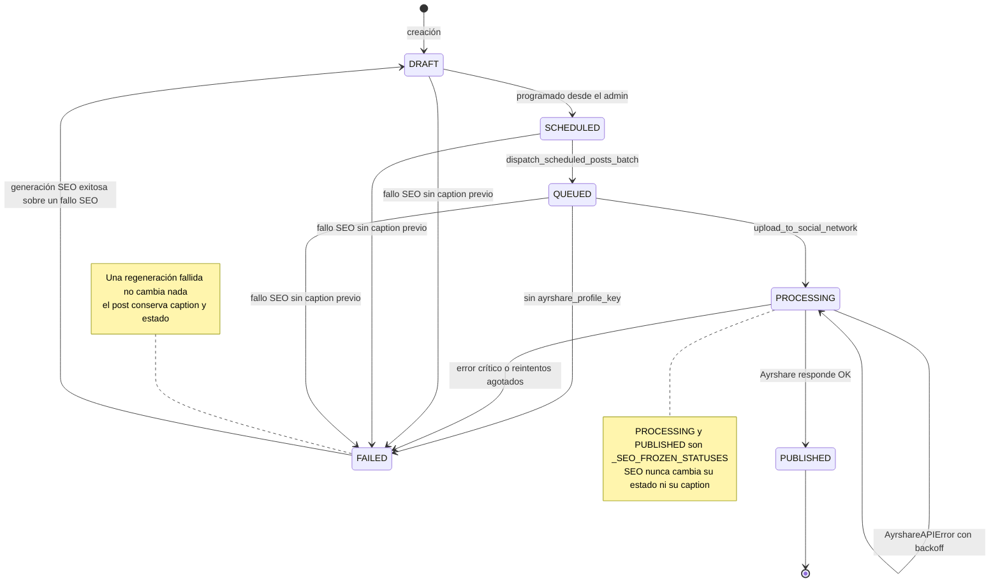
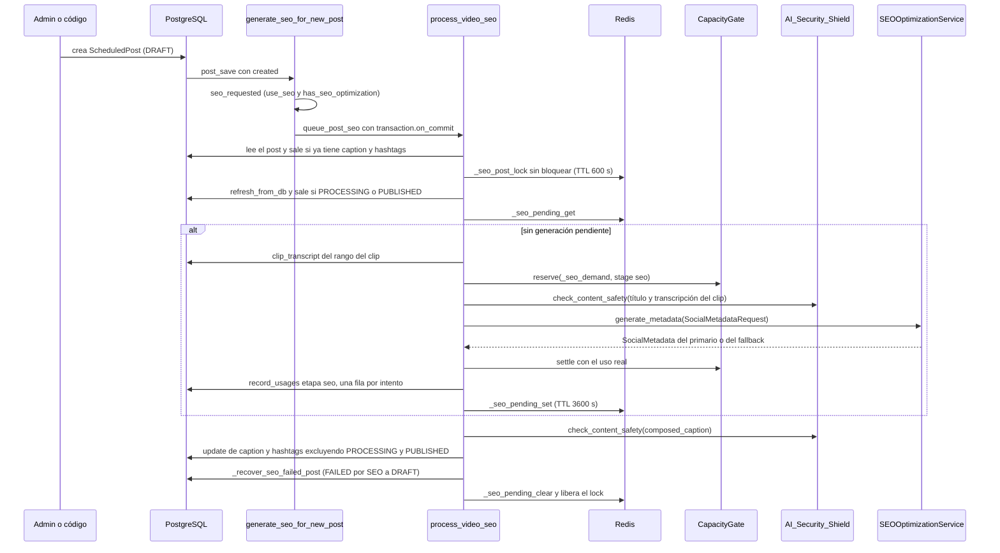
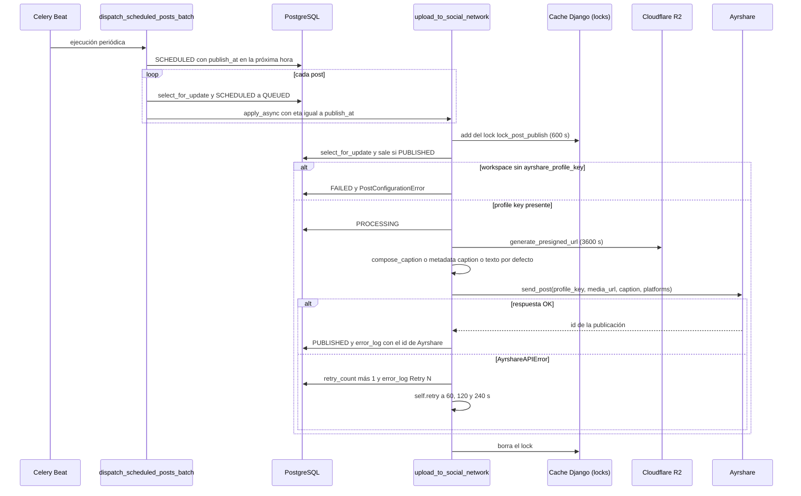

# SEO y publicación social

Este documento cubre la vida de una publicación (`ScheduledPost`): cómo se generan su caption y sus hashtags con IA (`process_video_seo`, [ADR-013](../adrs/013-ai-social-metadata.md)) y cómo se publica en TikTok, Instagram Reels o YouTube Shorts a través de Ayrshare (`upload_to_social_network`). La generación corre una vez por publicación, apenas se crea el `ScheduledPost`, y solo si el proyecto pagó el adicional de SEO. La publicación corre cuando `dispatch_scheduled_posts_batch` encuentra posts `SCHEDULED` cuya `publish_at` cae dentro de la próxima hora.

## Componentes

| Componente | Archivo | Rol |
|------------|---------|-----|
| `ScheduledPost` (`Status`, `Platform`) | [models.py](../../back/apps/videos/models.py) | Estado de la publicación, `generated_caption`, `generated_hashtags`, `error_log`, `retry_count`. |
| `generate_seo_for_new_post`, `seo_requested`, `queue_post_seo` | [signals.py](../../back/apps/videos/signals.py) | Receptor de `post_save`: encola la generación después del commit, solo con SEO contratado. |
| `VideosConfig.ready` | [apps.py](../../back/apps/videos/apps.py) | Importa `signals` (y `checks`) para registrar el receptor. |
| `ScheduledPostAdmin.regenerate_ai_metadata` | [admin.py](../../back/apps/videos/admin.py) | Acción "Regenerar caption y hashtags con IA": regeneración explícita. |
| `process_video_seo` y sus helpers | [tasks/social.py](../../back/apps/videos/tasks/social.py) | Tarea Celery: lock, capacidad, moderación, LLM, generación pendiente, persistencia, filas de uso. |
| `SEOOptimizationService`, `SocialMetadata`, `SocialMetadataRequest` | [services/seo_engine.py](../../back/apps/videos/services/seo_engine.py) | Llamada LiteLLM (primario y un fallback), prompt y contrato de salida. |
| `clip_transcript`, `niche_slug`, `caption_limit`, `compose_caption` | [services/seo_engine.py](../../back/apps/videos/services/seo_engine.py) | Helpers puros: texto del clip, nicho como slug, límite por plataforma, caption final. |
| `AI_Security_Shield.check_content_safety` | [core/security.py](../../back/apps/core/security.py) | Moderación de la entrada y de la salida ([ADR-011](../adrs/011-content-moderation.md)). |
| `dispatch_scheduled_posts_batch` | [tasks/social.py](../../back/apps/videos/tasks/social.py) | Pasa a `QUEUED` los posts de la próxima hora y encola la publicación con ETA. |
| `upload_to_social_network` | [tasks/social.py](../../back/apps/videos/tasks/social.py) | Publica vía Ayrshare, con backoff ante errores de la API. |
| `AyrshareClient.send_post` | [integrations/ayrshare_api.py](../../back/apps/integrations/ayrshare_api.py) | `POST https://app.ayrshare.com/api/post` con la key global y la profile key del workspace. |

## Flujo: estados de `ScheduledPost`

1. Todo post nace `DRAFT` (default del modelo). En el backend no hay endpoint que cree o programe publicaciones: hoy se crean y se pasan a `SCHEDULED` desde el admin (o desde código propio).
2. `dispatch_scheduled_posts_batch` toma los `SCHEDULED` con `publish_at` entre ahora y ahora + 1 h y los pasa a `QUEUED` bajo `select_for_update`.
3. `upload_to_social_network` los pasa a `PROCESSING` y, si Ayrshare responde, a `PUBLISHED`. Sin `ayrshare_profile_key` en el workspace el post queda `FAILED` desde cualquier estado previo.
4. Un fallo de SEO (`_fail_seo_post`) deja `FAILED` con un código estático en `error_log`, salvo dos excepciones: el post está en `_SEO_FROZEN_STATUSES` (`PROCESSING`, `PUBLISHED`) o ya tiene `generated_caption` no vacío y `generated_hashtags`. En ese último caso (regeneración fallida) solo se registra `seo.regenerate_failed`: el post sigue publicable con el caption anterior.
5. Una generación exitosa llama a `_recover_seo_failed_post`: un post `FAILED` cuyo `error_log` es un código de SEO vuelve a `DRAFT` con `error_log` vacío. Nunca se vuelve a programar solo: el usuario revisa el caption y lo programa de nuevo. Un `FAILED` de publicación no se toca.

## Flujo: disparo de la generación

1. **Gating.** `seo_requested(project)` es verdadero solo si `project.metadata['use_seo']` es exactamente `True` y el plan del workspace la incluye: `subscription_plan` es `None` (sin plan no hay límites, como en `PricingEngine`) o `has_seo_optimization` es verdadero. `use_seo` se guarda al crear el proyecto y se cobra como el adicional `seo_optimization` ([ver 01-creacion-de-proyecto](01-creacion-de-proyecto.md)). Prompt-to-Edit no lo puede encender: `ConfigValidator` descarta un `use_seo` que sube el precio ([ver 04-prompt-to-edit](04-prompt-to-edit.md)). El plan se evalúa en el momento del disparo, no al crear el proyecto.
2. **Señal.** `generate_seo_for_new_post` escucha `post_save` de `ScheduledPost` (`dispatch_uid='videos.scheduled_post_seo'`). Sale sin hacer nada si el post no es nuevo (`created` falso: editar nunca regenera), si viene de un fixture (`raw`), si ya trae `generated_caption` y `generated_hashtags`, si está `PROCESSING` o `PUBLISHED`, o si `seo_requested` es falso.
3. **Después del commit.** `queue_post_seo(post_id)` registra el envío con `transaction.on_commit`: si la transacción que creó el post hace rollback, la tarea nunca se encola, y cuando se encola siempre encuentra el post. Un error del broker se registra como `seo.dispatch_failed` y no deshace el post; el envío correcto registra `seo.dispatched`.
4. **Regeneración explícita.** La acción del admin `regenerate_ai_metadata` excluye los posts `PROCESSING` y `PUBLISHED`, filtra los que pasan `seo_requested` y llama a `queue_post_seo(post_id, regenerate=True)`, que encola `process_video_seo` con `kwargs={'regenerate': True}`. Es también la forma de reintentar un post cuyo disparo falló.
5. **`bulk_create`.** Django no emite `post_save` en `bulk_create`: los posts creados así no disparan la generación. Quien los cree de esa forma tiene que llamar a `queue_post_seo` por cada uno.

## Flujo: generación de caption y hashtags

1. **Idempotencia antes del lock.** Si el post ya tiene `generated_caption` y `generated_hashtags` y no es una regeneración, la tarea termina (`"SEO Already Generated"`) sin llamar al proveedor. Un reintento de Celery nunca paga dos veces una generación ya persistida.
2. **Lock por post.** `_seo_post_lock` toma un lock de Redis (`lock:seo:post:<post_id>`, `SEO_LOCK_TTL_SECONDS` = 600) sin bloquear. Si otro worker lo tiene, registra `seo.skipped reason=locked` y termina (`"SEO Busy"`). Si Redis no responde, levanta `RetryableAIError` y la tarea reintenta.
3. **Dentro del lock** relee el post: si ya está `PROCESSING` o `PUBLISHED` registra `seo.skipped reason=<estado>` y no hace nada. Vuelve a chequear la idempotencia (otro run pudo terminar antes del lock). En una regeneración nueva (`regenerate`, `retries == 0` y sin `capacity_waited_s`) borra cualquier generación pendiente vieja con `_seo_pending_clear`.
4. **Generación pendiente.** `_generate_post_metadata` busca primero `seo:pending:<post_id>` en Redis (`_seo_pending_get`). Si existe, la reutiliza y no llama al LLM: es el caso de un reintento después de que la moderación de salida no dio veredicto.
5. **Texto del clip.** `_generate_social_metadata` arma el texto con `clip_transcript(project.transcript_data, clip.start_time, clip.end_time)`: los ítems con tiempos que se superponen con el clip, ordenados por inicio. Sin texto, el post falla con `seo_no_clip_transcript`; la transcripción completa del proyecto nunca es un sustituto.
6. **Pedido.** `SocialMetadataRequest` lleva `clip_transcript`, `clip_title`, `platform`, `target_niche` (`metadata['niche']` o `general`; ningún endpoint lo escribe hoy) y `language` (`AI_SEO_LANGUAGE`).
7. **Capacidad primero.** Con `_capacity_gate()` activo, reserva `_seo_demand` en los modelos de `_selection_models(True)` (primario, y fallback si es otro modelo con key). La demanda es `ceil((len(transcripción) + len(título)) / 4)` + `AI_CAPACITY_LLM_PROMPT_TOKENS` + `AI_CAPACITY_LLM_OUTPUT_TOKENS` tokens y 1 request por modelo. Se reserva antes de moderar para que una espera nunca repita la llamada de moderación (ver abajo).
8. **Moderación de entrada.** `check_content_safety` sobre título + transcripción del clip (`_seo_moderation_payload`). Contenido bloqueado (`UnsafeContentError`): devuelve la reserva (`_release_seo_capacity`), registra `seo.input_blocked` y falla con `content_blocked`. Sin veredicto (`ModerationError`): devuelve la reserva y deja que el handler de la tarea decida el reintento. El detalle de la moderación por bloques está en [03-transcripcion-moderacion-seleccion](03-transcripcion-moderacion-seleccion.md).
9. **LLM.** `SEOOptimizationService().generate_metadata(request)` hereda de `LiteLLMSelectionProvider`: key por llamada, `AI_LLM_TIMEOUT_SECONDS`, `num_retries=0`, el mismo tope de razonamiento y temperatura `0.7`. Intenta `AI_DEFAULT_LLM_MODEL` y, si falla y `_has_fallback()`, un intento con `AI_FALLBACK_LLM_MODEL`. El prompt aísla título y transcripción con `isolate_user_input`, reduce el nicho con `niche_slug` y pide un caption de como máximo `max(100, caption_limit(platform) - 8 × 32)` caracteres.
10. **Validación local.** La respuesta pasa por `SocialMetadata` (`extra="forbid"`): caption no vacío y entre 5 y 8 hashtags normalizados (sin `#`, solo letras, dígitos o `_`, sin duplicados ignorando mayúsculas). Además `composed_caption()` no puede superar `caption_limit(platform)`. Cualquier violación es `AIContractValidationError` (no reintentable) y le da su oportunidad al fallback; el intento queda facturado en `usage_attempts`.
11. **Uso y capacidad.** Con éxito: `gate.settle` con `_llm_usage_by_model` y `record_usages` con etapa `seo`, versión `v2`, una fila por intento (`usages_for_success`). Con error: `gate.settle` con `_selection_failure_usage` y `_record_call_failure`; después se relanza. Las filas se escriben antes de la moderación de salida y de persistir: la llamada ya se pagó.
12. **Generación pendiente.** El resultado se guarda en Redis con `_seo_pending_set` (`SEO_PENDING_TTL_SECONDS` = 3600). Si no se puede guardar, se registra `seo.pending_not_saved` y el resultado se usa igual.
13. **Moderación de salida.** `check_content_safety(metadata.composed_caption())`. Bloqueado: borra la pendiente, registra `seo.output_blocked` y falla con `generated_content_blocked`. Sin veredicto: la pendiente queda en Redis y el reintento no paga una segunda generación.
14. **Persistencia.** Un `update` de `generated_caption` y `generated_hashtags` que excluye `_SEO_FROZEN_STATUSES`. Si no actualiza ninguna fila (la publicación empezó mientras se generaba), borra la pendiente, registra `seo.skipped reason=publishing` y deja el caption con el que se publicó. Si actualiza, llama a `_recover_seo_failed_post`, borra la pendiente y registra `seo.persisted`.

### Espera de capacidad

Si `gate.reserve` levanta `CapacityUnavailable`, `_seo_wait_for_capacity` decide:

- Si `capacity_waited_s + wait_seconds` supera `AI_CAPACITY_MAX_WAIT_SECONDS`, registra `seo.capacity_timeout` y falla con `capacity_timeout`.
- Si no, vuelve a encolar `process_video_seo` con `countdown = _capacity_countdown(wait_seconds)` (el déficit, con tope `AI_CAPACITY_MAX_COUNTDOWN_SECONDS`, más hasta 20 % de jitter), `capacity_waited_s` acumulado y `retries` igual al actual. Registra `seo.pending_capacity`.
- Una regeneración conserva `regenerate=True` en el mensaje re-encolado: sin eso, el run siguiente vería el caption viejo y terminaría sin regenerar.
- El contador de reintentos de Celery viaja con el mensaje: una llamada que falla siempre se queda sin reintentos aunque haya esperas en el medio.
- A diferencia de la ingesta, la espera de SEO no escribe `metadata['capacity_wait']` en el proyecto: el tiempo esperado solo viaja en `capacity_waited_s`. Los token buckets están en [07-capacidad-costos-y-operacion](07-capacidad-costos-y-operacion.md).

## Flujo: publicación

1. **Disparo periódico.** El docstring de `dispatch_scheduled_posts_batch` dice que corre cada hora con Celery Beat. En el repo no hay `CELERY_BEAT_SCHEDULE` ni servicio `beat` en `docker-compose.yml`: el schedule se configura fuera de este código.
2. **Ventana.** Solo toma posts `SCHEDULED` con `publish_at` en `[ahora, ahora + 1 h]`. Cada post se re-lee con `select_for_update` y pasa a `QUEUED` solo si sigue `SCHEDULED`; después se encola `upload_to_social_network` con `eta=publish_at`.
3. **Lock de publicación.** `caches['locks'].add(f"lock_post_publish_{post_id}", ..., AyrshareClient.TIMEOUT_SECONDS[1] + 300)` (600 s) en el alias `locks` de la caché de Django, que con `CACHE_REDIS_URL` es el Redis que comparten todos los workers: ahí `add` es un `SET NX` atómico ([07](07-capacidad-costos-y-operacion.md#cache-compartida)). Si ya existe, termina con `"Locked"`. Ese alias no ignora errores: si Redis no contesta, no publica sin lock. Loguea `publish.lock_unavailable` y reintenta con `self.retry` a 60, 120 y 240 s (`max_retries=3`); al agotarse, el post pasa a `FAILED` con `error_log` `Lock unavailable after N attempts: <clase>`, en vez de quedar `QUEUED` sin tarea (el despachador solo toma `SCHEDULED`). Se libera en el `finally`; si soltarlo falla, `publish.lock_release_failed` y lo libera el TTL.
4. **Validación.** Un post `PUBLISHED` termina (`"Already Published"`). Sin `workspace.ayrshare_profile_key` el post queda `FAILED` y se levanta `PostConfigurationError` después del commit (no se reintenta).
5. **Media.** `CloudflareR2Manager.generate_presigned_url(video_clip.s3_object_key, expiration_seconds=3600)`. Ayrshare descarga el video desde esa URL.
6. **Caption.** Con `generated_caption`, el texto es `compose_caption(generated_caption, generated_hashtags)`: el caption, una línea en blanco y los hashtags con `#` separados por espacio. Los hashtags se guardan sin `#` y lo ganan solo acá. Sin caption generado se usa `project.metadata['caption']` y, si tampoco existe, `Check this out! #Viral #<plataforma>`.
7. **Plataforma.** `TIKTOK` → `tiktok`, `INSTAGRAM_REELS` → `instagram`, `YOUTUBE_SHORTS` → `youtube` (default `tiktok`).
8. **Ayrshare.** `AyrshareClient.send_post` envía `post`, `platforms`, `mediaUrls` y `profileKeys` con `Authorization: Bearer AYRSHARE_API_KEY`. Un HTTP ≥ 400, un error de conexión o la falta de `AYRSHARE_API_KEY` levantan `AyrshareAPIError`.

## Errores, reintentos y casos borde

### Códigos que `process_video_seo` escribe en `error_log`

Todos son estáticos: nunca llevan texto del proveedor, del usuario ni del modelo. Los que figuran en `_SEO_FAILURE_CODES` o empiezan con `seo_` o `moderation_` son recuperables por `_recover_seo_failed_post`.

| Código | Cuándo |
|--------|--------|
| `seo_no_clip_transcript` | No hay transcripción temporizada que se superponga con el clip. |
| `content_blocked` | La moderación bloqueó el título o la transcripción del clip. |
| `generated_content_blocked` | La moderación bloqueó el caption o los hashtags generados. |
| `capacity_timeout` | La espera de capacidad superó `AI_CAPACITY_MAX_WAIT_SECONDS`. |
| `moderation_unavailable`, `moderation_misconfigured`, `moderation_quota` | `ModerationError` sin veredicto: no reintentable o reintentos agotados (`mod_exc.code`). |
| `seo_generation_failed:<clase>` | `AIError` no reintentable (auth, configuración, 4xx, contrato inválido) o reintentos agotados. Ej.: `seo_generation_failed:AIContractValidationError`. |
| `seo_failed:<clase>` | Cualquier otra excepción no reintentable o con reintentos agotados; además se relanza. |

### Situaciones

| Situación | Qué pasa | Dónde |
|-----------|----------|-------|
| Error reintentable (timeout, 429, 5xx, Redis caído, `ModerationError` reintentable) | `self.retry` con `_retry_countdown`: 30 s × 2^n con tope 600 s y jitter, hasta `max_retries=3`. | `process_video_seo` |
| Error no reintentable | Falla en el momento con el código de la tabla anterior. | `process_video_seo`, `_fail_seo_post` |
| Falla una regeneración | El post conserva caption, hashtags y estado; log `seo.regenerate_failed`. | `_fail_seo_post` |
| Falla SEO en un post `PROCESSING` o `PUBLISHED` | No se toca: el `filter` excluye `_SEO_FROZEN_STATUSES`. | `_fail_seo_post` |
| La publicación empieza durante la generación | El `update` no encuentra fila; log `seo.skipped reason=publishing`. El LLM ya se pagó y sus filas quedan. | `_generate_post_metadata` |
| El post se publica antes de que termine la generación | Se publica con `metadata['caption']` o el texto por defecto. | `upload_to_social_network` |
| Post `FAILED` por SEO que estaba programado | Ya no está `SCHEDULED`: el despachador no lo toma. Al recuperarse vuelve a `DRAFT` y hay que programarlo otra vez. | `_recover_seo_failed_post` |
| Dos mensajes para el mismo post a la vez | El segundo no obtiene el lock y termina (`"SEO Busy"`), sin reintento. | `_seo_post_lock` |
| El lock venció antes de terminar (más de 600 s) | Al liberar, `seo.lock_not_owned`. | `_seo_post_lock` |
| No se pudo guardar la generación pendiente | `seo.pending_not_saved`; el resultado se usa igual, pero un reintento de moderación volvería a pagar. | `_seo_pending_set` |
| Post creado con `bulk_create` | No hay señal: no se genera nada hasta llamar a `queue_post_seo`. | `generate_seo_for_new_post` |
| Broker caído al encolar | `seo.dispatch_failed`; el post queda sin caption. Se reintenta con la acción del admin. | `queue_post_seo` |
| Post con `publish_at` ya pasado | Queda fuera de la ventana `[ahora, ahora + 1 h]` y no se despacha. | `dispatch_scheduled_posts_batch` |
| Workspace sin `ayrshare_profile_key` | `FAILED` con `Error: Ayrshare Profile Key not configured in workspace.` y `PostConfigurationError`, sin reintento. | `upload_to_social_network` |
| El post se borró después de encolarse (con su clip, su proyecto o su workspace) | La tarea termina con `Post Deleted`, sin llamar a Ayrshare y sin fallar. Queda `publish.post_deleted` en el log. | `upload_to_social_network` |
| El post se borró mientras Ayrshare respondía | La tarea guarda solo `status` y `error_log` (`save(update_fields=...)`), así que no vuelve a insertar la fila. Termina sin fallar y deja `publish.post_deleted` con `when=after_publishing`. | `upload_to_social_network` |
| Se borra el workspace con un post `QUEUED` o `PROCESSING` | El borrado responde 409 `posts_in_flight` mientras la tarea puede estar trabajando: `PROCESSING` con `updated_at` dentro de `POST_PROCESSING_WINDOW`, o `QUEUED` hasta `POST_QUEUED_GRACE` después de `publish_at`. Un post más viejo está trabado y no frena el borrado. Los `SCHEDULED` se borran con el workspace y no se publican. | `WorkspaceDetailView.delete` (`apps/users/views_workspaces.py`) |
| Clip sin `s3_object_key` u otro error inesperado | `FAILED` con `Critical: <mensaje>` y la excepción se relanza. | `upload_to_social_network` |
| Redis de la cache no contesta al tomar el lock | `publish.lock_unavailable` y reintento a 60, 120 y 240 s. Al agotarse, `FAILED` con `Lock unavailable after N attempts: <clase>`. Nunca publica sin lock. | `upload_to_social_network` |
| `AyrshareAPIError` | `retry_count` + 1, `error_log` `Retry N: <mensaje>`, reintento a 60, 120 y 240 s (`max_retries=3`). Al agotarse, el post pasa a `FAILED` con `error_log` `Failed after N attempts: <mensaje>` y la excepción se propaga. | `upload_to_social_network` |
| Ayrshare no responde | `requests.post` usa `timeout=AyrshareClient.TIMEOUT_SECONDS` (10 s para conectar, 300 s para leer). Si no conecta, es `AyrshareAPIError` y se reintenta como arriba. Si conectó pero no contestó a tiempo (`ReadTimeout`), es `AyrshareOutcomeUnknownError`: el post queda `FAILED` sin reintento automático, porque pudo haberse publicado y reintentar lo duplicaría. El lock del post dura el timeout de lectura más 300 s. | `AyrshareClient.send_post`, `upload_to_social_network` |

## Datos que escribe

- **`ScheduledPost`**
  - `generated_caption`: el caption sin hashtags.
  - `generated_hashtags`: lista JSON de 5 a 8 hashtags sin `#`.
  - `status`: transiciones del diagrama.
  - `error_log`: códigos de SEO de la tabla anterior; en la publicación, `Ayrshare ID: <id>` al publicar, `Retry N: <mensaje>`, `Critical: <mensaje>` o el texto fijo de la profile key faltante. A diferencia de SEO, la publicación guarda el mensaje de la excepción.
  - `retry_count`: intentos fallidos contra Ayrshare.
- **`AIUsageRecord`**: una fila por intento con `stage='seo'`, `pipeline_version='v2'` (siempre, aunque el proyecto corra en legacy), `role` `primary` o `fallback`, `attempt` igual al `pipeline_attempts` del proyecto, tokens, costo estimado y `error_code` con la clase del error. Si la llamada falla sin intentos adjuntos, una fila de cero tokens con la latencia medida a nombre de `AI_DEFAULT_LLM_MODEL`. El export del piloto las suma aparte en `seo_records`, `seo_cost_usd` y `seo_cost_complete` ([runbook](../runbooks/ai-core-pilot-runbook.md)).
- **Redis**: `lock:seo:post:<post_id>` (600 s) y `seo:pending:<post_id>` (JSON de `SocialMetadata`, 3600 s). El alias `locks` de la caché de Django guarda `lock_post_publish_<post_id>` (600 s).
- **Capacidad**: reserva con `stage='seo'`, liquidada con el uso real o devuelta si la moderación cortó antes del LLM.
- **Claves de `VideoProject.metadata` que se leen**: `use_seo`, `niche`, `caption`.
- **Logs** (sin caption, hashtags, título ni transcripción): `seo.dispatched`, `seo.dispatch_failed`, `seo.skipped`, `seo.no_clip_transcript`, `seo.input_blocked`, `seo.output_blocked`, `seo.pending_capacity`, `seo.capacity_timeout`, `seo.completed`, `seo.primary_failed`, `seo.fallback_failed`, `seo.failed`, `seo.regenerate_failed`, `seo.persisted`, `seo.lock_not_owned`, `seo.pending_not_saved`, `seo.pending_not_cleared`.
- **Resultado de la tarea** (en el backend de resultados de Celery): `SEO Success`, `SEO Already Generated`, `SEO Busy`, `SEO Skipped`, `No Transcript`, `Security Abort`, `Moderation Failed`, `SEO Failed`, `Waiting for capacity`, `Capacity Timeout`.

## Configuración

| Setting | Default | Efecto |
|---------|---------|--------|
| `AI_SEO_LANGUAGE` | `'es'` | Idioma del caption. Se reduce a `[a-z-]`, hasta 10 caracteres. |
| `AI_SEO_CAPTION_MAX_CHARS` | `{'TIKTOK': 2200, 'INSTAGRAM_REELS': 2200, 'YOUTUBE_SHORTS': 5000}` | Límite de caption + hashtags por plataforma (`caption_limit`); también fija el presupuesto del caption en el prompt. |
| `AI_DEFAULT_LLM_MODEL` | `'gemini/gemini-3.8-flash'` | Modelo primario, el mismo que la selección. |
| `AI_FALLBACK_LLM_MODEL` | `'gemini/gemini-3.5-flash-lite'` | Un intento de fallback, solo si es otro modelo y su key está configurada. |
| `AI_LLM_TIMEOUT_SECONDS` | `60.0` | Timeout de cada llamada. |
| `AI_LLM_REASONING_EFFORT` | `''` | Tope de razonamiento, compartido con la selección. |
| `AI_CAPACITY_ENABLED` | `False` | Sin capacidad no se reserva ni se espera. Límites en `AI_CAPACITY_LIMITS` ([ver 07](07-capacidad-costos-y-operacion.md)). |
| `AI_CAPACITY_LLM_PROMPT_TOKENS` | `1500` | Parte fija de `_seo_demand`. |
| `AI_CAPACITY_LLM_OUTPUT_TOKENS` | `4000` | Parte fija de `_seo_demand`. |
| `AI_CAPACITY_MAX_WAIT_SECONDS` | `3600` | Espera acumulada máxima; después, `capacity_timeout`. |
| `AI_CAPACITY_MAX_COUNTDOWN_SECONDS` | `300` | Tope de cada re-encolado por capacidad. |
| `OPENAI_API_KEY` | `None` | Moderación. Sin key, `moderation_misconfigured` (fail-closed). |
| `MODERATION_MODEL`, `MODERATION_BLOCK_CHARS`, `MODERATION_NON_BLOCKING_CATEGORIES`, `MODERATION_TIMEOUT_SECONDS` | `'omni-moderation-latest'`, `10000`, 4 categorías, `10.0` | Moderación por bloques ([ver 03](03-transcripcion-moderacion-seleccion.md)). |
| `REDIS_URL` | `'redis://redis:6379/0'` | Lock por post y generación pendiente. |
| `AYRSHARE_API_KEY` | `None` | Key global de Ayrshare. Sin ella, cada intento falla con `AyrshareAPIError` y se reintenta. |

Constantes en código: `SEO_LOCK_TTL_SECONDS = 600` y `SEO_PENDING_TTL_SECONDS = 3600` (`tasks/social.py`); `MIN_HASHTAGS = 5`, `MAX_HASHTAGS = 8` y `_temperature = 0.7` (`seo_engine.py`).

## Referencias

- [ADR-013 — Generación de metadata social con IA](../adrs/013-ai-social-metadata.md)
- [ADR-011 — Moderación](../adrs/011-content-moderation.md), [ADR-005 — Publicación social](../adrs/005-social-publishing-strategy.md), [ADR-012 — Perfiles de modelos y capacidad](../adrs/012-model-profiles-and-capacity.md)
- [Runbook del piloto](../runbooks/ai-core-pilot-runbook.md) (columnas de SEO en el export)
- Issue #69 (AICORE-17): https://github.com/RomeKai/videoeditUTN/issues/69
- PR #82, metadata social por publicación sobre el núcleo de IA: https://github.com/RomeKai/videoeditUTN/pull/82
- PR #88, generar caption y hashtags al crear la publicación: https://github.com/RomeKai/videoeditUTN/pull/88
- Tests: [test_seo_task.py](../../back/apps/videos/tests/test_seo_task.py), [test_seo_dispatch.py](../../back/apps/videos/tests/test_seo_dispatch.py)
