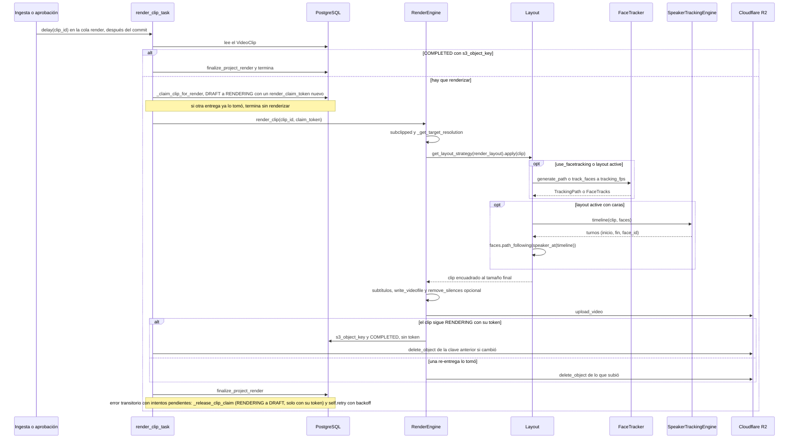
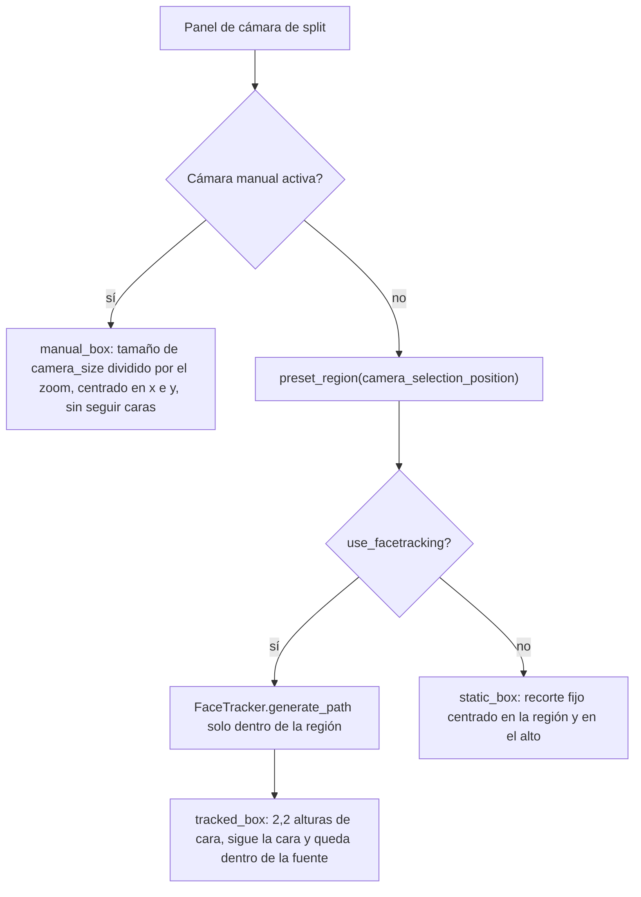
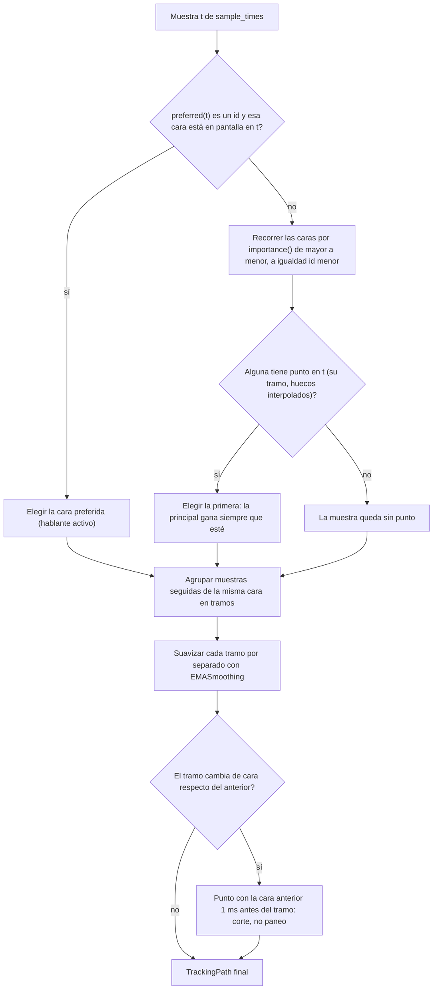
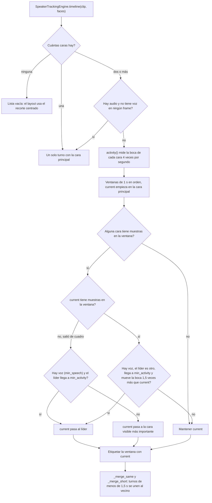
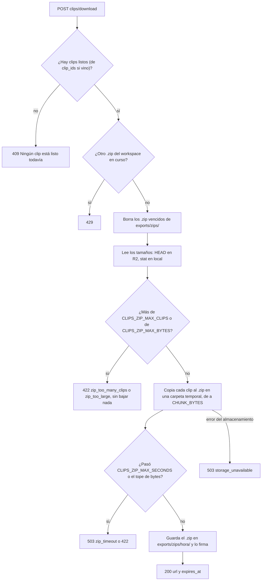

# Render, caras y hablante

Este documento cubre cómo se renderiza un clip: el recorte al formato y la resolución pedidos, el layout, el seguimiento de caras (face tracking v2, CORE-01) y la detección de quién habla para el layout `active` (CORE-02, [ADR-014](../adrs/014-speaker-detection.md)). El render de clips corre en la cola `render` cuando la ingesta termina con `auto_render_bypass` o en un video completo, y cuando el usuario aprueba la revisión con `approve-paper-edit`: cada segmento aprobado es un clip ([ver 02-pipeline-de-ingesta](02-pipeline-de-ingesta.md#aprobación-de-la-revisión-approve-paper-edit)). Con el proyecto terminado, el usuario puede pedir y pagar otro render: un clip desde su editor, el reintento de un clip fallido o todos los clips con otro estilo ([renders que pide el usuario](#renders-que-pide-el-usuario)). El render del paper edit en una sola exportación (`render_video_segments`) solo queda para las aprobaciones anteriores a ese cambio que seguían en curso al desplegar. El stack (MoviePy 2 + FFmpeg) está decidido en [ADR-003](../adrs/003-rendering-stack.md). Ninguna de estas etapas llama a un proveedor de IA externo: los subtítulos salen de la transcripción que ya hizo la ingesta.

## Componentes

| Componente | Archivo | Rol |
|------------|---------|-----|
| `render_clip_task`, `ClipRenderTask`, `_claim_clip_for_render`, `_release_clip_claim`, `_fail_owned_clip`, `_fail_unclaimed_clip` | [tasks/render.py](../../back/apps/videos/tasks/render.py) | Tarea por clip: claim con CAS y dueño (`render_claim_token`), tope de renders que no terminaron, render, limpieza de la clave vieja en R2, cierre del fan-out. |
| `finalize_project_render` | [tasks/render.py](../../back/apps/videos/tasks/render.py) | Cierra el proyecto (`COMPLETED` o `PARTIAL`) cuando todos los clips terminaron. |
| `ClipDetailView`, `ClipRenderView`, `ClipRetryView`, `ProjectRerenderView`, `_start_paid_render` | [views_clips.py](../../back/apps/videos/views_clips.py) | API del clip (leer, cambiar título y recorte, borrar) y los renders que pide el usuario con el proyecto terminado: reservan, vuelven el proyecto a `render_dispatched` y encolan (`CLIP_RENDER`). |
| `render_queued_rule` | [tasks/ingestion.py](../../back/apps/videos/tasks/ingestion.py) | Qué clips `draft` de un proyecto esperan a un worker, con la regla de `_whole_video_render_allowed`: da `render_queued` del clip en la API y el `clip_rendering` de un reintento repetido. |
| `render_video_segments`, `_resolve_approved_segments` | [tasks/render.py](../../back/apps/videos/tasks/render.py) | Render del paper edit de antes: corta y concatena los segmentos aprobados. Solo aprobaciones sin `render_clip_ids`. |
| `recover_stuck_renders`, `recover_stuck_renders_now` | [tasks/render_recovery.py](../../back/apps/videos/tasks/render_recovery.py) | Paper edits de antes cuya reserva del render quedó `RESERVED` sin nada que los traiga de vuelta: los re-encola, cobra los entregados o, si perdieron su worker demasiadas veces, los falla con reembolso. También los clips trabados de una revisión aprobada o un render automático (`decide_clips`): los re-encola, con el derecho a tomar los que quedaron `RENDERING`. También el comando [recover_stuck_renders](../../back/apps/videos/management/commands/recover_stuck_renders.py). |
| `RenderEngine.render_clip`, `_get_target_resolution` | [services/render_engine.py](../../back/apps/videos/services/render_engine.py) | Subclip, layout, subtítulos, escritura, quitar silencios, subida y guardado `COMPLETED` solo si la entrega sigue siendo dueña del clip. |
| `get_layout_strategy`, `LAYOUT_REGISTRY` | [services/layouts/\_\_init\_\_.py](../../back/apps/videos/services/layouts/__init__.py) | Elige la clase de layout por `render_layout`. |
| `BaseLayout` | [layouts/interface.py](../../back/apps/videos/services/layouts/interface.py) | Parámetros comunes, `editing_style` y `tracking_fps`. |
| `FillLayout`, `FitLayout` | [layouts/standard.py](../../back/apps/videos/services/layouts/standard.py) | Recorte con seguimiento de cara, y letterbox. |
| `GamingLayout`, `camera_size`, `static_box`, `tracked_box` | [layouts/gaming.py](../../back/apps/videos/services/layouts/gaming.py) | Cámara arriba y gameplay abajo. |
| `ManualCamera`, `preset_region`, `manual_box`, `fit_size`, `place` | [layouts/camera.py](../../back/apps/videos/services/layouts/camera.py) | Qué región de la fuente muestra la cámara en `split` y `versus`. Python puro. |
| `BlurredLayout` | [layouts/blur_pip.py](../../back/apps/videos/services/layouts/blur_pip.py) | Fondo desenfocado y primer plano nítido. |
| `VersusLayout`, `versus_size`, `versus_boxes`, `pane_size`, `ActiveSpeakerLayout` | [layouts/pro.py](../../back/apps/videos/services/layouts/pro.py) | Dos mitades, y cámara que sigue a quien habla. |
| `get_face_detector`, `_SharedDetector`, `FaceTracker` | [services/face_tracker.py](../../back/apps/videos/services/face_tracker.py) | Detector MediaPipe compartido por proceso, muestreo del clip, camino de encuadre. |
| `Detection`, `FaceTrack`, `IoUTracker`, `FaceTracks`, `sampling_fps` | [services/face_tracking.py](../../back/apps/videos/services/face_tracking.py) | Asociación de caras en el tiempo con ids estables y elección de la cara a encuadrar. Python puro. |
| `EMASmoothing`, `interpolate_gaps`, `TrackingPath` | [services/tracking_utils.py](../../back/apps/videos/services/tracking_utils.py) | Suavizado sin retraso, relleno de huecos e interpolación por frame. |
| `speech_activity`, `mouth_activity`, `SpeakerTrackingEngine`, `speaker_at` | [services/speaker_engine.py](../../back/apps/videos/services/speaker_engine.py) | Voz por energía, movimiento de boca por cara y timeline de turnos. |

## Flujo: render de un clip

1. **Encolado.** `_stage_dispatch_render` encola un `render_clip_task` por clip `DRAFT` con `transaction.on_commit`, y la aprobación de la revisión uno por clip aprobado (`_queue_clip_renders`, también después del commit); `_resume_render_dispatch` vuelve a encolar los que quedaron `DRAFT`. `CELERY_TASK_ROUTES` manda la tarea a la cola `render`, así un render pesado no bloquea la ingesta; el worker consume `-Q celery,render`.
2. **Entrega segura.** La tarea usa `acks_late=True` y `reject_on_worker_lost=True`: si el worker muere a mitad del render (por ejemplo, OOM en MoviePy), el broker re-entrega el mensaje en lugar de perder el clip.
3. **Idempotencia.** Un clip `COMPLETED` con `s3_object_key` no se vuelve a renderizar: solo se llama a `finalize_project_render`.
4. **Claim.** `_claim_clip_for_render` hace un compare-and-set `DRAFT` → `RENDERING` con el lock de la fila. Solo una entrega gana; la otra termina con `"Clip <id> already claimed"`. Un clip `FAILED` nunca se reclama: falló del todo y su parte de la reserva ya se liquidó, así que un mensaje duplicado o tardío lo volvería a renderizar (y a cobrar). Ningún camino encola uno a propósito: el despacho, el re-despacho y `recover_stuck_renders` encolan clips `DRAFT` (y `RENDERING` con derecho a tomarlos). Un render que pide el usuario sobre un clip fallido o ya entregado (`clips/:id/retry/`, `clips/:id/render/`, `projects/:id/rerender/`) reserva su render y vuelve el clip a `DRAFT` antes de encolarlo ([renders que pide el usuario](#renders-que-pide-el-usuario)). Un mensaje re-entregado (`delivery_info['redelivered']`), o el reintento de uno que falló antes del claim (header `render_takeover`), puede tomar además el clip si sigue `RENDERING` con el dueño que encontró cuando volvió: su worker pudo morir y nadie más lo terminaría. La entrega que gana escribe un `render_claim_token` nuevo (un uuid por claim) y suma un render empezado. Ver [dueño del claim](#dueño-del-claim-y-renders-que-no-terminan).
5. **Fuente y tamaño.** `RenderEngine.render_clip` abre el archivo local `project.source_file.path`, lo corta con `subclipped(start_time, end_time)` y calcula el tamaño con `_get_target_resolution(aspect_ratio, metadata['render_resolution'])` (ver [resolución](#flujo-resolución-y-formato-de-salida)).
6. **Layout.** `get_layout_strategy` recibe `render_layout`, el tamaño, `use_facetracking`, `gameplay_position`, `camera_selection_position`, las coordenadas manuales y `editing_style`, y devuelve una instancia que aplica el encuadre (ver [layouts](#flujo-layouts)).
7. **Subtítulos** (`add_subtitles`). Con `transcript_data` usa los ítems que caen en el clip (`_slice_segments`) agrupados con `TranscriptionEngine.group_words(..., max_words=subtitle_words_per_segment)`. Sin transcripción guardada, el clip se renderiza sin subtítulos y se loguea `render.subtitles_skipped`. No se vuelve a transcribir: esa llamada iba al proveedor sin reserva de capacidad ni filas de `AIUsageRecord`, y todo proyecto del pipeline se transcribe antes de tener clips. `subtitle_with_emojis` existe en el modelo, en la API y en `ProjectConfig`, pero el render no lo lee: los emojis no están en el MVP (C1 ofrece tamaño, posición, color y palabras por línea).
8. **Escritura.** `write_videofile` con `RENDER_CODEC` (`libx264`), `RENDER_AUDIO_CODEC` (`aac`), `RENDER_FPS` (24), `RENDER_PRESET` (`medium`) y `FFMPEG_PARAMS` (`-pix_fmt yuv420p`). Con `remove_silences`, `FFmpegManager.remove_silences_from_video` reemplaza el archivo antes de subirlo.
9. **Subida.** `CloudflareR2Manager.upload_video` devuelve la clave (`videos/<user_id>/<project_id>/<uuid>.mp4`). El clip queda `COMPLETED` con esa clave solo si sigue `RENDERING` con el token de esta entrega; si no, no se guarda nada y se borra lo subido. Si había una clave anterior distinta, `render_clip_task` borra ese objeto de R2. El archivo temporal lleva un uuid en el nombre: dos copias del mismo clip en el mismo host no se pisan.
10. **Cierre del fan-out.** `finalize_project_render` toma el lock de fila del proyecto y solo actúa si está en `RENDER_DISPATCHED` y ningún clip sigue `DRAFT` o `RENDERING`: con algún clip `FAILED` pasa a `PARTIAL`, si no a `COMPLETED` (etapa y estado). En una revisión aprobada solo cuentan los clips de `render_clip_ids` y los de un render pedido después (`clip_render_clip_ids`). Mientras ese render sigue `reserved`, el cierre espera solo a sus clips: un `draft` que dejó un render anterior ya liquidado no lo deja abierto. Se llama después de cada clip; solo la llamada que ve terminar al último hace la transición. Registra `pipeline.render_finalized`. En un video completo (`single_edit`), cada llamada liquida además la reserva de creación según cómo terminó el proyecto (`_settle_whole_video_reservation`). Con "Renderizar sin revisar", una revisión aprobada o un render pedido después liquida la reserva que pagó los clips: cobra la parte de los segundos entregados (`_settle_clip_render_reservations`, ver [02](02-pipeline-de-ingesta.md)). Y `render_clip_task` no renderiza un clip pago (video completo, render automático, aprobación o render pedido después) si el proyecto ya no está en `RENDER_DISPATCHED` o su reserva ya no está `reserved` (`_whole_video_render_allowed`), ni un clip que su reserva no paga (fuera de `auto_render_clip_ids`, de `render_clip_ids` o de `clip_render_clip_ids`). Un video completo se renderiza con su reserva de creación o, una vez cobrada, solo con un render pedido después que lo pague. Decide la reserva que paga el clip: una que no lo paga (por ejemplo, un render automático liquidado) no lo bloquea.
11. **Reintentos.** Si algo falla, `RenderEngine.render_clip` deja el clip en `RENDERING`: la tarea tiene el claim y decide. Un error transitorio (`_is_retryable_render_error`) con intentos pendientes devuelve el claim (`_release_clip_claim`, `RENDERING` → `DRAFT`, solo con su token), registra `render.retrying` y llama a `self.retry` con el backoff del pipeline (`_retry_countdown`), hasta `RENDER_CLIP_MAX_RETRIES` (2) reintentos. Si una re-entrega le había tomado el clip, no lo devuelve ni reintenta (`render.claim_lost`): ese claim sigue vivo y un reintento lo renderizaría otra vez. El reintento toma el clip con el mismo CAS que cualquier entrega: si otra entrega lo tomó durante la espera, el reintento termina con `already claimed` y nadie lo renderiza dos veces. Mientras espera, el clip está `DRAFT`, así que `finalize_project_render` no cierra el proyecto. Un error determinista, o el último intento, propaga la excepción y `ClipRenderTask.on_failure` marca el clip `FAILED` si esta entrega todavía es su dueña (`_fail_owned_clip`) o, sin claim, si está `DRAFT` sin dueño (`_fail_unclaimed_clip`), y siempre llama a `finalize_project_render`: así un video completo cuyo render falló del todo llega a su reembolso. Las dos consultas de `_whole_video_render_allowed` (antes y después del claim) corren también en cada reintento, porque un reintento vuelve a reclamar el clip.
   - Transitorio es lo mismo que en la ingesta (`_is_retryable_pipeline_error`: errores de IA reintentables, timeout y conexión, base de datos, R2 con 5xx, 408, 429 o `SlowDown`, una subida fallida, broker), salvo un `OSError` genérico: así reporta MoviePy un archivo que no puede leer o un encode que falla, y renderizar de nuevo no lo arregla. Los errores de transporte de botocore con R2 (`ReadTimeoutError`, `ConnectTimeoutError`, `EndpointConnectionError`, `ConnectionClosedError`, `SSLError`, `ProxyConnectionError`) también son `OSError` y se miran antes: reintentan (`_is_transient_storage_connection_error`).
   - `upload_file` de boto3 envuelve el throttling y los 5xx en `S3UploadFailedError`. Se clasifica por el `ClientError` que envuelve (su `__context__`): `SlowDown` o un 5xx reintentan, un 4xx como `AccessDenied` o `NoSuchBucket` falla enseguida. Sin ese detalle, reintenta.
   - Un fallo al cerrar el fan-out después de subir el clip también reintenta: el reintento encuentra el clip `COMPLETED` y solo llama a `finalize_project_render`.
   - Si el reintento no se puede encolar (el broker no responde), Celery lanzaría `Reject` y descartaría el mensaje sin `on_failure`: el clip quedaría `DRAFT` y el proyecto abierto para siempre. La tarea lo atrapa (`render.retry_not_queued`) y vuelve a lanzar el error original, así corre `on_failure`: la entrega ya no tiene claim, marca `FAILED` el clip si sigue `DRAFT` sin dueño y cierra el fan-out.
12. **Tiempo máximo.** `render_clip_task` tiene `soft_time_limit=RENDER_CLIP_SOFT_TIME_LIMIT` (2 h) y `time_limit=RENDER_CLIP_TIME_LIMIT` (soft + 300 s), fijos como en las demás tareas (ninguna escala su límite con la entrada). El soft limit lanza `SoftTimeLimitExceeded`, que nunca reintenta (`_is_retryable_render_error`): `on_failure` marca el clip `FAILED` y borra su claim, así un render colgado no se queda con el clip. El hard limit solo mata a un worker que ignoró el soft; Celery hace ack de ese mensaje, el clip queda `RENDERING` con un dueño muerto y lo toma `recover_stuck_renders`. `RENDER_STUCK_AFTER_SECONDS` nunca es menor que ese hard limit + 15 min, así esa recuperación nunca toma un render vivo.
13. **Inicio registrado.** Después del claim, `_record_clip_start` escribe `metadata['render_clip_started_at']`, que lee `recover_stuck_renders`. Ningún render corre sin eso: si la escritura falla (`render.start_not_recorded`), el error sube y la tarea devuelve el claim y reintenta como con cualquier error transitorio. Sin el inicio, la recuperación podía tomar un render vivo. Un render de clip no tiene heartbeat: este inicio y el hard limit alcanzan.

### Dueño del claim y renders que no terminan

Con Redis, un corte de la conexión con el broker puede re-entregar un `render_clip_task` que sigue corriendo (`acks_late`). La copia re-entregada (B) toma el clip en `RENDERING` y las dos renderizan. Para que solo una escriba en el clip:

- **Token.** `VideoClip.render_claim_token` dice qué entrega es dueña del clip. Lo escribe el claim: un uuid nuevo en cada entrega y en cada reintento, que vuelve a reclamar. La toma de B lo reemplaza. Se borra cuando el clip sale de `RENDERING` (`DRAFT`, `FAILED` o `COMPLETED`).
- **Derecho a tomar el clip** (`TakeoverRight`, `_resolve_takeover`). Solo una entrega con este derecho puede tomar un clip en `RENDERING`, y solo del dueño para el que es:
  - Un mensaje re-entregado (`delivery_info['redelivered']`) lee el clip al empezar. Si está `RENDERING`, el derecho queda fijado a su `render_claim_token` de ese momento (o a "sin token", un clip que tomó un worker con el código anterior). Si está `DRAFT`, no hace falta: lo reclama como cualquier entrega. Uno `FAILED` no se reclama.
  - El claim y el `FAILED` de `on_failure` con este derecho solo aplican a `RENDERING` con ese token (más el caso de siempre: `DRAFT` sin dueño). Un clip que alguien reclamó después, por ejemplo el reintento del dueño anterior tras devolverlo, no se toca.
  - Un reintento es un mensaje nuevo, nunca re-entregado, así que el derecho viaja en el header `render_takeover` (`RENDER_TAKEOVER_HEADER`) con el token fijado (`unowned` si no tenía). Si la entrega no pudo leer el clip, el header dice `observe` y el reintento lo fija en su primera lectura. Límite conocido: si esa lectura llega después de que el dueño vivo devolvió el clip y su propio reintento lo volvió a tomar, el derecho queda fijado a ese nuevo dueño sano (su render se pierde, o en el último intento se marca `failed`). Hace falta un corte del broker y errores de base en cada primera lectura durante todo el backoff; si pasara seguido, la solución es guardar cuándo se tomó el clip (`render_claimed_at`) y fijar solo dueños anteriores a la re-entrega. Es un header y no un kwarg por la misma razón que `render_lock_retries` del paper edit: en un deploy escalonado, un worker con el código anterior lo ignora. Sin el header, ese reintento encontraba el clip `RENDERING` con el token de un worker muerto, terminaba con `already claimed` y el clip quedaba trabado.
  - Si el mensaje del reintento vuelve a ser re-entregado (su propio worker murió), gana la re-entrega: fija el dueño que encuentra ahora.
  - El reintento de una entrega que ya tomó el clip y lo devolvió no lo lleva: el clip está `DRAFT`.
- **Escrituras con dueño.** Cada escritura posterior de una entrega es un `update` filtrado por el clip, `RENDERING` y su token: devolver el claim antes de un reintento (`_release_clip_claim`), `FAILED` en `on_failure` o en el chequeo de pago después del claim (`_fail_owned_clip`) y el guardado `COMPLETED` de `RenderEngine.render_clip`. La copia que perdió el clip (A) no escribe nada en él:
  - Con un error transitorio no lo devuelve a `DRAFT` ni reintenta (`render.claim_lost`). Antes lo devolvía y su reintento lo renderizaba una tercera vez.
  - En su último intento, `on_failure` no lo marca `FAILED`. Antes el proyecto se cerraba `PARTIAL`, un video completo se devolvía y después B lo entregaba gratis.
  - Si termina su render, no guarda y borra lo que subió. Si el guardado falla con un error, también lo borra, salvo que el clip ya apunte a esa clave.
- **`on_failure`** corre dentro del request de la entrega que falló y lee de ahí su token. Siempre llama a `finalize_project_render`.
  - Sin token (falló antes del claim, o devolvió el claim para un reintento que no se pudo encolar) marca `FAILED` el clip si está `DRAFT` sin dueño (`_fail_unclaimed_clip`): nadie lo renderiza y, si no, el proyecto quedaría abierto para siempre. Es definitivo: un mensaje posterior de ese clip no lo reclama.
  - Sin token y con el derecho a tomar el clip sin usar (re-entregada y falló antes del claim), también marca `FAILED` el clip si sigue `RENDERING` con el dueño fijado, en un solo `update` que borra ese token. Si no, el clip de un worker muerto quedaba `RENDERING` para siempre y la reserva de un video completo nunca se liquidaba. El costo solo alcanza a ese dueño, el que estaba cuando el mensaje volvió: si seguía vivo después de un corte del broker, su render se descarta (ya no puede guardar y borra lo que subió). Un dueño que reclamó después no se toca.
  - Con token, marca `FAILED` el clip si sigue siendo suyo. Si no, no lo toca: lo tomó otra entrega, o esa entrega lo devolvió para su propio reintento. La excepción es cuando su propia devolución del claim lanzó un error (`render.release_failed`): el `update` pudo confirmarse en la base aunque el driver falló, así que marca `FAILED` el clip si está `DRAFT` sin dueño.
- **Chequeo de pago antes del claim** (video completo). Sin claim, la entrega solo falla un clip `DRAFT` sin dueño (`_fail_unclaimed_clip`). Una entrega con el derecho a tomar el clip además toma y falla el clip si sigue `RENDERING` con el dueño fijado, en el mismo `update`: borra el token, así la copia que lo tenía ya no puede guardarlo.
- **Renders que no terminan.** `VideoClip.render_unfinished_starts` sube uno en cada claim y baja uno cuando esa entrega termina: entregó, devolvió el claim para un reintento, falló o perdió el clip. Vuelve a 0 cuando el clip llega a `COMPLETED` o `FAILED`. Lo que queda son renders cuyo worker murió (`render.restarted`). Es la misma regla que `metadata['render_unfinished_starts']` del paper edit.
  - Si después del claim hay más de `RENDER_CLIP_MAX_STARTS` (3, nunca menos de 2), contando el suyo, la tarea no renderiza: lanza `NonRetryableAIError` con código `render_worker_lost` (`render.worker_lost`) y `on_failure` marca el clip `FAILED`. Un clip que siempre mata a su worker (un OOM) se renderiza 3 veces y falla en la cuarta entrega, en lugar de volver para siempre.
  - Los reintentos por errores transitorios no gastan el tope: cada intento termina antes de que empiece el siguiente. Un claim que gana una copia mientras la anterior sigue viva sí cuenta esa copia hasta que termine. Por eso el mínimo es 2: con 1, un solo corte del broker fallaría un clip sano.
- **Columna nueva.** `render_unfinished_starts` tiene `db_default=0`: la base conserva el default, así un worker con el código anterior (que no conoce la columna) puede seguir creando clips entre la migración y su reinicio.

### Renders que pide el usuario

Con el proyecto terminado, el usuario puede pedir otro render. Lo paga aparte, con la reserva `CLIP_RENDER` (`clip_render_reservation_id`, `clip_render_clip_ids` y `clip_render_seconds` en `metadata`). Las vistas están en [views_clips.py](../../back/apps/videos/views_clips.py):

| Ruta | Vista | Qué renderiza | Rol |
|------|-------|---------------|-----|
| `POST clips/:id/render/` | `ClipRenderView` | El clip con su recorte actual (D4) | `clip.edit` |
| `POST clips/:id/retry/` | `ClipRetryView` | Un clip `failed` (D3) | `clip.edit` |
| `POST projects/:id/rerender/` | `ProjectRerenderView` | Todos los clips con otro estilo: en un proyecto de clips, los entregados, los fallidos y los `draft` que un render pagó y nunca entregó (nunca un sugerido de la revisión); en un video completo, su único clip (D5) | `project.review` |

Los tres pasan por `_start_paid_render`, en una transacción con la fila del proyecto bloqueada:

1. **Liquidación pendiente.** Antes del lock corre `finalize_project_render`: liquida un fan-out que cerró y cuya liquidación no llegó a correr (un worker que murió en el medio).
2. **Estado.** El proyecto tiene que haber terminado (`completed`, `partial` o `failed`, en estado y etapa) y ninguna reserva de render suya puede seguir `reserved` (`_render_reservation_open`: la aprobación, también una de antes, el render automático, un render pedido antes y, en un video completo, la de creación). Si no, 409 `{ error, code }`: `clip_rendering` (el clip se renderiza o espera su render), `project_rendering`, `project_processing`, `awaiting_approval` (los clips de una revisión se renderizan y se pagan al aprobarla) o `render_unsettled`.
3. **Publicaciones.** Un clip con archivo no se renderiza de nuevo mientras tiene posts `SCHEDULED`, `QUEUED` o `PROCESSING` (409 `posts_pending`): el render nuevo reemplaza ese archivo y borra el viejo debajo del post. Se cancelan o se esperan antes.
4. **Largo y precio.** Cada clip tiene que entrar en un render (`max_render_segment_seconds`, la regla de `check_segment_lengths`): si no, 400. El precio es `render_cost` de la suma de sus segundos. Sobre el límite del plan, 403 con `code` `resolution` o `duration` (y `limit`), los códigos que lee el frontend.
5. **Reserva.** `reserve_funds`, con el proyecto y la categoría `render` en la misma fila (el re-despacho, con `project`). Sin saldo, 402 `{ error, required }` y no se escribe nada.
6. **Escrituras**, en la misma transacción:
   - el estilo, solo en `rerender`, validado como el PATCH del proyecto. `render_resolution` no cambia: se cobró al crear;
   - los clips a `draft`, con un compare-and-set sobre las filas bloqueadas;
   - la etapa a `render_dispatched` (`advance` desde `completed`, `partial` o `failed`), `status=rendering` y sin `pipeline_error_code`;
   - las claves de `CLIP_RENDER`, y en `clip_render_previous` el estado y el archivo de cada clip que ya estaba entregado. Se borran los contadores de `recover_stuck_renders` del render anterior, y la reserva que esta reemplaza en su clave queda en `metadata['replaced_reservation_ids']`.
7. **Despacho.** Después del commit, `_dispatch_approved_clips` encola un `render_clip_task` por clip. Si uno no entra, encola un re-despacho a los 60 s; si tampoco, lo trae `recover_stuck_renders`.

El render y el cobro siguen el camino de siempre:

- `render_clip_task` toma el clip `draft`: `_whole_video_render_allowed` lo deja pasar porque `CLIP_RENDER` lo paga y sigue `reserved`. Al guardar el clip nuevo borra el archivo del render anterior.
- `finalize_project_render` cierra el proyecto cuando terminan los clips de este render y liquida `CLIP_RENDER` con `_clip_render_settlement`: cobra los segundos entregados y devuelve el resto. Si el render falla del todo, devuelve la reserva entera. La reserva anterior ya estaba liquidada, así que un clip nunca se cobra dos veces.
- **Un clip entregado no se pierde.** Solo cuenta como entregado un archivo nuevo: un clip de `clip_render_previous` con su archivo viejo no se cobra. Si su render nuevo falla, o nunca empezó y la reserva ya se liquidó (el proyecto terminó con el clip todavía `draft`), `_restore_rerendered_clips` lo devuelve a `completed` o `published` con su archivo viejo, que sigue en el storage (solo un archivo nuevo lo reemplaza). Corre al principio de cada `finalize_project_render`, después de cada liquidación de las reservas clip por clip y cuando `settle_stale_reservations` liquida una `clip_render`. Mientras la reserva sigue `reserved`, un `draft` no se toca: su render todavía lo puede tomar. Decide con la fila del proyecto bloqueada, la misma que toma un render pago para volver sus clips a `draft` y reservar: una primera lectura sin lock solo descarta lo que no tiene nada para devolver, y la reserva se vuelve a mirar bajo el lock. Así un render pedido justo después (un doble click sobre «Volver a renderizar» después de un fallo) conserva su clip en `draft` y lo renderiza; si se devolviera, el render lo saltearía como ya renderizado y se devolvería sin hacer lo que el usuario pagó. Un clip `published` que se renderiza bien sigue `published`, con el archivo nuevo. Log `render.clip_restored`.
- **Cierre.** Si al cerrar queda un clip del proyecto que este render no renderizó y nunca se entregó (un `draft` de un render anterior ya liquidado, por ejemplo uno que no se pudo pagar con `AutoRenderNotPaid`), el proyecto cierra `partial`, no `completed`: ese clip se puede renderizar desde su editor o con un `rerender`.
- Un re-despacho de la ingesta que encuentra el proyecto en `render_dispatched` con `CLIP_RENDER` `reserved` solo vuelve a encolar los clips de ese render (`_resume_render_dispatch`). No reserva un render automático (`pipeline.auto_render_not_needed reason=clip_render`) ni pide la reserva de creación de un video completo.
- `recover_stuck_renders` lo trata como cualquier render clip por clip, también en un video completo, y `settle_stale_reservations` lo liquida con `kind=clip_render` ([07](07-capacidad-costos-y-operacion.md#operación-reservas-de-tokens-que-quedaron-reserved)).

**El reintento también cobra.** Cuando un clip falla, el reparto por segundos ya devolvió su parte. Reservar de nuevo hace que se pague una vez en total; un reintento gratis lo entregaría sin pago. El modelo no guarda por qué falló un clip, así que no hay "reintento gratis si el error fue nuestro". La respuesta es el clip más `final_cost` y `transaction_id`.

**En cola, no sugerido.** Un render pago deja sus clips en `draft` hasta que un worker los toma, y `draft` es también el estado de una sugerencia de la revisión. Para separarlos, el clip de la API trae `render_queued` (`VideoClipSerializer`, solo lectura): `true` para un `draft` que un render va a tomar. Es la regla con la que `render_clip_task` toma un clip (`_whole_video_render_allowed`), leída por `render_queued_rule`:

- el proyecto está en `render_dispatched`, y
- una reserva todavía `reserved` paga el clip: la de creación de un video completo, o una reserva clip por clip que lo lista (render automático, aprobación o `CLIP_RENDER`). En un proyecto sin reservas clip por clip (un render de antes de ellas), todos sus `draft`.

Es `false` para cualquier otro estado (`rendering` ya lo dice el estado), para una sugerencia y para un `draft` que un render ya liquidado nunca entregó. `render_queued_rule` se lee una vez por proyecto, con una consulta como mucho y solo si el proyecto está en `render_dispatched`: la lista de proyectos no hace una consulta por clip.

**Redondeo.** Cada render se cobra por segundos enteros (`render_cost` redondea hacia arriba la suma de su render), y la parte devuelta sale de la proporción de segundos exactos. Un clip de 2,5 s de una aprobación de 5 s devuelve 1,25 al fallar y su reintento cuesta 1,50 (3 s). La diferencia es de menos de un segundo por render y se acepta.

**Un render por proyecto a la vez.** Mientras un clip se renderiza, el proyecto está `rendering`: otro clip del mismo proyecto recibe 409 `project_rendering` hasta que termine.

**Concurrencia.** La fila del proyecto serializa los pedidos:

- Doble click: el segundo pedido espera el lock, encuentra el proyecto `rendering` y recibe 409. Queda una sola reserva y un solo mensaje. En `retry/`, el clip ya no está `failed`: antes de responder `not_failed`, un clip `rendering` o en cola para el render abierto (`render_queued_rule`) recibe `clip_rendering`. Un clip que no es de ese render sigue recibiendo `not_failed`.
- Reintento durante un render: 409 `project_rendering`.
- Cambiar el recorte durante el render: el PATCH del clip responde 409 `project_rendering`; el título sí cambia. El render lee los bordes del clip cuando empieza.
- Borrar un clip durante un render: 409. Un clip entregado que se borra dejaría corto el cobro de su reserva.
- `rerender` con la reserva de una aprobación o de un render automático abierta: 409.
- Un post que publica mientras el clip se renderiza: no pasa. El render se rechaza mientras el clip tiene posts pendientes, y un post que se programa después publica el archivo que el clip tiene en ese momento (el viejo, completo, hasta que el nuevo se guarda).

**Leer, editar y borrar el clip** (`ClipDetailView`, `clips/:id/`):

- `GET` devuelve el clip como dentro del proyecto (`VideoClipSerializer`, con `render_queued`), para cualquier rol.
- `PATCH` cambia `title`, `start_time` y `end_time` (`clip.edit`). Nunca renderiza. El título cambia siempre: el render no lo lee. El recorte no cambia mientras el proyecto renderiza o tiene una reserva de render abierta (409 `project_rendering`), ni mientras el pipeline lo procesa (409 `project_processing`: un render automático pudo haber cobrado esos bordes). Es 400 si el fin no es mayor que el inicio, si pasa el final del video (`metadata['duration']`, medio segundo de margen) o si el clip dura más de lo que un render termina. Un recorte nuevo borra las vistas previas del clip (filas ahora, archivos después del commit).
- `DELETE` borra el clip con sus posts programados, capas y vistas previas, y sus archivos después del commit (`clip.edit`). Es 409 mientras el proyecto renderiza o procesa, y mientras un post del clip se está subiendo (`post_processing`).

**Borrar el proyecto** (`VideoProjectViewSet.destroy`, `project_delete_decision`) sigue la misma regla, con la fila bloqueada. Nada liquida una reserva cuyo proyecto ya no existe: `settle_stale_reservations` solo la reporta como `unlinked`.

- Terminado (`completed`, `partial` o `failed`) con una reserva de creación o de render `reserved`: 409 `reservation_open`. El pipeline, `recover_stuck_renders` o `settle_stale_reservations` la liquidan pronto.
- `uploaded`, `ingesting` o `rendering`: 409 `project_processing` mientras puede estar en curso.
- Trabado del todo (`_stuck`: ningún worker tiene su lock y no pasó nada en `RENDER_STUCK_AFTER_SECONDS`: ni la creación, ni una reserva, ni un error, ni una espera de capacidad, ni un inicio de render o un re-encolado) y sin nada entregado bajo sus reservas abiertas (`_delivered_under`, las reglas de sus liquidaciones): devuelve esas reservas y lo borra en la misma transacción (`project.deleted_stuck`). Pasa con una ingesta cuyo mensaje se perdió, o un paper edit de antes que la recuperación ya solo reporta. Si algo se entregó, sigue el 409: la liquidación cobra esa parte.
- Si no, no devuelve nada de lo cobrado.

### Paper edit (`render_video_segments`)

Es el render de las aprobaciones anteriores a los clips por segmento: una sola exportación de todos los segmentos. `approve_paper_edit` ya no la encola; sigue para las aprobaciones que estaban en curso al desplegar (`rendering`, con `metadata['render_reservation_id']` y sin `render_clip_ids`). Se puede borrar, junto con `recover_stuck_renders`, cuando ya no quede ninguna con su reserva del render `RESERVED`. Nunca toca una aprobación clip por clip (`_renders_per_clip`): no la renderiza (`render.skipped`), no la falla (`render.fail_skipped`) ni liquida su reserva (`render.settle_skipped`), todos con `reason=per_clip`.

1. La aprobación de antes reservó el costo, guardó `approved_segments` y encoló `render_video_segments(project_id)`.
2. **Entrega segura.** La tarea usa `acks_late=True` y `reject_on_worker_lost=True`, como la ingesta: si el worker muere a mitad del render, el mensaje vuelve a la cola en lugar de dejar el proyecto en `RENDERING` con la reserva tomada. Todo pasa con el lock del proyecto tomado (`project_lock`, renovado por heartbeat): el render (`_render_final_edit`) y también lo que hace un error (`_handle_render_error`).
   - **Lock.** Un mensaje puede volver con su worker vivo: esperó su countdown o en el prefetch del worker, y eso también cuenta para `CELERY_VISIBILITY_TIMEOUT`. Esa copia encuentra el lock tomado y se re-encola cada `PIPELINE_LOCK_RETRY_SECONDS` (45 s) hasta `PIPELINE_LOCK_MAX_RETRIES` (8) veces (`render.lock_busy_retrying`); después termina sin tocar el proyecto (`render.skipped`). Ese margen supera el TTL del lock, así que el lock de un worker muerto vence antes.
   - **Re-encolado que el broker no acepta.** Si el `apply_async` del re-encolado falla (broker caído), la entrega no termina con ese error: con `acks_late`, Celery hace ack de una tarea que falló y el único mensaje del proyecto se perdería. `_publish_requeue` (en `tasks/shared.py`, el mismo que usa la ingesta) loguea `render.requeue_not_published` (`requeue=lock`), espera `REQUEUE_NOT_PUBLISHED_PAUSE_SECONDS` (5 s) y lanza `Reject(requeue=True)`: el broker recibe el mismo mensaje de vuelta, con su header sin cambios. Volver a lanzar el error lo perdería (ack por fallo) y `self.retry` publica otro mensaje, que falla igual y termina en `Reject(requeue=False)`. La pausa evita un loop caliente mientras el broker siga fallando. Si Redis tampoco acepta el reject, el mensaje sigue sin ack y vuelve después de `CELERY_VISIBILITY_TIMEOUT`.
   - **Contador en un header.** Los re-encolados por lock llevan su contador en el header `render_lock_retries` (`RENDER_LOCK_RETRIES_HEADER`), no en un kwarg: en un deploy escalonado, un worker con el código anterior ignora un header desconocido, pero fallaría con `TypeError` ante un kwarg desconocido. La tarea lo lee de `self.request.headers`.
   - **Al empezar.** Un proyecto `COMPLETED` con `final_export_r2_key` no se vuelve a renderizar: solo se liquida la reserva del render (`render.already_delivered`), un no-op si ya se cobró. Si no, solo renderiza un proyecto `RENDERING` cuya reserva del render siga `RESERVED` (o que no tenga una). Una copia que llega después de un fallo final, o de una reserva ya devuelta, termina sin renderizar (`render.skipped`): no hay render gratis.
   - **Al guardar.** Antes de guardar mira si el lock se perdió (`handle.lost`): en ese caso borra lo que subió y no guarda. Guarda solo sobre un proyecto que sigue `RENDERING` y sin `final_export_r2_key`, y crea el `VideoClip` final solo si ese `update` cambió una fila. Si no cambió ninguna, borra lo subido (`render.not_persisted`): otra copia ya entregó, o el proyecto falló mientras tanto.
   - **Workers muertos.** `metadata['render_unfinished_starts']` sube uno cuando un render empieza y baja uno cuando termina, entregado o con un error manejado. Lo que queda son renders cuyo worker murió (`render.restarted`). Cada inicio guarda también la hora en `metadata['render_started_at']`, en la misma escritura y con el lock tomado: la usa `recover_stuck_renders`. Si al empezar ya hay más de `RENDER_SEGMENTS_MAX_REDELIVERIES` (2), el proyecto falla con `render_worker_lost` y se devuelve la reserva: un render que siempre mata a su worker (un OOM) no vuelve para siempre. Una re-entrega que no llegó a renderizar (un corte del broker, un apagado del worker, el lock ocupado) no cuenta.
3. `_resolve_approved_segments` lee la columna `approved_segments` (o `metadata['approved_segments']` en proyectos viejos) y la valida con `validate_approved_segments`. Sin segmentos o con segmentos inválidos levanta `NonRetryableAIError` con código `no_approved_segments` o `invalid_approved_segments`.
4. Descarga `original_r2_key` de R2 a un directorio temporal, corta cada segmento, los concatena y aplica el mismo `get_layout_strategy` (con `editing_style` y las mismas opciones de cámara que los clips) y `_get_target_resolution`.
5. Los subtítulos usan el `text` de cada segmento aprobado con tiempos recalculados sobre el video final.
6. Escribe con preset `slow` y sube a `<project_id>/final`. En una sola transacción guarda `final_export_r2_key`, deja el proyecto `COMPLETED` y crea un `VideoClip` "VIDEO FINAL EDITADO": una re-entrega nunca encuentra la mitad. Cobra la reserva después de cerrar MoviePy y los archivos temporales.
7. **Errores** (`_handle_render_error`, con el lock tomado):
   - Si la exportación ya se guardó (por ejemplo, falló al cerrar MoviePy), el render cuenta como entregado: se cobra y no se reintenta.
   - Si quedan reintentos, `self.retry` a 60 s y el proyecto **sigue `RENDERING`**, con la reserva tomada. El reintento es una entrega nueva: no hereda el header del lock (`headers={}`).
   - En el último intento, con un `NonRetryableAIError`, con el soft time limit, o si el reintento no se pudo encolar (`Reject`, `render.retry_not_queued`): `_fail_render` lo marca `FAILED` (nunca sobre un proyecto `COMPLETED`), guarda el código en `pipeline_error_code` y devuelve la reserva si no hubo entrega.
   - Si el lock se perdió y quedan reintentos, reintenta sin tocar el proyecto: otra copia puede tenerlo. En el último intento falla igual (`_fail_render`, `render.lock_lost`): si no, el proyecto quedaría `RENDERING` con la reserva tomada. Es seguro aunque otra copia lo tenga, porque `_fail_render` nunca toca un proyecto `COMPLETED` y una entrega solo se guarda sobre uno `RENDERING`.
   - Si no pudo tomar el lock (Redis caído), nada corrió: reintenta o, en el último intento, falla igual. `_fail_render` es seguro sin el lock, porque una entrega solo se guarda sobre un proyecto `RENDERING`.
8. **Límite de tiempo.** `RENDER_SEGMENTS_SOFT_TIME_LIMIT` (3 h) lanza `SoftTimeLimitExceeded`: fallo final con reembolso, sin reintento. `RENDER_SEGMENTS_TIME_LIMIT` (soft + 300 s) mata al worker que lo ignoró. Celery hace ack del mensaje de una tarea que mató por tiempo, así que nada lo re-entrega: el proyecto lo levanta `recover_stuck_renders` (punto 9). Los dos quedan por debajo de `CELERY_VISIBILITY_TIMEOUT`.
9. **Renders trabados** (`recover_stuck_renders`, en `tasks/render_recovery.py`). Algunos casos no vuelven solos: el hard time limit; una re-entrega después de un corte del broker que después pierde su worker (el reject apunta a un delivery tag que el broker ya había restaurado); y un render que nunca se encoló (falló el `delay` de la aprobación). Todos dejan el proyecto `RENDERING` con la reserva `RESERVED`. Un hard kill entre guardar la exportación y cobrar la deja `COMPLETED` con la reserva `RESERVED`.
   - **Candidatos.** Proyectos `RENDERING` o `COMPLETED` cuya reserva del render (`metadata['render_reservation_id']`) sigue `RESERVED`, aprobados antes de los clips por segmento: uno con `render_clip_ids` nunca entra. No toca uno con el lock tomado, ni uno con algo en `RENDER_STUCK_AFTER_SECONDS` (por defecto, y como mínimo, el mayor de `RENDER_SEGMENTS_TIME_LIMIT` y `RENDER_CLIP_TIME_LIMIT`, + 15 min): un inicio (`render_started_at`), la aprobación (`created_at` de la reserva) o un re-encolado de esta rutina (`render_recovery_requeued_at`). Esos chequeos van antes de tomar el lock: un mensaje del render que llega en ese momento no pierde un reintento de lock. Un video completo nunca entra: renderiza con `render_clip_task` y no tiene reserva de render.
   - **Qué hace.** Toma el lock del proyecto y el lock de fila, y vuelve a decidir:
     - `COMPLETED` con `final_export_r2_key`: se entregó y no se cobró, así que cobra la reserva. Nunca la devuelve. Si el cobro no se hizo en esta llamada, la salida no dice `charged`: `already_settled` si otro lo liquidó, o `error=settle_failed` (con `render.settle_failed`) si la billetera falló.
     - `RENDERING` con más de `RENDER_SEGMENTS_MAX_REDELIVERIES` (2) inicios perdidos en `render_unfinished_starts`, la misma regla que aplica `render_video_segments` al empezar: `_fail_render` con `render_stuck`, `FAILED` y reserva devuelta.
     - `RENDERING` con `RENDER_RECOVERY_MAX_REQUEUES` (10) re-encolados de esta rutina ya hechos (`metadata['render_recovery_requeues_total']`): solo lo reporta (`render.recovery_reported`, `requeue_total_cap`). Nunca lo falla ni lo devuelve: decide un operador.
     - `RENDERING` sin render: lo re-encola y anota el re-encolado (cuenta seguida, total y hora). La primera vez, pasado `RENDER_STUCK_AFTER_SECONDS`. Si ese mensaje tampoco empieza, la ventana se duplica con cada re-encolado seguido (`metadata['render_recovery_requeues']`), hasta 24 h (`RENDER_RECOVERY_MAX_BACKOFF_SECONDS`); mientras la espera, cada corrida lo reporta (`render.recovery_not_started`, `never_started`). Un inicio posterior al último re-encolado pone la cuenta seguida en cero.
   - **Nunca falla un render que no empezó.** Su mensaje puede estar esperando un worker de render caído o con cola, y un paper edit `FAILED` no tiene vuelta atrás. Si todas las copias del mensaje se perdieron (por ejemplo, el broker se recreó), el próximo re-encolado lo trae de vuelta. Solo fallan, con reembolso, los renders que empezaron y perdieron su worker más veces que el tope. Un mensaje duplicado por un re-encolado no renderiza ni cobra dos veces.
   - **Cota.** Un render que empieza y muere se re-encola a lo sumo 2 veces antes de fallar. Uno que nunca empieza se re-encola con la ventana 1, 2, 4 y 8 veces el umbral (tope 24 h) y después una vez por día: con el umbral por defecto, los 10 re-encolados ocupan unos 8 días. El total también corta el caso que el tope de inicios no ve: un re-encolado que empieza, termina con un error manejado (cierra su inicio) y cuyo reintento se pierde, una y otra vez.
   - **Cuándo corre.** Cada 15 min desde `CELERY_BEAT_SCHEDULE` (`recover-stuck-renders`), y a mano o desde cron con `manage.py recover_stuck_renders --apply`. Operación en [07](07-capacidad-costos-y-operacion.md#operación-renders-trabados).

## Flujo: layouts

| `render_layout` | Clase | Caras | Qué hace |
|-----------------|-------|-------|----------|
| `fill` (también un valor desconocido) | `FillLayout` | Con `use_facetracking` | Recorte al aspecto destino. La x sigue la cara y la y queda centrada. Zoom 1,3 si la cara mide menos del 15 % del alto. |
| `fit` | `FitLayout` | No | Video completo sobre fondo negro. |
| `pip` | `FitLayout` | No | Igual que `fit`: no hay layout PiP propio, ni región de cámara. |
| `blurred` | `BlurredLayout` | Con `use_facetracking` | Fondo desenfocado (sigma 30) y oscurecido; primer plano al ancho, con recorte vertical que sigue la y de la cara. |
| `split` | `GamingLayout` | Con `use_facetracking`, solo en la región elegida y sin cámara manual | Cámara arriba (35 % del alto) según la [cámara](#cámara-región-y-encuadre-manual); gameplay abajo (65 %) según `gameplay_position`. |
| `versus` | `VersusLayout` | No | Mitad izquierda arriba y mitad derecha abajo, cada una recortada al aspecto de su panel con al menos el 60 % de su alto. La cámara manual encuadra las dos. |
| `active` | `ActiveSpeakerLayout` | Siempre | Sigue a quien habla. Sin caras, o ante cualquier error, recorte centrado. |

- `BaseLayout.tracking_fps` devuelve `sampling_fps(editing_style)`: cada layout que sigue caras muestrea según el estilo de edición (ver la tabla de muestreo más abajo).
- `ActiveSpeakerLayout` no mira `use_facetracking`: siempre llama a `FaceTracker().track_faces`, porque sin caras no sabe quién habla. En C1, con el layout "Quien habla" el switch "Seguir caras" se muestra prendido y deshabilitado. La vista previa (`render_preview`) pasa `static=True` a `compose_clip`: ningún layout sigue caras ni hablante, y `active` usa directamente `_centered`. El render final no cambia. Si no hay tracks o el camino queda vacío, usa `_centered`. Cualquier excepción registra `layout.active_speaker_failed` y también cae en `_centered`. El encuadre usa todo el alto de la fuente con el aspecto destino y mueve la x con `path.get_at(t)`; registra `layout.active_speaker`.
- `VideoProject.speaker_tracking` no se lee en el render: seguir a quien habla es el layout `active`. Por eso, al crear, `speaker_tracking=true` sin `render_layout` ni `layout` en el pedido deja `render_layout='active'` (`VideoProjectSerializer.create`). Prompt-to-Edit hace lo mismo en `ConfigValidator` ([ver 04-prompt-to-edit](04-prompt-to-edit.md#qué-puede-pedir-un-prompt)). Un layout explícito siempre gana.
- `gameplay_position` elige la franja vertical del gameplay cuando la fuente es más ancha que el panel: `left`, `center` o `right`. Cualquier otro valor es el centro. El análisis de movimiento que elegía la franja sola (`GameplaySaliencyDetector`) se quitó: con las opciones del modelo no había forma de pedirlo.

### Cámara: región y encuadre manual

Solo `split` y `versus` tienen una región de cámara. Los demás layouts (`fill`, `fit`, `pip`, `blurred`, `active`) no leen `camera_selection_position` ni la cámara manual. El render de clips, la vista previa y el paper edit pasan las mismas opciones.

**Cámara manual** (`ManualCamera.from_coords`). Está activa solo si alguno de `manual_camera_x`, `manual_camera_y` o `manual_camera_zoom` cambió de su default (0,5, 0,2 y 1). Con los tres en el default, el layout encuadra como siempre.

- `x` e `y` (de 0 a 1) son el centro del recorte. Un valor fuera de rango se lleva al borde; uno que no es un número cuenta como el default.
- El zoom va de 1 a `MAX_ZOOM` (4). Zoom 1 es el tamaño del recorte que el layout usa sin seguir caras (`camera_size` con un tercio del alto en `split`, `versus_size` en `versus`). Sin seguir caras, prender la cámara manual mueve el encuadre sin alejarlo; con seguir caras, el zoom 1 es el del encuadre sin caras, así que puede quedar más abierto o más cerrado que el recorte que seguía la cara. Zoom 2 es la mitad de ancho y de alto.
- `manual_box` centra el recorte en (x, y) y lo corre hasta que entra entero en la fuente (o en la mitad, en `versus`).

**`split`** (`GamingLayout._camera`) elige el recorte de la cámara en este orden:

- `preset_region`: `left` es la mitad izquierda, `right` la mitad derecha y `center` (o cualquier otro valor) toda la fuente.
- Con `use_facetracking`, el detector solo ve la región (`clip.cropped`), así una cara del gameplay no se lleva la cámara. El recorte sigue la cara y puede salir de la región, pero no de la fuente. Sin caras en la región, el camino queda en su centro.
- Sin seguimiento, el recorte tiene el tamaño de siempre (`camera_size`: 2,2 veces un tercio del alto, con el aspecto del panel) y se centra en la región. Desde una fuente 16:9 a 9:16 ese recorte es más ancho que media fuente, así que `left` y `right` quedan pegados a cada borde.
- Con `center` y la cámara manual en el default, el panel es el mismo de antes: recorte centrado, o el que sigue la cara principal de todo el cuadro.
- Con cámara manual, `layout.split_camera mode=manual` queda en el log.

**`versus`** (`versus_boxes`) pone la mitad izquierda de la fuente arriba y la derecha abajo.

- `versus_size`: cada mitad se recorta con el aspecto de su panel, pero nunca con menos del 60 % de su alto (`VERSUS_MIN_HEIGHT`). Un panel ancho (1:1, 16:9) dejaría una franja fina y cortaría las cabezas; ahí el recorte conserva el 60 % y `pane_size` lo encaja en el panel con negro a los costados.
- Si el recorte con el aspecto del panel queda a menos de un 3 % por debajo de ese piso (`VERSUS_FLOOR_TOLERANCE`), se usa tal cual y el panel queda lleno: el piso solo agregaría unas columnas negras. Pasa, por ejemplo, con una fuente 1440 × 1080 en 9:16, que conserva 638 de 1080 (59 %).
- Sin cámara manual, el recorte va centrado en el ancho de la mitad y a la altura del 40 % (`VERSUS_CENTER_Y`), corrido hasta que entra: las caras suelen estar arriba.
- Antes cada mitad entera se escalaba por el alto y el panel no llenaba el ancho (por ejemplo, 284 de 360 px en 9:16).
- La cámara manual encuadra las dos mitades igual: `x` e `y` se miden dentro de cada mitad, el zoom divide el tamaño de `versus_size` y el recorte no sale de la mitad.

| Fuente 1920 × 1080, salida 1080p | Recorte de cada mitad (960 de ancho) | Panel |
|----------------------------------|--------------------------------------|-------|
| 9:16 (paneles de 608 × 540) | 852 de alto (79 %), desde y = 6 | Lleno |
| 1:1 (paneles de 1080 × 540) | 648 de alto (60 %), desde y = 108 | 800 × 540, con negro a los costados |
| 16:9 (paneles de 1920 × 540) | 648 de alto (60 %), desde y = 108 | 800 × 540, con negro a los costados |
- `camera_selection_position` y `gameplay_position` no se usan en `versus`: siempre hay dos personas, una por mitad.

## Flujo: face tracking v2

1. **Detector compartido.** `get_face_detector(min_detection_confidence=0.5)` carga una sola vez por proceso (y por confianza, redondeada a 3 decimales) el `FaceDetector` de MediaPipe con `face_detector.tflite`. Lo envuelve en `_SharedDetector`, que serializa las llamadas con un lock (MediaPipe no es thread-safe) y cuyo `close()` no hace nada. Una carga fallida también se recuerda: se registra `face_tracker.detector_failed` una vez y no se reintenta en cada clip.
2. **Muestreo.** `FaceTracker.track_faces(clip, fps)` toma frames en `0, 1/fps, 2/fps...` y `detect` convierte cada detección con caja positiva en una `Detection(t, x, y, w, h, score)` en píxeles. Un frame que falla cuenta como sin caras (se loguean los 3 primeros con `face_tracker.frame_failed`).
3. **Asociación** (`IoUTracker`, voraz, mejor par primero). Una detección continúa un track si su caja se superpone con la última (IoU ≥ 0,2) o, ante un movimiento rápido, si su área está entre la mitad y el doble de la anterior y su centro se movió como máximo 0,75 tamaños de cara. Un track sobrevive `max_missed` muestras sin detección (`max(2, round(fps × 1,5))`, unos 1,5 s: una cabeza girada, una mano delante); después la cara recibe un id nuevo. Los tracks con menos de 2 detecciones (`min_hits`) son ruido y no se reportan.
4. **Cara principal.** `FaceTracks.primary()` es la de mayor `importance()` = cantidad de detecciones × √(área media); a igualdad, la de id menor.
5. **Camino.** `generate_path` devuelve `framing_path()` (o el centro del frame si no hay detector, no hay caras o algo falla). `framing_path` es `path_following` sin cara preferida; `ActiveSpeakerLayout` usa `path_following(speaker_at(timeline))`.
6. **Por frame.** Los layouts leen `path.get_at(t)`, que interpola linealmente entre los puntos del camino. `get_average_size()` devuelve la mediana de ancho y alto, que usan `FillLayout` y `GamingLayout` para el zoom y el tamaño del recorte.

- "En pantalla" es el tramo de la cara entre su primera y su última detección, con los huecos cortos rellenados por `interpolate_gaps` (interpolación lineal en los tiempos muestreados, en lugar de quedarse quieto y saltar).
- Un cambio de plano o de persona mueve la cámara a la cara que está, en vez de dejar un encuadre vacío sobre la principal ausente.
- `EMASmoothing(alpha=0.35, bidirectional=True)` aplica una media móvil exponencial hacia adelante y otra hacia atrás, que cancela el retraso de una sola pasada (la cámara no queda detrás de la cara). Antes de suavizar refleja la serie de forma impar en ambos extremos (`ceil(3 / alpha)` puntos, como máximo la longitud − 1), así un paneo constante sigue recto en los bordes. Se aplica a x, y, ancho y alto; con menos de 3 puntos no suaviza.

### Muestreo adaptativo

Más muestras por segundo siguen mejor un corte rápido pero cuestan tiempo de detector por clip (`SAMPLING_FPS`):

| `editing_style` | Muestras por segundo |
|-----------------|----------------------|
| `dynamic`, `hormozi` | 3.0 |
| `vlog`, `custom` | 2.0 |
| `minimalist` | 1.5 |
| otro o vacío | `DEFAULT_SAMPLING_FPS` = 2.0 |

### Requisito de sistema: libEGL y libGLES

MediaPipe crea sus imágenes (`mp.Image`) con EGL/GLES aunque corra en CPU. El [Dockerfile](../../back/Dockerfile) instala `libegl1` y `libgles2` en la etapa `base` por eso (además de `libgl1`). Sin ellas, cada frame falla. `track_faces` lo distingue de un clip sin caras: si fallaron todas las muestras, registra el error `face_tracker.all_frames_failed samples=<n>`. El render no falla: el camino cae al centro del frame (`face_tracker.no_faces`) y el layout `active` al recorte centrado. Hay que buscar ese evento en los logs del worker para detectarlo.

## Flujo: quién habla

1. **Voz** (`speech_activity`). Lee el audio del clip a 16 kHz en lecturas de 1 s (`buffersize=16000`): con lecturas más largas a una tasa remuestreada, el lector de MoviePy devolvía muestras erróneas (repetía una sola). Calcula el RMS cada 50 ms y marca voz cuando supera `piso + 0,25 × (pico − piso)`, con piso = percentil 20 y pico = percentil 95. Un clip en silencio da todo falso; un nivel que nunca cambia (música de fondo, un tono) da todo verdadero y la decisión queda en la boca. Sin audio, o si la lectura falla (`speaker.audio_failed`), devuelve `None` y no se filtra por voz.
2. **Boca** (`activity` y `mouth_activity`). Cada 0,25 s (`sample_rate` = 4) compara el frame en `t` con el de `t + 0,1 s` (`pair_gap`) dentro de la caja de cada cara en pantalla. El puntaje es el cambio medio en la zona de la boca (62–95 % del alto de la cara, 25–75 % del ancho) menos el cambio en la parte superior (10–45 %): mover la cabeza o un cambio de luz no cuentan como hablar. Solo convierte a gris los píxeles de la cara. Se saltean las muestras sin voz alrededor; una cara fuera de su tramo no tiene muestras.
3. **Decisión por ventana** (`_label_windows`, diagrama). El líder es la cara de mayor puntaje medio (a igualdad, id menor). Hay voz si al menos el 30 % de la ventana (`min_speech`) tiene voz, o si no hay audio. Si quien tiene la cámara sale de cuadro, la toma el líder si se mueve claramente y hay voz; si no, la cara visible más importante.
4. **Turnos cortos** (`_merge_short`). Un turno de menos de `min_segment` (1,5 s) se une a su vecino más largo. Los turnos del medio y los más cortos van primero, para que dos turnos cortos en un borde no se sumen en uno que pase el mínimo.
5. **Salida.** Una lista `[(inicio, fin, face_id)]`; `speaker_at(timeline)` la convierte en `t → face_id` (desde el final del último turno, la cara de ese turno; fuera del timeline, `None`). `path_following` la usa como cara preferida, con un corte en cada cambio. Registra `speaker.timeline faces=<n> segments=<n>`.

Parámetros del constructor de `SpeakerTrackingEngine` (sin settings, se ajustan con la revisión del piloto): `sample_rate=4.0`, `pair_gap=0.1`, `window=1.0`, `switch_margin=1.5`, `min_activity=1.0`, `min_speech=0.3`, `min_segment=1.5`.

## Flujo: resolución y formato de salida

`RenderEngine._get_target_resolution(aspect_ratio, resolution)` toma el alto de `RESOLUTION_HEIGHTS` según `metadata['render_resolution']` y calcula el ancho según el formato, forzando dimensiones pares para H.264 (`ensure_even`):

| `render_resolution` | 9:16 | 1:1 | 16:9 |
|---------------------|------|-----|------|
| `720p`, ausente o desconocido (`DEFAULT_HEIGHT`) | 406 × 720 | 720 × 720 | 1280 × 720 |
| `1080p` | 608 × 1080 | 1080 × 1080 | 1920 × 1080 |
| `4K` | 1216 × 2160 | 2160 × 2160 | 3840 × 2160 |

- `metadata['render_resolution']` lo escribe el pedido de creación (campo `render_resolution`, cobrado y comparado con el plan) o Prompt-to-Edit, cuyo `ConfigValidator` descarta un tier que el plan no permite o que sube el precio ([ver 04-prompt-to-edit](04-prompt-to-edit.md)). Sin la clave, el precio (`_pricing_resolution`, [ver 01-creacion-de-proyecto](01-creacion-de-proyecto.md)) y el render usan `720p`: nunca se entrega más de lo que se cobró.
- **Formato cuadrado.** Hasta la migración `0009_square_aspect_ratio` el cuadrado se guardaba como `'1:Post'`, pero el render solo conoce `'1:1'`: cualquier otro valor cae en 9:16, así que los proyectos cuadrados salían verticales. La migración convierte las filas a `'1:1'`. El serializer sigue aceptando `'1:Post'` y lo guarda como `'1:1'` (`validate_aspect_ratio` con `LEGACY_ASPECT_RATIOS`), y `ProjectConfig` hace lo mismo con lo que devuelve el parser de Prompt-to-Edit.
- `FillLayout` y `ActiveSpeakerLayout` terminan con `resized(new_size=(target_w, target_h))`: con ancho y alto por separado MoviePy 2 podía dar un ancho impar.

## Descargas de clips

Un clip renderizado (`completed` o `published`, con `s3_object_key`) se baja con un link temporal; varios, en un .zip. Las dos vistas están en [views_project_data.py](../../back/apps/videos/views_project_data.py) y la lógica en [services/clip_download.py](../../back/apps/videos/services/clip_download.py). Las pueden pedir todos los roles, Lector incluido (`clip.download`), y un clip o proyecto de otro workspace da 404.

**Un clip: `GET /api/v1/clips/<id>/download/`** responde `url`, `filename` y `expires_at`.

- En R2 la URL firmada dura `CLIP_DOWNLOAD_URL_TTL_SECONDS` y pide `ResponseContentDisposition: attachment` con el nombre del archivo y `ResponseContentType: video/mp4`. Así el navegador guarda el archivo aunque venga de otro origen.
- En local (`USE_R2=False`) es la URL absoluta de `/media/`. La clave tiene que estar dentro de `MEDIA_ROOT` (`local_path`): una clave que apunta afuera, o a un archivo que no está, da 503.
- `filename` sale de `clip_filename`: el título en minúsculas, con un guion en lugar de cada tramo que no es letra ni número, y `.mp4` (`clip.mp4` si queda vacío). Es lo mismo que hace la web.
- 409 si el clip no está renderizado; 503 `storage_unavailable` si no se puede firmar.

**El proyecto: `POST /api/v1/projects/<id>/clips/download/`** con `clip_ids` opcional responde `url` y `expires_at` de un .zip. Se arma mientras espera el pedido (la web le da 180 s):

1. Entran los clips `completed` y `published` con archivo, por orden de creación. Los ids de `clip_ids` que no son de clips listos del proyecto (de otro proyecto u otro workspace, borradores) se ignoran; un `clip_ids` que no es una lista de ids, o que trae más de `CLIPS_ZIP_MAX_CLIPS`, da 400.
2. `workspace_zip_lock` deja un solo .zip a la vez por workspace, entre todos los workers web: cada uno ocupa un worker y su tamaño en disco. Es un lock de Redis con token de dueño (`Lock` de redis-py, como `project_lock`) en `lock:clips-zip:workspace:<id>`, con un TTL de `CLIPS_ZIP_MAX_SECONDS` + 60 s, más largo que el armado. Solo su dueño lo suelta, así que un pedido no puede borrar el lock de otro (`clips_zip.lock_not_owned`). El cliente de Redis espera a lo sumo 2 s para conectar y 2 s por respuesta. Sin Redis usa la caché `locks` (la que avisa sus errores, ver [07](07-capacidad-costos-y-operacion.md)) si los settings la definen, o `default`, también con un token (`clips_zip.lock_fallback`). Si esa caché tampoco responde, el .zip se arma sin lock (`clips_zip.lock_unavailable`): un almacén de locks caído no rechaza las descargas.
3. Antes de bajar nada se suman los tamaños. También se mira que la carpeta temporal tenga lugar para el .zip y 64 MB más.
4. Cada clip pasa del almacenamiento al .zip de a `CHUNK_BYTES` (1 MB): en R2 con `get_object` e `iter_chunks`, en local leyendo el archivo. Nada se carga entero en memoria. El .zip guarda los MP4 sin comprimir (`ZIP_STORED`, con ZIP64), con nombres como los de un clip suelto: un título repetido sale `-2`, `-3`.
5. Entre parte y parte se miran el tiempo y los bytes escritos: si se pasa de `CLIPS_ZIP_MAX_SECONDS` corta con 503 `zip_timeout`, y si los bytes superan el tope (un tamaño que mintió), con 422. El tope cubre también la subida a R2: se sube en el mismo hilo y cada parte que sale mira el reloj (`Callback`), así que una subida que se pasa se corta. El cliente de R2 de este módulo tiene timeouts cortos (5 s para conectar, 20 s de lectura) para que una lectura trabada no pase el tope.
6. El .zip se guarda en `exports/zips/<AAAAMMDDHH>/<proyecto>-<uuid>.zip` (en local, bajo `MEDIA_ROOT`) y se firma por `CLIPS_ZIP_URL_TTL_SECONDS`, con `Content-Disposition: attachment` y el título del proyecto (`clips.zip` si queda vacío). Si la firma falla, se borra lo que se subió.
7. La carpeta temporal se borra siempre. Cada pedido borra, antes de armar el suyo, hasta 50 .zip guardados cuyo link ya venció (la hora va primero en la clave, así que R2 los lista del más viejo al más nuevo). En R2 conviene además una regla de ciclo de vida que borre `exports/` después de un día, por si nadie pide otro .zip.

Logs: `clips_zip.built` (clips, bytes y duración), `clips_zip.lock_fallback`, `clips_zip.lock_unavailable`, `clips_zip.lock_not_owned`, `clips_zip.lock_release_failed`, `clips_zip.size_failed`, `clips_zip.read_failed`, `clips_zip.store_failed`, `clips_zip.client_failed`, `clips_zip.storage_failed`, `clips_zip.no_disk`, `clips_zip.timeout`, `clips_zip.delete_failed`, `clips_zip.cleanup_failed` y `clip_download.failed`, con ids, números y la clase del error.

## Errores, reintentos y casos borde

| Situación | Qué pasa | Dónde |
|-----------|----------|-------|
| Dos entregas del mismo clip | La que pierde el CAS termina con `already claimed` sin renderizar. | `_claim_clip_for_render` |
| Mensaje duplicado o tardío de un clip que ya falló | No lo reclama ni lo renderiza: el clip sigue `FAILED` y no se cobra. | `_claim_clip_for_render` |
| Render de un clip colgado o más largo que `RENDER_CLIP_SOFT_TIME_LIMIT` | `SoftTimeLimitExceeded`, sin reintento: el clip queda `FAILED` sin claim y el fan-out se cierra. Si el worker ignora el soft, el hard limit lo mata y `recover_stuck_renders` toma el clip. | `render_clip_task`, `ClipRenderTask` |
| No se puede registrar el inicio del render | `render.start_not_recorded`: no renderiza, devuelve el claim y reintenta. | `_record_clip_start`, `render_clip_task` |
| Re-entrega de un clip que su primera copia sigue renderizando | La re-entrega toma el clip con un token nuevo. La copia anterior no lo devuelve, no lo marca `FAILED` ni lo guarda, y borra lo que subió (`render.claim_lost`). | `_claim_clip_for_render`, `RenderEngine.render_clip`, `ClipRenderTask` |
| Worker muerto a mitad del render | El broker re-entrega el mensaje (`acks_late`, `reject_on_worker_lost`) y la re-entrega puede tomar el clip en `RENDERING`. Tarda lo que `CELERY_VISIBILITY_TIMEOUT`. | `render_clip_task` |
| Clip ya `COMPLETED` | No-op y `finalize_project_render`. | `render_clip_task` |
| Error transitorio en el render de un clip | El clip vuelve a `DRAFT` y la tarea reintenta con backoff (`render.retrying`), hasta `RENDER_CLIP_MAX_RETRIES`. El proyecto no se cierra mientras tanto. Si una re-entrega le tomó el clip, no lo devuelve ni reintenta. | `render_clip_task` |
| Error determinista, o el último intento | La excepción se propaga y `ClipRenderTask.on_failure` marca el clip `FAILED` si la entrega sigue siendo su dueña (sin claim, solo si está `DRAFT` sin dueño), y llama a `finalize_project_render` (el proyecto puede terminar `PARTIAL`). Un clip ya `COMPLETED` o `PUBLISHED` no se marca `FAILED`. | `render_clip_task`, `ClipRenderTask` |
| Clip cuyo worker murió `RENDER_CLIP_MAX_STARTS` veces | La entrega siguiente no renderiza: `render.worker_lost` y el clip queda `FAILED`. Un video completo se devuelve. | `render_clip_task` |
| No se puede devolver el claim antes de reintentar | `render.release_failed` y el clip falla en ese intento: el reintento no podría tomarlo. | `render_clip_task` |
| El reintento de un clip no se puede encolar | `render.retry_not_queued` y el error original: `on_failure` marca el clip `FAILED` y cierra el fan-out. | `render_clip_task` |
| `on_failure` no puede escribir en la base | Log `render.failure_not_recorded`. | `ClipRenderTask` |
| Último intento que falla antes de tomar el clip | `on_failure` marca el clip `FAILED` si está `DRAFT` sin dueño y cierra el fan-out (un video completo se devuelve). Un clip `RENDERING` de otra entrega no se toca, salvo que la entrega tenga el derecho a tomarlo sin usar y el clip siga con el dueño fijado. | `ClipRenderTask` |
| Re-entrega que falla antes del claim con intentos pendientes | El reintento lleva el header `render_takeover` con el dueño fijado y toma el clip si sigue con ese dueño. | `render_clip_task` |
| Clip `DRAFT` que ya tenía una clave y se renderiza con otra | Se borra el objeto anterior de R2; si falla, se loguea y sigue. | `render_clip_task` |
| Proyecto fuera de `RENDER_DISPATCHED` o transición en conflicto | `finalize_project_render` no hace nada. | `finalize_project_render` |
| MediaPipe no instalado, modelo ausente o carga fallida | Sin detector: camino al centro (`face_tracker.detector_unavailable`) y layout `active` centrado. | `get_face_detector`, `FaceTracker` |
| Fallan todos los frames (faltan libEGL/libGLES) | `face_tracker.all_frames_failed`; render centrado, sin error. | `FaceTracker.track_faces` |
| Clip sin caras | `face_tracker.no_faces`; camino al centro del frame. | `FaceTracker.generate_path` |
| Error en el tracking | `face_tracker.failed`; camino al centro. | `FaceTracker.generate_path` |
| Layout `active` con una sola cara, o con audio sin voz | Un único turno con la cara principal. | `SpeakerTrackingEngine.timeline` |
| Falla la lectura de frames para la boca | Se saltea la muestra; `speaker.frame_failed` (3 primeras) y, si fueron más de 3, `speaker.frames_failed` con el total. | `SpeakerTrackingEngine.activity` |
| Cualquier error del layout `active` | `layout.active_speaker_failed` y recorte centrado. | `ActiveSpeakerLayout.apply` |
| Subtítulos sin `transcript_data` | El clip sale sin subtítulos y se loguea `render.subtitles_skipped`. No se vuelve a transcribir: esa llamada iba al proveedor sin capacidad ni filas de uso. Todo proyecto del pipeline se transcribe antes de tener clips. | `RenderEngine.render_clip` |
| Mensaje de `render_video_segments` para un proyecto aprobado clip por clip | No renderiza, no lo falla ni liquida su reserva (`reason=per_clip`): lo deciden sus clips. | `_render_final_edit`, `_fail_render`, `_settle_render_reservation` |
| Clip fuera de `render_clip_ids`, o reserva de la aprobación ya liquidada | No se renderiza: el clip queda `FAILED` (`render.skipped_unpaid`). | `render_clip_task`, `_whole_video_render_allowed` |
| Clip de una aprobación o un render automático que quedó `DRAFT` sin mensaje (también si su re-despacho se quedó sin reintentos, `pipeline.render_not_queued`), o `RENDERING` con un dueño muerto | Pasados `RENDER_STUCK_AFTER_SECONDS` sin que empiece un render del proyecto, `recover_stuck_renders` lo re-encola; uno `RENDERING`, con el header `render_takeover` fijado a su dueño. Uno que mata a su worker falla al pasar `RENDER_CLIP_MAX_STARTS`. Pasados 10 re-encolados sin que empiecen, los clips que nunca empezaron fallan, el proyecto cierra `partial` con `render_stuck` y la reserva se liquida por lo entregado. | `recover_stuck_renders_now`, `decide_clips` |
| Paper edit sin segmentos o con segmentos inválidos | Proyecto `FAILED`, `pipeline_error_code` `no_approved_segments` o `invalid_approved_segments`, sin reintento. | `render_video_segments` |
| Otro error del paper edit | `self.retry` a 60 s, hasta `max_retries=2`, con el proyecto todavía `RENDERING`. En el último intento, `FAILED` y se devuelve la reserva del render. Si el error llega después de guardar la exportación (por ejemplo, al cerrar MoviePy), el render cuenta como entregado: se cobra y no se reintenta. | `_handle_render_error` |
| El reintento del paper edit no se puede encolar | `render.retry_not_queued`: fallo final, `FAILED` y reserva devuelta. | `_handle_render_error` |
| Soft time limit del paper edit | `SoftTimeLimitExceeded`: `FAILED`, `pipeline_error_code` `SoftTimeLimitExceeded` y reserva devuelta, sin reintento. | `_handle_render_error` |
| Worker muerto a mitad del paper edit | El broker re-entrega el mensaje y el render empieza de nuevo. Si el lock del muerto sigue vivo, se re-encola hasta que vence. | `render_video_segments` |
| Paper edit cortado por el hard time limit, re-entrega perdida o mensaje que nunca se encoló | Queda `RENDERING` con la reserva tomada hasta que `recover_stuck_renders` lo re-encola. Con más de 2 inicios perdidos, `FAILED` con `render_stuck` y reserva devuelta. Si nunca empieza, se re-encola con una ventana que se duplica (tope 24 h) y nunca falla. Después de 10 re-encolados en total, solo se reporta (`requeue_total_cap`). | `recover_stuck_renders_now` |
| Paper edit entregado cuyo worker murió antes de cobrar | Queda `COMPLETED` con la reserva `RESERVED`: `recover_stuck_renders` la cobra. | `recover_stuck_renders_now` |
| El re-encolado por lock no se puede publicar | `render.requeue_not_published`, pausa de 5 s y `Reject(requeue=True)`: el mismo mensaje vuelve al broker. | `_publish_requeue` |
| Re-entrega de un paper edit que sigue corriendo | Encuentra el lock tomado, se re-encola hasta `PIPELINE_LOCK_MAX_RETRIES` veces y termina sin tocar el proyecto. Nunca hay dos renders a la vez. | `render_video_segments` |
| Copia de un paper edit que ya falló o cuya reserva ya se liquidó | No renderiza (`render.skipped`). | `_render_final_edit` |
| Re-entrega de un paper edit ya entregado | No renderiza ni cobra de nuevo; solo liquida la reserva si seguía `RESERVED`. | `_render_final_edit` |
| Copia que perdió el lock, o proyecto que dejó de estar `RENDERING`, antes de guardar | No guarda la exportación y borra lo que subió. Con el lock perdido reintenta; en el último intento, `FAILED` y reserva devuelta. | `_render_final_edit`, `_handle_render_error` |
| Paper edit cuyo worker murió más de `RENDER_SEGMENTS_MAX_REDELIVERIES` veces | Proyecto `FAILED` con `pipeline_error_code` `render_worker_lost` y reserva devuelta. | `_render_final_edit` |
| Paper edit entregado | Se cobra la reserva del render (`metadata['render_reservation_id']`, `render.charged`). Un fallo sin arreglo la devuelve (`render.refunded`). | `_settle_render_reservation` |

## Datos que escribe

- **`VideoClip`** (aprobación): un clip `DRAFT` por segmento aprobado, nuevo o actualizado (`start_time`, `end_time`, `title`), y los `DRAFT` no aprobados borrados, salvo uno con posts programados o capas, que queda como estaba ([02](02-pipeline-de-ingesta.md#aprobación-de-la-revisión-approve-paper-edit)).
- **`VideoClip`**: `status` (`DRAFT` → `RENDERING` → `COMPLETED`; de vuelta a `DRAFT` antes de un reintento; `FAILED` vía `on_failure` después del último intento, y de ahí solo sale con un render que pide y paga el usuario: vuelve a `DRAFT`), `s3_object_key`, `render_claim_token` (la entrega dueña mientras está `RENDERING`) y `render_unfinished_starts` (renders que empezaron y no terminaron). Los dos últimos no salen en la API (`VideoClipSerializer`).
- **`VideoProject`** (fan-out): `pipeline_stage` `RENDER_DISPATCHED` → `COMPLETED` o `PARTIAL`, y `status` igual.
- **`VideoProject`** (aprobación): `approved_segments`, `pipeline_stage` `RENDER_DISPATCHED`, `status` `RENDERING` y, en `metadata`, `render_reservation_id`, `render_clip_ids`, `render_seconds` y `final_duration` (y sin las claves de un render automático liquidado).
- **`VideoProject`** (render que pide el usuario): `pipeline_stage` de `COMPLETED`, `PARTIAL` o `FAILED` a `RENDER_DISPATCHED`, `status` `RENDERING`, el estilo en un `rerender` y, en `metadata`, `clip_render_reservation_id`, `clip_render_clip_ids`, `clip_render_seconds`, `clip_render_previous` (estado y archivo de los clips que ya estaban entregados) y `replaced_reservation_ids` (sin los contadores de re-encolados del render anterior). Un clip entregado cuyo render nuevo falla vuelve a `COMPLETED` o `PUBLISHED`.
- **`VideoProject`** (render por clip): `metadata['render_clip_started_at']`, la hora del último claim de un clip (obligatoria: si no se puede escribir, el render no corre y reintenta), y los contadores de re-encolados de `recover_stuck_renders` (`render_recovery_requeues`, `render_recovery_requeues_total`, `render_recovery_requeued_at`).
- **`VideoProject`** (paper edit de antes): `final_export_r2_key`, `status` (`COMPLETED` o `FAILED`), `pipeline_error_code` y `pipeline_error_at` en el fallo final (código de segmentos, `render_worker_lost`, `render_stuck` o la clase del error), `metadata['render_unfinished_starts']` (renders que empezaron y no terminaron), `metadata['render_started_at']` (hora del último inicio), `metadata['render_recovery_requeues']` (seguidos sin empezar), `metadata['render_recovery_requeues_total']` y `metadata['render_recovery_requeued_at']` (re-encolados de `recover_stuck_renders`) y un `VideoClip` nuevo "VIDEO FINAL EDITADO".
- **R2**: el video de cada clip en `videos/<user_id>/<project_id>/`, el del paper edit en `videos/<user_id>/<project_id>/final/`. Con `USE_R2=False` se copian bajo `MEDIA_ROOT/videos/`.
- **`AIUsageRecord`**: ninguna fila. El render no reserva capacidad.
- **Logs**: `face_tracker.mediapipe_unavailable`, `face_tracker.detector_loaded`, `face_tracker.detector_failed`, `face_tracker.detector_unavailable`, `face_tracker.frame_failed`, `face_tracker.all_frames_failed`, `face_tracker.tracked` (muestras, caras, frames fallidos), `face_tracker.no_faces`, `face_tracker.failed`, `speaker.audio_failed`, `speaker.frame_failed`, `speaker.frames_failed`, `speaker.timeline`, `layout.active_speaker`, `layout.active_speaker_failed`, `layout.split_camera`, `render.retrying` (clip, intento y clase del error), `render.release_failed`, `render.retry_not_queued`, `render.failure_not_recorded`, `render.skipped_unpaid`, `render.claim_lost`, `render.restarted` y `render.worker_lost` (con los renders perdidos), `render.start_not_closed`, `render.start_not_recorded`, `render.orphan_not_deleted`, `pipeline.render_finalized`; de la aprobación, `render.approved` (clips, borrados y conservados), `render.approval_draft_kept`, `render.approval_reserve_failed`, `render.approval_failed`, `render.approval_after_commit_failed`, `render.dispatch_failed`, `render.redispatch_queued`, `render.redispatch_not_queued`, `render.charged` (con `whole`), `render.refunded`, `render.settle_skipped` y `render.settle_failed`, y `preview.cleanup_failed`; de los renders que pide el usuario, `render.clip_render_reserved` (clips y segundos), `render.clip_charged` (con `whole`), `render.clip_refunded`, `render.clip_settle_skipped`, `render.clip_settle_failed`, `render.clip_restored`, `clip.deleted` y `clip.file_not_deleted`; del paper edit, `render.already_delivered`, `render.restarted` (con los renders perdidos), `render.lock_busy_retrying`, `render.skipped` (`lock_busy`, `not_rendering`, `reservation_settled` o `per_clip`), `render.fail_skipped`, `render.not_persisted`, `render.lock_lost`, `render.retry_not_queued`, `render.orphan_not_deleted`, `render.start_not_closed`, `render.cleanup_failed`, `render.charged`, `render.refunded` y `render.settle_skipped`. Recuperación de paper edits trabados: `render.requeue_not_published`, `render.recovery_requeued`, `render.recovery_charged`, `render.recovery_failed`, `render.recovery_closed`, `render.recovery_not_started`, `render.recovery_reported`, `render.recovery_error` y `render.recovery_done` (con `reason`).

## Configuración

| Setting | Default | Efecto |
|---------|---------|--------|
| `CELERY_TASK_ROUTES` | `render_clip_task` y `render_video_segments` → cola `render` | Separa los renders de la ingesta. El worker tiene que consumir `-Q celery,render`. |
| `CELERY_VISIBILITY_TIMEOUT` | `14400` (4 h) | Cuándo Redis re-entrega un render sin ack (todo el host muerto). Un mensaje que esperó (countdown, prefetch) puede volver con su worker vivo: el lock del proyecto evita el segundo render. |
| `RENDER_CLIP_MAX_STARTS` | `3` | Renders de un clip que empezaron y no terminaron (su worker murió), contando el que va a empezar. Pasado este número el clip falla (`render_worker_lost`). Los reintentos transitorios no cuentan. Mínimo 2. |
| `RENDER_CLIP_SOFT_TIME_LIMIT` | `7200` (2 h) | Soft time limit de `render_clip_task`: el clip falla del todo y suelta el claim. |
| `RENDER_CLIP_SECONDS_PER_SECOND` | `4.0` | Peor caso de segundos de render por segundo de clip. La aprobación rechaza (400) un segmento más largo que `RENDER_CLIP_SOFT_TIME_LIMIT` dividido por esto: 1800 s por defecto. |
| `RENDER_CLIP_TIME_LIMIT` | soft + `300` | Hard time limit del render de un clip. Celery hace ack de ese mensaje: el clip lo toma `recover_stuck_renders`. Menor que `CELERY_VISIBILITY_TIMEOUT`. |
| `RENDER_SEGMENTS_SOFT_TIME_LIMIT` | `10800` (3 h) | Soft time limit del render del paper edit: fallo final con reembolso. |
| `RENDER_SEGMENTS_TIME_LIMIT` | soft + `300` | Hard time limit: mata al worker que ignoró el soft. Nada re-entrega ese mensaje: lo levanta `recover_stuck_renders`. Menor que `CELERY_VISIBILITY_TIMEOUT`. |
| `RENDER_STUCK_AFTER_SECONDS` | el hard limit mayor (`RENDER_SEGMENTS_TIME_LIMIT` o `RENDER_CLIP_TIME_LIMIT`) + `900` | Tiempo sin inicio, aprobación ni re-encolado tras el cual `recover_stuck_renders` da por trabado un paper edit o un render clip por clip. Nunca menos que eso: un valor menor del entorno se ignora. |
| `CELERY_BEAT_SCHEDULE` | `recover-stuck-renders` cada 15 min | Corre `recover_stuck_renders` si hay un proceso beat. Sin beat, el comando desde cron. |
| `PIPELINE_LOCK_TTL` | `300` | TTL del lock del proyecto que toma el paper edit, renovado por heartbeat: cuánto espera la re-entrega de un worker muerto. |
| `TRANSCRIPTION_BACKEND` | `'groq'` | Backend de esa transcripción cuando V2 está habilitado. |
| `FONTS_DIR` | `<BASE_DIR>/assets/fonts` | Fuente `Montserrat-Bold.ttf` de los subtítulos. |
| `MEDIA_ROOT` | `<BASE_DIR>/media` | Archivos temporales del render. |
| `USE_R2` | `False` | Sin R2, `upload_video` copia el archivo bajo `MEDIA_ROOT` y devuelve esa ruta como clave. |
| `MEDIA_PUBLIC_BASE_URL` | vacío | Solo sin R2. `generate_presigned_url` devuelve la URL `/media/` absoluta (`absolute_media_url`): con el pedido, usa su origen (`proxy_url`, la vista previa); sin pedido (una tarea de Celery), usa este origen. Vacío, esas quedan relativas. Con `DEBUG` y sin R2, Django sirve `/media/`. |
| `CLIP_DOWNLOAD_URL_TTL_SECONDS` | `3600` | Duración del link de descarga de un clip. Se lee con `getattr`: no está en `base.py`, igual que los cuatro siguientes. |
| `CLIPS_ZIP_MAX_BYTES` | `1073741824` (1 GB) | Tope de lo que entra en un .zip. Más, 422 `zip_too_large`. |
| `CLIPS_ZIP_MAX_CLIPS` | `50` | Tope de clips de un .zip. Más, 422 `zip_too_many_clips`; un `clip_ids` más largo, 400. |
| `CLIPS_ZIP_MAX_SECONDS` | `140` | Tope de todo el armado: leer los clips, el .zip y su subida. La web espera 180 s. El lock del workspace dura esto más 60 s. |
| `CLIPS_ZIP_URL_TTL_SECONDS` | `3600` | Duración del link del .zip, y edad desde la que se borra. |
| `CLIPS_ZIP_TMP_DIR` | la carpeta temporal del sistema | Dónde se arma el .zip. |

Constantes en código, sin setting: `RENDER_CLIP_MAX_RETRIES` y `RENDER_SEGMENTS_MAX_REDELIVERIES` (`tasks/render.py`); `RENDER_RECOVERY_MAX_BACKOFF_SECONDS` y `RENDER_RECOVERY_MAX_REQUEUES` (`tasks/render_recovery.py`); `PIPELINE_LOCK_RETRY_SECONDS`, `PIPELINE_LOCK_MAX_RETRIES` y `REQUEUE_NOT_PUBLISHED_PAUSE_SECONDS` (`tasks/shared.py`); `RENDER_FPS`, `RENDER_CODEC`, `RENDER_AUDIO_CODEC`, `RENDER_PRESET` y `FFMPEG_PARAMS` (`utils/moviepy_utils.py`); `RESOLUTION_HEIGHTS` y `DEFAULT_HEIGHT` (`RenderEngine`); `SAMPLING_FPS` y los parámetros de `IoUTracker` (`face_tracking.py`); `EMASmoothing(alpha=0.35)`; los parámetros de `SpeakerTrackingEngine`. Los módulos de tracking fijan `MEDIAPIPE_DISABLE_GPU=1` al importarse.

## Referencias

- [ADR-014 — Detección de quién habla sin pyannote](../adrs/014-speaker-detection.md)
- [ADR-003 — Stack de rendering (MoviePy + FFmpeg)](../adrs/003-rendering-stack.md)
- PR #91, face tracking v2 (CORE-01): https://github.com/RomeKai/videoeditUTN/pull/91
- PR #93, el layout "Speaker dinámico" sigue a quien habla (CORE-02): https://github.com/RomeKai/videoeditUTN/pull/93
- PR #94, el formato cuadrado sale cuadrado y el render usa la resolución pedida: https://github.com/RomeKai/videoeditUTN/pull/94
- [Dockerfile](../../back/Dockerfile) (librerías de sistema de MediaPipe)
- Tests: [test_approve_per_clip.py](../../back/apps/videos/tests/test_approve_per_clip.py), [test_render_tasks.py](../../back/apps/videos/tests/test_render_tasks.py), [test_render_clip_claims.py](../../back/apps/videos/tests/test_render_clip_claims.py), [test_render_video_segments.py](../../back/apps/videos/tests/test_render_video_segments.py), [test_layouts.py](../../back/apps/videos/tests/test_layouts.py), [test_layout_camera.py](../../back/apps/videos/tests/test_layout_camera.py), [test_render_options.py](../../back/apps/videos/tests/test_render_options.py), [test_square_and_resolution.py](../../back/apps/videos/tests/test_square_and_resolution.py), [services/test_face_tracking.py](../../back/apps/videos/tests/services/test_face_tracking.py), [services/test_speaker_detection.py](../../back/apps/videos/tests/services/test_speaker_detection.py), [test_render_recovery.py](../../back/apps/videos/tests/test_render_recovery.py), [test_clip_actions.py](../../back/apps/videos/tests/test_clip_actions.py)
