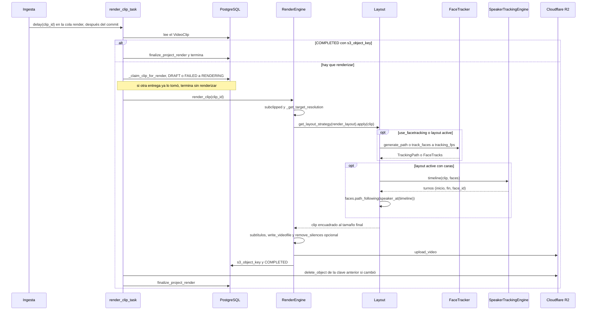
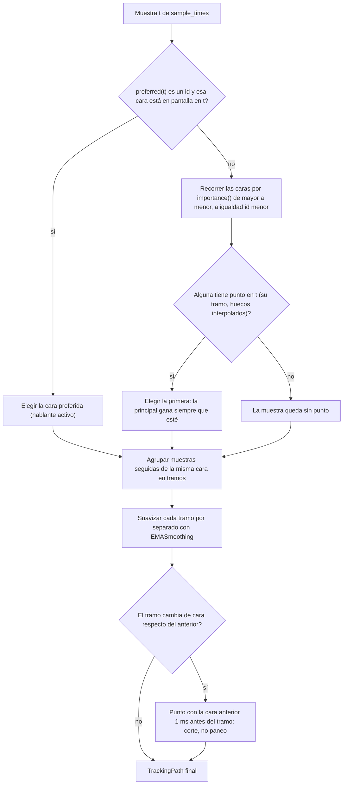
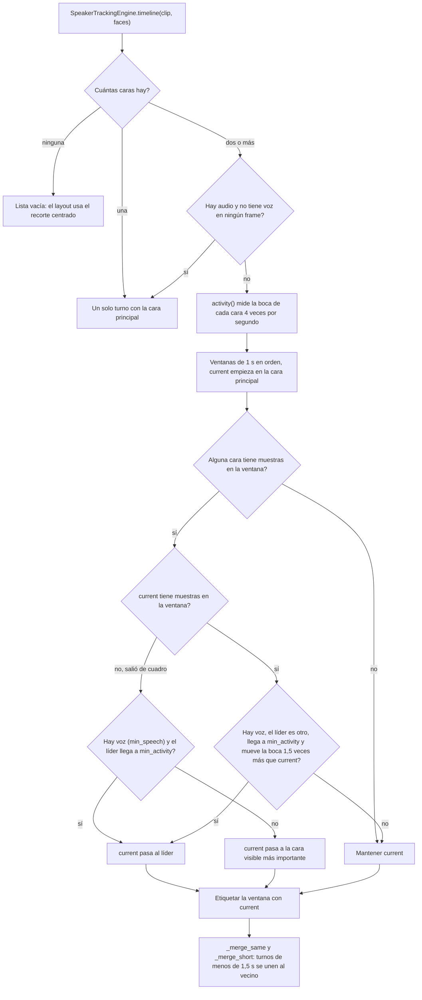

# Render, caras y hablante

Este documento cubre cómo se renderiza un clip: el recorte al formato y la resolución pedidos, el layout, el seguimiento de caras (face tracking v2, CORE-01) y la detección de quién habla para el layout `active` (CORE-02, [ADR-014](../adrs/014-speaker-detection.md)). El render de clips corre en la cola `render` cuando la ingesta termina con `auto_render_bypass` ([ver 02-pipeline-de-ingesta](02-pipeline-de-ingesta.md)). El render del paper edit (`render_video_segments`) corre cuando el usuario aprueba los segmentos con `approve-paper-edit`. El stack (MoviePy 2 + FFmpeg) está decidido en [ADR-003](../adrs/003-rendering-stack.md). Ninguna de estas etapas llama a un proveedor de IA externo: los subtítulos salen de la transcripción que ya hizo la ingesta.

## Componentes

| Componente | Archivo | Rol |
|------------|---------|-----|
| `render_clip_task`, `ClipRenderTask`, `_claim_clip_for_render` | [tasks/render.py](../../back/apps/videos/tasks/render.py) | Tarea por clip: claim con CAS, render, limpieza de la clave vieja en R2, cierre del fan-out. |
| `finalize_project_render` | [tasks/render.py](../../back/apps/videos/tasks/render.py) | Cierra el proyecto (`COMPLETED` o `PARTIAL`) cuando todos los clips terminaron. |
| `render_video_segments`, `_resolve_approved_segments` | [tasks/render.py](../../back/apps/videos/tasks/render.py) | Render del paper edit: corta y concatena los segmentos aprobados. |
| `RenderEngine.render_clip`, `_get_target_resolution` | [services/render_engine.py](../../back/apps/videos/services/render_engine.py) | Subclip, layout, subtítulos, escritura, quitar silencios, subida. |
| `get_layout_strategy`, `LAYOUT_REGISTRY` | [services/layouts/\_\_init\_\_.py](../../back/apps/videos/services/layouts/__init__.py) | Elige la clase de layout por `render_layout`. |
| `BaseLayout` | [layouts/interface.py](../../back/apps/videos/services/layouts/interface.py) | Parámetros comunes, `editing_style` y `tracking_fps`. |
| `FillLayout`, `FitLayout` | [layouts/standard.py](../../back/apps/videos/services/layouts/standard.py) | Recorte con seguimiento de cara, y letterbox. |
| `GamingLayout` | [layouts/gaming.py](../../back/apps/videos/services/layouts/gaming.py) | Cámara arriba y gameplay abajo. |
| `BlurredLayout` | [layouts/blur_pip.py](../../back/apps/videos/services/layouts/blur_pip.py) | Fondo desenfocado y primer plano nítido. |
| `VersusLayout`, `ActiveSpeakerLayout` | [layouts/pro.py](../../back/apps/videos/services/layouts/pro.py) | Dos mitades, y cámara que sigue a quien habla. |
| `get_face_detector`, `_SharedDetector`, `FaceTracker` | [services/face_tracker.py](../../back/apps/videos/services/face_tracker.py) | Detector MediaPipe compartido por proceso, muestreo del clip, camino de encuadre. |
| `Detection`, `FaceTrack`, `IoUTracker`, `FaceTracks`, `sampling_fps` | [services/face_tracking.py](../../back/apps/videos/services/face_tracking.py) | Asociación de caras en el tiempo con ids estables y elección de la cara a encuadrar. Python puro. |
| `EMASmoothing`, `interpolate_gaps`, `TrackingPath` | [services/tracking_utils.py](../../back/apps/videos/services/tracking_utils.py) | Suavizado sin retraso, relleno de huecos e interpolación por frame. |
| `speech_activity`, `mouth_activity`, `SpeakerTrackingEngine`, `speaker_at` | [services/speaker_engine.py](../../back/apps/videos/services/speaker_engine.py) | Voz por energía, movimiento de boca por cara y timeline de turnos. |

## Flujo: render de un clip

1. **Encolado.** `_stage_dispatch_render` encola un `render_clip_task` por clip `DRAFT` con `transaction.on_commit`; `_resume_render_dispatch` vuelve a encolar los que quedaron `DRAFT`. `CELERY_TASK_ROUTES` manda la tarea a la cola `render`, así un render pesado no bloquea la ingesta; el worker consume `-Q celery,render`.
2. **Entrega segura.** La tarea usa `acks_late=True` y `reject_on_worker_lost=True`: si el worker muere a mitad del render (por ejemplo, OOM en MoviePy), el broker re-entrega el mensaje en lugar de perder el clip.
3. **Idempotencia.** Un clip `COMPLETED` con `s3_object_key` no se vuelve a renderizar: solo se llama a `finalize_project_render`.
4. **Claim.** `_claim_clip_for_render` hace un compare-and-set `DRAFT`/`FAILED` → `RENDERING` con un `update` filtrado. Solo una entrega gana; la otra termina con `"Clip <id> already claimed"`. Un mensaje re-entregado (`delivery_info['redelivered']`) puede tomar además un clip que quedó en `RENDERING`: su worker murió y nadie más lo terminaría.
5. **Fuente y tamaño.** `RenderEngine.render_clip` abre el archivo local `project.source_file.path`, lo corta con `subclipped(start_time, end_time)` y calcula el tamaño con `_get_target_resolution(aspect_ratio, metadata['render_resolution'])` (ver [resolución](#flujo-resolución-y-formato-de-salida)).
6. **Layout.** `get_layout_strategy` recibe `render_layout`, el tamaño, `use_facetracking`, `gameplay_position`, `camera_selection_position`, las coordenadas manuales y `editing_style`, y devuelve una instancia que aplica el encuadre (ver [layouts](#flujo-layouts)).
7. **Subtítulos** (`add_subtitles`). Con `transcript_data` usa los ítems que caen en el clip (`_slice_segments`) agrupados con `TranscriptionEngine.group_words(..., max_words=subtitle_words_per_segment)`. Sin transcripción guardada, extrae el audio a MP3 y transcribe con `TranscriptionEngine(model_size="tiny", v2_enabled=v2_enabled_for(project))`: con V2 habilitado para el proyecto usa el backend de `TRANSCRIPTION_BACKEND` (Groq por defecto), si no, Whisper local. Esta transcripción no reserva capacidad ni escribe filas de `AIUsageRecord`.
8. **Escritura.** `write_videofile` con `RENDER_CODEC` (`libx264`), `RENDER_AUDIO_CODEC` (`aac`), `RENDER_FPS` (24), `RENDER_PRESET` (`medium`) y `FFMPEG_PARAMS` (`-pix_fmt yuv420p`). Con `remove_silences`, `FFmpegManager.remove_silences_from_video` reemplaza el archivo antes de subirlo.
9. **Subida.** `CloudflareR2Manager.upload_video` devuelve la clave (`videos/<user_id>/<project_id>/<uuid>.mp4`); el clip queda `COMPLETED` con esa clave. Si había una clave anterior distinta (re-render después de un fallo), `render_clip_task` borra ese objeto de R2.
10. **Cierre del fan-out.** `finalize_project_render` toma el lock de fila del proyecto y solo actúa si está en `RENDER_DISPATCHED` y ningún clip sigue `DRAFT` o `RENDERING`: con algún clip `FAILED` pasa a `PARTIAL`, si no a `COMPLETED` (etapa y estado). Se llama después de cada clip; solo la llamada que ve terminar al último hace la transición. Registra `pipeline.render_finalized`. En un video completo (`single_edit`), esa misma llamada cobra la reserva de creación si quedó `COMPLETED` y la devuelve si quedó `PARTIAL` (`_settle_whole_video_reservation`, ver [02](02-pipeline-de-ingesta.md)).

### Paper edit (`render_video_segments`)

1. `approve_paper_edit` reserva el costo, guarda `approved_segments` y encola `render_video_segments(project_id)`.
2. `_resolve_approved_segments` lee la columna `approved_segments` (o `metadata['approved_segments']` en proyectos viejos) y la valida con `validate_approved_segments`. Sin segmentos o con segmentos inválidos levanta `NonRetryableAIError` con código `no_approved_segments` o `invalid_approved_segments`.
3. Descarga `original_r2_key` de R2 a un directorio temporal, corta cada segmento, los concatena y aplica el mismo `get_layout_strategy` (con `editing_style`, sin coordenadas manuales) y `_get_target_resolution`.
4. Los subtítulos usan el `text` de cada segmento aprobado con tiempos recalculados sobre el video final.
5. Escribe con preset `slow`, sube a `<project_id>/final`, guarda `final_export_r2_key`, deja el proyecto `COMPLETED` y crea un `VideoClip` "VIDEO FINAL EDITADO".

## Flujo: layouts

| `render_layout` | Clase | Caras | Qué hace |
|-----------------|-------|-------|----------|
| `fill` (también un valor desconocido) | `FillLayout` | Con `use_facetracking` | Recorte al aspecto destino. La x sigue la cara y la y queda centrada. Zoom 1,3 si la cara mide menos del 15 % del alto. |
| `fit` | `FitLayout` | No | Video completo sobre fondo negro. |
| `pip` | `FitLayout` | No | Igual que `fit`: no hay layout PiP propio. |
| `blurred` | `BlurredLayout` | Con `use_facetracking` | Fondo desenfocado (sigma 30) y oscurecido; primer plano al ancho, con recorte vertical que sigue la y de la cara. |
| `split` | `GamingLayout` | Con `use_facetracking` | Cámara arriba (35 % del alto) encuadrada sobre la cara; gameplay abajo (65 %) según `gameplay_position`. |
| `versus` | `VersusLayout` | No | Mitad izquierda arriba y mitad derecha abajo. |
| `active` | `ActiveSpeakerLayout` | Siempre | Sigue a quien habla. Sin caras, o ante cualquier error, recorte centrado. |

- `BaseLayout.tracking_fps` devuelve `sampling_fps(editing_style)`: cada layout que sigue caras muestrea según el estilo de edición (ver la tabla de muestreo más abajo).
- `ActiveSpeakerLayout` no mira `use_facetracking`: siempre llama a `FaceTracker().track_faces`. Si no hay tracks o el camino queda vacío, usa `_centered`. Cualquier excepción registra `layout.active_speaker_failed` y también cae en `_centered`. El encuadre usa todo el alto de la fuente con el aspecto destino y mueve la x con `path.get_at(t)`; registra `layout.active_speaker`.
- `camera_selection_position` y `manual_camera_x/y/zoom` llegan a `BaseLayout`, pero hoy ningún layout los lee. `VideoProject.speaker_tracking` tampoco se lee en el render: el seguimiento del hablante depende solo de `render_layout='active'`.
- En `GamingLayout`, `GameplaySaliencyDetector` solo corre si `gameplay_position` no es `left`, `center` ni `right`; con las opciones del modelo ese caso no se da.

## Flujo: face tracking v2

1. **Detector compartido.** `get_face_detector(min_detection_confidence=0.5)` carga una sola vez por proceso (y por confianza, redondeada a 3 decimales) el `FaceDetector` de MediaPipe con `face_detector.tflite`. Lo envuelve en `_SharedDetector`, que serializa las llamadas con un lock (MediaPipe no es thread-safe) y cuyo `close()` no hace nada. Una carga fallida también se recuerda: se registra `face_tracker.detector_failed` una vez y no se reintenta en cada clip.
2. **Muestreo.** `FaceTracker.track_faces(clip, fps)` toma frames en `0, 1/fps, 2/fps...` y `detect` convierte cada detección con caja positiva en una `Detection(t, x, y, w, h, score)` en píxeles. Un frame que falla cuenta como sin caras (se loguean los 3 primeros con `face_tracker.frame_failed`).
3. **Asociación** (`IoUTracker`, voraz, mejor par primero). Una detección continúa un track si su caja se superpone con la última (IoU ≥ 0,2) o, ante un movimiento rápido, si su área está entre la mitad y el doble de la anterior y su centro se movió como máximo 0,75 tamaños de cara. Un track sobrevive `max_missed` muestras sin detección (`max(2, round(fps × 1,5))`, unos 1,5 s: una cabeza girada, una mano delante); después la cara recibe un id nuevo. Los tracks con menos de 2 detecciones (`min_hits`) son ruido y no se reportan.
4. **Cara principal.** `FaceTracks.primary()` es la de mayor `importance()` = cantidad de detecciones × √(área media); a igualdad, la de id menor.
5. **Camino.** `generate_path` devuelve `framing_path()` (o el centro del frame si no hay detector, no hay caras o algo falla). `framing_path` es `path_following` sin cara preferida; `ActiveSpeakerLayout` usa `path_following(speaker_at(timeline))`.
6. **Por frame.** Los layouts leen `path.get_at(t)`, que interpola linealmente entre los puntos del camino. `get_average_size()` devuelve la mediana de ancho y alto, que usan `FillLayout` y `GamingLayout` para el zoom y el tamaño del recorte.

- "En pantalla" es el tramo de la cara entre su primera y su última detección, con los huecos cortos rellenados por `interpolate_gaps` (interpolación lineal en los tiempos muestreados, en lugar de quedarse quieto y saltar).
- Un cambio de plano o de persona mueve la cámara a la cara que está, en vez de dejar un encuadre vacío sobre la principal ausente.
- `EMASmoothing(alpha=0.35, bidirectional=True)` aplica una media móvil exponencial hacia adelante y otra hacia atrás, que cancela el retraso de una sola pasada (la cámara no queda detrás de la cara). Antes de suavizar refleja la serie de forma impar en ambos extremos (`ceil(3 / alpha)` puntos, como máximo la longitud − 1), así un paneo constante sigue recto en los bordes. Se aplica a x, y, ancho y alto; con menos de 3 puntos no suaviza.

### Muestreo adaptativo

Más muestras por segundo siguen mejor un corte rápido pero cuestan tiempo de detector por clip (`SAMPLING_FPS`):

| `editing_style` | Muestras por segundo |
|-----------------|----------------------|
| `dynamic`, `hormozi` | 3.0 |
| `vlog`, `custom` | 2.0 |
| `minimalist` | 1.5 |
| otro o vacío | `DEFAULT_SAMPLING_FPS` = 2.0 |

### Requisito de sistema: libEGL y libGLES

MediaPipe crea sus imágenes (`mp.Image`) con EGL/GLES aunque corra en CPU. El [Dockerfile](../../back/Dockerfile) instala `libegl1` y `libgles2` en la etapa `base` por eso (además de `libgl1`). Sin ellas, cada frame falla. `track_faces` lo distingue de un clip sin caras: si fallaron todas las muestras, registra el error `face_tracker.all_frames_failed samples=<n>`. El render no falla: el camino cae al centro del frame (`face_tracker.no_faces`) y el layout `active` al recorte centrado. Hay que buscar ese evento en los logs del worker para detectarlo.

## Flujo: quién habla

1. **Voz** (`speech_activity`). Lee el audio del clip a 16 kHz en lecturas de 1 s (`buffersize=16000`): con lecturas más largas a una tasa remuestreada, el lector de MoviePy devolvía muestras erróneas (repetía una sola). Calcula el RMS cada 50 ms y marca voz cuando supera `piso + 0,25 × (pico − piso)`, con piso = percentil 20 y pico = percentil 95. Un clip en silencio da todo falso; un nivel que nunca cambia (música de fondo, un tono) da todo verdadero y la decisión queda en la boca. Sin audio, o si la lectura falla (`speaker.audio_failed`), devuelve `None` y no se filtra por voz.
2. **Boca** (`activity` y `mouth_activity`). Cada 0,25 s (`sample_rate` = 4) compara el frame en `t` con el de `t + 0,1 s` (`pair_gap`) dentro de la caja de cada cara en pantalla. El puntaje es el cambio medio en la zona de la boca (62–95 % del alto de la cara, 25–75 % del ancho) menos el cambio en la parte superior (10–45 %): mover la cabeza o un cambio de luz no cuentan como hablar. Solo convierte a gris los píxeles de la cara. Se saltean las muestras sin voz alrededor; una cara fuera de su tramo no tiene muestras.
3. **Decisión por ventana** (`_label_windows`, diagrama). El líder es la cara de mayor puntaje medio (a igualdad, id menor). Hay voz si al menos el 30 % de la ventana (`min_speech`) tiene voz, o si no hay audio. Si quien tiene la cámara sale de cuadro, la toma el líder si se mueve claramente y hay voz; si no, la cara visible más importante.
4. **Turnos cortos** (`_merge_short`). Un turno de menos de `min_segment` (1,5 s) se une a su vecino más largo. Los turnos del medio y los más cortos van primero, para que dos turnos cortos en un borde no se sumen en uno que pase el mínimo.
5. **Salida.** Una lista `[(inicio, fin, face_id)]`; `speaker_at(timeline)` la convierte en `t → face_id` (desde el final del último turno, la cara de ese turno; fuera del timeline, `None`). `path_following` la usa como cara preferida, con un corte en cada cambio. Registra `speaker.timeline faces=<n> segments=<n>`.

Parámetros del constructor de `SpeakerTrackingEngine` (sin settings, se ajustan con la revisión del piloto): `sample_rate=4.0`, `pair_gap=0.1`, `window=1.0`, `switch_margin=1.5`, `min_activity=1.0`, `min_speech=0.3`, `min_segment=1.5`.

## Flujo: resolución y formato de salida

`RenderEngine._get_target_resolution(aspect_ratio, resolution)` toma el alto de `RESOLUTION_HEIGHTS` según `metadata['render_resolution']` y calcula el ancho según el formato, forzando dimensiones pares para H.264 (`ensure_even`):

| `render_resolution` | 9:16 | 1:1 | 16:9 |
|---------------------|------|-----|------|
| `720p`, ausente o desconocido (`DEFAULT_HEIGHT`) | 406 × 720 | 720 × 720 | 1280 × 720 |
| `1080p` | 608 × 1080 | 1080 × 1080 | 1920 × 1080 |
| `4K` | 1216 × 2160 | 2160 × 2160 | 3840 × 2160 |

- `metadata['render_resolution']` lo escribe el pedido de creación (campo `render_resolution`, cobrado y comparado con el plan) o Prompt-to-Edit, cuyo `ConfigValidator` descarta un tier que el plan no permite o que sube el precio ([ver 04-prompt-to-edit](04-prompt-to-edit.md)). Sin la clave, el precio (`_pricing_resolution`, [ver 01-creacion-de-proyecto](01-creacion-de-proyecto.md)) y el render usan `720p`: nunca se entrega más de lo que se cobró.
- **Formato cuadrado.** Hasta la migración `0009_square_aspect_ratio` el cuadrado se guardaba como `'1:Post'`, pero el render solo conoce `'1:1'`: cualquier otro valor cae en 9:16, así que los proyectos cuadrados salían verticales. La migración convierte las filas a `'1:1'`. El serializer sigue aceptando `'1:Post'` y lo guarda como `'1:1'` (`validate_aspect_ratio` con `LEGACY_ASPECT_RATIOS`), y `ProjectConfig` hace lo mismo con lo que devuelve el parser de Prompt-to-Edit.
- `FillLayout` y `ActiveSpeakerLayout` terminan con `resized(new_size=(target_w, target_h))`: con ancho y alto por separado MoviePy 2 podía dar un ancho impar.

## Errores, reintentos y casos borde

| Situación | Qué pasa | Dónde |
|-----------|----------|-------|
| Dos entregas del mismo clip | La que pierde el CAS termina con `already claimed` sin renderizar. | `_claim_clip_for_render` |
| Worker muerto a mitad del render | El broker re-entrega el mensaje (`acks_late`, `reject_on_worker_lost`) y la re-entrega puede tomar el clip en `RENDERING`. Tarda lo que `CELERY_VISIBILITY_TIMEOUT`. | `render_clip_task` |
| Clip ya `COMPLETED` | No-op y `finalize_project_render`. | `render_clip_task` |
| Error dentro de `RenderEngine.render_clip` | El clip vuelve a `DRAFT` y la excepción se propaga. La tarea no reintenta: `ClipRenderTask.on_failure` lo marca `FAILED` y llama a `finalize_project_render` (el proyecto puede terminar `PARTIAL`). | `render_clip`, `ClipRenderTask` |
| `on_failure` no puede escribir en la base | Log `render.failure_not_recorded`. | `ClipRenderTask` |
| Re-render con clave nueva | Se borra el objeto anterior de R2; si falla, se loguea y sigue. | `render_clip_task` |
| Proyecto fuera de `RENDER_DISPATCHED` o transición en conflicto | `finalize_project_render` no hace nada. | `finalize_project_render` |
| MediaPipe no instalado, modelo ausente o carga fallida | Sin detector: camino al centro (`face_tracker.detector_unavailable`) y layout `active` centrado. | `get_face_detector`, `FaceTracker` |
| Fallan todos los frames (faltan libEGL/libGLES) | `face_tracker.all_frames_failed`; render centrado, sin error. | `FaceTracker.track_faces` |
| Clip sin caras | `face_tracker.no_faces`; camino al centro del frame. | `FaceTracker.generate_path` |
| Error en el tracking | `face_tracker.failed`; camino al centro. | `FaceTracker.generate_path` |
| Layout `active` con una sola cara, o con audio sin voz | Un único turno con la cara principal. | `SpeakerTrackingEngine.timeline` |
| Falla la lectura de frames para la boca | Se saltea la muestra; `speaker.frame_failed` (3 primeras) y, si fueron más de 3, `speaker.frames_failed` con el total. | `SpeakerTrackingEngine.activity` |
| Cualquier error del layout `active` | `layout.active_speaker_failed` y recorte centrado. | `ActiveSpeakerLayout.apply` |
| Subtítulos sin `transcript_data` | El clip sale sin subtítulos y se loguea `render.subtitles_skipped`. No se vuelve a transcribir: esa llamada iba al proveedor sin capacidad ni filas de uso. Todo proyecto del pipeline se transcribe antes de tener clips. | `RenderEngine.render_clip` |
| Paper edit sin segmentos o con segmentos inválidos | Proyecto `FAILED`, `pipeline_error_code` `no_approved_segments` o `invalid_approved_segments`, sin reintento. | `render_video_segments` |
| Otro error del paper edit | Proyecto `FAILED` y `self.retry` a 60 s, hasta `max_retries=2`. En el último intento se devuelve la reserva del render. | `render_video_segments` |
| Paper edit entregado | Se cobra la reserva del render (`metadata['render_reservation_id']`, `render.charged`). Un fallo sin arreglo la devuelve (`render.refunded`). | `_settle_render_reservation` |

## Datos que escribe

- **`VideoClip`**: `status` (`DRAFT` → `RENDERING` → `COMPLETED`, o `FAILED` vía `on_failure`) y `s3_object_key`.
- **`VideoProject`** (fan-out): `pipeline_stage` `RENDER_DISPATCHED` → `COMPLETED` o `PARTIAL`, y `status` igual.
- **`VideoProject`** (paper edit): `final_export_r2_key`, `status` (`COMPLETED` o `FAILED`), `pipeline_error_code` y `pipeline_error_at` en los errores de segmentos, y un `VideoClip` nuevo "VIDEO FINAL EDITADO".
- **R2**: el video de cada clip en `videos/<user_id>/<project_id>/`, el del paper edit en `videos/<user_id>/<project_id>/final/`. Con `USE_R2=False` se copian bajo `MEDIA_ROOT/videos/`.
- **`AIUsageRecord`**: ninguna fila. El render no reserva capacidad.
- **Logs**: `face_tracker.mediapipe_unavailable`, `face_tracker.detector_loaded`, `face_tracker.detector_failed`, `face_tracker.detector_unavailable`, `face_tracker.frame_failed`, `face_tracker.all_frames_failed`, `face_tracker.tracked` (muestras, caras, frames fallidos), `face_tracker.no_faces`, `face_tracker.failed`, `speaker.audio_failed`, `speaker.frame_failed`, `speaker.frames_failed`, `speaker.timeline`, `layout.active_speaker`, `layout.active_speaker_failed`, `render.failure_not_recorded`, `pipeline.render_finalized`.

## Configuración

| Setting | Default | Efecto |
|---------|---------|--------|
| `CELERY_TASK_ROUTES` | `render_clip_task` y `render_video_segments` → cola `render` | Separa los renders de la ingesta. El worker tiene que consumir `-Q celery,render`. |
| `CELERY_VISIBILITY_TIMEOUT` | `14400` (4 h) | Cuándo Redis re-entrega un render sin ack (worker muerto). |
| `TRANSCRIPTION_BACKEND` | `'groq'` | Backend de esa transcripción cuando V2 está habilitado. |
| `FONTS_DIR` | `<BASE_DIR>/assets/fonts` | Fuente `Montserrat-Bold.ttf` de los subtítulos. |
| `MEDIA_ROOT` | `<BASE_DIR>/media` | Archivos temporales del render. |
| `USE_R2` | `False` | Sin R2, `upload_video` copia el archivo bajo `MEDIA_ROOT` y devuelve esa ruta como clave. |

Constantes en código, sin setting: `RENDER_FPS`, `RENDER_CODEC`, `RENDER_AUDIO_CODEC`, `RENDER_PRESET` y `FFMPEG_PARAMS` (`utils/moviepy_utils.py`); `RESOLUTION_HEIGHTS` y `DEFAULT_HEIGHT` (`RenderEngine`); `SAMPLING_FPS` y los parámetros de `IoUTracker` (`face_tracking.py`); `EMASmoothing(alpha=0.35)`; los parámetros de `SpeakerTrackingEngine`. Los módulos de tracking fijan `MEDIAPIPE_DISABLE_GPU=1` al importarse.

## Referencias

- [ADR-014 — Detección de quién habla sin pyannote](../adrs/014-speaker-detection.md)
- [ADR-003 — Stack de rendering (MoviePy + FFmpeg)](../adrs/003-rendering-stack.md)
- PR #91, face tracking v2 (CORE-01): https://github.com/RomeKai/videoeditUTN/pull/91
- PR #93, el layout "Speaker dinámico" sigue a quien habla (CORE-02): https://github.com/RomeKai/videoeditUTN/pull/93
- PR #94, el formato cuadrado sale cuadrado y el render usa la resolución pedida: https://github.com/RomeKai/videoeditUTN/pull/94
- [Dockerfile](../../back/Dockerfile) (librerías de sistema de MediaPipe)
- Tests: [test_render_tasks.py](../../back/apps/videos/tests/test_render_tasks.py), [test_render_video_segments.py](../../back/apps/videos/tests/test_render_video_segments.py), [test_layouts.py](../../back/apps/videos/tests/test_layouts.py), [test_square_and_resolution.py](../../back/apps/videos/tests/test_square_and_resolution.py), [services/test_face_tracking.py](../../back/apps/videos/tests/services/test_face_tracking.py), [services/test_speaker_detection.py](../../back/apps/videos/tests/services/test_speaker_detection.py)
