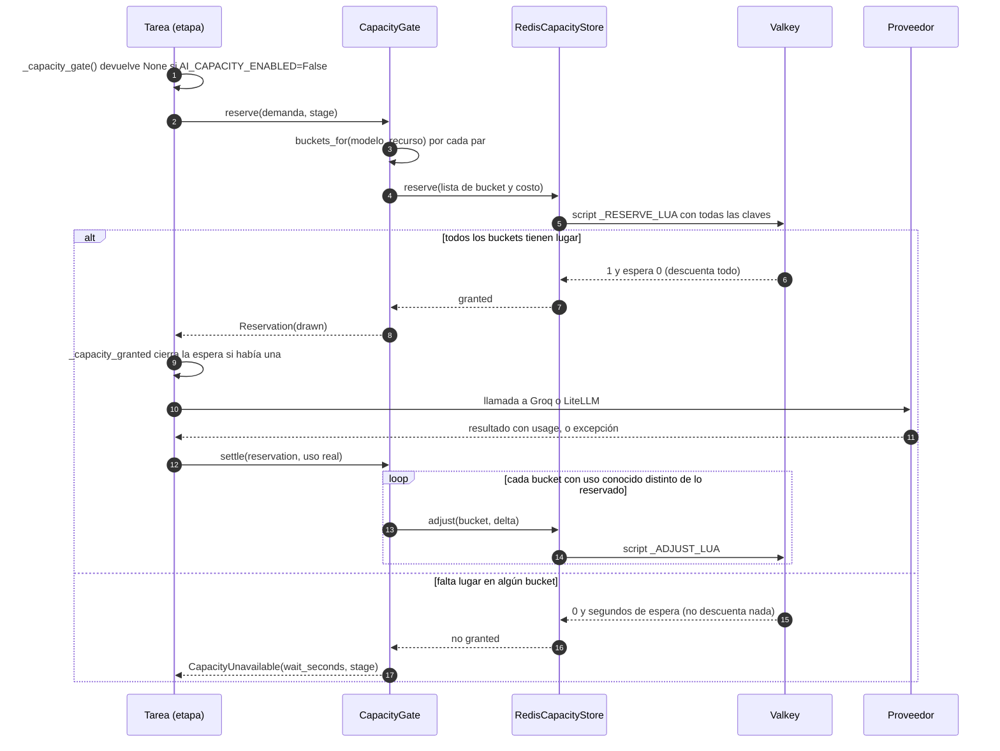
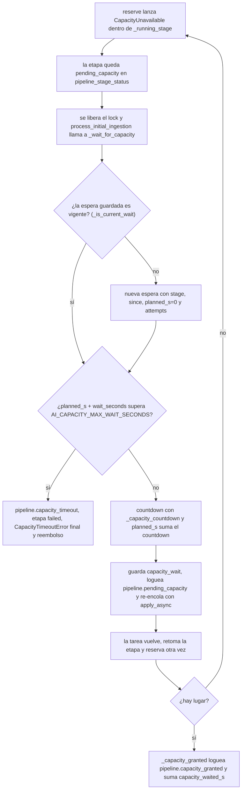
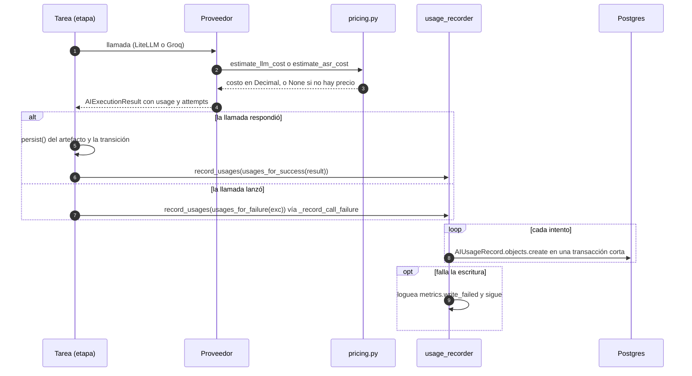

# Capacidad, costos y operación

Este documento cubre lo transversal del core de IA: el control de capacidad propio (token buckets en Valkey) que corre antes de cada llamada a Groq o al LLM, el registro de uso y costo (`AIUsageRecord` y la tabla de precios), el export y la evaluación del piloto, la habilitación gradual de V2, el chequeo de arranque, la cache compartida y la referencia completa de configuración. Cierra con los eventos de log para operar y una tabla de síntomas. El procedimiento del piloto está en el [runbook](../runbooks/ai-core-pilot-runbook.md) y no se repite acá.

## Componentes

| Componente | Archivo | Rol |
|------------|---------|-----|
| `CapacityGate`, `Bucket`, `RedisCapacityStore` | [services/ai/capacity.py](../../back/apps/videos/services/ai/capacity.py) | Reserva antes de la llamada (`reserve`) y ajuste con el uso real (`settle`). Scripts Lua atómicos en Valkey |
| `buckets_for`, `capacity_enabled` | [services/ai/capacity.py](../../back/apps/videos/services/ai/capacity.py) | Lee y valida `AI_CAPACITY_LIMITS`. `capacity_enabled` lee `AI_CAPACITY_ENABLED` |
| `CapacityUnavailable`, `CapacityTimeoutError` | [services/ai/capacity.py](../../back/apps/videos/services/ai/capacity.py) | Falta lugar (espera, no fallo) y espera vencida (fallo final) |
| Helpers de capacidad | [tasks/shared.py](../../back/apps/videos/tasks/shared.py) | `_capacity_gate`, `_transcription_demand`, `_llm_demand`, `_selection_models`, `_llm_usage_by_model`, `_selection_failure_usage`, `_audio_usage`, `_is_current_wait`, `_capacity_granted`, `_capacity_countdown` |
| Espera de la ingesta | [tasks/ingestion.py](../../back/apps/videos/tasks/ingestion.py) | `_wait_for_capacity`, `_reserve_selection`, `_PromptParseCapacity`, `_prompt_capacity_exhausted` |
| Espera de SEO | [tasks/social.py](../../back/apps/videos/tasks/social.py) | `_seo_demand`, `_seo_wait_for_capacity`, `_release_seo_capacity` |
| `AIUsageRecord` | [models.py](../../back/apps/videos/models.py) | Una fila por intento de llamada, insert-only, sin columnas de texto libre |
| Registro de uso | [services/ai/usage_recorder.py](../../back/apps/videos/services/ai/usage_recorder.py) | `record_usages`, `usages_for_success`, `usages_for_failure`, `failure_usage` |
| Precios | [services/ai/pricing.py](../../back/apps/videos/services/ai/pricing.py) | `PRICING_VERSION`, `estimate_llm_cost`, `estimate_asr_cost`, `has_current_price` |
| Rollout | [services/ai/rollout.py](../../back/apps/videos/services/ai/rollout.py) | `v2_enabled_for`, `v2_allowlist`, `invalid_allowlist_entries` |
| Chequeo de arranque | [checks.py](../../back/apps/videos/checks.py) | `check_ai_configuration`: `videos.E001` a `videos.E006` |
| Export del piloto | [export_ai_pilot_metrics.py](../../back/apps/videos/management/commands/export_ai_pilot_metrics.py) | CSV o JSONL por registro o por proyecto |
| Evaluación de transcripción | [evaluate_ai_transcription.py](../../back/apps/videos/management/commands/evaluate_ai_transcription.py) | WER y error de timestamps contra referencias humanas |
| Barrido de reservas | [settle_stale_reservations.py](../../back/apps/videos/management/commands/settle_stale_reservations.py) | Reporta las reservas de tokens que quedaron `RESERVED` y, con `--apply`, las cobra o las devuelve según el estado del proyecto |
| Cache de Django | [settings/base.py](../../back/backend/settings/base.py), [settings/prod.py](../../back/backend/settings/prod.py), [core/cache.py](../../back/apps/core/cache.py), [core/testing.py](../../back/apps/core/testing.py) | `CACHES` (`default` y `locks`) en la base de Redis de `CACHE_REDIS_URL` (django-redis), compartida por todos los procesos web y worker; el corte de `default` cuando Redis no contesta; `clear_local_caches` para los tests ([ver abajo](#cache-compartida)) |
| Workspaces sin plan | [services/plans.py](../../back/apps/payments/services/plans.py), [assign_default_plan.py](../../back/apps/payments/management/commands/assign_default_plan.py) | `get_default_plan_id` da el plan de `DEFAULT_PLAN_NAME` a un workspace nuevo; el comando lista los workspaces sin plan y, con `--apply`, les asigna ese plan |
| Suscripción y compras | [views_subscription.py](../../back/apps/payments/views_subscription.py), [views_purchases.py](../../back/apps/payments/views_purchases.py), [services/subscriptions.py](../../back/apps/payments/services/subscriptions.py), [services/payments.py](../../back/apps/payments/services/payments.py), [services/payment_providers.py](../../back/apps/payments/services/payment_providers.py), [tasks.py](../../back/apps/payments/tasks.py) | Cambio de plan, compra de tokens y pago de una subida (`Payment`), con el proveedor de `PAYMENTS_PROVIDER`. `apply_due_plan_changes` (Celery Beat) aplica las bajadas programadas, rechaza los intentos sin checkout y vence los checkouts que nadie pagó ([ver abajo](#operación-suscripción-y-compras-de-tokens)) |
| Renders trabados | [tasks/render_recovery.py](../../back/apps/videos/tasks/render_recovery.py), [recover_stuck_renders.py](../../back/apps/videos/management/commands/recover_stuck_renders.py) | `recover_stuck_renders` (Celery Beat) y el comando del mismo nombre: re-encolan los paper edits de antes (una sola exportación) que quedaron `RENDERING` con la reserva tomada, cobran los entregados sin cobrar y fallan con reembolso los que perdieron su worker demasiadas veces; y re-encolan los clips trabados de una revisión aprobada o un render automático. También re-encolan o fallan con reembolso las ingestas que no avanzan (`kind=ingestion`) y reintentan la restauración de los clips que dejó un render ya liquidado (`kind=restore`) |

## Flujo: reserva y ajuste de capacidad

Con `AI_CAPACITY_ENABLED=True`, cada llamada a Groq (transcripción) o al LLM (selección, lector de prompts, SEO) reserva en los buckets de su modelo antes de salir. Con `False`, `_capacity_gate` devuelve `None` y no se reserva nada. La moderación (OpenAI) no pasa por los buckets: el endpoint es gratis y un 429 es un `ModerationError` reintentable.



1. Hay un bucket por modelo, recurso y ventana: clave `capacity:v1:<modelo>:<recurso>_per_<ventana>`, con recursos `audio_seconds`, `tokens` y `requests` y ventanas `minute`, `hour` y `day`. Cada bucket guarda como mucho su límite y se rellena de forma continua a `limit / ventana`. Una demanda de `tokens` descuenta de todos los buckets `tokens_per_*` configurados del modelo.
2. `buckets_for` valida la configuración del modelo: sin entrada, sin claves, con una clave desconocida (por ejemplo `tokens_per_min`), con un valor no numérico o no positivo, lanza `ImproperlyConfigured`. Con la capacidad prendida, llamar a un modelo sin límites sería saltear el control.
3. `_RESERVE_LUA` usa el reloj del servidor (`TIME`) y revisa todos los buckets de la demanda juntos: o descuenta en todos o en ninguno. Si alguno no alcanza, devuelve la espera del más escaso, `(needed - tokens) / rate`. Con N workers no se puede pasar un límite.
4. Una demanda mayor que el bucket entero pide solo `min(cost, limit)` para pasar: espera a que el bucket esté lleno, descuenta el costo completo y lo deja negativo. Las demandas siguientes esperan a que se recupere.
5. Cada escritura pone `EXPIRE` al tiempo que tarda el bucket en llenarse, más 1 s. Un bucket sin clave arranca lleno.
6. `settle` aplica el uso real. Para cada bucket reservado: si el uso de ese modelo y recurso no está en `actual`, se conserva la reserva (uso desconocido, criterio conservador); si está, el delta `usado - reservado` se descuenta o se devuelve con `_ADJUST_LUA`, con tope en el límite. Un modelo listado con 0 (por ejemplo, un fallback que no se usó) recupera todo lo suyo.
7. `settle` nunca lanza: la llamada paga ya ocurrió. Si Valkey falla, loguea `capacity.settle_failed` con la clave del bucket.

### Qué reserva cada llamada

| Llamada | Modelos del bucket | Demanda | Ajuste | Etapa de la espera |
|---------|--------------------|---------|--------|--------------------|
| Transcripción con Groq (`_stage_transcribe`) | `groq/<AI_DEFAULT_TRANSCRIPTION_MODEL>` | `_transcription_demand`: `audio_seconds` = duración del video (mínimo 1) y `requests` = un request por ventana de 598 s (600 s menos 2 s de solapamiento) | `_audio_usage`: segundos facturados. `requests` no se ajusta | `transcribed` |
| Selección V2 (`_stage_select_clips`) | `_selection_models(True)`: el primario y el fallback si es distinto y su proveedor tiene key | `_llm_demand`: `tokens` = `ceil(minutos × AI_CAPACITY_LLM_TOKENS_PER_AUDIO_MINUTE) + AI_CAPACITY_LLM_PROMPT_TOKENS + AI_CAPACITY_LLM_OUTPUT_TOKENS` (mínimo 1 minuto) y `requests` = 1, en cada modelo | `_llm_usage_by_model` con los intentos. Si falla, `_selection_failure_usage` | `clips_selected` |
| Selección legacy | `_selection_models(False)`: el modelo de `GeminiFlashStrategy` (`AI_DEFAULT_LLM_MODEL`) | Igual que V2, solo en ese modelo | Ninguno: el selector legacy no informa tokens y queda la reserva | `clips_selected` |
| Lector de prompts (`_PromptParseCapacity`) | `_selection_models(True)` | `ceil(caracteres del prompt / 4) + AI_CAPACITY_LLM_PROMPT_TOKENS + AI_CAPACITY_LLM_OUTPUT_TOKENS` tokens y 1 request | Igual que la selección V2 | La etapa siguiente a la actual |
| SEO (`_generate_social_metadata`) | `_selection_models(True)` | `_seo_demand`: `ceil((caracteres del transcript del clip + del título) / 4) + AI_CAPACITY_LLM_PROMPT_TOKENS + AI_CAPACITY_LLM_OUTPUT_TOKENS` tokens y 1 request | Igual que la selección V2. Si la moderación frena el post antes del LLM, `_release_seo_capacity` devuelve todo | `seo` |

Cómo se calcula el uso real:

- `_llm_usage_by_model`: parte de `tokens=0` y `requests=0` para cada modelo reservado (lo no usado se devuelve) y suma `total_tokens` y un request por intento. Un intento fallido sin tokens y con costo `None` (facturación desconocida) deja `tokens=None` para ese modelo: se conserva la reserva.
- `_selection_failure_usage`: si el error no trae intentos y es de facturación incierta (`is_billing_uncertain`: `AITimeoutError`, `AIConnectionError` salvo `AIConnectionNotEstablishedError`, `AIUnexpectedProviderError` o el soft time limit de la tarea), devuelve `{}` y se conserva todo. Si no, usa los intentos que trae el error; sin intentos, todo vuelve.
- `_audio_usage`: si la transcripción terminó, usa `usage.audio_seconds`. Si falló con facturación incierta, o el intento que trae el error no tiene precio, conserva la reserva. Si falló antes de facturar un chunk, ajusta a 0.

## Flujo: espera por capacidad (`pending_capacity`)



1. `CapacityUnavailable` sale de `reserve` dentro de `_running_stage`, que marca la etapa `pending_capacity` (no `failed`) y la relanza. Esperar no es un intento fallido: no suma `pipeline_attempts` ni escribe filas de uso.
2. La excepción sale del `project_lock`, así que el lock ya está libre cuando `process_initial_ingestion` llama a `_wait_for_capacity`. El worker no queda bloqueado esperando.
3. `_is_current_wait` considera vigente la espera guardada en `metadata['capacity_wait']` solo si es de la misma etapa y su `attempts` coincide con `pipeline_attempts`. Una espera de otra etapa o anterior a un intento fallido (por ejemplo, tras un re-despacho manual) se descarta y se empieza de cero.
4. Si la espera planificada más la nueva supera `AI_CAPACITY_MAX_WAIT_SECONDS`, se loguea `pipeline.capacity_timeout`, la etapa pasa a `failed`, se borra `capacity_wait` y `_record_pipeline_failure` registra `CapacityTimeoutError` como fallo final: suma `pipeline_attempts`, escribe `pipeline_error_code`, marca el proyecto `failed` y devuelve la reserva de tokens si no tiene clips.
5. Si no, `_capacity_countdown` calcula `min(max(wait_seconds, 1), AI_CAPACITY_MAX_COUNTDOWN_SECONDS)` más entre 0 y 20 % de jitter. Ese countdown se suma a `planned_s`, se guarda `capacity_wait` y la tarea se re-encola con `apply_async(countdown=..., retries=self.request.retries)`: el contador de reintentos de Celery viaja con el mensaje, así que una llamada que sigue fallando se queda sin reintentos aunque haya esperas en el medio.
6. Al volver, la tarea retoma la etapa (la anterior está persistida) y reserva de nuevo. Con lugar, `_capacity_granted` loguea `pipeline.capacity_granted` con `waited_s`, suma los segundos a `metadata['capacity_waited_s'][<etapa>]` y borra `capacity_wait`.
7. Si guardar la espera falla (por ejemplo, la base), se trata como cualquier error de etapa: reintento con backoff o fallo final. La etapa nunca queda en `pending_capacity` sin un mensaje en la cola.

Variantes:

- **Lector de prompts.** `_run_ingestion` captura el `CapacityUnavailable` de `apply_prompt_to_project`. Si `_prompt_capacity_exhausted` dice que se pasaría del máximo, loguea `prompt_parse.capacity_timeout` y `give_up_prompt(project_id, 'CapacityTimeoutError')`: el proyecto sigue con su configuración y `metadata['pte']` queda con `status='failed'`. Si no, marca `pending_capacity` en la etapa que sigue y relanza, y la espera sigue el flujo de arriba. Detalle en [04](04-prompt-to-edit.md).
- **SEO.** `_seo_wait_for_capacity` lleva la espera acumulada en el argumento `capacity_waited_s` de `process_video_seo`, no en `metadata`. Al vencer, loguea `seo.capacity_timeout` y deja el post `FAILED` con `error_log='capacity_timeout'`. Si no, loguea `seo.pending_capacity` y re-encola con el mismo `retries` (y `regenerate=True` si era una regeneración). Detalle en [05](05-seo-y-publicacion.md).

## Flujo: uso y costo



1. Cada proveedor calcula `estimated_cost_usd` por intento con la tabla de precios. Groq suma `estimate_asr_cost` chunk por chunk y, si algún chunk no tiene precio, el total queda `None`.
2. `usages_for_success` devuelve todos los intentos del resultado (`attempts`), o solo `usage` si no se rastrearon. `usages_for_failure` usa los intentos que trae el error (`usage_attempts`, cobrados incluidos) o arma uno con `failure_usage`: cero tokens, la latencia medida, `error_code` con el nombre de la clase y costo 0, salvo facturación incierta, que deja `None`.
3. `_persist_then_record_usage` escribe las filas después de persistir el artefacto, fuera de su transacción. Si persistir falla, la llamada ya se cobró: escribe las filas igual y deja pasar el error.
4. `record_usages` toma `attempt` de `VideoProject.pipeline_attempts` (tope 32767), escribe una fila por intento y nunca lanza. Las filas son insert-only: dos filas exitosas de la misma etapa en un proyecto son dos cobros reales (reentrega o pérdida de propiedad).
5. Solo llegan a la tabla números, nombres de modelo y el nombre de la clase del error. `resolved_model` se limpia a `[A-Za-z0-9._:/-]` y 64 caracteres.

| `stage` | Quién la escribe | `pipeline_version` | Notas |
|---------|------------------|--------------------|-------|
| `transcription` | `_stage_transcribe` | `v2` si corrió Groq, `legacy` si corrió Whisper local | Local: `provider='local'`, `model='whisper-base'`, costo 0 real |
| `selection` | `_stage_select_clips` | `v2` o `legacy` | Legacy: una fila con costo `NULL`, porque el selector no informa tokens |
| `prompt_parse` | `record_prompt_parse_usage` ([prompt_parser.py](../../back/apps/videos/services/ai/prompt_parser.py)) | Siempre `v2` | Ver [04](04-prompt-to-edit.md) |
| `seo` | `_generate_social_metadata` ([tasks/social.py](../../back/apps/videos/tasks/social.py)) | Siempre `v2` | Ver [05](05-seo-y-publicacion.md) |

La moderación escribe una fila por chequeo con etapa `moderation` (`record_moderation_usage`): proveedor `openai`, modelo `MODERATION_MODEL`, costo conocido 0 (el endpoint es gratis), latencia y la clase del error si no pasó. Hay dos chequeos posibles por proyecto: el del prompt de Prompt-to-Edit, antes del lector, y el de la etapa de moderación. Su resultado y latencia también quedan en `metadata['moderation']` (ver [03](03-transcripcion-moderacion-seleccion.md)).

### Precios

`pricing.py` guarda los precios en código para que cada cambio pase por un PR. `PRICING_VERSION` (hoy `"2026-10-09"`) se guarda en cada fila.

- La clave es `(proveedor, modelo)`. Un string de LiteLLM se parte en la primera `/` si nombra `gemini`, `openai` o `groq`; un nombre sin prefijo es `openai` para LLM y `groq` para ASR. Así `groq/openai/gpt-oss-120b` y `openai/gpt-4o-mini` no chocan.
- Cada modelo tiene períodos con `valid_from` y `valid_until` (inclusivos). La fecha de consulta es hoy en UTC.
- Modelo desconocido: `None` y log `pricing.unknown_model`. Modelo sin período para la fecha: `None` y `pricing.no_price_for_date`. Cada par (motivo, modelo) se loguea una vez por proceso. Nunca 0: un cero falso pasaría el criterio de costo.
- `estimate_llm_cost`: prompt no cacheado al precio de entrada, `cache_read_tokens` al precio cacheado (o al de entrada si no se conoce) y `completion_tokens + reasoning_tokens` al precio de salida, por millón.
- `estimate_asr_cost`: por request, `max(segundos, min_billable_seconds) / 3600 × precio por hora`. Con precio conocido, 0 segundos cuesta 0. Un valor negativo o no finito lanza `ValueError`.
- `has_current_price(model, kind)` dice si hay precio vigente hoy, sin loguear. Lo usa el chequeo de arranque.

| Modelo | Precio (USD) | Vigencia |
|--------|--------------|----------|
| `gemini/gemini-3.8-flash`, `gemini-3.7-flash`, `gemini-3.6-flash` | 0,75 / 0,075 / 3,75 por M tokens (entrada / cacheada / salida) | Del 2026-10-09 al 2026-12-31. Desde 2027-01-01: 1,50 / 0,15 / 7,50 |
| `gemini/gemini-3.5-flash` | 1,50 / 0,15 / 9,00 | Desde 2026-10-09 |
| `gemini/gemini-3.5-flash-lite` | 0,30 / 0,03 / 2,50 | Desde 2026-10-09 |
| `gemini/gemini-3.1-flash-lite` | 0,25 / 0,025 / 1,50 | Desde 2026-10-09 |
| `gemini/gemini-2.5-flash` | 0,30 / 0,03 / 2,50 | Sin límite |
| `gemini/gemini-2.5-flash-lite` | 0,10 / 0,01 / 0,40 | Sin límite |
| `openai/gpt-4o-mini` | 0,15 / 0,075 / 0,60 | Sin límite |
| `groq/openai/gpt-oss-120b` | 0,15 / sin precio cacheado / 0,60 | Desde 2026-10-09 |
| `groq/openai/gpt-oss-20b` | 0,075 / sin precio cacheado / 0,30 | Desde 2026-10-09 |
| `whisper-large-v3-turbo` (Groq) | 0,04 por hora de audio, mínimo 10 s por request | Sin límite |
| `whisper-large-v3` (Groq) | 0,111 por hora de audio, mínimo 10 s por request | Sin límite |

### Export y evaluación del piloto

`export_ai_pilot_metrics` lee solo columnas numéricas, de enumeración o de nombre de modelo. Nunca títulos, transcripts, prompts, reasoning ni ids de usuario.

| Argumento | Valores |
|-----------|---------|
| `--since` | `YYYY-MM-DD`, obligatorio, inclusivo desde 00:00 UTC |
| `--until` | `YYYY-MM-DD`, exclusivo |
| `--level` | `record` o `project` (default) |
| `--format` | `csv` (default) o `jsonl` |
| `--output` | Archivo; sin él, stdout |

- **`record`:** una fila por `AIUsageRecord` creado en la ventana, con las columnas de `EXPORT_COLUMNS` (`provider`, `model`, `resolved_model`, `stage`, `role`, `pipeline_version`, `attempt`, `success`, `error_code`, tokens, `audio_seconds`, `latency_seconds`, `cached`, `estimated_cost_usd`, `pricing_version`, `created_at`, `project_id`).
- **`project`:** una fila por proyecto creado en la ventana, aunque no tenga registros. Las columnas de ingesta (`total_tokens`, `reasoning_tokens`, `total_cost_usd`, `cost_per_30min_usd`, `cost_complete`, `records_count`, `failed_records`, `fallback_used`, `cached_any`, latencias) suman solo `transcription` y `selection`. SEO va aparte en `seo_records`, `seo_cost_usd` y `seo_cost_complete`. Las filas `prompt_parse` no entran en ninguna columna de este nivel: se ven solo en `record`.
- `pipeline_version` del proyecto es `mixed` si sus registros tienen más de una versión. `cost_complete` es `False` si algún registro tiene costo `NULL` o no hay registros. `cost_per_30min_usd = total_cost_usd / duración del video fuente × 1800`, con la duración de `metadata['duration']`.
- `reasoning_effort` sale de `metadata['selection_reasoning_effort']` y solo se exporta si es `minimal`, `low`, `medium`, `high` o `default`.
- En CSV, un texto que empieza con `=`, `+`, `-`, `@`, tab o CR lleva una comilla adelante.

`evaluate_ai_transcription` calcula el WER del corpus y el error de timestamps de las anclas, por proyecto y agregado por `pipeline_version` (filas `ALL`). Toma `--references DIR` (con `manifest.csv`, `<video_id>.txt` y opcionalmente `<video_id>.anchors.csv`), `--accents keep|strip` (obligatorio), `--window` (default 5 s) y `--output`. La versión de cada proyecto sale de sus filas `transcription`: una sola versión, `mixed` o `unknown`. El resumen compara contra los umbrales del G1 (WER ≤ 15 %, mediana ≤ 300 ms) y sale por stderr, o por stdout cuando el CSV va a `--output`.

Cómo correr ambos y leerlos: [runbook §1.3](../runbooks/ai-core-pilot-runbook.md#13-export-de-métricas) y [§3.4](../runbooks/ai-core-pilot-runbook.md#34-cálculo-automático-de-wer-y-timestamps).

## Rollout de V2

`v2_enabled_for(project)` decide por proyecto:

- `AI_CORE_V2_ENABLED=False` devuelve `False` siempre: es el switch maestro y el kill switch.
- Con el switch prendido y `AI_CORE_V2_ALLOWLIST` vacía, todos van a V2.
- Con la lista cargada, solo los proyectos cuyo `uploaded_by_id` está en la lista. Las entradas se comparan como UUID canónico; una entrada que no es UUID nunca coincide (y la marca `videos.E006`).

Cada etapa pregunta cuando corre, así que un cambio aplica desde la siguiente etapa de un proyecto en curso, y `pipeline_version` guarda el camino que corrió.

| Dónde | ¿Pregunta? | V2 | Legacy |
|-------|------------|----|--------|
| Transcripción (`_stage_transcribe`) | Sí, y se lo pasa a `TranscriptionEngine` | `TRANSCRIPTION_BACKEND` (`groq` por defecto) | Whisper local `base` |
| Moderación (`_stage_moderate`) | No | Siempre `AI_Security_Shield` | Igual |
| Selección (`_stage_select_clips`) | Sí | `SelectionEngine.select_viral_clips_detailed` (LiteLLM) | `SelectionEngine.select_viral_clips(..., v2_enabled=False)` |
| Render por clip (`RenderEngine.render_clip`) | No: sin `transcript_data` el clip sale sin subtítulos (`render.subtitles_skipped`) y no transcribe | — | — |
| Prompt-to-Edit (`apply_prompt_to_project`) | No | Siempre LiteLLM, filas `v2` | — |
| SEO (`process_video_seo`) | No | Siempre LiteLLM, filas `v2` | — |

Con V2 y `TRANSCRIPTION_BACKEND=local`, la transcripción corre Whisper local y sus filas salen `legacy`: la versión se fija por el backend que corrió.

Pasos de la habilitación gradual y del rollback: [runbook §5.3](../runbooks/ai-core-pilot-runbook.md#53-habilitación-gradual-después-de-g2) y [§7](../runbooks/ai-core-pilot-runbook.md#7-rollback).

## Chequeo de arranque

`check_ai_configuration` está registrado como system check de Django (`Tags.compatibility`) y corre con los comandos de `manage.py` (`check`, `migrate`, `runserver`). Solo lee settings: no llama a ningún proveedor.

| Código | Falla cuando | Qué hacer |
|--------|--------------|-----------|
| `videos.E001` | `AI_DEFAULT_LLM_MODEL`, `AI_FALLBACK_LLM_MODEL` o, con V2 y backend Groq, `AI_DEFAULT_TRANSCRIPTION_MODEL` contiene `latest` (alias móvil) | Fijar una versión del modelo |
| `videos.E002` | Uno de esos modelos no tiene precio vigente hoy en `pricing.py` | Agregar el precio por PR o configurar un modelo con precio |
| `videos.E003` | `AI_CORE_V2_ENABLED=True` y `TRANSCRIPTION_BACKEND` no es `groq` ni `local` | Corregir el backend |
| `videos.E004` | `AI_LLM_REASONING_EFFORT` no es vacío ni `minimal`, `low`, `medium` o `high` | Corregir el valor |
| `videos.E005` | `AI_CAPACITY_ENABLED=True` y `AI_CAPACITY_LIMITS` no es un objeto JSON, o un modelo que el pipeline reserva no tiene límites válidos. Se revisan el primario, el fallback si es distinto y tiene key, y `groq/<AI_DEFAULT_TRANSCRIPTION_MODEL>` con V2 y Groq | Completar los límites de cada modelo |
| `videos.E006` | `AI_CORE_V2_ALLOWLIST` tiene entradas que no son UUID | Usar los ids de usuario |

`E001` y `E002` se excluyen por modelo: un alias no se revisa también por precio. `MODERATION_MODEL` no pasa por este chequeo (su default es `omni-moderation-latest`).

## Cache compartida

`CACHES` de dev y prod sale de [settings/base.py](../../back/backend/settings/base.py) (`ci.py` usa sus propias LocMem, con los mismos dos alias).

- **Con `CACHE_REDIS_URL`** (docker-compose lo define para `web` y `worker` como `redis://redis:6379/1`): django-redis en esa base. Es una base propia, nunca la del broker (`REDIS_URL`, base 0): en django-redis `cache.clear()` es un `FLUSHDB` de toda la base, sin mirar el prefijo, y en la del broker vaciaría las colas de Celery, el hash de mensajes sin ack de kombu, los locks por proyecto y los buckets de capacidad. Si las dos URL apuntan a la misma base, los settings lo avisan al cargar con `cache.shares_broker_db`. Claves con `KEY_PREFIX` (`CACHE_KEY_PREFIX`, `onecreator` por defecto; `make_key` queda `<prefijo>:1:<clave>`), `TIMEOUT` de 300 s y `SOCKET_CONNECT_TIMEOUT` y `SOCKET_TIMEOUT` de 2 s: un Redis que no contesta falla la llamada en segundos en vez de colgar el request o la tarea.
- **Sin `CACHE_REDIS_URL`**: una `LocMemCache` por proceso para cada alias. Sirve para un `runserver` sin Redis. `REDIS_URL` sola no alcanza. En prod, `prod.py` lo avisa al cargar los settings con `cache.not_shared`, por stderr porque `LOGGING` todavía no se aplicó.

Hay dos alias, con reglas distintas cuando Redis no contesta ([core/cache.py](../../back/apps/core/cache.py)):

| Alias | Backend | Sin Redis | Para qué |
|-------|---------|-----------|----------|
| `default` | `FailOpenRedisCache` (`IGNORE_EXCEPTIONS`), con un corte por proceso | Un `get` es un miss, un `set` o un `delete` no hace nada. El primer error de una caída se loguea como `cache.unavailable error=<clase>`, sin el traceback, y abre el corte (ver abajo) | Lo que se puede reconstruir o dejar pasar: la lista pública de planes (`payments.services.plans`, una hora, que entonces sale de la base), los límites de intentos y las caches de consultas. Nunca un lock: ahí `add` devolvería `None` |
| `locks` | `django_redis.cache.RedisCache`, con prefijo `<prefijo>:locks` | Lanza el error de redis-py | Locks con `caches['locks'].add(clave, ...)`: en Redis es un solo `SET NX PX`, atómico entre procesos. Hoy, el lock de cada publicación (`lock_post_publish_<post_id>` en `upload_to_social_network`, [05](05-seo-y-publicacion.md)): sin Redis la tarea reintenta y nunca publica sin lock |

**Corte de la cache `default` (circuit breaker).** Con Redis colgado, cada llamada a la cache esperaba su `SOCKET_TIMEOUT` de 2 s, y un login hace varias. `FailOpenRedisCache` guarda un `CircuitBreaker` por proceso y por URL de Redis:

- El primer error de conexión abre el corte y loguea `cache.unavailable` una sola vez por caída. Solo cuenta que Redis no conteste (`ConnectionError`, `TimeoutError` de redis-py, o un timeout del socket). Un error con el que Redis contesta a un comando (`ResponseError`: `WRONGTYPE`, sin memoria al escribir) se loguea como `cache.command_failed error=<clase>`, devuelve lo mismo que un miss y no abre el corte.
- Con el corte abierto, cada llamada contesta lo mismo que un miss sin tocar Redis, durante `CACHE_CIRCUIT_COOLDOWN_SECONDS` (5 s).
- Al terminar ese tiempo, una sola llamada prueba Redis. Las demás siguen sin tocarlo. Si la prueba falla, empieza otra espera. Mientras la caída sigue, cada 5 minutos loguea `cache.still_unavailable error=<clase> down_for_seconds=<n>` a nivel ERROR: una URL mal puesta no se arregla sola y no puede quedar en un solo aviso. Si contesta, el corte se cierra y loguea `cache.recovered after_seconds=<n>`.
- El alias `locks` no tiene corte: cada `add` va a Redis y lanza si no contesta.

Así, un Redis que no contesta le cuesta a cada proceso una espera de 2 s cada 5 s, no una por llamada.

**Límites de intentos sin Redis.** Los límites de los endpoints que verifican una contraseña cuentan en la cache `default`. Si fallaran abiertos, una caída de Redis (o los 5 s del corte) dejaría adivinar contraseñas sin límite. Por eso guardan la cuenta en la memoria del proceso mientras la cache no contesta ([users/throttles.py](../../back/apps/users/throttles.py)):

- **`LoginFailureGuard`** (logins fallidos por cuenta, `LOGIN_FAILURE_RATES`): cuenta en `local_counts`, una `LocMemCache` del proceso con hasta 20000 claves. Solo para emails que tienen cuenta: los de emails inventados no ocupan lugar, así que no pueden desalojar los contadores de una cuenta.
- **`AttemptThrottle`** (login y renovación por IP, cambio de contraseña y cambio de email por usuario, y los endpoints de cuenta de [users/views_auth.py](../../back/apps/users/views_auth.py): registro y recuperar por IP, cerrar sesión por usuario; `EmailChangeThrottle` y `EmailAttemptThrottle` heredan de ella): su cache es `LocalFallbackCache`. Una escritura que Redis no tomó queda en memoria, y una lectura sin resultado mira ahí. Lo que cuenta «por IP» es la dirección para IPv4 y el /64 para IPv6 (`client_ident`), porque un cliente IPv6 puede estrenar una dirección de su /64 en cada pedido. `LoginFailureGuard` usa lo mismo para su ventana por cuenta e IP.
- **`EmailAttemptThrottle`** (reenviar la verificación y recuperar contraseña): cuenta por email, no por IP. La clave es un HMAC del email normalizado, nunca el email, y es la misma para todas sus escrituras, tenga cuenta o no. En esas vistas el límite por IP va primero, y el primero que rechaza corta (`PublicAccountView.check_throttles`). DRF los revisa todos: un pedido que su IP ya no podía hacer igual contaba para el email, y desde una IP se podía tener esperando a cualquier email sin mandarle nada.

En los dos casos el límite vale por proceso: con N procesos web, admite hasta N veces el límite mientras dura la caída. Lo guardado en memoria vence con su ventana, igual que lo compartido, y un login correcto borra los fallos de su cuenta. Cuando Redis vuelve, sigue la cuenta compartida.

Con la LocMem de antes, cada worker de gunicorn o contenedor tenía su propia lista de planes y su propio lock: dos entregas del mismo post en workers distintos podían publicar dos veces.

Un lock que necesita un token de dueño o renovarse mientras trabaja no va en la cache de Django: va con redis-py directo, como el lock por proyecto ([project_lock.py](../../back/apps/videos/services/ai/project_lock.py)). Los buckets de capacidad y el contador de alertas de tareas también usan redis-py directo, en `REDIS_URL`, porque necesitan Lua o `INCR`.

**Tests.** pytest toma `DJANGO_SETTINGS_MODULE` del entorno antes que de `pytest.ini`, y los contenedores de docker-compose lo tienen en `dev`: un test que corre ahí usa la cache de Redis. Un test o fixture que limpia la cache usa `clear_local_caches` ([core/testing.py](../../back/apps/core/testing.py)), que falla con `AssertionError` si el alias no es una `LocMemCache`, en vez de `cache.clear()`.

## Errores, reintentos y casos borde

| Situación | Qué pasa | Dónde |
|-----------|----------|-------|
| Valkey no responde al reservar | El error de redis es reintentable: backoff del pipeline. Nunca se llama al proveedor sin reserva | `RedisCapacityStore.reserve`, `_is_retryable_pipeline_error` |
| Valkey falla al ajustar | `capacity.settle_failed` y la etapa sigue. El bucket queda con lo reservado | `CapacityGate.settle` |
| Modelo sin límites con la capacidad prendida | `ImproperlyConfigured` antes de llamar. No es reintentable: el proyecto falla. `videos.E005` lo detecta al arrancar | `buckets_for` |
| Demanda mayor que un bucket entero | Espera a que el bucket esté lleno, pasa y lo deja negativo | `_RESERVE_LUA` |
| Espera vencida en la ingesta | `CapacityTimeoutError` como fallo final y reembolso de tokens si no hay clips. Una cuota diaria agotada vence enseguida | `_wait_for_capacity` |
| Espera vencida en el lector de prompts | El proyecto sigue con su configuración: `metadata['pte']` queda con `status='failed'` y `error_code='CapacityTimeoutError'` | `_run_ingestion` |
| Espera vencida en SEO | Post `FAILED` con `error_log='capacity_timeout'` | `_seo_wait_for_capacity` |
| Re-encolado por capacidad | Conserva el contador de Celery (`retries`) y `parse_retries`. `lock_retries` vuelve a 0 porque el lock ya se había tomado | `_wait_for_capacity` |
| El re-encolado por capacidad no se puede publicar (broker caído) | `pipeline.requeue_not_published` con `requeue=capacity`. `_restore_capacity_wait` devuelve la espera que se había sumado a `planned_s` y, tras 5 s, el mismo mensaje vuelve al broker (`Reject(requeue=True)`): no se pierde, no cuenta un intento fallido y la espera no se cuenta dos veces | `_publish_requeue` |
| Espera vieja tras un re-despacho manual | `_is_current_wait` la descarta y empieza otra | [tasks/shared.py](../../back/apps/videos/tasks/shared.py) |
| Timeout o conexión cortada | Costo `NULL` en la fila y la reserva de capacidad se conserva: pudo haberse cobrado | `failure_usage`, `_selection_failure_usage`, `_audio_usage` |
| Falla escribir un `AIUsageRecord` | `metrics.write_failed` con el nombre de la clase. La etapa sigue | `record_usages` |
| Falla persistir el artefacto | Las filas de uso se escriben igual y el error sigue | `_persist_then_record_usage` |
| Worker muerto a mitad de la llamada | No escribe filas: ese cobro no aparece en el export | `usage_recorder.py` |
| Modelo sin precio | `estimated_cost_usd` `NULL`, `cost_complete=False` en el export | `pricing.py` |

## Datos que escribe

| Dónde | Clave o campo | Contenido |
|-------|---------------|-----------|
| Valkey | `capacity:v1:<modelo>:<recurso>_per_<ventana>` | Hash con `tokens` y `ts`, con `EXPIRE` |
| Valkey, base de `CACHE_REDIS_URL` | `<CACHE_KEY_PREFIX>:1:payments:public-plans`, `<CACHE_KEY_PREFIX>:locks:1:lock_post_publish_<post_id>` | Lista pública de planes (1 h, alias `default`) y lock de publicación (alias `locks`) |
| `VideoProject` | `pipeline_error_code` = `IngestionNotQueued` | La creación no pudo encolar la ingesta: el proyecto queda `failed` y su reserva devuelta ([01](01-creacion-de-proyecto.md)) |
| `VideoProject` | `pipeline_error_code` = `IngestionStuck` | `recover_stuck_renders` falló la ingesta que no avanzaba y devolvió su reserva ([abajo](#ingestas-que-no-avanzan-kindingestion)) |
| `VideoProject.metadata` | `ingestion_started_at`, `ingestion_recovery_requeues`, `ingestion_recovery_requeues_total`, `ingestion_recovery_requeued_at`, `ingestion_chain` | Inicio de la última entrega, re-encolados de `recover_stuck_renders` y la cadena de mensajes que puede correr la ingesta ([02](02-pipeline-de-ingesta.md#cadenas-de-mensajes)) |
| `VideoProject.pipeline_stage_status` | `<etapa>` | `pending_capacity` mientras espera |
| `VideoProject.metadata` | `capacity_wait` | `stage`, `since` (ISO), `planned_s`, `attempts`. Se borra al obtener lugar o al vencer |
| `VideoProject.metadata` | `capacity_waited_s` | Segundos esperados por etapa, acumulados |
| `VideoProject.metadata` | `transcription_usage`, `selection_usage` | `ProviderUsage` final de cada etapa |
| `VideoProject.metadata` | `selection_reasoning_effort` | Nivel enviado al primario o `default` |
| `VideoProject` | `pipeline_error_code` | `CapacityTimeoutError` si venció la espera |
| `AIUsageRecord` | Todas las columnas | `stage`, `pipeline_version`, `attempt`, `role`, `provider`, `model`, `resolved_model`, `success`, `error_code`, tokens, `audio_seconds`, `latency_seconds`, `cached`, `estimated_cost_usd`, `pricing_version`, `created_at`. `project` sin constraint en la base: borrar un proyecto no borra sus filas |
| `ScheduledPost.error_log` | `capacity_timeout` | Espera vencida en SEO |
| `Transaction` | `created_at` | Cuándo se hizo la reserva (migración `payments.0003`). Las filas anteriores a la migración tienen la hora en que corrió. La usa `settle_stale_reservations` |
| `Transaction` | `status` | `settle_stale_reservations --apply`: `COMPLETED` (cobrada) o `FAILED` (devuelta), por `commit_reservation` y `rollback_reservation`. `recover_stuck_renders` liquida la reserva del render de la misma forma |

## Configuración

Todos los settings de IA de [settings/base.py](../../back/backend/settings/base.py). Los valores vienen del entorno salvo que se indique.

| Setting | Default | Efecto |
|---------|---------|--------|
| `AI_CORE_V2_ENABLED` | `False` | Switch maestro de V2 y kill switch |
| `AI_CORE_V2_ALLOWLIST` | `[]` | Ids de usuario (UUID) con V2. Vacía = todos |
| `LITELLM_LOCAL_MODEL_COST_MAP` (variable de entorno) | `True` (con `setdefault`) | LiteLLM usa el mapa de modelos que trae su versión y no lo descarga al importar |
| `GEMINI_API_KEY`, `GROQ_API_KEY`, `OPENAI_API_KEY`, `XAI_API_KEY` | `None` | Keys por proveedor. `resolve_api_key` elige por el prefijo del modelo. `OPENAI_API_KEY` es también la de la moderación |
| `MODERATION_TIMEOUT_SECONDS` | `10.0` | Timeout de cada llamada de moderación. Sin reintentos del SDK |
| `MODERATION_MODEL` | `omni-moderation-latest` | Modelo de la Moderation API |
| `MODERATION_BLOCK_CHARS` | `10000` | Tamaño de los bloques que se moderan |
| `MODERATION_NON_BLOCKING_CATEGORIES` | `harassment, violence, self-harm, illicit` | Categorías que se miden pero no bloquean |
| `AI_DEFAULT_LLM_MODEL` | `gemini/gemini-3.8-flash` | Primario de selección, Prompt-to-Edit y SEO. También el modelo del selector legacy |
| `AI_FALLBACK_LLM_MODEL` | `gemini/gemini-3.5-flash-lite` | Un intento de fallback, solo si su proveedor tiene key y es distinto del primario |
| `AI_LLM_TIMEOUT_SECONDS` | `60.0` | Timeout por llamada al LLM |
| `AI_LLM_REASONING_EFFORT` | `''` | `minimal`, `low`, `medium` o `high`. Vacío = default del proveedor. Solo se envía a modelos que razonan |
| `AI_LLM_MAX_TRANSCRIPT_CHARS` | `400000` | Tope en caracteres del transcript con timestamps que se envía a la selección |
| `AI_CLIP_MIN_SECONDS` / `AI_CLIP_MAX_SECONDS` | `15.0` / `60.0` | Duración de un clip anclado a palabras |
| `AI_CLIP_SNAP_TOLERANCE_SECONDS` | `1.0` | Tolerancia para ajustar los bordes a palabras |
| `AI_CLIP_PAUSE_SECONDS` | `0.5` | Pausa mínima entre palabras que cuenta como borde natural |
| `AI_DEFAULT_TRANSCRIPTION_MODEL` | `whisper-large-v3-turbo` | Modelo de Groq. Su bucket es `groq/<modelo>` |
| `AI_TRANSCRIPTION_TIMEOUT_SECONDS` | `120.0` | Timeout de cada request a Groq (un chunk de audio); conectar tiene 5 s. Sin reintentos del SDK: el provider reintenta el chunk ante 429, 5xx o conexión, y un timeout es `AITimeoutError` y reintenta Celery |
| `TRANSCRIPTION_BACKEND` | `groq` | Backend con V2: `groq` o `local`. Sin fallback automático entre ellos |
| `AI_PROMPT_MAX_CHARS` | `1000` | Largo máximo del prompt de Prompt-to-Edit: `from-prompt` rechaza uno más largo y `clean_prompt` corta |
| `AI_UPLOAD_MAX_DURATION_SECONDS` | `10800` | Duración máxima de una subida |
| `AI_SINGLE_EDIT_MAX_DURATION_SECONDS` | `600` | Duración máxima de un video completo (`single_edit`): un solo render lo tiene entero |
| `AI_UPLOAD_MAX_LONG_SIDE_PX` / `AI_UPLOAD_MIN_SHORT_SIDE_PX` | `4096` / `240` | Límites de resolución de una subida |
| `REDIS_URL` | `redis://redis:6379/0` | Broker y result backend de Celery, lock por proyecto, buckets y contador de alertas |
| `CACHE_REDIS_URL` | sin valor (docker-compose: `redis://redis:6379/1`) | Base de Redis de la cache de Django, otra que la del broker. Sin la variable, la cache es LocMem por proceso (`cache.not_shared` en prod); en la misma base que `REDIS_URL`, `cache.shares_broker_db` |
| `CACHE_CIRCUIT_COOLDOWN_SECONDS` | `5` | Cuánto saltea Redis la cache `default` después de un error, antes de probar de nuevo ([corte](#cache-compartida)) |
| `CACHE_KEY_PREFIX` | `onecreator` | Prefijo de las claves de la cache (`<prefijo>:locks` en el alias `locks`). Distinto por entorno si dos comparten Redis |
| `PIPELINE_LOCK_TTL` | `300` | TTL del lock por proyecto, renovado por heartbeat |
| `CELERY_BROKER_TRANSPORT_OPTIONS['visibility_timeout']` (variable `CELERY_VISIBILITY_TIMEOUT`) | `14400` | Tiempo tras el cual Redis reentrega una tarea sin ack. Mayor que el lock y que la etapa más larga |
| `PIPELINE_SOFT_TIME_LIMIT` | `7200` | Soft time limit de `process_initial_ingestion`: falla con `SoftTimeLimitExceeded` y libera el lock |
| `PIPELINE_TIME_LIMIT` | `PIPELINE_SOFT_TIME_LIMIT + 300` | Hard time limit: mata al worker que ignoró el soft |
| `RENDER_CLIP_MAX_STARTS` | `3` | Renders de un clip (`render_clip_task`) que empezaron y no terminaron porque su worker murió, contando el que va a empezar. Pasado este número el clip falla en lugar de volver para siempre. Los reintentos transitorios no cuentan. Mínimo 2 |
| `RENDER_CLIP_SOFT_TIME_LIMIT` | `7200` | Soft time limit de `render_clip_task`: un render colgado o demasiado largo falla del todo, sin reintento, y suelta el claim del clip |
| `RENDER_CLIP_SECONDS_PER_SECOND` | `4.0` | Peor caso de segundos de render por segundo de clip (4K, face tracking y layout `active` en CPU). La aprobación rechaza con 400 un segmento más largo que `RENDER_CLIP_SOFT_TIME_LIMIT` dividido por esto (1800 s por defecto): fallaría por el soft limit después de reservado. Mínimo 1 |
| `RENDER_CLIP_TIME_LIMIT` | `RENDER_CLIP_SOFT_TIME_LIMIT + 300` | Hard time limit del render de un clip. Celery hace ack de ese mensaje: el clip queda `rendering` y lo toma `recover_stuck_renders`. Menor que el `visibility_timeout` |
| `RENDER_SEGMENTS_SOFT_TIME_LIMIT` | `10800` | Soft time limit de `render_video_segments` (paper edit): el proyecto falla y se devuelve la reserva del render |
| `RENDER_SEGMENTS_TIME_LIMIT` | `RENDER_SEGMENTS_SOFT_TIME_LIMIT + 300` | Hard time limit del paper edit. Celery hace ack de ese mensaje: el proyecto lo levanta `recover_stuck_renders`. Menor que el `visibility_timeout` |
| `RENDER_STUCK_AFTER_SECONDS` | el mayor de `RENDER_SEGMENTS_TIME_LIMIT` y `RENDER_CLIP_TIME_LIMIT`, `+ 900` | Tiempo sin inicio, aprobación ni re-encolado tras el cual `recover_stuck_renders` da por trabado un paper edit o un render clip por clip. Es también el mínimo: el entorno solo puede subirlo, porque un render más nuevo que su hard limit puede seguir corriendo |
| `CELERY_BEAT_SCHEDULE` | `cleanup-expired-previews`, `recover-stuck-renders` y `apply-due-plan-changes`, cada 15 min; `flush-expired-tokens`, todos los días a las 04:30 UTC | Fijo en código. Solo corre si hay un proceso `celery beat` (el servicio `beat` de docker-compose). Ver [renders trabados](#operación-renders-trabados), [cuentas](#operación-cuentas-emails-y-tokens) y [suscripción](#operación-suscripción-y-compras-de-tokens) |
| `CELERY_TASK_ROUTES` | `render_clip_task` y `render_video_segments` a la cola `render` | Fijo en código. El resto va a la cola `celery` |
| `CELERY_WORKER_PREFETCH_MULTIPLIER` | `1` | Fijo en código. Un worker solo reserva la tarea que corre |
| `AI_CAPACITY_ENABLED` | `False` | Prende los buckets de capacidad |
| `AI_CAPACITY_LIMITS` | `{}` | JSON `{"<modelo>": {"<recurso>_per_<ventana>": límite}}`, por debajo del límite del proveedor |
| `AI_CAPACITY_MAX_WAIT_SECONDS` | `3600` | Espera máxima por etapa antes de `CapacityTimeoutError` |
| `AI_CAPACITY_MAX_COUNTDOWN_SECONDS` | `300` | Tope de cada re-encolado por capacidad |
| `AI_CAPACITY_LLM_TOKENS_PER_AUDIO_MINUTE` | `456` | Tokens de entrada estimados por minuto de audio (selección) |
| `AI_CAPACITY_LLM_PROMPT_TOKENS` | `1500` | Tokens fijos del prompt en cada reserva de LLM |
| `AI_CAPACITY_LLM_OUTPUT_TOKENS` | `4000` | Tokens de salida (visible y razonamiento) en cada reserva de LLM |
| `AI_SEO_LANGUAGE` | `es` | Idioma del caption |
| `AI_SEO_CAPTION_MAX_CHARS` | `{"TIKTOK": 2200, "INSTAGRAM_REELS": 2200, "YOUTUBE_SHORTS": 5000}` | Largo máximo de caption más hashtags por plataforma |
| `PAYMENTS_PROVIDER` | vacío (`simulated` en `settings/dev.py`) | Quién cobra las compras y las subidas de plan. Vacío: nadie, y empezar un pago responde 501 `payments_unavailable`. `simulated`: el checkout de prueba de la app web, que no cobra nada. Otro valor frena el arranque (`payments.E001`) |
| `PAYMENTS_ALLOW_SIMULATED` | `False` | Deja correr `simulated` sin `DEBUG` (una demo). `settings/prod.py` no arranca con `simulated` sin esto, y con esto loguea `payments.simulated_provider_on` y `check --deploy` avisa `payments.W001` |
| `PAYMENTS_SIMULATE_ALLOWED_EMAILS` | `[]` | Sin `DEBUG`, además del staff, los emails (verificados) que pueden aprobar o rechazar un pago simulado. Separados por coma |
| `PAYMENTS_PROVIDER_TIMEOUT_SECONDS` | `30` | Lo más que puede tardar una llamada al proveedor que abre o cierra un checkout, como plazo total y duro (lo tiene que respetar cada `PaymentProvider`). Un pago pendiente sin checkout pasado el doble desde que empezó su llamada se rechaza y libera su clave. Tiene que ser mayor que 0: si no, no arranca |
| `PAYMENTS_CHECKOUT_TTL_SECONDS` | `86400` (24 h) | Cuánto vive un checkout abierto, desde que empezó su llamada al proveedor (`Payment.checkout_started_at`). Pasado eso, la tarea de beat rechaza el pago y cierra su checkout en el proveedor; una confirmación que llega después es un pago tardío (`payment.late_paid`). Tiene que ser mayor que 0: si no, no arranca |
| `PAYMENTS_LOCAL_CURRENCY`, `PAYMENTS_USD_TO_LOCAL_RATE` | `ARS`, `1450` | Conversión de referencia de los paquetes de tokens. Solo se muestra: todo pago es en USD |

Los límites por entorno de `AI_CAPACITY_LIMITS` están en el [runbook §5.5](../runbooks/ai-core-pilot-runbook.md#55-rate-limiting-propio-aicore-11). Los workers leen el entorno al arrancar: un cambio de settings necesita reiniciarlos.

## Operación: eventos de log

Los eventos tienen nombre estable y llevan ids, códigos y números, nunca texto del usuario. Se buscan por prefijo.

| Prefijo | Eventos principales | Dónde |
|---------|---------------------|-------|
| `pipeline.` | `started`, `stage_started`, `stage_completed`, `stage_failed`, `advanced`, `failed` (con `final` y la clase del error), `skipped`, `lock_busy_retrying`, `requeue_not_published` (`requeue=lock`, `prompt_parse` o `capacity`) | [tasks/ingestion.py](../../back/apps/videos/tasks/ingestion.py), [pipeline_state.py](../../back/apps/videos/services/ai/pipeline_state.py) |
| `pipeline.` (capacidad) | `pending_capacity` (`stage`, `countdown_s`, `planned_s`), `capacity_granted` (`waited_s`), `capacity_timeout` | [tasks/ingestion.py](../../back/apps/videos/tasks/ingestion.py), [tasks/shared.py](../../back/apps/videos/tasks/shared.py) |
| `pipeline.` (lock y estado) | `lock_lost`, `lock_renew_failed`, `lock_not_owned`, `lock_release_failed`, `status_write_skipped`, `status_write_failed`, `mark_failed_skipped`, `fail_skipped`, `failure_not_recorded` | [project_lock.py](../../back/apps/videos/services/ai/project_lock.py), [tasks/ingestion.py](../../back/apps/videos/tasks/ingestion.py) |
| `pipeline.` (reserva de tokens) | `refunded`, `refund_skipped` (`has_clips`, `no_reservation`, `not_reserved`), `refund_failed` | [tasks/ingestion.py](../../back/apps/videos/tasks/ingestion.py) |
| `pipeline.` (ingesta que no avanza) | `recovery_requeued`, `recovery_failed`, `recovery_handed_off`, `recovery_reported` (con `reason`, `requeues` y `requeues_total`); un mensaje de una cadena vieja, `chain_stale` (en una etapa) o `redispatch_skipped reason=stale_chain` (en un proyecto `failed`) | [tasks/render_recovery.py](../../back/apps/videos/tasks/render_recovery.py), [tasks/ingestion.py](../../back/apps/videos/tasks/ingestion.py) |
| `capacity.` | `settle_failed` | [capacity.py](../../back/apps/videos/services/ai/capacity.py) |
| `metrics.` / `pricing.` | `metrics.write_failed`, `pricing.unknown_model`, `pricing.no_price_for_date` | [usage_recorder.py](../../back/apps/videos/services/ai/usage_recorder.py), [pricing.py](../../back/apps/videos/services/ai/pricing.py) |
| `transcription.` | `started`, `completed`, `chunk_without_speech`, `chunk_retry`, `usage_not_attached`, `local_model_loading` | [transcription_engine.py](../../back/apps/videos/services/transcription_engine.py), [groq_transcription.py](../../back/apps/videos/services/ai/groq_transcription.py) |
| `moderation.` | `passed`, `blocked` (categorías), `failed`. También `pipeline.moderation_overridden` | [security.py](../../back/apps/core/security.py) |
| `selection.` | `started`, `completed`, `primary_failed`, `fallback_failed`, `no_fallback`, `clips_sanitized`, `schema_unsupported`, `legacy_call`, `legacy_failed` | [litellm_selection.py](../../back/apps/videos/services/ai/litellm_selection.py), [selection_engine.py](../../back/apps/videos/services/selection_engine.py) |
| `llm.` | `reasoning_effort_skipped` | [llm_options.py](../../back/apps/videos/services/ai/llm_options.py) |
| `prompt_parse.` | `completed`, `primary_failed`, `fallback_failed`, `fields_dropped`, `transient`, `retrying`, `failed`, `applied`, `capacity_timeout` | [prompt_parser.py](../../back/apps/videos/services/ai/prompt_parser.py), [prompt_validator.py](../../back/apps/videos/services/ai/prompt_validator.py) |
| `publish.` | `lock_unavailable` (Redis de la cache no contesta; se reintenta), `lock_release_failed` | [tasks/social.py](../../back/apps/videos/tasks/social.py) |
| `seo.` | `dispatched`, `dispatch_failed`, `pending_capacity`, `capacity_timeout`, `input_blocked`, `output_blocked`, `no_clip_transcript`, `completed`, `persisted`, `failed`, `skipped`, `regenerate_failed` | [signals.py](../../back/apps/videos/signals.py), [tasks/social.py](../../back/apps/videos/tasks/social.py), [seo_engine.py](../../back/apps/videos/services/seo_engine.py) |
| `plans.` | `default_plan_missing` (no hay un plan con el nombre de `DEFAULT_PLAN_NAME`), `default_plan_inactive` (`plan_id`) y `default_plan_lookup_failed` (la clase del error): el workspace nuevo quedó sin plan. `cache_unavailable` (`operation`: `get`, `set`, `delete` o `migrate`, y la clase del error): la cache de la lista pública falló y se leyó de la base | [payments/services/plans.py](../../back/apps/payments/services/plans.py) |
| `payments.` / `payment.` | `started` (`kind` `tokens` o `plan`, tokens, monto, proveedor), `settled` (`status`), `settle_ignored` (ya estaba liquidado: no escribe nada), `checkout_failed` (la clase del error del proveedor; el pago queda rechazado), `checkout_not_stored` (la URL no entró), `checkout_orphaned` (llegó para un pago ya liquidado y se cerró), `checkout_not_started` (el pago se liquidó antes de pedir el checkout), `stale_checkout_failed` (un intento sin checkout pasado el doble del timeout), `checkout_expired` (un checkout abierto pasado `PAYMENTS_CHECKOUT_TTL_SECONDS`: el pago queda rechazado y el checkout cerrado), `checkout_expiry_failed` (la clase del error; la próxima corrida lo reintenta), `cancel_checkout_failed`. `payment.late_paid` (warning): un pago confirmado después de rechazado, para devolverlo a mano. Al arrancar, `simulated_provider_on` | [services/payments.py](../../back/apps/payments/services/payments.py), [services/subscriptions.py](../../back/apps/payments/services/subscriptions.py), [settings/prod.py](../../back/backend/settings/prod.py) |
| `subscription.` | `changed` (`applied` `now` o `period_end`), `change_canceled` (y el pago que esperaba), `upgrade_payment_reused`, `plan_change_applied` (`seats_used`, `max_members`), `period_ended` (al plan por defecto), `period_end_without_default`, `over_member_limit`, `plan_change_failed` (la clase del error), `due_changes_done` (`applied`, `stale_checkouts`, `expired_checkouts`) | [services/subscriptions.py](../../back/apps/payments/services/subscriptions.py), [tasks.py](../../back/apps/payments/tasks.py) |
| `upload.` | `rejected` (`code`), `probe_failed`; de una creación rechazada, `deleted` y `cleanup_failed` | [media_validation.py](../../back/apps/videos/services/media_validation.py), [storage_service.py](../../back/apps/videos/services/storage_service.py) |
| `project.` | `save_failed`, `ingestion_not_queued` (la clase del error del broker), `not_queued_refunded`, `not_queued_not_recorded`. Si el mensaje llega tarde, `pipeline.redispatch_skipped reason=not_queued` | [views.py](../../back/apps/videos/views.py), [tasks/ingestion.py](../../back/apps/videos/tasks/ingestion.py) |
| `cache.` | `not_shared` (prod sin `CACHE_REDIS_URL`), `shares_broker_db`, `unavailable` (la clase del primer error de una caída de Redis, alias `default`; una vez por caída y por proceso), `still_unavailable` (ERROR, cada 5 minutos mientras sigue caída, con `down_for_seconds`), `recovered` (`after_seconds`: Redis volvió a contestar), `command_failed` (Redis contestó un comando con error; la clase) | [settings](../../back/backend/settings/base.py), [core/cache.py](../../back/apps/core/cache.py) |
| `tokens.` | `expired_flushed` (`outstanding_deleted`, `blacklisted_deleted`, `outstanding_left`, `blacklisted_left`): la limpieza diaria de refresh tokens vencidos | [users/tasks.py](../../back/apps/users/tasks.py) |
| `users.` | `email_domains_not_normalized` (`count`): cuentas que la migración `users` 0008 dejó con el dominio del email sin normalizar | [users/migrations](../../back/apps/users/migrations/0008_dominios_de_email_normalizados.py) |
| `register.` / `password_reset.` / `logout.` | `register.created`, `register.send_failed` (la clase del error: no se creó la cuenta), `password_reset.done`, `logout.done` (`all_devices`). Con el id de la cuenta, nunca el email | [users/views_auth.py](../../back/apps/users/views_auth.py) |
| `account_email.` | `sent`, `skipped` (`reason`: `no_account` o `verified`), `send_failed` (la clase del error), `not_queued` (la cola no respondió: 502), `unknown_kind`. `kind` es `resend_verification` o `password_reset` | [users/tasks.py](../../back/apps/users/tasks.py), [users/views_auth.py](../../back/apps/users/views_auth.py) |
| `probe_link.` | `ok`, `rejected` (`code`), `failed` (`provider`, `code`, clase del error), `dns_failed`. Con el id del usuario, nunca el link | [link_probe.py](../../back/apps/videos/services/link_probe.py) |
| `clips_zip.` / `clip_download.` | `built` (clips, bytes, duración), `lock_fallback`, `lock_unavailable`, `lock_not_owned`, `lock_release_failed`, `size_failed`, `read_failed`, `store_failed`, `client_failed`, `storage_failed`, `no_disk`, `timeout`, `delete_failed`, `cleanup_failed`; `clip_download.failed` | [clip_download.py](../../back/apps/videos/services/clip_download.py), [views_project_data.py](../../back/apps/videos/views_project_data.py) |
| `face_tracker.` | `mediapipe_unavailable`, `detector_unavailable`, `detector_failed`, `tracked`, `no_faces`, `failed`, `all_frames_failed` | [face_tracker.py](../../back/apps/videos/services/face_tracker.py) |
| `speaker.` / `layout.` | `speaker.timeline`, `speaker.audio_failed`, `speaker.frames_failed`, `layout.active_speaker`, `layout.active_speaker_failed` | [speaker_engine.py](../../back/apps/videos/services/speaker_engine.py), [layouts/pro.py](../../back/apps/videos/services/layouts/pro.py) |
| `render.` | `dispatch_failed`, `retrying`, `release_failed`, `retry_not_queued`, `failure_not_recorded`, `skipped_unpaid`, `claim_lost`, `restarted`, `worker_lost`, `start_not_closed`, `start_not_recorded`, `orphan_not_deleted`; de la aprobación, `approved`, `approval_draft_kept`, `approval_reserve_failed`, `approval_failed`, `approval_after_commit_failed`, `redispatch_queued`, `redispatch_not_queued`, `charged` (con `whole`), `refunded`, `settle_skipped`, `settle_failed`; del paper edit de antes, `already_delivered`, `restarted`, `lock_busy_retrying`, `skipped`, `fail_skipped`, `not_persisted`, `lock_lost`, `orphan_not_deleted`, `start_not_closed`, `cleanup_failed`, `charged`, `refunded`, `settle_skipped`, `settle_failed`. También `pipeline.render_redispatched`, `pipeline.render_not_queued` y `pipeline.render_finalized`; recuperación: `recovery_requeued`, `recovery_charged`, `recovery_failed`, `recovery_closed`, `recovery_not_started`, `recovery_reported`, `recovery_restored` (clips devueltos), `recovery_error` (con `kind`), `recovery_done` (con `restore`), y `requeue_not_published`; de un render pedido después, `clip_restored` y `clip_restore_failed` (la restauración falló y la liquidación quedó) | [tasks/ingestion.py](../../back/apps/videos/tasks/ingestion.py), [tasks/render.py](../../back/apps/videos/tasks/render.py), [tasks/render_recovery.py](../../back/apps/videos/tasks/render_recovery.py) |

### Qué mirar si...

| Síntoma | Qué mirar |
|---------|-----------|
| Un proyecto lleva mucho en "Procesando" | `pipeline_stage_status`: si una etapa está `pending_capacity`, mirar `metadata['capacity_wait']` y los logs `pipeline.pending_capacity`. Si es seguido, falta capacidad del proveedor (ampliar el tier, no subir los límites por encima del 80 %). Si no avanza (`metadata['ingestion_started_at']` viejo y ningún worker con el lock), `recover_stuck_renders` lo re-encola a los 30 min (`kind=ingestion`, `pipeline.recovery_requeued`); correrlo en modo reporte para ver dónde está ([abajo](#operación-renders-trabados)) |
| Proyecto `failed` con `pipeline_error_code=IngestionStuck` | Su ingesta no avanzó después de los re-encolados de `recover_stuck_renders` (2 seguidos sin empezar, 4 en total) y 2 h 20 min sin nada (o no avanzaba y la reserva tenía más de un día, `reason=too_old`): lo falló y devolvió la reserva de creación (`pipeline.recovery_failed`). Revisar que haya workers consumiendo la cola `celery` y el broker. El usuario lo re-despacha (reserva de nuevo) |
| Proyecto `failed` con `pipeline_error_code=IngestionNotQueued`, o creaciones que responden 503 | El broker no tomó la ingesta al crear (`project.ingestion_not_queued`). Con `project.not_queued_refunded` la reserva ya se devolvió; revisar Valkey y el worker. El usuario crea el proyecto de nuevo: re-despacharlo no hace nada. Con `project.not_queued_not_recorded` el proyecto quedó en `uploaded` con la reserva tomada: ver [reservas](#operación-reservas-de-tokens-que-quedaron-reserved) |
| La lista de planes no se actualiza igual en todos los servidores, o un post se publicó dos veces | La cache no es compartida: buscar `cache.not_shared` al arrancar y que `CACHE_REDIS_URL` esté en el entorno de web y worker ([cache compartida](#cache-compartida)) |
| Una bajada de plan no se aplicó en su fecha | `apply-due-plan-changes` corre solo con un proceso `celery beat`. Buscar `subscription.due_changes_done`; si no aparece, no hay beat. Con `subscription.plan_change_failed`, la próxima corrida lo vuelve a intentar |
| Comprar tokens o subir de plan responde 501 | No hay proveedor de pagos (`PAYMENTS_PROVIDER` vacío). Es lo esperado en producción hasta que exista el proveedor real (PAY-02) |
| Un cliente dice que pagó y no recibió nada | Buscar `payment.late_paid` con el id del pago: lo confirmó el proveedor después de rechazado (también después de vencido su checkout). Devolverlo a mano en el proveedor |
| Borrar un workspace responde 409 `payment_pending` | Tiene un `Payment` pendiente: una compra de tokens o un pago de plan con el checkout abierto o abriéndose. Se libera cuando el proveedor lo liquida o cuando vence su checkout (`payments.checkout_expired`, a las `PAYMENTS_CHECKOUT_TTL_SECONDS`; necesita `celery beat`). Un pago de plan también se cancela desde la web: «Seguir con …» en Planes (`POST /api/v1/subscription/change/` con el plan actual). Una compra de tokens no se puede cancelar |
| `cache.unavailable` sin un `cache.recovered` después | Redis de la cache no contesta: las lecturas van a la base y los límites de intentos pasan a contarse por proceso. Las publicaciones fallan (alias `locks`). Revisar Valkey y `CACHE_REDIS_URL`. Sale una línea por caída y por proceso, no una por pedido, y un `cache.still_unavailable` (ERROR) cada 5 minutos mientras sigue |
| `cache.command_failed` seguido | Redis contesta, pero rechaza un comando: una clave con otro tipo de dato, o Redis sin memoria. La cache sigue en uso para lo demás |
| `users.email_domains_not_normalized` al migrar | Hay cuentas con el dominio del email sin normalizar: correr `manage.py check_email_domains` ([cuentas](#operación-cuentas-emails-y-tokens)) |
| Proyecto `failed` con `pipeline_error_code=CapacityTimeoutError` | La espera planificada superó `AI_CAPACITY_MAX_WAIT_SECONDS`, por ejemplo por una cuota diaria agotada. Confirmar el reembolso (`pipeline.refunded`) y re-despachar cuando haya cuota |
| Una etapa falla con `ImproperlyConfigured` que nombra `AI_CAPACITY_LIMITS` | Falta la entrada de un modelo que el pipeline llama. Correr `manage.py check` (`videos.E005`) y completar los límites |
| El deploy o `migrate` falla con un código `videos.E001` a `videos.E006` | Ver la tabla del [chequeo de arranque](#chequeo-de-arranque) |
| Los proyectos nuevos siguen en `legacy` | `AI_CORE_V2_ENABLED`, que el `uploaded_by` del proyecto esté en `AI_CORE_V2_ALLOWLIST` y que los workers se hayan reiniciado. Confirmar con el export `--level record` (`pipeline_version`) |
| `cost_complete=False` en el export | Filas con `estimated_cost_usd` `NULL`: selección legacy, modelo sin precio (`pricing.unknown_model`, `pricing.no_price_for_date`) o timeouts de facturación incierta. Buscar con `--level record` |
| Faltan filas de uso | `metrics.write_failed`. Si el worker murió a mitad de la llamada, la fila no existe |
| Un bucket parece no recuperarse | `capacity.settle_failed` (el ajuste no se aplicó) o una demanda mayor que el bucket que lo dejó negativo. Revisar la clave `capacity:v1:...` en Valkey |
| Post `FAILED` por SEO | `error_log`: `capacity_timeout`, `content_blocked`, `generated_content_blocked`, `seo_no_clip_transcript`, un código `moderation_*`, `seo_generation_failed:<clase>` o `seo_failed:<clase>`. Ver [05](05-seo-y-publicacion.md) |
| Los renders por clip no avanzan | Que algún worker consuma la cola `render` (`-Q celery,render`) |
| Un clip `failed` sin error del render en los logs | `render.worker_lost`: su worker murió `RENDER_CLIP_MAX_STARTS` veces (`render.restarted` muestra cada vuelta). Suele ser un OOM: revisar la memoria del worker y la resolución del proyecto |
| Un clip `failed` después de horas renderizando | La tarea pasó `RENDER_CLIP_SOFT_TIME_LIMIT` (`SoftTimeLimitExceeded` en el log de Celery): un render colgado o un segmento aprobado muy largo. No se reintenta y su parte de la reserva se devuelve. Si los segmentos largos son legítimos, subir `RENDER_CLIP_SOFT_TIME_LIMIT` (sube también `RENDER_STUCK_AFTER_SECONDS`) |
| Una revisión aprobada lleva horas en `RENDERING` con clips `draft` o `rendering` | Falló el encolado de esos clips (`render.dispatch_failed`, `render.redispatch_not_queued`, o `pipeline.render_not_queued` si el re-despacho se quedó sin reintentos) o murió su worker. `recover_stuck_renders` los re-encola cuando el proyecto lleva `RENDER_STUCK_AFTER_SECONDS` sin que empiece un render (`kind=clips`); correrlo en modo reporte para ver dónde está (ver [abajo](#operación-renders-trabados)) |
| Un paper edit de antes lleva horas en `RENDERING` | Correr `recover_stuck_renders` en modo reporte (ver [abajo](#operación-renders-trabados)). Buscar `render.recovery_` y, si hubo un corte del broker, `render.requeue_not_published` |
| `plans.cache_unavailable` seguido | La cache (Redis) no responde. `GET /api/v1/plans/` igual contesta desde la base, un cambio de plan se guarda y `migrate` sigue; una lista vieja que quedó en la cache dura hasta 5 min. Revisar Redis |
| Un workspace nuevo sin plan (crea en 4K o con SEO sin límite, y no puede invitar a nadie) | `plans.default_plan_missing`, `plans.default_plan_inactive` o `plans.default_plan_lookup_failed`: falta el plan de `DEFAULT_PLAN_NAME`, está inactivo o la búsqueda falló. Correr las migraciones de `payments` (0005, 0007 y 0009 siembran Gratis) o corregir el setting, y después `assign_default_plan` (ver [abajo](#operación-workspaces-sin-plan)) |
| Saldo reservado que no baja, o una reserva `RESERVED` de un proyecto que ya terminó | Correr `settle_stale_reservations` en modo reporte (ver [abajo](#operación-reservas-de-tokens-que-quedaron-reserved)). Buscar también `pipeline.charge_failed`, `pipeline.refund_failed` y `render.settle_failed` |
| El layout no sigue caras | `face_tracker.mediapipe_unavailable`, `face_tracker.detector_unavailable` o `face_tracker.no_faces`: el recorte vuelve al centro. Ver [06](06-render-caras-y-hablante.md) |

## Operación: reservas de tokens que quedaron RESERVED

El pipeline liquida cada reserva: la de creación (`metadata['reservation_id']`) se cobra cuando hay clips y se devuelve si el proyecto falla sin clips (en un video completo, cuando el video se entrega: ver [02](02-pipeline-de-ingesta.md)); la del render de una aprobación (`metadata['render_reservation_id']`), la del render automático (`metadata['auto_render_reservation_id']`) y la de un render que pide el usuario con el proyecto terminado (`metadata['clip_render_reservation_id']`, [06](06-render-caras-y-hablante.md#renders-que-pide-el-usuario)) cobran la parte de los clips entregados; la de una aprobación de antes (sin `render_clip_ids`) se cobra cuando el paper edit se entrega y se devuelve si falla del todo. Igual pueden quedar reservas `RESERVED`: las de antes de que existiera el cobro y las de un cobro o una devolución que falló por un error de base (`pipeline.charge_failed`, `pipeline.refund_failed`, `render.settle_failed`), `settle_stale_reservations` las encuentra y las liquida con las mismas reglas. Un paper edit que quedó `RENDERING` sin worker, o entregado y sin cobrar, lo resuelve antes `recover_stuck_renders` ([abajo](#operación-renders-trabados)); si igual llega a este barrido, las dos herramientas cobran con la misma regla y el segundo cobro no hace nada.

```bash
# Solo reporta (dry run): no escribe nada
docker compose exec web python manage.py settle_stale_reservations
# Liquida las que tienen una regla
docker compose exec web python manage.py settle_stale_reservations --apply
# Otra antigüedad mínima (24 h por defecto)
docker compose exec web python manage.py settle_stale_reservations --min-age-hours 72
```

Solo mira transacciones `RESERVED` con `created_at` de hace al menos `--min-age-hours`. Para cada una busca el proyecto que la tiene en `metadata['reservation_id']` (creación), en `metadata['render_reservation_id']` (render), en `metadata['auto_render_reservation_id']` (render automático) o en `metadata['clip_render_reservation_id']` (render pedido después). Las filas de video completo, de render automático, de una aprobación clip por clip y de un render pedido después usan la misma regla que el pipeline (`_whole_video_settlement` y `_clip_render_settlement`, en `tasks/ingestion.py`), no una copia:

| Reserva | Estado del proyecto | Acción (`reason`) |
|---------|---------------------|-------------------|
| Creación | `clips_selected` o una etapa posterior (`clips_selected`) | Cobra (`commit`) |
| Creación | Con clips, aunque esté `failed` (`has_clips`) | Cobra |
| Creación | `failed` sin clips (`failed_without_clips`) | Devuelve (`rollback`) |
| Creación | Otra etapa (`in_progress`) | Solo reporta. Si no avanza, lo re-encola o lo falla y devuelve `recover_stuck_renders` (`kind=ingestion`) |
| Creación de un video completo (`single_edit` con `priced_duration_s`) | `completed`, `partial` o `failed` con un clip `completed` o `published` (`video_delivered`) | Cobra |
| Creación de un video completo | `completed`, `partial` o `failed` con un clip todavía `rendering` (`clip_rendering`) | Solo reporta |
| Creación de un video completo | `completed`, `partial` o `failed` sin eso: el render falló o el proyecto falló antes (`video_not_delivered`) | Devuelve |
| Creación de un video completo | Cualquier otra etapa, incluidas `clips_selected` y `render_dispatched` (`not_final`) | Solo reporta |
| Render de una aprobación (con `render_clip_ids`) | `completed`, `partial` o `failed` con clips de `render_clip_ids` `completed` o `published` y ninguno `rendering` (`clips_delivered`) | Cobra la parte de los segundos entregados y devuelve el resto |
| Render de una aprobación | `completed`, `partial` o `failed` sin clips entregados (`nothing_delivered`) | Devuelve |
| Render de una aprobación | Un clip todavía `rendering`, o cualquier otra etapa (`render_in_progress`) | Solo reporta |
| Render de una aprobación de antes (sin `render_clip_ids`) | Con `final_export_r2_key`, aunque esté `FAILED` (`render_delivered`) | Cobra |
| Render de una aprobación de antes | `FAILED` (`render_failed`) | Devuelve |
| Render de una aprobación de antes | Otro estado, por ejemplo `RENDERING` (`render_in_progress`) | Solo reporta. Si está trabado, lo resuelve `recover_stuck_renders` |
| Render automático (`metadata['auto_render_reservation_id']`) | `completed`, `partial` o `failed` con clips `completed` o `published` y ninguno `rendering` (`clips_delivered`) | Cobra la parte de los segundos entregados y devuelve el resto |
| Render automático | `completed`, `partial` o `failed` sin clips entregados (`nothing_delivered`) | Devuelve |
| Render automático | `clips_selected`: se reservó y nunca se despachó, porque el despacho pasa el proyecto a `render_dispatched` antes de encolar (`not_dispatched`) | Devuelve |
| Render automático | Un clip todavía `rendering`, o cualquier otra etapa (`auto_render_in_progress`) | Solo reporta |
| Render pedido después (`metadata['clip_render_reservation_id']`: un clip, un reintento o un `rerender`) | `completed`, `partial` o `failed` con clips de `clip_render_clip_ids` `completed` o `published` y ninguno `rendering` (`clips_delivered`) | Cobra la parte de los segundos entregados y devuelve el resto |
| Render pedido después | `completed`, `partial` o `failed` sin clips entregados (`nothing_delivered`) | Devuelve |
| Render pedido después | Un clip todavía `rendering`, o cualquier otra etapa (`clip_render_in_progress`) | Solo reporta. Si está trabado en `render_dispatched`, lo resuelve `recover_stuck_renders` |
| Sin proyecto (`unlinked`) | — | Solo reporta |

- **Seguridad.** Sin `--apply` no escribe nada. Con `--apply` vuelve a decidir con el lock de fila del proyecto tomado y liquida con `wallet_service.commit_reservation` o `rollback_reservation`, que bloquean la transacción y vuelven a chequear que siga `RESERVED`. Si el pipeline la liquidó mientras tanto, el resultado es `already_settled`; si el proyecto cambió y ahora toca solo reportar, `skipped`.
- **Antigüedad.** El mínimo de 24 h deja afuera reservas de proyectos que siguen trabajando, por ejemplo un render que espera su reintento. Las transacciones anteriores a la migración `payments.0003` tienen como `created_at` la hora de la migración: el barrido las toma un `--min-age-hours` después del deploy.
- **Salida.** Una línea por transacción, sin texto del usuario (ni la descripción de la transacción, que lleva el título del proyecto): `transaction`, `amount`, `age_h`, `kind` (`creation`, `render`, `auto_render`, `clip_render` o `-`), `project`, `stage`, `status`, `action` (`commit`, `rollback` o `report`), `reason`, `result` (`dry_run`, `reported`, `committed`, `rolled_back`, `already_settled`, `skipped` o `error=<clase>`) y `restore` (`ok`, `error=<clase>` o `-`). Al final, una línea `summary` con los totales, `errors` y `restore_errors`.
- **Restauración.** Después de liquidar un render pedido después (`clip_render`), devuelve como estaban los clips que ese render no renderizó (`_restore_rerendered_clips`). No es parte de la liquidación: si falla (un corte de la base después del commit), la línea dice `result=committed` o `rolled_back` con `restore=error=<clase>`, se loguea `render.clip_restore_failed`, y `recover_stuck_renders` la reintenta en su próxima corrida (`kind=restore`). Antes, ese error se informaba como si la liquidación hubiera fallado.
- **Errores.** Un error de pago o de base al liquidar se informa en su línea y el barrido sigue. Si hubo alguno, el comando termina con error (código 1) para que un cron lo note. Una restauración que falló no cambia el código de salida: la liquidación quedó, y la restauración la reintenta `recover_stuck_renders`; se cuenta aparte en `restore_errors`.
- **Lo que queda en reporte.** Un render que sigue `RENDERING` sin worker lo maneja `recover_stuck_renders` (re-encola, falla o reporta), también en un proyecto que ya terminó o falló mientras un clip renderizaba. Una creación cuyo encolado falló ya no deja una: el request falla el proyecto y devuelve la reserva. Si eso también falla por un error de base (`project.not_queued_not_recorded`), queda `uploaded` con la reserva tomada (`in_progress`) y `recover_stuck_renders` lo re-encola a los 30 min, como a cualquier ingesta cuyo mensaje se perdió ([abajo](#ingestas-que-no-avanzan-kindingestion)). Una reserva sin proyecto se revisa con el workspace dueño de la billetera: borrar un proyecto con una reserva `reserved`, o mientras renderiza o procesa, responde 409, así que solo quedan las de antes de esa regla. Un proyecto trabado del todo en `uploaded`, `ingesting` o `rendering` (ningún worker, nada en `RENDER_STUCK_AFTER_SECONDS`, nada entregado) sí se borra: devuelve sus reservas en la misma transacción ([06](06-render-caras-y-hablante.md#renders-que-pide-el-usuario)). La aprobación de una revisión ya no deja una: toma el proyecto, reserva y aprueba en una sola transacción, así que un proceso que muere en el medio no deja nada.

## Operación: renders trabados

`recover_stuck_renders` busca dos tipos de render con la reserva `RESERVED` y nada que los traiga de vuelta (columna `kind` de la salida).

**Paper edits de antes** (`kind=paper_edit`). Solo las aprobaciones de antes de los clips por segmento (una sola exportación, `render_video_segments`). Esta parte y `render_video_segments` se pueden borrar cuando no quede ningún proyecto con la reserva de `metadata['render_reservation_id']` en `RESERVED` y sin `render_clip_ids`: el reporte de esta rutina, sin `--apply`, ya no lista ninguno `paper_edit`, y `settle_stale_reservations` liquida los que quedaron `failed`.

Un paper edit de antes puede quedar `RENDERING` con la reserva del render tomada y ningún mensaje que lo traiga de vuelta: el hard time limit (`RENDER_SEGMENTS_TIME_LIMIT`, Celery hace ack de ese mensaje), una re-entrega perdida después de un corte del broker, o un `delay` de la aprobación que falló. Un hard kill entre guardar y cobrar lo deja `COMPLETED` con la reserva tomada. `recover_stuck_renders` los encuentra y decide con las reglas de [06, Paper edit](06-render-caras-y-hablante.md): cobra el entregado, re-encola el que no tiene render, falla con `render_stuck` y reembolso el que perdió su worker más de 2 veces, y re-encola cada vez más espaciado (la ventana se duplica, tope 24 h) el que nunca empieza, sin fallarlo nunca. Pasados `RENDER_RECOVERY_MAX_REQUEUES` (10) re-encolados de un proyecto, solo lo reporta (`requeue_total_cap`).

**Renders clip por clip** (`kind=clips`): una revisión aprobada (con `render_clip_ids`), un render automático o un render que pide el usuario con el proyecto terminado (`clip_render_reservation_id`, también de un video completo), en `render_dispatched` con esa reserva `RESERVED`. Se traban si se perdió el mensaje de un clip (el `delay` de la aprobación y su re-despacho fallaron, el re-despacho se quedó sin reintentos con el broker caído, `pipeline.render_not_queued`, o el broker perdió la cola), que queda `draft`, o si una re-entrega perdida dejó un clip `rendering` con un dueño muerto. El proyecto nunca cierra y la reserva nunca se liquida.

- **Cuándo actúa.** Cuando no pasó nada en `RENDER_STUCK_AFTER_SECONDS`: ningún render de un clip del proyecto empezó (`metadata['render_clip_started_at']`, que escribe `render_clip_task` al tomar un clip), ni se hizo la reserva, ni un re-encolado de esta rutina (`recent` mientras tanto). Un proyecto cuyos clips siguen empezando nunca se toca, aunque la cola esté larga. Un render de clip no tiene heartbeat ni le hace falta: ninguno corre sin registrar su inicio (si no se puede escribir, devuelve el claim y reintenta) y ninguno vive más que `RENDER_CLIP_TIME_LIMIT`, que es menor que este umbral. Así un clip que sigue `rendering` pasado ese tiempo tiene un dueño muerto.
- **Qué hace.** Re-encola los clips que esa reserva paga: los `draft` como cualquier despacho (`_queue_clip_renders`), y los `rendering` con el derecho a tomarlos del dueño que tienen ahora (header `render_takeover` fijado a su `render_claim_token`, [06](06-render-caras-y-hablante.md#dueño-del-claim-y-renders-que-no-terminan)). Un clip que mata a su worker una y otra vez falla al pasar `RENDER_CLIP_MAX_STARTS`. Con todos los clips pagos ya terminados y el proyecto todavía en `render_dispatched` (un cierre que falló), lo cierra con `finalize_project_render`, que liquida la reserva (`close`, `fan_out_open`).
- **Backoff.** El mismo que los paper edits: la ventana se duplica con cada re-encolado seguido sin que empiece un render (`never_started`). Un re-encolado que el broker acepta borra el `pipeline_error_code` que dejó un despacho que no pudo encolar (por ejemplo `OperationalError` de `pipeline.render_not_queued`).
- **Proyecto terminado con un clip trabado.** Un proyecto `completed`, `partial` o `failed` con una de esas reservas `RESERVED`, o un video completo con su reserva de creación `RESERVED`, nunca se re-encola: nada lo renderiza ya. Pasado el mismo umbral, un clip pago que sigue `rendering` tiene un dueño muerto y falla (`fail`, `dead_clip_after_end`; el proyecto conserva su propio `pipeline_error_code`), y `finalize_project_render` liquida la reserva con la regla de siempre. Sin clips `rendering`, solo liquida (`close`, `ended_unsettled`). Antes, la reserva esperaba a ese clip para siempre y cada render nuevo del proyecto respondía 409 `render_unsettled`.
- **Tope.** Después de 10 re-encolados en total, y pasada también la ventana del último, no se reporta para siempre como un paper edit: falla los clips pagos que nunca empezaron (`draft`, o `rendering` con el dueño muerto que vio; uno que alguien tomó mientras tanto queda con su dueño), escribe `render_stuck` en `pipeline_error_code` y cierra el fan-out con `finalize_project_render` (`fail`, `requeue_total_cap`, log `render.recovery_failed`). Ese cierre liquida la reserva con la regla de siempre: cobra la parte entregada y devuelve el resto, y el proyecto queda `partial`. Un mensaje que llegue después no renderiza nada: un clip `failed` no se reclama.

### Ingestas que no avanzan (`kind=ingestion`)

La misma corrida busca proyectos `uploaded` o `ingesting`, en una etapa anterior a la revisión o al render (de `uploaded` a `clips_selected`), con la reserva de creación (`metadata['reservation_id']`) `RESERVED` y creados hace más de `ingestion_stuck_after()`; y los que quedaron `ingesting` en `clips_selected` con la creación ya cobrada (su worker murió antes de pasarlos a la revisión). Se traban si su mensaje nunca corrió (el broker lo perdió, o la creación no lo pudo encolar ni marcar fallado, `project.not_queued_not_recorded`) o si su worker murió con el mensaje ya confirmado (el hard limit `PIPELINE_TIME_LIMIT`). Las reglas completas están en [02](02-pipeline-de-ingesta.md#flujo-ingestas-que-no-avanzan).

- **Cuándo actúa.** Cuando ningún worker tiene el lock del proyecto y no pasó nada en `ingestion_stuck_after()`: 30 min, y nunca menos que el doble de la espera más larga que el pipeline programa solo (`PIPELINE_RETRY_CAP_SECONDS`, 10 min; `AI_CAPACITY_MAX_COUNTDOWN_SECONDS` más 20 %). "Algo" es la creación o su reserva, una entrega que empezó (`metadata['ingestion_started_at']`, que escribe cada entrega con el lock tomado), un error registrado (`pipeline_error_at`) o un re-encolado de esta rutina.
- **Qué hace.** Re-encola `process_initial_ingestion` (`requeue`, `never_started` o `worker_lost`) con una cadena nueva (`metadata['ingestion_chain']`, kwarg `chain`) hasta 2 veces seguidas sin que empiece (`INGESTION_RECOVERY_MAX_REQUEUES`; un inicio las vuelve a 0) y 4 en total (`INGESTION_RECOVERY_MAX_REQUEUES_TOTAL`), anotado en `metadata['ingestion_recovery_requeues']`, `ingestion_recovery_requeues_total` e `ingestion_recovery_requeued_at`. Lo que gasta (etapas pagas, o el render de un video completo o de un render automático) solo si la reserva tiene menos de un día (`INGESTION_REQUEUE_MAX_AGE_SECONDS`): uno más viejo se falla y se devuelve antes de `clips_selected`, o se reporta después (`too_old`), así nunca se cobra un trabajo que el usuario dejó de esperar. La entrega nueva retoma desde la última etapa terminada. Si el mensaje original seguía vivo (sin ack en un host muerto, como countdown en un worker ocupado, en una cola atrasada), es de la cadena anterior y no corre nada cuando llega: ni reabre gratis un proyecto que la copia nueva falló y devolvió, ni corre etapas o espera capacidad al lado de ella ([02](02-pipeline-de-ingesta.md#cadenas-de-mensajes)).
- **Tope.** Sin re-encolados (seguidos o en total), espera `ingestion_fail_after()` (`PIPELINE_TIME_LIMIT` + 15 min, 2 h 20 min por defecto: más de lo que vive cualquier entrega) sin novedades (`report`, `requeue_cap`) y después falla el proyecto con `IngestionStuck`, le pone una cadena que ningún mensaje tiene y devuelve la reserva de creación, en una sola transacción con la fila bloqueada (`fail`, `no_progress`, log `pipeline.recovery_failed`). Un proyecto con los clips ya elegidos nunca se devuelve: en `clips_selected`, pasado ese tiempo, lo pasa a la revisión sin renderizar (`handoff`, log `pipeline.recovery_handed_off`: cobra la creación si seguía tomada, devuelve un render automático que nunca se despachó y lo deja en `awaiting_approval`). Un video completo en `clips_selected` se falla y su creación se liquida con la regla del pipeline (`_whole_video_settlement`: nunca se renderizó, se devuelve). Un proyecto viejo con clips en otra etapa solo se reporta (`clips_selected`).
- **Después del fallo.** Una copia de cualquier mensaje anterior que llega tarde no corre nada (`pipeline.redispatch_skipped reason=stale_chain`). El usuario ve "El proceso se trabó y te devolvimos los tokens. Podés intentarlo de nuevo." y lo puede re-despachar: reserva de nuevo, con su cadena, corre y tiene sus propios re-encolados. Un override de moderación del admin también lo re-encola, sin volver a cobrar. Un re-despacho cuyo mensaje se pierde deja el proyecto `failed` con la reserva tomada: eso no lo toca esta rutina, lo devuelve `settle_stale_reservations`.

### Restauraciones pendientes (`kind=restore`)

Cuando se liquida un render que pidió el usuario con el proyecto terminado (`CLIP_RENDER`), los clips que no renderizó vuelven como estaban, con su archivo viejo (`_restore_rerendered_clips`, [06](06-render-caras-y-hablante.md#renders-que-pide-el-usuario)). Si esa restauración falla después de que la liquidación hizo commit (`render.clip_restore_failed`), nada la volvía a correr: un clip entregado quedaba `draft`. Cada corrida la reintenta en los proyectos terminados (`completed`, `partial` o `failed`) con `metadata['clip_render_previous']`, la reserva de `CLIP_RENDER` ya liquidada y un clip para devolver (`_restore_pending`): uno `draft` o `failed` con su archivo viejo, o uno que estaba `published` y quedó `completed` con el archivo nuevo (vuelve a `published`). La restauración decide con la fila del proyecto bloqueada, así que nunca deshace un render pago nuevo. Cuando no queda nada para devolver y la reserva está liquidada, borra `clip_render_previous` (`_forget_rerendered_clips`), también en el flujo normal: así la consulta de candidatos (sin filtro previo en SQL: cada proyecto con esa clave cuesta dos consultas) solo ve las restauraciones pendientes. Los proyectos liquidados antes de esta regla, sin nada pendiente, pierden la clave en la primera corrida con `--apply`. Resultado `restored` (log `render.recovery_restored` con la cantidad de clips cambiados, de los dos tipos) o `nothing_restored` si otro la hizo antes. No espera ningún umbral: no hay nada corriendo sobre esos clips.

**Cómo corre.** La tarea `recover_stuck_renders` está en `CELERY_BEAT_SCHEDULE` cada 15 min, pero `docker-compose.yml` no levanta un proceso beat. Donde no haya beat, correr el comando desde cron con `--apply`. Los dos pueden convivir: cada proyecto se vuelve a decidir con su lock.

```bash
# Solo reporta (dry run): no escribe nada ni toma locks
docker compose exec web python manage.py recover_stuck_renders
# Re-encola, cobra, cierra o falla lo trabado
docker compose exec web python manage.py recover_stuck_renders --apply
# Cron sin beat, cada 15 min
*/15 * * * * cd /ruta/al/repo && docker compose exec -T web python manage.py recover_stuck_renders --apply
```

- **Candidatos.** Ingestas y restauraciones: ver arriba. Paper edits: proyectos `RENDERING` o `COMPLETED` cuya reserva del render sigue `RESERVED` y sin `render_clip_ids`. Clip por clip: proyectos en `render_dispatched`, o ya terminados, cuya aprobación (con `render_clip_ids`), render automático o render pedido después sigue `RESERVED`, y videos completos terminados con la reserva de creación `RESERVED`. No toca uno con el lock tomado (`lock_held`), ni uno que empezó, se aprobó o se re-encoló hace menos de `RENDER_STUCK_AFTER_SECONDS` (`recent`), ni un video completo en `render_dispatched` (`whole_video`) salvo con un render pedido después: su primer render lo paga la reserva de creación.
- **Seguridad.** Decide primero sin locks: un proyecto `recent`, con el lock tomado o que solo se reporta nunca toma el lock. Con `--apply`, para actuar toma el lock del proyecto y el lock de fila y vuelve a decidir. Re-encola dentro de la transacción: si el broker no acepta el mensaje, no queda anotado y la próxima corrida lo intenta de nuevo. Nunca devuelve la reserva de un render cuya exportación se guardó, y nunca falla un paper edit que no empezó. Un render clip por clip solo falla clips que no empezaron al llegar a su tope, y cobra lo que sí se entregó.
- **Un render que nunca empieza** (`requeue` o `report` con `never_started`, log `render.recovery_not_started` en cada corrida que no re-encola): falta un worker de render, o el broker perdió el mensaje. Revisar que haya workers consumiendo la cola `render` (`-Q celery,render`) y su backlog. La rutina lo sigue re-encolando con la ventana duplicada (1, 2, 4, 8 veces `RENDER_STUCK_AFTER_SECONDS`, tope 24 h), así que vuelve aunque todas sus copias se hayan perdido; cuando hay worker, una copia lo renderiza y las demás no hacen nada. Hasta el tope: ahí un paper edit queda en reporte y un render clip por clip se liquida.
- **Tope total de un paper edit** (`report`, `requeue_total_cap`, log `render.recovery_reported`): el proyecto ya tuvo 10 re-encolados de esta rutina (`render_recovery_requeues_total`), unos 8 días para uno que nunca empieza con el umbral por defecto, o un render que empieza, termina con un error manejado y pierde su reintento una y otra vez. La rutina ya no actúa: un operador revisa el worker y el broker y, o lo re-encola (`render_video_segments`), o lo marca `FAILED` a mano para que `settle_stale_reservations --apply` devuelva la reserva. Un render clip por clip no llega a esto: en su tope la rutina falla los clips que nunca empezaron y liquida la reserva (ver arriba). Si eso pasa seguido, falta un worker de render: revisar la cola `render`.
- **Salida.** Una línea por candidato, sin texto del usuario: `project`, `kind` (`paper_edit`, `clips`, `ingestion` o `restore`), `unfinished_starts` (en `clips`, el mayor de sus clips trabados; `-` en una ingesta o una restauración), `requeues` (re-encolados seguidos sin empezar; en una ingesta, los re-encolados de esta corrida), `idle_min` (minutos desde el último inicio, aprobación o re-encolado; en una ingesta, desde lo último que pasó), `action` (`requeue`, `charge`, `fail`, `close`, `restore`, `handoff`, `report`, `skip` o `error`), `reason` (`no_render_left`, `clips_left`, `delivered_unpaid`, `lost_starts`, `never_started`, `worker_lost`, `requeue_total_cap`, `requeue_cap`, `no_progress`, `too_old`, `clips_selected`, `fan_out_open`, `dead_clip_after_end`, `ended_unsettled`, `export_saved`, `render_settled`, `nothing_to_restore`, `lock_held`, `recent`, `not_delivered`, `reservation_settled`, `not_rendering`, `not_ingesting`, `whole_video`, `no_reservation` o `gone`) y `result` (`dry_run`, `requeued`, `charged`, `failed`, `closed`, `restored`, `nothing_restored`, `handed_off`, `reported`, `skipped`, `already_settled` si otro liquidó antes, o `error=<clase>`; `error=settle_failed` si el cobro falló en la billetera). Al final, una línea `summary` con los totales (`restore` y `handoff` al final). La tarea de beat loguea lo mismo como `render.recovery_done`.
- **Errores.** Un error en un proyecto se informa en su línea (`render.recovery_error`, con la clase) y la corrida sigue. Si hubo alguno, el comando termina con error (código 1) para que un cron lo note.

## Operación: workspaces sin plan

Un workspace nuevo empieza en el plan de `DEFAULT_PLAN_NAME` (`Gratis`, ver [01](01-creacion-de-proyecto.md#configuración)). Los de antes no: la señal buscaba un plan "Starter" que nadie creaba, así que quedaron con `subscription_plan` `NULL`. Sin plan `PricingEngine` no chequea nada (duración, 4K, SEO) y no se puede invitar a nadie. Ninguna migración los pasa a Gratis a propósito: pondría límites a cuentas en uso en medio de un deploy. Lo hace `assign_default_plan`, a mano y cuando se decida.

```bash
# Solo lista (dry run, también con --dry-run): no escribe nada
docker compose exec web python manage.py assign_default_plan
# Asigna el plan de DEFAULT_PLAN_NAME a los que no tienen
docker compose exec web python manage.py assign_default_plan --apply
```

- **Seguridad.** Sin `--apply` no escribe nada. Con `--apply` hace un UPDATE por lote de 500 workspaces (`BATCH_SIZE`), solo donde sigue sin plan: uno que alguien pasó a otro plan mientras tanto queda como está (`skipped`). Nunca saca miembros.
- **Miembros de más.** Un workspace con más miembros que el plan (Gratis admite 2: el dueño y una persona más, contando invitaciones pendientes) sale con `over_member_limit=yes`. Conserva sus miembros, pero no puede sumar otro hasta cambiar de plan. Revisar esos antes del `--apply`: quizás les corresponde otro plan, que se asigna en el admin.
- **Salida.** Una línea por workspace sin plan, solo con ids y números (nunca el nombre, que lleva el username): `workspace`, `owner`, `members`, `created` (fecha), `over_member_limit` y `result` (`dry_run`, `assigned` o `skipped`). Al final, una línea `summary` con `mode`, `plan` (id, o `missing`), `without_plan`, `assigned`, `skipped` y `over_member_limit`.
- **Sin el plan.** Si no hay un plan activo con el nombre de `DEFAULT_PLAN_NAME`, lista los workspaces, no asigna nada y termina con error (código 1).

**Nota de deploy (planes).** Las migraciones `payments` 0006 a 0011 agregan `is_public`, completan los cuatro planes sembrados que quedaron con los valores vacíos de 0004 (precio 0,00, sin descripción, orden 0, ninguno recomendado) sin pisar lo editado en el admin, los marcan públicos, pasan Estudio de 14400 s a 10800 s y Gratis de 1 a 2 miembros si nadie los cambió, dejan un solo plan recomendado (Pro, salvo que se haya marcado otro) y lo vuelven una constraint (`payments_plan_single_recommended`), y suben a 1 un `max_members` o `max_video_duration_seconds` menor (0010) antes de las check constraints de 0011. Un plan con otro nombre ("Starter", "Free") deja de salir en `GET /api/v1/plans/` hasta que se lo marque público. Las migraciones de datos borran la lista cacheada al hacer commit, y un error de la cache no las frena (se loguea `plans.cache_unavailable operation=migrate`); la clave lleva versión (`payments:public-plans:v2`), así que tampoco se sirve lo que cacheó el código anterior. La 0013 pasa Creador de 2 a 5 miembros y la 0014 Pro de 5 a 10, cada una solo si nadie cambió el valor (al revertir quedan así), y también borran la lista cacheada.

**Migraciones al arrancar.** `back/docker/entrypoint.sh` espera una conexión real a la base (hasta 30 intentos, cada 2 s) y después corre `migrate` sin `|| true`: si una migración falla, el contenedor no arranca y el error queda en el log. `migrate` también corre los checks de Django, así que un check de nivel Error (`videos.E001` a `E006`) frena el arranque. Antes de desplegar, revisar que no haya emails repetidos que solo difieran en mayúsculas (la migración `users` 0006 se frena; la 0008, que normaliza dominios, no se frena nunca) y que el deploy reinicie el contenedor si sale con error.

Después del deploy:

1. Correr `assign_default_plan` en modo reporte y revisar los `over_member_limit=yes`.
2. Cuando se decida, correrlo con `--apply`.

## Operación: suscripción y compras de tokens

**Qué hay.** `GET /api/v1/subscription/` (todos los roles), `POST /api/v1/subscription/change/`, `GET /api/v1/token-packages/` (todos los roles), `POST /api/v1/token-purchases/` y `GET /api/v1/token-purchases/<id>/`. Todo lo que cambia un pago, o muestra su checkout, es del Dueño y los Admin (`billing.manage`). La excepción es `pending_payment` en `GET /api/v1/subscription/`, que leen todos los roles: un resumen del pago de plan que espera, sin la URL del checkout. El contrato está en `front/src/api/contracts/billing.ts`.

**Cambio de plan.** Antes de PAY-02, todo otro plan pago es una compra, sea más caro, más barato o del mismo precio: crea un `Payment` pendiente con `plan` y `tokens` 0, y responde el `checkout_url` del proveedor. El plan no cambia hasta que se confirma el pago; entonces cambia al momento y empieza un período pagado de un mes propio (`Workspace.plan_renews_at`), y se borra la bajada programada. **No hay prorrateo:** se cobra el mes entero del plan nuevo, y lo que quedaba del período actual se pierde. Así pagar una vez nunca deja un plan pago para siempre: ni programando un plan pago más barato, ni eligiéndolo apenas termina el período. Pedir de nuevo el mismo plan devuelve el mismo checkout; si ese pago todavía está abriendo su checkout (un doble envío), responde 409 `checkout_in_progress` y no rechaza nada. Elegir otro plan rechaza el pago que esperaba. Solo un plan gratis guarda `pending_plan` y `pending_plan_effective_at` (el fin del período pagado); sin período pagado se aplica al momento. Ningún cambio deja más lugares ocupados (miembros más invitaciones pendientes, `seats_used`) que los del plan nuevo: 409 `seats_exceeded`. Elegir el plan actual cancela la bajada programada y el pago de plan que esperaba su checkout (lo rechaza y cierra su checkout). En la web es «Seguir con …» en Planes.

**El pago de plan en Planes.** `GET /api/v1/subscription/` trae `pending_payment` (`pending_plan_payment`): `{id, plan_id, plan_name, expires_at}` del pago de plan pendiente, o null. `expires_at` es `Payment.checkout_started_at` más `PAYMENTS_CHECKOUT_TTL_SECONDS`, o null mientras el checkout todavía se está abriendo. No aparece un pago cuyo checkout venció, ni un intento cuya llamada al proveedor se perdió (sin checkout pasado el doble de `PAYMENTS_PROVIDER_TIMEOUT_SECONDS`): la tarea de beat todavía no los rechazó, pero ya no hay nada que cancelar. Una compra de tokens pendiente nunca es un `pending_payment`. Planes muestra «Estás pasando al plan X: falta el pago» con la fecha de `expires_at` y «Seguir con …». Con una bajada programada además, se ve solo el aviso de la bajada, que dice que «Seguir con …» también cancela el pago. Al volver del checkout de ese pago (`?compra=<id>`), mientras se confirma, la web no ofrece «Seguir con …»: si ya está pagado, cancelarlo dejaría un pago tardío (`payment.late_paid`) para devolver a mano.

**El pago que espera.** El pago de plan pendiente se lee con su fila bloqueada (`select_for_update`): un checkout que todavía se está abriendo, o se guardó antes (y entonces se cierra en el proveedor con su `provider_reference`), o espera y encuentra el pago ya rechazado. Un pedido cuyo pago se reemplazó mientras se abría su checkout responde 409 `plan_change_superseded` («Elegiste otro plan mientras abríamos el pago…»): nunca recibe el checkout de otro plan. Un intento cuyo checkout nunca abrió (el proceso murió en la llamada al proveedor) deja de contar como «en curso» pasado el doble de `PAYMENTS_PROVIDER_TIMEOUT_SECONDS` desde que empezó esa llamada (`Payment.checkout_started_at`, que se marca justo antes de `start_checkout`): el próximo pedido o la tarea de beat lo deciden otra vez con la fila bloqueada (workspace y después pago), lo rechazan y liberan su clave (`payments.stale_checkout_failed`). Si mientras tanto se guardó su checkout, o lo confirmó el proveedor, lo dejan como está; si tenía `provider_reference`, cierran su checkout. Un pago ya liquidado antes de su llamada no le pide nada al proveedor (`payments.checkout_not_started`). Un pago aprobado nunca pierde su clave.

**Un checkout que nadie paga.** Un checkout abierto vive `PAYMENTS_CHECKOUT_TTL_SECONDS` (24 h por defecto), contadas desde `Payment.checkout_started_at`, igual que el intento sin checkout. Pasado eso, la tarea de beat (`expire_checkouts`) lo decide otra vez con la fila bloqueada (workspace y después pago): si sigue pendiente, lo rechaza («El checkout venció sin que se pagara.», `payments.checkout_expired`) y llama a `cancel_checkout` en el proveedor; si una confirmación lo liquidó antes, lo deja como está. La confirmación que llega después es un pago tardío: no cambia nada y loguea `payment.late_paid`. Vale para las compras de tokens y para los pagos de plan: un pago de plan abandonado deja de limitar las invitaciones. Un checkout vencido nunca se vuelve a entregar: pedir el mismo plan abre otro checkout (aunque la tarea todavía no haya corrido), y repetir la `Idempotency-Key` de una compra responde esa compra, rechazada. El pago vencido conserva su clave.

**El orden de los planes.** La web llama «Subir» o «Bajar» según `sort_order`, y avisa que un plan pago se paga y se aplica al momento. Un check de Django (`payments.W002`, corre con `migrate` y con `check --database default`) avisa si un plan público viene después de otro y cuesta menos.

**Lugares mientras una bajada espera.** `check_seat_limit` cuenta los lugares del plan más chico entre el actual, `pending_plan` y el plan de un pago de plan que espera su checkout (al confirmarse se aplica al momento), leídos de la base (no de la instancia que recibe): la bajada se aceptó porque los miembros entraban, y siguen entrando cuando se aplique. Invitar a más gente se rechaza con «Tu plan pasa a … el … y ese plan permite N miembros. Cancelá el cambio de plan para invitar más gente.» o «Estás pasando al plan …, que permite N miembros. Hay un pago en curso: terminalo, o elegí «Seguir con {plan actual}» en Planes para cancelarlo.» (`plan_payment_pending_message`). El pago de plan deja de contar cuando se liquida (se confirma, o se cancela eligiendo el plan actual: «Seguir con …» en Planes) o cuando vence su checkout. La confirmación de un pago de plan con menos lugares que los ocupados también loguea `subscription.over_member_limit`. Si igual sobran al aplicarse (alguien bajó los lugares del plan en el admin, o el plan por defecto tiene menos), los miembros de antes conservan su lugar, se loguea `subscription.over_member_limit` y nadie nuevo entra hasta que se vaya alguien.

**Fin del período.** Todavía nada cobra una renovación (es del proveedor real, PAY-02). El período se cuenta en `WORKSPACE_TIME_ZONE` y se ancla al día en que empezó (`Workspace.plan_anchor_day`), así los períodos encadenados vuelven a ese día (31 ene → 28 feb → 31 mar). Cuando `plan_renews_at` pasa, `apply_due_plan_changes` (Celery Beat, cada 15 min) aplica la bajada programada o, sin ninguna, pasa el workspace al plan por defecto (`DEFAULT_PLAN_NAME`, `subscription.period_ended`); sin plan por defecto lo deja como está y loguea `subscription.period_end_without_default`. Pagar una vez nunca deja un plan pago para siempre. Cada workspace se decide con su fila bloqueada: correrla dos veces no cambia nada. Un plan asignado en el admin es una cortesía: no tiene período y no vence. Cambiar el plan en el admin borra la bajada programada y el período pagado del plan anterior (`plan_renews_at` y `plan_anchor_day`, en `WorkspaceAdmin.save_model`), salvo que el staff ponga la fecha de renovación en el mismo guardado.

**Dinero, una sola vez.** `settle_payment` bloquea la fila del workspace (`FOR NO KEY UPDATE`: no frena las filas que apuntan al workspace) y después la del pago, y solo cambia un pago `pending`. Aprobar una compra de tokens suma los tokens al `available_balance` y escribe un `Transaction` `DEPOSIT` + `COMPLETED` con `category` `purchase` («Compra de 1.000 tokens») en la misma transacción de base. `Payment.credit_transaction` lo enlaza: es único, una constraint exige que una compra aprobada lo tenga y que ninguna otra lo tenga, y el depósito no se borra solo (`RESTRICT`). Una segunda confirmación no escribe nada. El checkout se guarda solo si el pago sigue pendiente (en el mismo `UPDATE`); uno que llega para un pago ya liquidado se cierra en el proveedor. El admin muestra los pagos pero no los edita.

**Borrar el workspace.** `DELETE /api/v1/workspaces/<id>/` responde 409 `payment_pending` («Hay un pago en curso: terminalo, o esperá a que venza (24 h después de abrirlo).», con el plazo de `PAYMENTS_CHECKOUT_TTL_SECONDS`) mientras el workspace tiene un `Payment` pendiente, y no borra nada: la fila del pago es la que liquida la confirmación, o contra la que se loguea un pago tardío. Se decide con la fila del workspace bloqueada, antes de bloquear la billetera (el orden de siempre: workspace, pago, billetera). Crear una compra de tokens también bloquea primero el workspace, como el cambio de plan y `settle_payment`: o el borrado termina antes y la compra responde 404 sin escribir nada, o la compra escribe su pago y el borrado lo ve. Un pago ya liquidado se va con el workspace.

**Pagos tardíos.** Si el proveedor confirma un pago que ya estaba rechazado (reemplazado por otro plan, cancelado al seguir con el plan, con el checkout vencido o fallido), no cambia nada y queda en el log `payment.late_paid` con el id del pago, el workspace, el monto, los tokens o el plan y la referencia del proveedor. Nada se devuelve solo: el staff busca ese evento y devuelve el pago a mano en el proveedor.

**Idempotencia.** La `Idempotency-Key` de `POST /token-purchases/` vale por workspace: repetida, responde la compra que ya empezó. Mientras esa compra todavía abre su checkout, responde 409 `purchase_in_progress`. Si el checkout no se abrió (502 `checkout_failed`), el pago queda rechazado y la clave libre: reintentar con la misma clave es un intento nuevo. `return_url` admite hasta 600 caracteres; un checkout que no entra en la columna rechaza el pago con 502 en vez de un 500.

**Proveedor simulado.** Con `PAYMENTS_PROVIDER=simulated` y `DEBUG` (o `PAYMENTS_ALLOW_SIMULATED=True`), el checkout es la página `/dev/checkout` de la app web (modos mock e hybrid), que aprueba o rechaza con `POST /api/v1/token-purchases/<id>/simulate/`. Ese endpoint solo existe así, y solo para pagos del proveedor simulado; si no, responde 404. Sin `DEBUG` (una demo sobre `settings.prod`), solo lo usan el staff y las cuentas con email verificado de `PAYMENTS_SIMULATE_ALLOWED_EMAILS`; el resto recibe 404. Sin proveedor, empezar un pago responde 501 y no crea nada. 501 y no 503: la app web muestra el mantenimiento ante cualquier 503.

**Precio.** Un token cuesta `TOKEN_PRICE_USD` (el mismo de `GET /api/v1/pricing/`); un paquete cobra eso con su descuento y la cantidad libre, sin descuento.

**Para el proveedor real (PAY-02).** Implementar `PaymentProvider.start_checkout` (y `cancel_checkout`, para cerrar el checkout de una subida reemplazada o cancelada, o de un checkout vencido) y llamar a `settle_payment` desde el webhook verificado. El checkout del proveedor no debería vivir más que `PAYMENTS_CHECKOUT_TTL_SECONDS`, o `cancel_checkout` tiene que poder cerrarlo. Antes de eso, dos pendientes: que los pagos sobrevivan al borrado del workspace (hoy los ya liquidados se van con él, así que un webhook tardío no encontraría su fila para loguear `payment.late_paid`), y que la sesión del proveedor venza a más tardar a las `PAYMENTS_CHECKOUT_TTL_SECONDS`. La renovación del período también es suya: hasta entonces, el fin del período pasa al plan por defecto.

## Operación: cuentas, emails y tokens

**Un email, una escritura.** El dominio de un email se puede escribir de varias formas que llegan a la misma casilla: con mayúsculas, con letras de ancho completo (`ｔｅｓｔ.com`), en Unicode (`mañana.com`) o en su forma ASCII (`xn--maana-pta.com`). `normalize_email` ([users/emails.py](../../back/apps/users/emails.py)) deja una sola: Unicode NFKC, después IDNA a ASCII (punycode), después minúsculas. La parte local queda como se escribió.

- **IDNA 2008.** Usa el paquete `idna` con UTS 46 no transicional. `straße.de` queda como `xn--strae-oqa.de` y no se confunde con `strasse.de`, que es de otro dueño. El codec `idna` de la biblioteca estándar de Python es IDNA 2003 y sí los mezcla: no usarlo.
- **Largo.** El punycode alarga un dominio Unicode. Después de normalizar, el dominio admite 253 caracteres y el email entero 254 (la columna).
- **Error.** Un dominio que no se puede codificar, o un email que no entra, lanza `InvalidEmailDomain`. Su `message` es un texto para el usuario.

Pasan por ahí todas las entradas de un email que existen hoy:

| Entrada | Qué hace | Dominio que no se puede codificar |
|---------|----------|-----------------------------------|
| `User.save` y `UserManager.normalize_email` (`create_user`, `createsuperuser`) | Guarda `email` y `pending_email` normalizados. Solo normaliza el campo que ese guardado escribe: un alta, un guardado completo, o el campo en `update_fields` | `InvalidEmailDomain` (un `ValueError`) |
| Login (`UserManager.get_by_natural_key`) y `LoginFailureGuard.account_key` | Busca la cuenta por el email normalizado: todas las escrituras entran a la misma cuenta y comparten sus contadores | Busca el email tal como se escribió: 401 como cualquier email sin cuenta, salvo una cuenta de antes guardada así |
| `PATCH /api/v1/me/` (`UpdateMeSerializer.validate_email`, `email_taken`) | Normaliza antes de comparar con el email propio y con los de otras cuentas | 400 en `email`: "El dominio del email no es válido. Revisá que esté bien escrito.", o "El email es demasiado largo. Probá con una dirección más corta." |
| `POST /api/v1/auth/verify-email/` (`VerifyEmailView`) | Pasa `pending_email` a `email`, normalizado | 400 en `token` con el mismo texto; no aplica nada |
| `POST /api/v1/auth/register/` (`RegisterSerializer`, `email_taken`) | Guarda el email normalizado; otra escritura de un email con cuenta es 400 `code: "unique"` | 400 en `email` con el mismo texto |
| `POST /api/v1/auth/verify-email/resend/` y `POST /api/v1/auth/password-reset/` (`EmailRequestSerializer`) | Busca la cuenta como el login | Busca el email tal como se escribió: 204 como cualquier email |
| Admin (`User.clean`) | Normaliza en el formulario | Error del campo, con el mismo texto |

**Registro, verificación y recuperar contraseña** ([users/views_auth.py](../../back/apps/users/views_auth.py), links en [users/email_verification.py](../../back/apps/users/email_verification.py)):

- **Registro** (`RegisterView`). Crea la cuenta sin verificar, con `terms_accepted_at`. La señal `create_default_workspace` crea su workspace con `create_owned_workspace` ([users/workspaces.py](../../back/apps/users/workspaces.py)), lo mismo que `POST /api/v1/workspaces/`: el plan de `DEFAULT_PLAN_NAME`, su billetera y la membresía de Admin activo. El registro le pone "Espacio de <nombre>". Manda el link de verificación en la misma transacción: si el servidor de email falla, no queda nada (502, o 400 en `email` si rechaza la dirección). Es el único que dice si un email tiene cuenta, porque A2 lo pide: por eso su límite por IP (`register`). Y lo dice solo cuando todo lo demás está bien (`RegisterSerializer.validate`): un registro que no crearía nada responde igual con cualquier email. Responde un `signup_nonce` para el navegador que se registró; la cuenta guarda solo su hash (`User.signup_nonce_hash`).
- **Verificación.** El link es `/verificar?token=…` con el propósito `SIGNUP`. Solo sirve con el `signup_nonce` del registro (la web lo guarda en ese navegador; vale `EMAIL_VERIFICATION_MAX_AGE_SECONDS` desde `date_joined`) o con la sesión de esa cuenta. Entonces `VerifyEmailView` marca `is_email_verified`, descarta un `pending_email` pedido antes, borra el hash del nonce y devuelve un par de tokens. Si no, responde `{"signed_in": false}` y no cambia nada: el link sigue sirviendo, y la web lleva a `/login?motivo=verificar&siguiente=<el link>` para abrirlo de nuevo con la sesión. Así, alguien que se registró con un email ajeno no consigue una cuenta verificada (`may_simulate`, de los pagos simulados, confía en `is_email_verified`) ni le inicia la sesión a su dueño. El dueño, que no sabe esa contraseña, entra recuperándola: eso verifica el email y cierra las sesiones del ocupante. Por eso el login deja entrar a una cuenta sin verificar. Sirve una vez y vence en `EMAIL_VERIFICATION_MAX_AGE_SECONDS`.
- **Reenviar y recuperar** (`ResendVerificationView`, `PasswordResetView`). Responden 204 para cualquier email. El pedido hace siempre lo mismo: una consulta por el id de la cuenta y una tarea `apps.users.tasks.send_account_email` con ese id o `None`. El worker decide y manda. Así ni la respuesta ni su tiempo dicen si hay cuenta, y el email no pasa por la cola ni por los logs de Celery. Cada email espera 60 s entre pedidos (`resend`, `password_reset`), y una IP tiene un tope para los dos juntos (`auth_email`). El registro cuenta como el primer envío de la verificación. Si la cola no responde, 502 igual para todos.
- **Link de recuperar.** `/recuperar#token=<id>.<token>&email=<email de la cuenta>`, en el fragmento: el navegador no lo manda, así no queda en los logs del host de la web. A4 lo lee de `location.hash` y lo saca de la URL. El token es de `PasswordResetTokenGenerator` de Django, con su propia sal (un token del generador de Django no pasa): vence en `PASSWORD_RESET_TIMEOUT` (24 h) y deja de servir al usarse o con cualquier cambio de contraseña o de email. El generador también mira `last_login`, pero el login con JWT no lo escribe (`UPDATE_LAST_LOGIN` apagado): iniciar sesión no cancela el link. Lo recibe también una cuenta sin contraseña usable (login social): así crea una.
- **Confirmar** (`PasswordResetConfirmView`). Revisa el token con la fila bloqueada, después la contraseña con las reglas de `AUTH_PASSWORD_VALIDATORS` en castellano. Guarda con `User.save`, que cierra todas las sesiones como `POST /me/password/`, marca el email como verificado y descarta lo que dejó quien tenía la contraseña antes: un `pending_email` y el hash del nonce del registro. Dos pedidos con el mismo link a la vez: gana uno. Responde 204 sin tokens.

**Cerrar sesión** (`LogoutView`, `POST /api/v1/auth/logout/`). Pide la sesión, y el refresh tiene que ser de esa misma cuenta: si no, 400 y no revoca nada. Pone ese refresh en la blacklist; uno ya revocado responde 204. Con `all_devices`, `revoke_sessions` ([users/tokens.py](../../back/apps/users/tokens.py)) guarda `User.sessions_revoked_at` y revoca todos los refresh. `SessionJWTAuthentication` y la renovación rechazan cualquier token emitido antes (su `iat`), también los de acceso: el otro dispositivo recibe 401 `code: "session_revoked"` en el próximo pedido.

Ningún paso loguea emails ni tokens: los eventos (`register.created`, `account_email.sent`, `account_email.skipped`, `account_email.send_failed`, `password_reset.done`, `logout.done`) llevan el id de la cuenta y la clase del error.

Una cuenta con dominio Unicode se guarda y se muestra en punycode (`ana@xn--maana-pta.com`). Entra escribiendo cualquiera de las dos formas.

**Cuentas de antes.** La migración `users` 0008 normaliza las filas que ya existían, de la cuenta más antigua a la más nueva (`date_joined`, `pk`). No falla nunca: cada fila se actualiza en su propio savepoint, y un error de la base deja esa fila y sigue. Deja un email como está en estos casos, y loguea cuántas cuentas quedaron con `users.email_domains_not_normalized count=<n>`:

- otra cuenta ya tiene el email normalizado (son dos cuentas de una misma casilla; gana la más antigua);
- el dominio no se puede codificar, o el email no entra una vez codificado;
- lo mismo para `pending_email`.

`manage.py check_email_domains` las cuenta y las lista por id, nunca por email, y no cambia nada. Tiene cuatro grupos: choque, dominio que no se puede codificar, sin normalizar y sin choque, y email pendiente sin normalizar o inválido.

- **Choque.** Qué cuenta queda se decide a mano, en el admin: cambiarle el email a una o borrarla. Mientras tanto, un login con ese email entra a la cuenta que tiene el email normalizado; la otra no puede iniciar sesión. Sus sesiones abiertas siguen andando.
- **Dominio que no se puede codificar.** La cuenta sigue andando: inicia sesión con su email tal como está guardado, y cambia su nombre y su contraseña. Puede pasar a un email válido con `PATCH /api/v1/me/`. Un guardado completo (`save()` sin `update_fields`, o el admin) pide un email válido.
- **Email pendiente inválido.** Su link responde 400. El usuario pide el cambio de nuevo.

**Tokens vencidos.** Con `ROTATE_REFRESH_TOKENS` y `BLACKLIST_AFTER_ROTATION`, cada login y cada renovación agregan filas a `OutstandingToken` y `BlacklistedToken`. La tarea `apps.users.tasks.flush_expired_tokens` corre `flushexpiredtokens` de SimpleJWT todos los días a las 04:30 UTC (`flush-expired-tokens` en `CELERY_BEAT_SCHEDULE`) y loguea `tokens.expired_flushed` con cuántas filas borró y cuántas quedan. Solo borra tokens vencidos, que ya se rechazan por su fecha. Sin proceso beat, correr `manage.py flushexpiredtokens` desde cron.

## Notificaciones dentro de la app

La campana lee `Notification` (`apps/notifications`). Solo las escribe `apps/notifications/services.py`, desde donde pasa cada evento:

| Evento | Dónde se llama | Función | Quién la recibe |
|---|---|---|---|
| Listo para revisar | `_hand_to_review` | `notify_project_ready` | Dueño y miembros activos |
| Render terminado, completo o parcial | `finalize_project_render` y `render_video_segments` | `notify_render_finished` | Dueño y miembros activos |
| Proyecto fallido | `_record_pipeline_failure`, `_fail_render`, `_recover_ingestion`, `_fail_unqueued_project` y el re-despacho sin saldo (`AutoRenderNotPaid`) | `notify_project_failed` | Dueño y miembros activos |
| Pago aprobado o rechazado | `settle_payment` | `notify_payment_settled` | Quien inició el pago |

- Se escriben cuando la transacción del evento hace commit (`transaction.on_commit`). Un cambio que se revierte no avisa.
- Nunca frenan el pipeline. Un error se registra como `notifications.not_created`, con ids y la clase del error.
- El texto dice cuánto se devolvió en ese evento. Quien llama toma la hora justo antes de devolver y la pasa en `since`: se suman las reservas del proyecto devueltas desde ahí. Una devolución anterior no se vuelve a contar.
- «No se cobró nada.» solo aparece si el proyecto no tiene ninguna reserva cobrada ni reservada. Si quedó algo cobrado y no se devolvió nada, el texto no habla de tokens: dice que los clips siguen en el proyecto, si los hay.
- El re-despacho sin saldo (`AutoRenderNotPaid`) tiene su propio texto: «no alcanzó el saldo para renderizar».
- Un render que termina completo pero devuelve tokens tuvo un clip que no se pudo volver a generar: el texto lo dice, y el clip quedó con el archivo que tenía.
- Un pago rechazado solo se avisa si lo rechazó el proveedor. No se avisa si el checkout no abrió o venció, ni si la persona eligió otro plan o seguir con el suyo (`settle_payment(..., notify=False)`).
- Quien ya no es miembro del workspace no recibe nada.
- Se guardan las últimas 20 por usuario y workspace (`KEPT_PER_USER`): al escribir una se borran las más viejas. No hay tarea de limpieza.
- Todavía no se avisa de una publicación fallida ni del saldo bajo, y no se envían emails.

## Referencias

- [ADR-012: perfiles de modelos y capacidad](../adrs/012-model-profiles-and-capacity.md) (D-C3 chequeo de arranque, D-C4 rate limiting propio, D-C5 tiers)
- [ADR-011: moderación de contenido](../adrs/011-content-moderation.md)
- [ADR-013: metadata social con IA](../adrs/013-ai-social-metadata.md)
- [Runbook del piloto](../runbooks/ai-core-pilot-runbook.md): export (§1.3), evaluación (§3.4), habilitación gradual (§5.3), capacidad (§5.4 y §5.5), rollback (§7)
- Issues: AICORE-8 [#42](https://github.com/RomeKai/videoeditUTN/issues/42), AICORE-9 [#43](https://github.com/RomeKai/videoeditUTN/issues/43), AICORE-11 [#60](https://github.com/RomeKai/videoeditUTN/issues/60), AICORE-14 [#66](https://github.com/RomeKai/videoeditUTN/issues/66), AICORE-15 [#67](https://github.com/RomeKai/videoeditUTN/issues/67), AICORE-17 [#69](https://github.com/RomeKai/videoeditUTN/issues/69)
