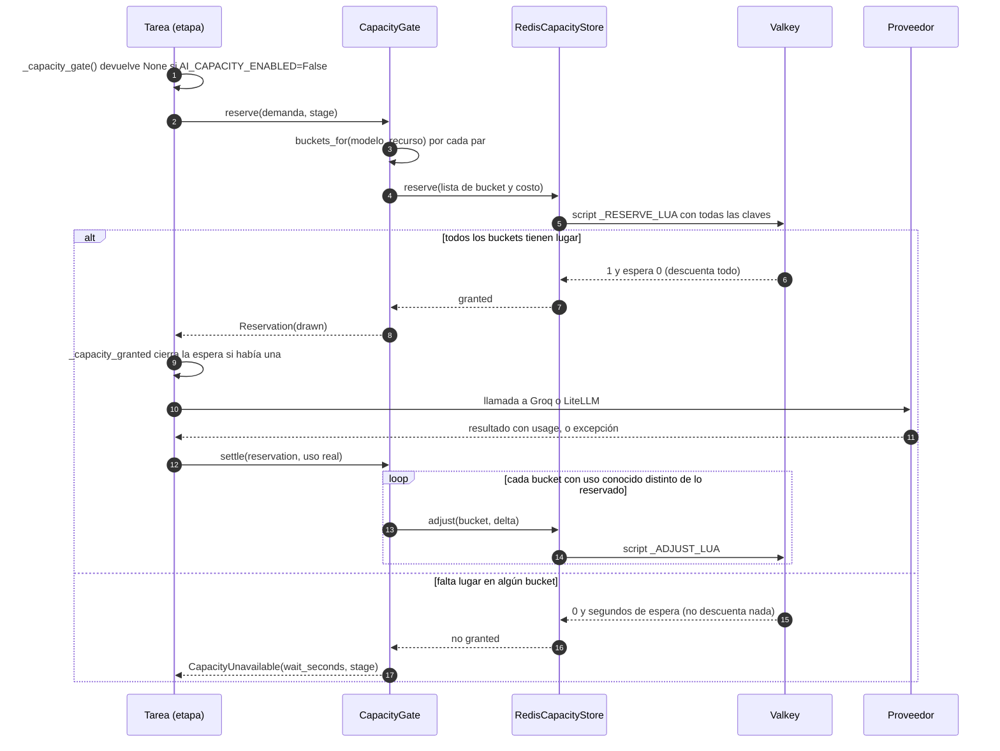
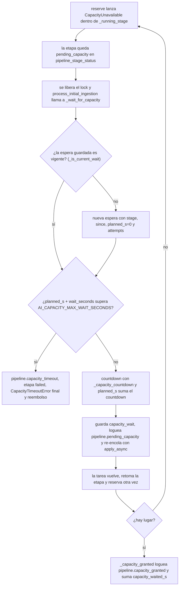
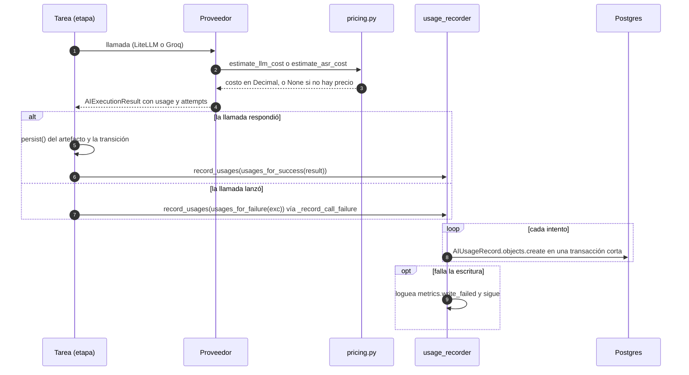

# Capacidad, costos y operación

Este documento cubre lo transversal del core de IA: el control de capacidad propio (token buckets en Valkey) que corre antes de cada llamada a Groq o al LLM, el registro de uso y costo (`AIUsageRecord` y la tabla de precios), el export y la evaluación del piloto, la habilitación gradual de V2, el chequeo de arranque y la referencia completa de configuración. Cierra con los eventos de log para operar y una tabla de síntomas. El procedimiento del piloto está en el [runbook](../runbooks/ai-core-pilot-runbook.md) y no se repite acá.

## Componentes

| Componente | Archivo | Rol |
|------------|---------|-----|
| `CapacityGate`, `Bucket`, `RedisCapacityStore` | [services/ai/capacity.py](../../back/apps/videos/services/ai/capacity.py) | Reserva antes de la llamada (`reserve`) y ajuste con el uso real (`settle`). Scripts Lua atómicos en Valkey |
| `buckets_for`, `capacity_enabled` | [services/ai/capacity.py](../../back/apps/videos/services/ai/capacity.py) | Lee y valida `AI_CAPACITY_LIMITS`. `capacity_enabled` lee `AI_CAPACITY_ENABLED` |
| `CapacityUnavailable`, `CapacityTimeoutError` | [services/ai/capacity.py](../../back/apps/videos/services/ai/capacity.py) | Falta lugar (espera, no fallo) y espera vencida (fallo final) |
| Helpers de capacidad | [tasks/shared.py](../../back/apps/videos/tasks/shared.py) | `_capacity_gate`, `_transcription_demand`, `_llm_demand`, `_selection_models`, `_llm_usage_by_model`, `_selection_failure_usage`, `_audio_usage`, `_is_current_wait`, `_capacity_granted`, `_capacity_countdown` |
| Espera de la ingesta | [tasks/ingestion.py](../../back/apps/videos/tasks/ingestion.py) | `_wait_for_capacity`, `_reserve_selection`, `_PromptParseCapacity`, `_prompt_capacity_exhausted` |
| Espera de SEO | [tasks/social.py](../../back/apps/videos/tasks/social.py) | `_seo_demand`, `_seo_wait_for_capacity`, `_release_seo_capacity` |
| `AIUsageRecord` | [models.py](../../back/apps/videos/models.py) | Una fila por intento de llamada, insert-only, sin columnas de texto libre |
| Registro de uso | [services/ai/usage_recorder.py](../../back/apps/videos/services/ai/usage_recorder.py) | `record_usages`, `usages_for_success`, `usages_for_failure`, `failure_usage` |
| Precios | [services/ai/pricing.py](../../back/apps/videos/services/ai/pricing.py) | `PRICING_VERSION`, `estimate_llm_cost`, `estimate_asr_cost`, `has_current_price` |
| Rollout | [services/ai/rollout.py](../../back/apps/videos/services/ai/rollout.py) | `v2_enabled_for`, `v2_allowlist`, `invalid_allowlist_entries` |
| Chequeo de arranque | [checks.py](../../back/apps/videos/checks.py) | `check_ai_configuration`: `videos.E001` a `videos.E006` |
| Export del piloto | [export_ai_pilot_metrics.py](../../back/apps/videos/management/commands/export_ai_pilot_metrics.py) | CSV o JSONL por registro o por proyecto |
| Evaluación de transcripción | [evaluate_ai_transcription.py](../../back/apps/videos/management/commands/evaluate_ai_transcription.py) | WER y error de timestamps contra referencias humanas |
| Barrido de reservas | [settle_stale_reservations.py](../../back/apps/videos/management/commands/settle_stale_reservations.py) | Reporta las reservas de tokens que quedaron `RESERVED` y, con `--apply`, las cobra o las devuelve según el estado del proyecto |

## Flujo: reserva y ajuste de capacidad

Con `AI_CAPACITY_ENABLED=True`, cada llamada a Groq (transcripción) o al LLM (selección, lector de prompts, SEO) reserva en los buckets de su modelo antes de salir. Con `False`, `_capacity_gate` devuelve `None` y no se reserva nada. La moderación (OpenAI) no pasa por los buckets: el endpoint es gratis y un 429 es un `ModerationError` reintentable.



1. Hay un bucket por modelo, recurso y ventana: clave `capacity:v1:<modelo>:<recurso>_per_<ventana>`, con recursos `audio_seconds`, `tokens` y `requests` y ventanas `minute`, `hour` y `day`. Cada bucket guarda como mucho su límite y se rellena de forma continua a `limit / ventana`. Una demanda de `tokens` descuenta de todos los buckets `tokens_per_*` configurados del modelo.
2. `buckets_for` valida la configuración del modelo: sin entrada, sin claves, con una clave desconocida (por ejemplo `tokens_per_min`), con un valor no numérico o no positivo, lanza `ImproperlyConfigured`. Con la capacidad prendida, llamar a un modelo sin límites sería saltear el control.
3. `_RESERVE_LUA` usa el reloj del servidor (`TIME`) y revisa todos los buckets de la demanda juntos: o descuenta en todos o en ninguno. Si alguno no alcanza, devuelve la espera del más escaso, `(needed - tokens) / rate`. Con N workers no se puede pasar un límite.
4. Una demanda mayor que el bucket entero pide solo `min(cost, limit)` para pasar: espera a que el bucket esté lleno, descuenta el costo completo y lo deja negativo. Las demandas siguientes esperan a que se recupere.
5. Cada escritura pone `EXPIRE` al tiempo que tarda el bucket en llenarse, más 1 s. Un bucket sin clave arranca lleno.
6. `settle` aplica el uso real. Para cada bucket reservado: si el uso de ese modelo y recurso no está en `actual`, se conserva la reserva (uso desconocido, criterio conservador); si está, el delta `usado - reservado` se descuenta o se devuelve con `_ADJUST_LUA`, con tope en el límite. Un modelo listado con 0 (por ejemplo, un fallback que no se usó) recupera todo lo suyo.
7. `settle` nunca lanza: la llamada paga ya ocurrió. Si Valkey falla, loguea `capacity.settle_failed` con la clave del bucket.

### Qué reserva cada llamada

| Llamada | Modelos del bucket | Demanda | Ajuste | Etapa de la espera |
|---------|--------------------|---------|--------|--------------------|
| Transcripción con Groq (`_stage_transcribe`) | `groq/<AI_DEFAULT_TRANSCRIPTION_MODEL>` | `_transcription_demand`: `audio_seconds` = duración del video (mínimo 1) y `requests` = un request por ventana de 598 s (600 s menos 2 s de solapamiento) | `_audio_usage`: segundos facturados. `requests` no se ajusta | `transcribed` |
| Selección V2 (`_stage_select_clips`) | `_selection_models(True)`: el primario y el fallback si es distinto y su proveedor tiene key | `_llm_demand`: `tokens` = `ceil(minutos × AI_CAPACITY_LLM_TOKENS_PER_AUDIO_MINUTE) + AI_CAPACITY_LLM_PROMPT_TOKENS + AI_CAPACITY_LLM_OUTPUT_TOKENS` (mínimo 1 minuto) y `requests` = 1, en cada modelo | `_llm_usage_by_model` con los intentos. Si falla, `_selection_failure_usage` | `clips_selected` |
| Selección legacy | `_selection_models(False)`: el modelo de `GeminiFlashStrategy` (`AI_DEFAULT_LLM_MODEL`) | Igual que V2, solo en ese modelo | Ninguno: el selector legacy no informa tokens y queda la reserva | `clips_selected` |
| Lector de prompts (`_PromptParseCapacity`) | `_selection_models(True)` | `ceil(caracteres del prompt / 4) + AI_CAPACITY_LLM_PROMPT_TOKENS + AI_CAPACITY_LLM_OUTPUT_TOKENS` tokens y 1 request | Igual que la selección V2 | La etapa siguiente a la actual |
| SEO (`_generate_social_metadata`) | `_selection_models(True)` | `_seo_demand`: `ceil((caracteres del transcript del clip + del título) / 4) + AI_CAPACITY_LLM_PROMPT_TOKENS + AI_CAPACITY_LLM_OUTPUT_TOKENS` tokens y 1 request | Igual que la selección V2. Si la moderación frena el post antes del LLM, `_release_seo_capacity` devuelve todo | `seo` |

Cómo se calcula el uso real:

- `_llm_usage_by_model`: parte de `tokens=0` y `requests=0` para cada modelo reservado (lo no usado se devuelve) y suma `total_tokens` y un request por intento. Un intento fallido sin tokens y con costo `None` (facturación desconocida) deja `tokens=None` para ese modelo: se conserva la reserva.
- `_selection_failure_usage`: si el error no trae intentos y es de facturación incierta (`is_billing_uncertain`: `AITimeoutError`, `AIConnectionError` salvo `AIConnectionNotEstablishedError`, `AIUnexpectedProviderError` o el soft time limit de la tarea), devuelve `{}` y se conserva todo. Si no, usa los intentos que trae el error; sin intentos, todo vuelve.
- `_audio_usage`: si la transcripción terminó, usa `usage.audio_seconds`. Si falló con facturación incierta, o el intento que trae el error no tiene precio, conserva la reserva. Si falló antes de facturar un chunk, ajusta a 0.

## Flujo: espera por capacidad (`pending_capacity`)



1. `CapacityUnavailable` sale de `reserve` dentro de `_running_stage`, que marca la etapa `pending_capacity` (no `failed`) y la relanza. Esperar no es un intento fallido: no suma `pipeline_attempts` ni escribe filas de uso.
2. La excepción sale del `project_lock`, así que el lock ya está libre cuando `process_initial_ingestion` llama a `_wait_for_capacity`. El worker no queda bloqueado esperando.
3. `_is_current_wait` considera vigente la espera guardada en `metadata['capacity_wait']` solo si es de la misma etapa y su `attempts` coincide con `pipeline_attempts`. Una espera de otra etapa o anterior a un intento fallido (por ejemplo, tras un re-despacho manual) se descarta y se empieza de cero.
4. Si la espera planificada más la nueva supera `AI_CAPACITY_MAX_WAIT_SECONDS`, se loguea `pipeline.capacity_timeout`, la etapa pasa a `failed`, se borra `capacity_wait` y `_record_pipeline_failure` registra `CapacityTimeoutError` como fallo final: suma `pipeline_attempts`, escribe `pipeline_error_code`, marca el proyecto `failed` y devuelve la reserva de tokens si no tiene clips.
5. Si no, `_capacity_countdown` calcula `min(max(wait_seconds, 1), AI_CAPACITY_MAX_COUNTDOWN_SECONDS)` más entre 0 y 20 % de jitter. Ese countdown se suma a `planned_s`, se guarda `capacity_wait` y la tarea se re-encola con `apply_async(countdown=..., retries=self.request.retries)`: el contador de reintentos de Celery viaja con el mensaje, así que una llamada que sigue fallando se queda sin reintentos aunque haya esperas en el medio.
6. Al volver, la tarea retoma la etapa (la anterior está persistida) y reserva de nuevo. Con lugar, `_capacity_granted` loguea `pipeline.capacity_granted` con `waited_s`, suma los segundos a `metadata['capacity_waited_s'][<etapa>]` y borra `capacity_wait`.
7. Si guardar la espera falla (por ejemplo, la base), se trata como cualquier error de etapa: reintento con backoff o fallo final. La etapa nunca queda en `pending_capacity` sin un mensaje en la cola.

Variantes:

- **Lector de prompts.** `_run_ingestion` captura el `CapacityUnavailable` de `apply_prompt_to_project`. Si `_prompt_capacity_exhausted` dice que se pasaría del máximo, loguea `prompt_parse.capacity_timeout` y `give_up_prompt(project_id, 'CapacityTimeoutError')`: el proyecto sigue con su configuración y `metadata['pte']` queda con `status='failed'`. Si no, marca `pending_capacity` en la etapa que sigue y relanza, y la espera sigue el flujo de arriba. Detalle en [04](04-prompt-to-edit.md).
- **SEO.** `_seo_wait_for_capacity` lleva la espera acumulada en el argumento `capacity_waited_s` de `process_video_seo`, no en `metadata`. Al vencer, loguea `seo.capacity_timeout` y deja el post `FAILED` con `error_log='capacity_timeout'`. Si no, loguea `seo.pending_capacity` y re-encola con el mismo `retries` (y `regenerate=True` si era una regeneración). Detalle en [05](05-seo-y-publicacion.md).

## Flujo: uso y costo



1. Cada proveedor calcula `estimated_cost_usd` por intento con la tabla de precios. Groq suma `estimate_asr_cost` chunk por chunk y, si algún chunk no tiene precio, el total queda `None`.
2. `usages_for_success` devuelve todos los intentos del resultado (`attempts`), o solo `usage` si no se rastrearon. `usages_for_failure` usa los intentos que trae el error (`usage_attempts`, cobrados incluidos) o arma uno con `failure_usage`: cero tokens, la latencia medida, `error_code` con el nombre de la clase y costo 0, salvo facturación incierta, que deja `None`.
3. `_persist_then_record_usage` escribe las filas después de persistir el artefacto, fuera de su transacción. Si persistir falla, la llamada ya se cobró: escribe las filas igual y deja pasar el error.
4. `record_usages` toma `attempt` de `VideoProject.pipeline_attempts` (tope 32767), escribe una fila por intento y nunca lanza. Las filas son insert-only: dos filas exitosas de la misma etapa en un proyecto son dos cobros reales (reentrega o pérdida de propiedad).
5. Solo llegan a la tabla números, nombres de modelo y el nombre de la clase del error. `resolved_model` se limpia a `[A-Za-z0-9._:/-]` y 64 caracteres.

| `stage` | Quién la escribe | `pipeline_version` | Notas |
|---------|------------------|--------------------|-------|
| `transcription` | `_stage_transcribe` | `v2` si corrió Groq, `legacy` si corrió Whisper local | Local: `provider='local'`, `model='whisper-base'`, costo 0 real |
| `selection` | `_stage_select_clips` | `v2` o `legacy` | Legacy: una fila con costo `NULL`, porque el selector no informa tokens |
| `prompt_parse` | `record_prompt_parse_usage` ([prompt_parser.py](../../back/apps/videos/services/ai/prompt_parser.py)) | Siempre `v2` | Ver [04](04-prompt-to-edit.md) |
| `seo` | `_generate_social_metadata` ([tasks/social.py](../../back/apps/videos/tasks/social.py)) | Siempre `v2` | Ver [05](05-seo-y-publicacion.md) |

La moderación escribe una fila por chequeo con etapa `moderation` (`record_moderation_usage`): proveedor `openai`, modelo `MODERATION_MODEL`, costo conocido 0 (el endpoint es gratis), latencia y la clase del error si no pasó. Hay dos chequeos posibles por proyecto: el del prompt de Prompt-to-Edit, antes del lector, y el de la etapa de moderación. Su resultado y latencia también quedan en `metadata['moderation']` (ver [03](03-transcripcion-moderacion-seleccion.md)).

### Precios

`pricing.py` guarda los precios en código para que cada cambio pase por un PR. `PRICING_VERSION` (hoy `"2026-10-09"`) se guarda en cada fila.

- La clave es `(proveedor, modelo)`. Un string de LiteLLM se parte en la primera `/` si nombra `gemini`, `openai` o `groq`; un nombre sin prefijo es `openai` para LLM y `groq` para ASR. Así `groq/openai/gpt-oss-120b` y `openai/gpt-4o-mini` no chocan.
- Cada modelo tiene períodos con `valid_from` y `valid_until` (inclusivos). La fecha de consulta es hoy en UTC.
- Modelo desconocido: `None` y log `pricing.unknown_model`. Modelo sin período para la fecha: `None` y `pricing.no_price_for_date`. Cada par (motivo, modelo) se loguea una vez por proceso. Nunca 0: un cero falso pasaría el criterio de costo.
- `estimate_llm_cost`: prompt no cacheado al precio de entrada, `cache_read_tokens` al precio cacheado (o al de entrada si no se conoce) y `completion_tokens + reasoning_tokens` al precio de salida, por millón.
- `estimate_asr_cost`: por request, `max(segundos, min_billable_seconds) / 3600 × precio por hora`. Con precio conocido, 0 segundos cuesta 0. Un valor negativo o no finito lanza `ValueError`.
- `has_current_price(model, kind)` dice si hay precio vigente hoy, sin loguear. Lo usa el chequeo de arranque.

| Modelo | Precio (USD) | Vigencia |
|--------|--------------|----------|
| `gemini/gemini-3.8-flash`, `gemini-3.7-flash`, `gemini-3.6-flash` | 0,75 / 0,075 / 3,75 por M tokens (entrada / cacheada / salida) | Del 2026-10-09 al 2026-12-31. Desde 2027-01-01: 1,50 / 0,15 / 7,50 |
| `gemini/gemini-3.5-flash` | 1,50 / 0,15 / 9,00 | Desde 2026-10-09 |
| `gemini/gemini-3.5-flash-lite` | 0,30 / 0,03 / 2,50 | Desde 2026-10-09 |
| `gemini/gemini-3.1-flash-lite` | 0,25 / 0,025 / 1,50 | Desde 2026-10-09 |
| `gemini/gemini-2.5-flash` | 0,30 / 0,03 / 2,50 | Sin límite |
| `gemini/gemini-2.5-flash-lite` | 0,10 / 0,01 / 0,40 | Sin límite |
| `openai/gpt-4o-mini` | 0,15 / 0,075 / 0,60 | Sin límite |
| `groq/openai/gpt-oss-120b` | 0,15 / sin precio cacheado / 0,60 | Desde 2026-10-09 |
| `groq/openai/gpt-oss-20b` | 0,075 / sin precio cacheado / 0,30 | Desde 2026-10-09 |
| `whisper-large-v3-turbo` (Groq) | 0,04 por hora de audio, mínimo 10 s por request | Sin límite |
| `whisper-large-v3` (Groq) | 0,111 por hora de audio, mínimo 10 s por request | Sin límite |

### Export y evaluación del piloto

`export_ai_pilot_metrics` lee solo columnas numéricas, de enumeración o de nombre de modelo. Nunca títulos, transcripts, prompts, reasoning ni ids de usuario.

| Argumento | Valores |
|-----------|---------|
| `--since` | `YYYY-MM-DD`, obligatorio, inclusivo desde 00:00 UTC |
| `--until` | `YYYY-MM-DD`, exclusivo |
| `--level` | `record` o `project` (default) |
| `--format` | `csv` (default) o `jsonl` |
| `--output` | Archivo; sin él, stdout |

- **`record`:** una fila por `AIUsageRecord` creado en la ventana, con las columnas de `EXPORT_COLUMNS` (`provider`, `model`, `resolved_model`, `stage`, `role`, `pipeline_version`, `attempt`, `success`, `error_code`, tokens, `audio_seconds`, `latency_seconds`, `cached`, `estimated_cost_usd`, `pricing_version`, `created_at`, `project_id`).
- **`project`:** una fila por proyecto creado en la ventana, aunque no tenga registros. Las columnas de ingesta (`total_tokens`, `reasoning_tokens`, `total_cost_usd`, `cost_per_30min_usd`, `cost_complete`, `records_count`, `failed_records`, `fallback_used`, `cached_any`, latencias) suman solo `transcription` y `selection`. SEO va aparte en `seo_records`, `seo_cost_usd` y `seo_cost_complete`. Las filas `prompt_parse` no entran en ninguna columna de este nivel: se ven solo en `record`.
- `pipeline_version` del proyecto es `mixed` si sus registros tienen más de una versión. `cost_complete` es `False` si algún registro tiene costo `NULL` o no hay registros. `cost_per_30min_usd = total_cost_usd / duración del video fuente × 1800`, con la duración de `metadata['duration']`.
- `reasoning_effort` sale de `metadata['selection_reasoning_effort']` y solo se exporta si es `minimal`, `low`, `medium`, `high` o `default`.
- En CSV, un texto que empieza con `=`, `+`, `-`, `@`, tab o CR lleva una comilla adelante.

`evaluate_ai_transcription` calcula el WER del corpus y el error de timestamps de las anclas, por proyecto y agregado por `pipeline_version` (filas `ALL`). Toma `--references DIR` (con `manifest.csv`, `<video_id>.txt` y opcionalmente `<video_id>.anchors.csv`), `--accents keep|strip` (obligatorio), `--window` (default 5 s) y `--output`. La versión de cada proyecto sale de sus filas `transcription`: una sola versión, `mixed` o `unknown`. El resumen compara contra los umbrales del G1 (WER ≤ 15 %, mediana ≤ 300 ms) y sale por stderr, o por stdout cuando el CSV va a `--output`.

Cómo correr ambos y leerlos: [runbook §1.3](../runbooks/ai-core-pilot-runbook.md#13-export-de-métricas) y [§3.4](../runbooks/ai-core-pilot-runbook.md#34-cálculo-automático-de-wer-y-timestamps).

## Rollout de V2

`v2_enabled_for(project)` decide por proyecto:

- `AI_CORE_V2_ENABLED=False` devuelve `False` siempre: es el switch maestro y el kill switch.
- Con el switch prendido y `AI_CORE_V2_ALLOWLIST` vacía, todos van a V2.
- Con la lista cargada, solo los proyectos cuyo `uploaded_by_id` está en la lista. Las entradas se comparan como UUID canónico; una entrada que no es UUID nunca coincide (y la marca `videos.E006`).

Cada etapa pregunta cuando corre, así que un cambio aplica desde la siguiente etapa de un proyecto en curso, y `pipeline_version` guarda el camino que corrió.

| Dónde | ¿Pregunta? | V2 | Legacy |
|-------|------------|----|--------|
| Transcripción (`_stage_transcribe`) | Sí, y se lo pasa a `TranscriptionEngine` | `TRANSCRIPTION_BACKEND` (`groq` por defecto) | Whisper local `base` |
| Moderación (`_stage_moderate`) | No | Siempre `AI_Security_Shield` | Igual |
| Selección (`_stage_select_clips`) | Sí | `SelectionEngine.select_viral_clips_detailed` (LiteLLM) | `SelectionEngine.select_viral_clips(..., v2_enabled=False)` |
| Render por clip (`RenderEngine.render_clip`) | No: sin `transcript_data` el clip sale sin subtítulos (`render.subtitles_skipped`) y no transcribe | — | — |
| Prompt-to-Edit (`apply_prompt_to_project`) | No | Siempre LiteLLM, filas `v2` | — |
| SEO (`process_video_seo`) | No | Siempre LiteLLM, filas `v2` | — |

Con V2 y `TRANSCRIPTION_BACKEND=local`, la transcripción corre Whisper local y sus filas salen `legacy`: la versión se fija por el backend que corrió.

Pasos de la habilitación gradual y del rollback: [runbook §5.3](../runbooks/ai-core-pilot-runbook.md#53-habilitación-gradual-después-de-g2) y [§7](../runbooks/ai-core-pilot-runbook.md#7-rollback).

## Chequeo de arranque

`check_ai_configuration` está registrado como system check de Django (`Tags.compatibility`) y corre con los comandos de `manage.py` (`check`, `migrate`, `runserver`). Solo lee settings: no llama a ningún proveedor.

| Código | Falla cuando | Qué hacer |
|--------|--------------|-----------|
| `videos.E001` | `AI_DEFAULT_LLM_MODEL`, `AI_FALLBACK_LLM_MODEL` o, con V2 y backend Groq, `AI_DEFAULT_TRANSCRIPTION_MODEL` contiene `latest` (alias móvil) | Fijar una versión del modelo |
| `videos.E002` | Uno de esos modelos no tiene precio vigente hoy en `pricing.py` | Agregar el precio por PR o configurar un modelo con precio |
| `videos.E003` | `AI_CORE_V2_ENABLED=True` y `TRANSCRIPTION_BACKEND` no es `groq` ni `local` | Corregir el backend |
| `videos.E004` | `AI_LLM_REASONING_EFFORT` no es vacío ni `minimal`, `low`, `medium` o `high` | Corregir el valor |
| `videos.E005` | `AI_CAPACITY_ENABLED=True` y `AI_CAPACITY_LIMITS` no es un objeto JSON, o un modelo que el pipeline reserva no tiene límites válidos. Se revisan el primario, el fallback si es distinto y tiene key, y `groq/<AI_DEFAULT_TRANSCRIPTION_MODEL>` con V2 y Groq | Completar los límites de cada modelo |
| `videos.E006` | `AI_CORE_V2_ALLOWLIST` tiene entradas que no son UUID | Usar los ids de usuario |

`E001` y `E002` se excluyen por modelo: un alias no se revisa también por precio. `MODERATION_MODEL` no pasa por este chequeo (su default es `omni-moderation-latest`).

## Errores, reintentos y casos borde

| Situación | Qué pasa | Dónde |
|-----------|----------|-------|
| Valkey no responde al reservar | El error de redis es reintentable: backoff del pipeline. Nunca se llama al proveedor sin reserva | `RedisCapacityStore.reserve`, `_is_retryable_pipeline_error` |
| Valkey falla al ajustar | `capacity.settle_failed` y la etapa sigue. El bucket queda con lo reservado | `CapacityGate.settle` |
| Modelo sin límites con la capacidad prendida | `ImproperlyConfigured` antes de llamar. No es reintentable: el proyecto falla. `videos.E005` lo detecta al arrancar | `buckets_for` |
| Demanda mayor que un bucket entero | Espera a que el bucket esté lleno, pasa y lo deja negativo | `_RESERVE_LUA` |
| Espera vencida en la ingesta | `CapacityTimeoutError` como fallo final y reembolso de tokens si no hay clips. Una cuota diaria agotada vence enseguida | `_wait_for_capacity` |
| Espera vencida en el lector de prompts | El proyecto sigue con su configuración: `metadata['pte']` queda con `status='failed'` y `error_code='CapacityTimeoutError'` | `_run_ingestion` |
| Espera vencida en SEO | Post `FAILED` con `error_log='capacity_timeout'` | `_seo_wait_for_capacity` |
| Re-encolado por capacidad | Conserva el contador de Celery (`retries`) y `parse_retries`. `lock_retries` vuelve a 0 porque el lock ya se había tomado | `_wait_for_capacity` |
| Espera vieja tras un re-despacho manual | `_is_current_wait` la descarta y empieza otra | [tasks/shared.py](../../back/apps/videos/tasks/shared.py) |
| Timeout o conexión cortada | Costo `NULL` en la fila y la reserva de capacidad se conserva: pudo haberse cobrado | `failure_usage`, `_selection_failure_usage`, `_audio_usage` |
| Falla escribir un `AIUsageRecord` | `metrics.write_failed` con el nombre de la clase. La etapa sigue | `record_usages` |
| Falla persistir el artefacto | Las filas de uso se escriben igual y el error sigue | `_persist_then_record_usage` |
| Worker muerto a mitad de la llamada | No escribe filas: ese cobro no aparece en el export | `usage_recorder.py` |
| Modelo sin precio | `estimated_cost_usd` `NULL`, `cost_complete=False` en el export | `pricing.py` |

## Datos que escribe

| Dónde | Clave o campo | Contenido |
|-------|---------------|-----------|
| Valkey | `capacity:v1:<modelo>:<recurso>_per_<ventana>` | Hash con `tokens` y `ts`, con `EXPIRE` |
| `VideoProject.pipeline_stage_status` | `<etapa>` | `pending_capacity` mientras espera |
| `VideoProject.metadata` | `capacity_wait` | `stage`, `since` (ISO), `planned_s`, `attempts`. Se borra al obtener lugar o al vencer |
| `VideoProject.metadata` | `capacity_waited_s` | Segundos esperados por etapa, acumulados |
| `VideoProject.metadata` | `transcription_usage`, `selection_usage` | `ProviderUsage` final de cada etapa |
| `VideoProject.metadata` | `selection_reasoning_effort` | Nivel enviado al primario o `default` |
| `VideoProject` | `pipeline_error_code` | `CapacityTimeoutError` si venció la espera |
| `AIUsageRecord` | Todas las columnas | `stage`, `pipeline_version`, `attempt`, `role`, `provider`, `model`, `resolved_model`, `success`, `error_code`, tokens, `audio_seconds`, `latency_seconds`, `cached`, `estimated_cost_usd`, `pricing_version`, `created_at`. `project` sin constraint en la base: borrar un proyecto no borra sus filas |
| `ScheduledPost.error_log` | `capacity_timeout` | Espera vencida en SEO |
| `Transaction` | `created_at` | Cuándo se hizo la reserva (migración `payments.0003`). Las filas anteriores a la migración tienen la hora en que corrió. La usa `settle_stale_reservations` |
| `Transaction` | `status` | `settle_stale_reservations --apply`: `COMPLETED` (cobrada) o `FAILED` (devuelta), por `commit_reservation` y `rollback_reservation` |

## Configuración

Todos los settings de IA de [settings/base.py](../../back/backend/settings/base.py). Los valores vienen del entorno salvo que se indique.

| Setting | Default | Efecto |
|---------|---------|--------|
| `AI_CORE_V2_ENABLED` | `False` | Switch maestro de V2 y kill switch |
| `AI_CORE_V2_ALLOWLIST` | `[]` | Ids de usuario (UUID) con V2. Vacía = todos |
| `LITELLM_LOCAL_MODEL_COST_MAP` (variable de entorno) | `True` (con `setdefault`) | LiteLLM usa el mapa de modelos que trae su versión y no lo descarga al importar |
| `GEMINI_API_KEY`, `GROQ_API_KEY`, `OPENAI_API_KEY`, `XAI_API_KEY` | `None` | Keys por proveedor. `resolve_api_key` elige por el prefijo del modelo. `OPENAI_API_KEY` es también la de la moderación |
| `MODERATION_TIMEOUT_SECONDS` | `10.0` | Timeout de cada llamada de moderación. Sin reintentos del SDK |
| `MODERATION_MODEL` | `omni-moderation-latest` | Modelo de la Moderation API |
| `MODERATION_BLOCK_CHARS` | `10000` | Tamaño de los bloques que se moderan |
| `MODERATION_NON_BLOCKING_CATEGORIES` | `harassment, violence, self-harm, illicit` | Categorías que se miden pero no bloquean |
| `AI_DEFAULT_LLM_MODEL` | `gemini/gemini-3.8-flash` | Primario de selección, Prompt-to-Edit y SEO. También el modelo del selector legacy |
| `AI_FALLBACK_LLM_MODEL` | `gemini/gemini-3.5-flash-lite` | Un intento de fallback, solo si su proveedor tiene key y es distinto del primario |
| `AI_LLM_TIMEOUT_SECONDS` | `60.0` | Timeout por llamada al LLM |
| `AI_LLM_REASONING_EFFORT` | `''` | `minimal`, `low`, `medium` o `high`. Vacío = default del proveedor. Solo se envía a modelos que razonan |
| `AI_LLM_MAX_TRANSCRIPT_CHARS` | `400000` | Tope en caracteres del transcript con timestamps que se envía a la selección |
| `AI_CLIP_MIN_SECONDS` / `AI_CLIP_MAX_SECONDS` | `15.0` / `60.0` | Duración de un clip anclado a palabras |
| `AI_CLIP_SNAP_TOLERANCE_SECONDS` | `1.0` | Tolerancia para ajustar los bordes a palabras |
| `AI_CLIP_PAUSE_SECONDS` | `0.5` | Pausa mínima entre palabras que cuenta como borde natural |
| `AI_DEFAULT_TRANSCRIPTION_MODEL` | `whisper-large-v3-turbo` | Modelo de Groq. Su bucket es `groq/<modelo>` |
| `AI_TRANSCRIPTION_TIMEOUT_SECONDS` | `120.0` | Timeout de cada request a Groq (un chunk de audio); conectar tiene 5 s. Sin reintentos del SDK: el provider reintenta el chunk ante 429, 5xx o conexión, y un timeout es `AITimeoutError` y reintenta Celery |
| `TRANSCRIPTION_BACKEND` | `groq` | Backend con V2: `groq` o `local`. Sin fallback automático entre ellos |
| `AI_PROMPT_MAX_CHARS` | `1000` | Largo máximo del prompt de Prompt-to-Edit: `from-prompt` rechaza uno más largo y `clean_prompt` corta |
| `AI_UPLOAD_MAX_DURATION_SECONDS` | `10800` | Duración máxima de una subida |
| `AI_SINGLE_EDIT_MAX_DURATION_SECONDS` | `600` | Duración máxima de un video completo (`single_edit`): un solo render lo tiene entero |
| `AI_UPLOAD_MAX_LONG_SIDE_PX` / `AI_UPLOAD_MIN_SHORT_SIDE_PX` | `4096` / `240` | Límites de resolución de una subida |
| `REDIS_URL` | `redis://redis:6379/0` | Broker y result backend de Celery, locks y buckets |
| `PIPELINE_LOCK_TTL` | `300` | TTL del lock por proyecto, renovado por heartbeat |
| `CELERY_BROKER_TRANSPORT_OPTIONS['visibility_timeout']` (variable `CELERY_VISIBILITY_TIMEOUT`) | `14400` | Tiempo tras el cual Redis reentrega una tarea sin ack. Mayor que el lock y que la etapa más larga |
| `PIPELINE_SOFT_TIME_LIMIT` | `7200` | Soft time limit de `process_initial_ingestion`: falla con `SoftTimeLimitExceeded` y libera el lock |
| `PIPELINE_TIME_LIMIT` | `PIPELINE_SOFT_TIME_LIMIT + 300` | Hard time limit: mata al worker que ignoró el soft |
| `RENDER_CLIP_MAX_STARTS` | `3` | Renders de un clip (`render_clip_task`) que empezaron y no terminaron porque su worker murió, contando el que va a empezar. Pasado este número el clip falla en lugar de volver para siempre. Los reintentos transitorios no cuentan. Mínimo 2 |
| `RENDER_SEGMENTS_SOFT_TIME_LIMIT` | `10800` | Soft time limit de `render_video_segments` (paper edit): el proyecto falla y se devuelve la reserva del render |
| `RENDER_SEGMENTS_TIME_LIMIT` | `RENDER_SEGMENTS_SOFT_TIME_LIMIT + 300` | Hard time limit del paper edit. Sin reembolso automático: queda para `settle_stale_reservations`. Menor que el `visibility_timeout` |
| `CELERY_TASK_ROUTES` | `render_clip_task` y `render_video_segments` a la cola `render` | Fijo en código. El resto va a la cola `celery` |
| `CELERY_WORKER_PREFETCH_MULTIPLIER` | `1` | Fijo en código. Un worker solo reserva la tarea que corre |
| `AI_CAPACITY_ENABLED` | `False` | Prende los buckets de capacidad |
| `AI_CAPACITY_LIMITS` | `{}` | JSON `{"<modelo>": {"<recurso>_per_<ventana>": límite}}`, por debajo del límite del proveedor |
| `AI_CAPACITY_MAX_WAIT_SECONDS` | `3600` | Espera máxima por etapa antes de `CapacityTimeoutError` |
| `AI_CAPACITY_MAX_COUNTDOWN_SECONDS` | `300` | Tope de cada re-encolado por capacidad |
| `AI_CAPACITY_LLM_TOKENS_PER_AUDIO_MINUTE` | `456` | Tokens de entrada estimados por minuto de audio (selección) |
| `AI_CAPACITY_LLM_PROMPT_TOKENS` | `1500` | Tokens fijos del prompt en cada reserva de LLM |
| `AI_CAPACITY_LLM_OUTPUT_TOKENS` | `4000` | Tokens de salida (visible y razonamiento) en cada reserva de LLM |
| `AI_SEO_LANGUAGE` | `es` | Idioma del caption |
| `AI_SEO_CAPTION_MAX_CHARS` | `{"TIKTOK": 2200, "INSTAGRAM_REELS": 2200, "YOUTUBE_SHORTS": 5000}` | Largo máximo de caption más hashtags por plataforma |

Los límites por entorno de `AI_CAPACITY_LIMITS` están en el [runbook §5.5](../runbooks/ai-core-pilot-runbook.md#55-rate-limiting-propio-aicore-11). Los workers leen el entorno al arrancar: un cambio de settings necesita reiniciarlos.

## Operación: eventos de log

Los eventos tienen nombre estable y llevan ids, códigos y números, nunca texto del usuario. Se buscan por prefijo.

| Prefijo | Eventos principales | Dónde |
|---------|---------------------|-------|
| `pipeline.` | `started`, `stage_started`, `stage_completed`, `stage_failed`, `advanced`, `failed` (con `final` y la clase del error), `skipped`, `lock_busy_retrying` | [tasks/ingestion.py](../../back/apps/videos/tasks/ingestion.py), [pipeline_state.py](../../back/apps/videos/services/ai/pipeline_state.py) |
| `pipeline.` (capacidad) | `pending_capacity` (`stage`, `countdown_s`, `planned_s`), `capacity_granted` (`waited_s`), `capacity_timeout` | [tasks/ingestion.py](../../back/apps/videos/tasks/ingestion.py), [tasks/shared.py](../../back/apps/videos/tasks/shared.py) |
| `pipeline.` (lock y estado) | `lock_lost`, `lock_renew_failed`, `lock_not_owned`, `lock_release_failed`, `status_write_skipped`, `status_write_failed`, `mark_failed_skipped`, `fail_skipped`, `failure_not_recorded` | [project_lock.py](../../back/apps/videos/services/ai/project_lock.py), [tasks/ingestion.py](../../back/apps/videos/tasks/ingestion.py) |
| `pipeline.` (reserva de tokens) | `refunded`, `refund_skipped` (`has_clips`, `no_reservation`, `not_reserved`), `refund_failed` | [tasks/ingestion.py](../../back/apps/videos/tasks/ingestion.py) |
| `capacity.` | `settle_failed` | [capacity.py](../../back/apps/videos/services/ai/capacity.py) |
| `metrics.` / `pricing.` | `metrics.write_failed`, `pricing.unknown_model`, `pricing.no_price_for_date` | [usage_recorder.py](../../back/apps/videos/services/ai/usage_recorder.py), [pricing.py](../../back/apps/videos/services/ai/pricing.py) |
| `transcription.` | `started`, `completed`, `chunk_without_speech`, `chunk_retry`, `usage_not_attached`, `local_model_loading` | [transcription_engine.py](../../back/apps/videos/services/transcription_engine.py), [groq_transcription.py](../../back/apps/videos/services/ai/groq_transcription.py) |
| `moderation.` | `passed`, `blocked` (categorías), `failed`. También `pipeline.moderation_overridden` | [security.py](../../back/apps/core/security.py) |
| `selection.` | `started`, `completed`, `primary_failed`, `fallback_failed`, `no_fallback`, `clips_sanitized`, `schema_unsupported`, `legacy_call`, `legacy_failed` | [litellm_selection.py](../../back/apps/videos/services/ai/litellm_selection.py), [selection_engine.py](../../back/apps/videos/services/selection_engine.py) |
| `llm.` | `reasoning_effort_skipped` | [llm_options.py](../../back/apps/videos/services/ai/llm_options.py) |
| `prompt_parse.` | `completed`, `primary_failed`, `fallback_failed`, `fields_dropped`, `transient`, `retrying`, `failed`, `applied`, `capacity_timeout` | [prompt_parser.py](../../back/apps/videos/services/ai/prompt_parser.py), [prompt_validator.py](../../back/apps/videos/services/ai/prompt_validator.py) |
| `seo.` | `dispatched`, `dispatch_failed`, `pending_capacity`, `capacity_timeout`, `input_blocked`, `output_blocked`, `no_clip_transcript`, `completed`, `persisted`, `failed`, `skipped`, `regenerate_failed` | [signals.py](../../back/apps/videos/signals.py), [tasks/social.py](../../back/apps/videos/tasks/social.py), [seo_engine.py](../../back/apps/videos/services/seo_engine.py) |
| `upload.` | `rejected` (`code`), `probe_failed` | [media_validation.py](../../back/apps/videos/services/media_validation.py) |
| `face_tracker.` | `mediapipe_unavailable`, `detector_unavailable`, `detector_failed`, `tracked`, `no_faces`, `failed`, `all_frames_failed` | [face_tracker.py](../../back/apps/videos/services/face_tracker.py) |
| `speaker.` / `layout.` | `speaker.timeline`, `speaker.audio_failed`, `speaker.frames_failed`, `layout.active_speaker`, `layout.active_speaker_failed` | [speaker_engine.py](../../back/apps/videos/services/speaker_engine.py), [layouts/pro.py](../../back/apps/videos/services/layouts/pro.py) |
| `render.` | `dispatch_failed`, `retrying`, `release_failed`, `retry_not_queued`, `failure_not_recorded`, `skipped_unpaid`, `claim_lost`, `restarted`, `worker_lost`, `start_not_closed`, `orphan_not_deleted`; del paper edit, `already_delivered`, `restarted`, `lock_busy_retrying`, `skipped`, `not_persisted`, `lock_lost`, `orphan_not_deleted`, `start_not_closed`, `cleanup_failed`, `charged`, `refunded`, `settle_skipped`, `settle_failed`. También `pipeline.render_redispatched` y `pipeline.render_finalized` | [tasks/ingestion.py](../../back/apps/videos/tasks/ingestion.py), [tasks/render.py](../../back/apps/videos/tasks/render.py) |

### Qué mirar si...

| Síntoma | Qué mirar |
|---------|-----------|
| Un proyecto lleva mucho en "Procesando" | `pipeline_stage_status`: si una etapa está `pending_capacity`, mirar `metadata['capacity_wait']` y los logs `pipeline.pending_capacity`. Si es seguido, falta capacidad del proveedor (ampliar el tier, no subir los límites por encima del 80 %) |
| Proyecto `failed` con `pipeline_error_code=CapacityTimeoutError` | La espera planificada superó `AI_CAPACITY_MAX_WAIT_SECONDS`, por ejemplo por una cuota diaria agotada. Confirmar el reembolso (`pipeline.refunded`) y re-despachar cuando haya cuota |
| Una etapa falla con `ImproperlyConfigured` que nombra `AI_CAPACITY_LIMITS` | Falta la entrada de un modelo que el pipeline llama. Correr `manage.py check` (`videos.E005`) y completar los límites |
| El deploy o `migrate` falla con un código `videos.E001` a `videos.E006` | Ver la tabla del [chequeo de arranque](#chequeo-de-arranque) |
| Los proyectos nuevos siguen en `legacy` | `AI_CORE_V2_ENABLED`, que el `uploaded_by` del proyecto esté en `AI_CORE_V2_ALLOWLIST` y que los workers se hayan reiniciado. Confirmar con el export `--level record` (`pipeline_version`) |
| `cost_complete=False` en el export | Filas con `estimated_cost_usd` `NULL`: selección legacy, modelo sin precio (`pricing.unknown_model`, `pricing.no_price_for_date`) o timeouts de facturación incierta. Buscar con `--level record` |
| Faltan filas de uso | `metrics.write_failed`. Si el worker murió a mitad de la llamada, la fila no existe |
| Un bucket parece no recuperarse | `capacity.settle_failed` (el ajuste no se aplicó) o una demanda mayor que el bucket que lo dejó negativo. Revisar la clave `capacity:v1:...` en Valkey |
| Post `FAILED` por SEO | `error_log`: `capacity_timeout`, `content_blocked`, `generated_content_blocked`, `seo_no_clip_transcript`, un código `moderation_*`, `seo_generation_failed:<clase>` o `seo_failed:<clase>`. Ver [05](05-seo-y-publicacion.md) |
| Los renders por clip no avanzan | Que algún worker consuma la cola `render` (`-Q celery,render`) |
| Un clip `failed` sin error del render en los logs | `render.worker_lost`: su worker murió `RENDER_CLIP_MAX_STARTS` veces (`render.restarted` muestra cada vuelta). Suele ser un OOM: revisar la memoria del worker y la resolución del proyecto |
| Saldo reservado que no baja, o una reserva `RESERVED` de un proyecto que ya terminó | Correr `settle_stale_reservations` en modo reporte (ver [abajo](#operación-reservas-de-tokens-que-quedaron-reserved)). Buscar también `pipeline.charge_failed`, `pipeline.refund_failed` y `render.settle_failed` |
| El layout no sigue caras | `face_tracker.mediapipe_unavailable`, `face_tracker.detector_unavailable` o `face_tracker.no_faces`: el recorte vuelve al centro. Ver [06](06-render-caras-y-hablante.md) |

## Operación: reservas de tokens que quedaron RESERVED

El pipeline liquida cada reserva: la de creación (`metadata['reservation_id']`) se cobra cuando hay clips y se devuelve si el proyecto falla sin clips (en un video completo, cuando el video se entrega: ver [02](02-pipeline-de-ingesta.md)); la del render (`metadata['render_reservation_id']`) se cobra cuando el paper edit se entrega y se devuelve si falla del todo; la del render automático (`metadata['auto_render_reservation_id']`) cobra la parte de los clips entregados. Igual pueden quedar reservas `RESERVED`: las de antes de que existiera el cobro, un cobro o una devolución que falló por un error de base (`pipeline.charge_failed`, `pipeline.refund_failed`, `render.settle_failed`) o un render cuyo worker murió. `settle_stale_reservations` las encuentra y las liquida con las mismas reglas.

```bash
# Solo reporta (dry run): no escribe nada
docker compose exec web python manage.py settle_stale_reservations
# Liquida las que tienen una regla
docker compose exec web python manage.py settle_stale_reservations --apply
# Otra antigüedad mínima (24 h por defecto)
docker compose exec web python manage.py settle_stale_reservations --min-age-hours 72
```

Solo mira transacciones `RESERVED` con `created_at` de hace al menos `--min-age-hours`. Para cada una busca el proyecto que la tiene en `metadata['reservation_id']` (creación), en `metadata['render_reservation_id']` (render) o en `metadata['auto_render_reservation_id']` (render automático). Las filas de video completo y de render automático usan la misma regla que el pipeline (`_whole_video_settlement` y `_auto_render_settlement`, en `tasks/ingestion.py`), no una copia:

| Reserva | Estado del proyecto | Acción (`reason`) |
|---------|---------------------|-------------------|
| Creación | `clips_selected` o una etapa posterior (`clips_selected`) | Cobra (`commit`) |
| Creación | Con clips, aunque esté `failed` (`has_clips`) | Cobra |
| Creación | `failed` sin clips (`failed_without_clips`) | Devuelve (`rollback`) |
| Creación | Otra etapa (`in_progress`) | Solo reporta |
| Creación de un video completo (`single_edit` con `priced_duration_s`) | `completed`, `partial` o `failed` con un clip `completed` o `published` (`video_delivered`) | Cobra |
| Creación de un video completo | `completed`, `partial` o `failed` con un clip todavía `rendering` (`clip_rendering`) | Solo reporta |
| Creación de un video completo | `completed`, `partial` o `failed` sin eso: el render falló o el proyecto falló antes (`video_not_delivered`) | Devuelve |
| Creación de un video completo | Cualquier otra etapa, incluidas `clips_selected` y `render_dispatched` (`not_final`) | Solo reporta |
| Render | Con `final_export_r2_key`, aunque esté `FAILED` (`render_delivered`) | Cobra |
| Render | `FAILED` (`render_failed`) | Devuelve |
| Render | Otro estado, por ejemplo `RENDERING` (`render_in_progress`) | Solo reporta |
| Render automático (`metadata['auto_render_reservation_id']`) | `completed`, `partial` o `failed` con clips `completed` o `published` y ninguno `rendering` (`clips_delivered`) | Cobra la parte de los segundos entregados y devuelve el resto |
| Render automático | `completed`, `partial` o `failed` sin clips entregados (`nothing_delivered`) | Devuelve |
| Render automático | Un clip todavía `rendering`, o cualquier otra etapa (`auto_render_in_progress`) | Solo reporta |
| Sin proyecto (`unlinked`) | — | Solo reporta |

- **Seguridad.** Sin `--apply` no escribe nada. Con `--apply` vuelve a decidir con el lock de fila del proyecto tomado y liquida con `wallet_service.commit_reservation` o `rollback_reservation`, que bloquean la transacción y vuelven a chequear que siga `RESERVED`. Si el pipeline la liquidó mientras tanto, el resultado es `already_settled`; si el proyecto cambió y ahora toca solo reportar, `skipped`.
- **Antigüedad.** El mínimo de 24 h deja afuera reservas de proyectos que siguen trabajando, por ejemplo un render que espera su reintento. Las transacciones anteriores a la migración `payments.0003` tienen como `created_at` la hora de la migración: el barrido las toma un `--min-age-hours` después del deploy.
- **Salida.** Una línea por transacción, sin texto del usuario (ni la descripción de la transacción, que lleva el título del proyecto): `transaction`, `amount`, `age_h`, `kind` (`creation`, `render` o `-`), `project`, `stage`, `status`, `action` (`commit`, `rollback` o `report`), `reason` y `result` (`dry_run`, `reported`, `committed`, `rolled_back`, `already_settled`, `skipped` o `error=<clase>`). Al final, una línea `summary` con los totales.
- **Errores.** Un error de pago o de base en una transacción se informa en su línea y el barrido sigue. Si hubo alguno, el comando termina con error (código 1) para que un cron lo note.
- **Lo que queda en reporte** se resuelve a mano: un render que sigue `RENDERING` sin worker (por ejemplo, después del hard time limit) se re-encola (`render_video_segments`) o se marca `FAILED` para que el próximo barrido devuelva la reserva; una reserva sin proyecto se revisa con el workspace dueño de la billetera.

## Referencias

- [ADR-012: perfiles de modelos y capacidad](../adrs/012-model-profiles-and-capacity.md) (D-C3 chequeo de arranque, D-C4 rate limiting propio, D-C5 tiers)
- [ADR-011: moderación de contenido](../adrs/011-content-moderation.md)
- [ADR-013: metadata social con IA](../adrs/013-ai-social-metadata.md)
- [Runbook del piloto](../runbooks/ai-core-pilot-runbook.md): export (§1.3), evaluación (§3.4), habilitación gradual (§5.3), capacidad (§5.4 y §5.5), rollback (§7)
- Issues: AICORE-8 [#42](https://github.com/RomeKai/videoeditUTN/issues/42), AICORE-9 [#43](https://github.com/RomeKai/videoeditUTN/issues/43), AICORE-11 [#60](https://github.com/RomeKai/videoeditUTN/issues/60), AICORE-14 [#66](https://github.com/RomeKai/videoeditUTN/issues/66), AICORE-15 [#67](https://github.com/RomeKai/videoeditUTN/issues/67), AICORE-17 [#69](https://github.com/RomeKai/videoeditUTN/issues/69)
