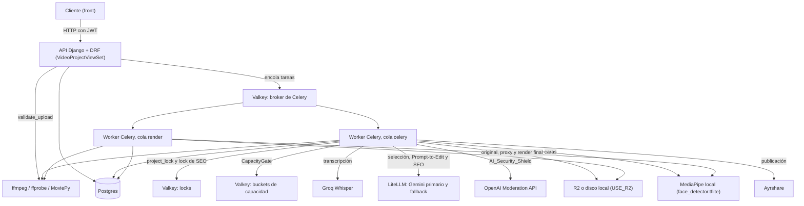
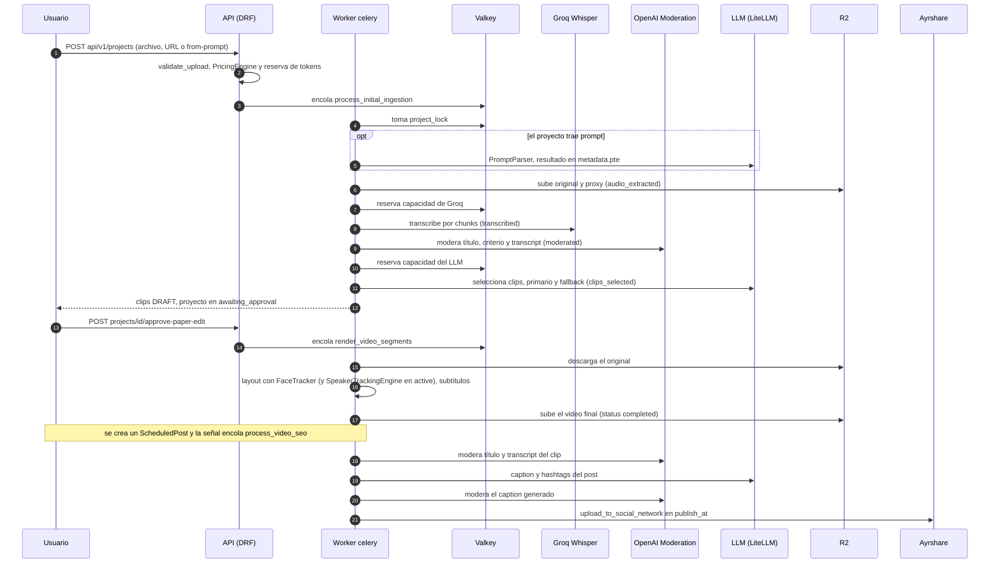

# IA en OneCreator: arquitectura general

Este set documenta el core de IA del backend (`back/`): qué hace cada pieza, en qué orden corre y qué deja escrito. El recorrido completo de un video es: **subida** (validación con ffprobe y reserva de tokens) → **ingesta** en Celery (fuente a R2, **transcripción** con Groq Whisper, **moderación** con la Moderation API de OpenAI, **selección de clips** con un LLM vía LiteLLM) → **aprobación** del usuario (paper edit) → **render** con layouts, seguimiento de caras y detección de quién habla → **metadata social** (caption y hashtags por publicación) → **publicación** vía Ayrshare. Cada llamada a Groq o al LLM del pipeline reserva capacidad propia antes de salir (si `AI_CAPACITY_ENABLED=True`) y deja filas de uso (`AIUsageRecord`) con su costo estimado.

Este README da el mapa. El detalle de cada flujo está en los documentos del [índice](#índice-de-documentos).

## Componentes

| Componente | Archivo | Rol |
|------------|---------|-----|
| API (DRF) | [views.py](../../back/apps/videos/views.py) | `VideoProjectViewSet`: `create`, `from_prompt` (`from-prompt`), `approve_paper_edit` (`approve-paper-edit`) y `paper_edit_data`. Valida la subida, reserva tokens y encola `process_initial_ingestion` o `render_video_segments`. Rutas bajo `api/v1/projects/` |
| Celery | [celery.py](../../back/backend/celery.py), [settings/base.py](../../back/backend/settings/base.py) | Broker y result backend en `REDIS_URL`. `CELERY_TASK_ROUTES` manda `apps.videos.tasks.render_clip_task` y `apps.videos.tasks.render_video_segments` a la cola `render`; el resto va a la cola por defecto de Celery, `celery`. Los workers consumen las dos: `celery -A backend worker -Q celery,render` ([docker-compose.yml](../../docker-compose.yml)) |
| Postgres | `DATABASE_URL` (Postgres en `docker-compose.yml`; sin la variable, SQLite) | `VideoProject` (etapa, estado por etapa, `metadata`), `VideoClip`, `ScheduledPost`, `AIUsageRecord`, `ModerationOverride` y el wallet |
| Valkey / Redis | `REDIS_URL` (servicio `redis`, imagen `valkey/valkey:8-alpine`) | Broker de Celery, lock por proyecto (`lock:pipeline:project:<id>`), lock y resultado pendiente de SEO (`lock:seo:post:<id>`, `seo:pending:<id>`) y buckets de capacidad (`capacity:v1:<modelo>:<recurso>_per_<ventana>`) |
| Almacenamiento | [storage_service.py](../../back/apps/videos/services/storage_service.py) | `CloudflareR2Manager`: R2 con `USE_R2=True`; con `False`, todo opera sobre el disco local |
| Groq Whisper | [groq_transcription.py](../../back/apps/videos/services/ai/groq_transcription.py) | Transcripción V2 por chunks con `AI_DEFAULT_TRANSCRIPTION_MODEL` |
| LLM vía LiteLLM | [litellm_selection.py](../../back/apps/videos/services/ai/litellm_selection.py) | Selección de clips, lector de prompts y SEO. Primario `AI_DEFAULT_LLM_MODEL`, un intento de fallback con `AI_FALLBACK_LLM_MODEL` si su proveedor tiene key |
| OpenAI Moderation | [security.py](../../back/apps/core/security.py) | `AI_Security_Shield.check_content_safety`: modera por bloques y falla cerrado |
| MediaPipe (local) | [face_tracker.py](../../back/apps/videos/services/face_tracker.py) | Detección de caras en el worker, sin proveedor externo |
| ffmpeg / ffprobe | [media_validation.py](../../back/apps/videos/services/media_validation.py), [ffmpeg_utils.py](../../back/apps/videos/utils/ffmpeg_utils.py) | Validación de la subida (ffprobe), audio FLAC para Groq, proxy web y render con MoviePy |
| Ayrshare | [tasks/social.py](../../back/apps/videos/tasks/social.py) | `upload_to_social_network` publica el clip con el caption generado |

## Mapa de módulos

Rutas relativas a `back/apps/videos/` salvo indicación.

| Módulo | Qué hace |
|--------|----------|
| [tasks/\_\_init\_\_.py](../../back/apps/videos/tasks/__init__.py) | Reexporta las tareas. Cada una conserva su nombre registrado `apps.videos.tasks.<nombre>` |
| [tasks/shared.py](../../back/apps/videos/tasks/shared.py) | Helpers compartidos: descarga con yt-dlp, política de reintentos (`_is_retryable_pipeline_error`, `_retry_countdown`), `_merge_metadata`, filas de uso y helpers de capacidad |
| [tasks/ingestion.py](../../back/apps/videos/tasks/ingestion.py) | `process_initial_ingestion`: lock, Prompt-to-Edit, etapas, espera de capacidad, fallo final y reembolso |
| [tasks/render.py](../../back/apps/videos/tasks/render.py) | `render_clip_task` (cola `render`), `render_video_segments` (paper edit) y `finalize_project_render` |
| [tasks/social.py](../../back/apps/videos/tasks/social.py) | `process_video_seo`, `dispatch_scheduled_posts_batch` y `upload_to_social_network` |
| [services/ai/\_\_init\_\_.py](../../back/apps/videos/services/ai/__init__.py) | Paquete del core: contratos y errores compartidos |
| [services/ai/audio_preprocessor.py](../../back/apps/videos/services/ai/audio_preprocessor.py) | `AudioPreprocessor`: FLAC 16 kHz mono y ventanas de 600 s con 2 s de solapamiento |
| [services/ai/capacity.py](../../back/apps/videos/services/ai/capacity.py) | Token buckets en Valkey: `CapacityGate.reserve` y `settle` |
| [services/ai/clip_validation.py](../../back/apps/videos/services/ai/clip_validation.py) | `sanitize_clips`: candidatos válidos, dentro del video, sin solaparse y anclados a palabras |
| [services/ai/contracts.py](../../back/apps/videos/services/ai/contracts.py) | Contratos Pydantic: transcripción, `ViralClip`, `ProviderUsage`, `AIExecutionResult` |
| [services/ai/errors.py](../../back/apps/videos/services/ai/errors.py) | Jerarquía `AIError` (reintentable o no), `is_retryable_error`, `is_billing_uncertain` |
| [services/ai/evaluation.py](../../back/apps/videos/services/ai/evaluation.py) | WER y error de timestamps del gate G1. Módulo puro |
| [services/ai/groq_transcription.py](../../back/apps/videos/services/ai/groq_transcription.py) | `GroqTranscriptionProvider`: chunks, corrección de offset y deduplicación del solapamiento |
| [services/ai/litellm_selection.py](../../back/apps/videos/services/ai/litellm_selection.py) | `LiteLLMSelectionProvider`: selección con salida estructurada, primario y un fallback |
| [services/ai/llm_credentials.py](../../back/apps/videos/services/ai/llm_credentials.py) | `provider_for_model` y `resolve_api_key`: key por llamada según el prefijo del modelo |
| [services/ai/llm_options.py](../../back/apps/videos/services/ai/llm_options.py) | `reasoning_effort_setting` y `reasoning_kwargs` (`AI_LLM_REASONING_EFFORT`) |
| [services/ai/pipeline_state.py](../../back/apps/videos/services/ai/pipeline_state.py) | Máquina de etapas con compare-and-set: `advance`, `set_stage_status`, `mark_failed`, `reopen` |
| [services/ai/pricing.py](../../back/apps/videos/services/ai/pricing.py) | Tabla de precios versionada (`PRICING_VERSION`), `estimate_llm_cost`, `estimate_asr_cost` |
| [services/ai/project_lock.py](../../back/apps/videos/services/ai/project_lock.py) | `project_lock`: lock por proyecto con dueño, TTL y heartbeat |
| [services/ai/prompt_parser.py](../../back/apps/videos/services/ai/prompt_parser.py) | `PromptParser`: prompt del usuario a `ProjectConfig` (PTE-01a) |
| [services/ai/prompt_validator.py](../../back/apps/videos/services/ai/prompt_validator.py) | `apply_prompt_to_project` y `ConfigValidator`: valida contra el plan y aplica (PTE-01b) |
| [services/ai/rollout.py](../../back/apps/videos/services/ai/rollout.py) | `v2_enabled_for`: switch maestro y allowlist |
| [services/ai/selection_criteria.py](../../back/apps/videos/services/ai/selection_criteria.py) | `normalize_selection_criteria`: preferencia libre del usuario para la selección (PTE-02) |
| [services/ai/transcript_formatter.py](../../back/apps/videos/services/ai/transcript_formatter.py) | `build_timestamped_transcript`: líneas `[START-END] text` para el LLM |
| [services/ai/usage_recorder.py](../../back/apps/videos/services/ai/usage_recorder.py) | `record_usages`: filas `AIUsageRecord` insert-only que nunca rompen la etapa |
| [services/transcription_engine.py](../../back/apps/videos/services/transcription_engine.py) | `TranscriptionEngine`: fachada de transcripción. `resolve_backend` elige `groq` o `local` |
| [services/selection_engine.py](../../back/apps/videos/services/selection_engine.py) | `SelectionEngine`: fachada de selección. V2 con LiteLLM o legacy con `GeminiFlashStrategy` |
| [services/seo_engine.py](../../back/apps/videos/services/seo_engine.py) | `SEOOptimizationService`: caption y hashtags por publicación. `clip_transcript`, `compose_caption` |
| [services/media_validation.py](../../back/apps/videos/services/media_validation.py) | `validate_upload`: tipo real con libmagic, ffprobe y límites `AI_UPLOAD_*` |
| [services/render_engine.py](../../back/apps/videos/services/render_engine.py) | `RenderEngine.render_clip`: layout, subtítulos, export y subida de un clip |
| [services/layouts/](../../back/apps/videos/services/layouts/__init__.py) | `get_layout_strategy` y `LAYOUT_REGISTRY`: `fill`, `fit`, `blurred`, `split`, `pip`, `versus`, `active` |
| [services/face_tracker.py](../../back/apps/videos/services/face_tracker.py) | `FaceTracker`: detección con MediaPipe, `track_faces` y `generate_path` |
| [services/face_tracking.py](../../back/apps/videos/services/face_tracking.py) | `IoUTracker` y `FaceTracks`: une detecciones en tracks con id estable. `sampling_fps` por estilo |
| [services/tracking_utils.py](../../back/apps/videos/services/tracking_utils.py) | `TrackingPoint`, `TrackingPath`, suavizado (`MovingAverageSmoothing`, `EMASmoothing`) e `interpolate_gaps` |
| [services/speaker_engine.py](../../back/apps/videos/services/speaker_engine.py) | `SpeakerTrackingEngine`: quién habla, con energía del audio y movimiento de boca, sin pyannote |
| [services/saliency_tracker.py](../../back/apps/videos/services/saliency_tracker.py) | `GameplaySaliencyDetector`: zona de juego por movimiento, para el layout `split` |
| [signals.py](../../back/apps/videos/signals.py) | `generate_seo_for_new_post` (post_save de `ScheduledPost`), `queue_post_seo`, `seo_requested` |
| [checks.py](../../back/apps/videos/checks.py) | `check_ai_configuration`: chequeo de arranque `videos.E001` a `videos.E006` |
| [management/commands/export_ai_pilot_metrics.py](../../back/apps/videos/management/commands/export_ai_pilot_metrics.py) | Export de métricas del piloto en CSV o JSONL, sin texto del usuario |
| [management/commands/evaluate_ai_transcription.py](../../back/apps/videos/management/commands/evaluate_ai_transcription.py) | WER y error de timestamps contra referencias humanas |
| [models.py](../../back/apps/videos/models.py) | `VideoProject` (campos `pipeline_*`), `AIUsageRecord`, `ModerationOverride`, `ScheduledPost` |
| [apps/core/security.py](../../back/apps/core/security.py) | `AI_Security_Shield`: `check_content_safety` (moderación) e `isolate_user_input` (aislamiento contra prompt injection) |

## Flujo: ciclo de vida de un video

El camino feliz con `auto_render_bypass=False` (el usuario aprueba los segmentos). Con `auto_render_bypass=True` la ingesta salta la aprobación y encola un `render_clip_task` por clip en la cola `render` (ver [06](06-render-caras-y-hablante.md)).

1. La API valida el archivo (tipo real y ffprobe), calcula el costo con `PricingEngine`, reserva tokens del wallet y guarda `metadata['reservation_id']`. Ver [01](01-creacion-de-proyecto.md).
2. `process_initial_ingestion` toma el lock del proyecto y recorre las etapas. Cada etapa persiste su resultado antes de avanzar, así un reintento retoma donde quedó y no repite llamadas pagas. Ver [02](02-pipeline-de-ingesta.md).
3. Si el proyecto se creó con `from-prompt`, el prompt se parsea al empezar la ingesta, no en el request. Ver [04](04-prompt-to-edit.md).
4. Transcripción, moderación y selección están en [03](03-transcripcion-moderacion-seleccion.md). Antes de cada llamada a Groq o al LLM se reserva capacidad (paso 7 y 10 del diagrama) si `AI_CAPACITY_ENABLED=True`. Ver [07](07-capacidad-costos-y-operacion.md).
5. Al aprobar, la API reserva el costo del render y encola `render_video_segments`, que aplica el layout del proyecto (seguimiento de caras, hablante activo) y sube el resultado. Ver [06](06-render-caras-y-hablante.md).
6. La API no expone un endpoint para crear `ScheduledPost`: hoy se crean desde el admin de Django. Al crearse, `generate_seo_for_new_post` encola `process_video_seo` si el proyecto pidió SEO (`metadata['use_seo']`) y el plan lo incluye. La publicación corre en `upload_to_social_network`. Ver [05](05-seo-y-publicacion.md).

## Errores, reintentos y casos borde

Resumen. Cada documento tiene su tabla completa.

| Situación | Qué pasa | Dónde |
|-----------|----------|-------|
| Error reintentable de proveedor o infraestructura | Backoff exponencial con jitter, hasta `PIPELINE_MAX_RETRIES` (5) | [02](02-pipeline-de-ingesta.md) |
| Error no reintentable o reintentos agotados | Proyecto `failed` con `pipeline_error_code`. Si no tiene clips, se devuelve la reserva de tokens | [02](02-pipeline-de-ingesta.md) |
| Moderación bloquea el contenido | `UnsafeContentError`, proyecto `failed` y reembolso. Un `ModerationOverride` lo libera | [03](03-transcripcion-moderacion-seleccion.md) |
| No hay capacidad en un bucket | Etapa en `pending_capacity` y la tarea se re-encola. Pasado `AI_CAPACITY_MAX_WAIT_SECONDS`, `CapacityTimeoutError` | [07](07-capacidad-costos-y-operacion.md) |
| Otro worker tiene el proyecto | `ProjectLockedError`: se re-encola con su propio contador (`lock_retries`) | [02](02-pipeline-de-ingesta.md) |
| El parser de prompts falla | El proyecto sigue con su configuración (`metadata['pte']['status']='failed'`) | [04](04-prompt-to-edit.md) |
| Falla la metadata social | El post queda `FAILED` con un código estático en `error_log` | [05](05-seo-y-publicacion.md) |
| MediaPipe no está o no ve caras | El layout usa el recorte centrado | [06](06-render-caras-y-hablante.md) |

## Datos que escribe

| Dónde | Qué | Detalle |
|-------|-----|---------|
| `VideoProject.pipeline_stage`, `pipeline_stage_status`, `pipeline_attempts`, `pipeline_error_code` | Progreso y fallos de la ingesta | [02](02-pipeline-de-ingesta.md) |
| `VideoProject.metadata` | `reservation_id`, `duration`, `full_text`, `transcription_usage`, `moderation`, `selection_usage`, `selection_reasoning_effort`, `pte`, `capacity_wait`, `capacity_waited_s` | Cada documento lista las suyas |
| `VideoProject.transcript_data`, `VideoClip` | Transcript por palabra y clips sugeridos (`DRAFT`) | [03](03-transcripcion-moderacion-seleccion.md) |
| `AIUsageRecord` | Una fila por intento de llamada paga: etapas `prompt_parse`, `transcription`, `selection`, `seo` | [07](07-capacidad-costos-y-operacion.md) |
| `ScheduledPost.generated_caption`, `generated_hashtags`, `error_log` | Metadata social y fallos de SEO | [05](05-seo-y-publicacion.md) |
| Logs | Eventos con nombre estable (`pipeline.*`, `capacity.*`, `seo.*`, ...), sin texto del usuario | [07](07-capacidad-costos-y-operacion.md#operación-eventos-de-log) |

## Configuración

Los interruptores principales. La referencia completa está en [07](07-capacidad-costos-y-operacion.md#configuración).

| Setting | Default | Efecto |
|---------|---------|--------|
| `AI_CORE_V2_ENABLED` | `False` | Switch maestro. `False` manda todo a legacy |
| `AI_CORE_V2_ALLOWLIST` | `[]` | Ids de usuario con V2 mientras el switch está prendido. Vacía = todos |
| `TRANSCRIPTION_BACKEND` | `groq` | Backend de transcripción con V2: `groq` o `local` |
| `AI_DEFAULT_LLM_MODEL` / `AI_FALLBACK_LLM_MODEL` | `gemini/gemini-3.8-flash` / `gemini/gemini-3.5-flash-lite` | Modelos de selección, Prompt-to-Edit y SEO |
| `AI_CAPACITY_ENABLED` | `False` | Activa los buckets de capacidad |
| `REDIS_URL` | `redis://redis:6379/0` | Broker, locks y buckets |
| `USE_R2` | `False` | R2 o disco local |

## Glosario

| Término | Significado |
|---------|-------------|
| V2 (AI Core V2) | Camino nuevo: Groq para transcribir y LiteLLM para seleccionar. Se decide por proyecto con `v2_enabled_for` |
| Legacy | Camino anterior: Whisper local (`openai-whisper`) y el selector de una sola llamada `GeminiFlashStrategy`. Queda como kill switch |
| `pipeline_version` | `v2` o `legacy` en cada `AIUsageRecord`: el camino que corrió de verdad |
| Etapa | Valor de `VideoProject.pipeline_stage`: la última etapa terminada (`uploaded`, `audio_extracted`, `transcribed`, `moderated`, `clips_selected`, `render_dispatched`, `completed`, `partial`, `failed`). No es `status`, que es lo que ve el usuario |
| Estado de etapa | `pipeline_stage_status`: JSON con un `StageStatus` por etapa (`pending`, `running`, `completed`, `failed`, `pending_capacity`) |
| `pending_capacity` | La etapa espera capacidad del proveedor. No es un fallo ni suma a `pipeline_attempts` |
| Reserva de tokens | Saldo del wallet reservado al crear el proyecto (`Transaction` en `RESERVED`, `metadata['reservation_id']`). Se devuelve si el proyecto termina `failed` sin clips |
| Reserva de capacidad | Lo que `CapacityGate.reserve` descuenta de los buckets antes de una llamada. Se ajusta después con `settle`. No tiene relación con el wallet |
| Bucket | Token bucket en Valkey por modelo, recurso (`audio_seconds`, `tokens`, `requests`) y ventana (`minute`, `hour`, `day`) |
| `AIUsageRecord` | Una fila por intento de llamada a un proveedor, insert-only, con tokens, latencia y costo estimado |
| Allowlist | `AI_CORE_V2_ALLOWLIST`: ids de `VideoProject.uploaded_by` que reciben V2 |
| PTE (Prompt-to-Edit) | Crear un proyecto con un prompt en lenguaje natural que se traduce a la configuración del proyecto |
| Paper edit | Revisión de los clips sugeridos y aprobación de segmentos (`approve-paper-edit`), que dispara `render_video_segments` |
| `auto_render_bypass` | El proyecto salta la aprobación y renderiza cada clip apenas termina la selección |
| Primario / fallback | `AI_DEFAULT_LLM_MODEL` y `AI_FALLBACK_LLM_MODEL`. El fallback se intenta una vez si falla el primario. `role` en `AIUsageRecord` |
| Re-despacho | Volver a encolar `process_initial_ingestion` para un proyecto `failed`: retoma desde la última etapa completada |
| `ModerationOverride` | Registro de auditoría con el que un admin libera un proyecto bloqueado por moderación |
| `PRICING_VERSION` | Fecha de la tabla de precios con la que se calculó cada costo |
| G0, G1, G2, G3 | Gates del piloto. Ver el [runbook](../runbooks/ai-core-pilot-runbook.md#52-gates) |

## Índice de documentos

| Documento | Contenido |
|-----------|-----------|
| [README.md](README.md) | Este documento: arquitectura, componentes, mapa de módulos y glosario |
| [01-creacion-de-proyecto.md](01-creacion-de-proyecto.md) | Creación por archivo, URL o prompt, validación de la subida, precio y reserva de tokens con sus reembolsos |
| [02-pipeline-de-ingesta.md](02-pipeline-de-ingesta.md) | `process_initial_ingestion`: lock, etapas y estados, reintentos, espera de capacidad, fallo final, límites de tiempo, decisión V2 o legacy |
| [03-transcripcion-moderacion-seleccion.md](03-transcripcion-moderacion-seleccion.md) | Transcripción con Groq por chunks, moderación por bloques y override, selección de clips con primario y fallback |
| [04-prompt-to-edit.md](04-prompt-to-edit.md) | Endpoint `from-prompt`, `PromptParser`, `ConfigValidator`, reintentos y capacidad del parser, `metadata['pte']` |
| [05-seo-y-publicacion.md](05-seo-y-publicacion.md) | `ScheduledPost`, disparo por señal, `process_video_seo`, moderación de entrada y salida, publicación |
| [06-render-caras-y-hablante.md](06-render-caras-y-hablante.md) | Render por clip y paper edit, layouts, seguimiento de caras, detección de quién habla, resolución |
| [07-capacidad-costos-y-operacion.md](07-capacidad-costos-y-operacion.md) | Buckets de capacidad, `AIUsageRecord` y precios, export del piloto, allowlist, chequeo de arranque, configuración completa y logs |

## Referencias

- [ADR-001: selección de proveedor LLM](../adrs/001-llm-provider-selection.md)
- [ADR-008: transcripción remota con Groq Whisper](../adrs/008-groq-whisper-migration.md)
- [ADR-011: moderación de contenido](../adrs/011-content-moderation.md)
- [ADR-012: perfiles de modelos y capacidad](../adrs/012-model-profiles-and-capacity.md)
- [ADR-013: metadata social con IA](../adrs/013-ai-social-metadata.md)
- [ADR-014: detección de quién habla](../adrs/014-speaker-detection.md)
- [Runbook del piloto de AI Core V2](../runbooks/ai-core-pilot-runbook.md)
- [Índice de ADRs](../adrs/README.md)
