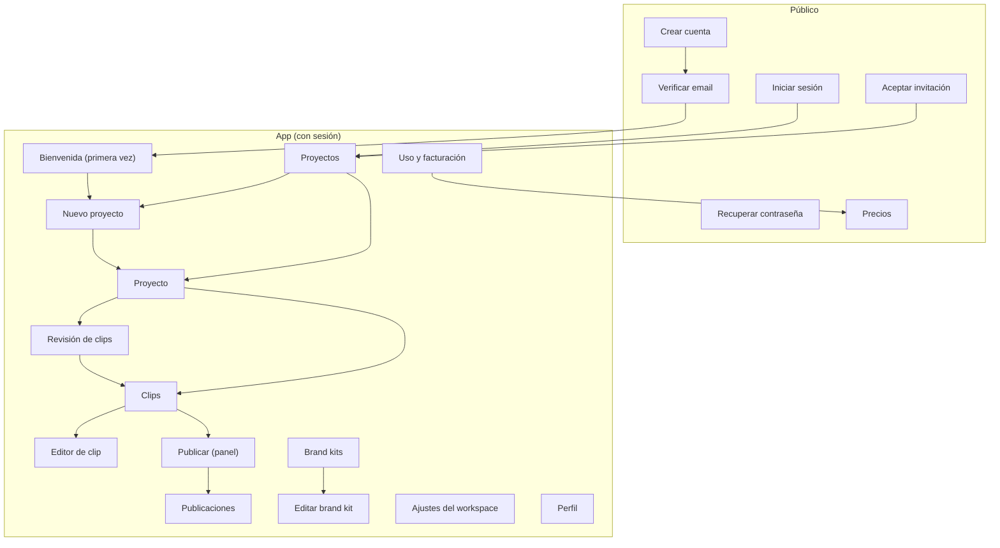

# Mapa de pantallas de OneCreator (MVP)

Este documento lista **todas** las pantallas, estados y diálogos del producto, con una decisión tomada para cada una. Es la base para el diseño y para el frontend. El diseño de todas las pantallas está en el [canvas de diseño](https://claude.ai/artifact/Qj7y6R7mVSAtHPpNRkWiaC), y el sistema visual (colores, tipografía, componentes) está en [`diseno/`](diseno/README.md). Si algo no está acá, no está decidido: se agrega acá antes de diseñarlo o construirlo.

Cada pantalla tiene:

- **Para qué** sirve y **quién** la usa.
- **Qué muestra** y **qué se puede hacer**.
- **Estados**: cargando, vacío, error y los propios de la pantalla.
- **Móvil**: qué cambia en pantallas chicas.
- **API**: qué existe hoy en el backend.

Leyenda de API: ✅ existe · ⚠️ existe en parte · ❌ falta. Los huecos están juntos en la [sección 8](#8-huecos-de-backend).

---

## 1. Decisiones globales

### 1.1 Estructura de la app

- **Barra superior, sin barra lateral.** Hay dos filas:
  - Fila 1: logo, selector de workspace, saldo de tokens, botón **Nuevo proyecto**, notificaciones y avatar.
  - Fila 2: pestañas **Proyectos · Publicaciones · Brand kits · Uso y facturación · Ajustes**.
- **Pantallas de detalle** (un proyecto, un clip): llevan un encabezado con migas (`Proyectos / Nombre del proyecto`) y sus propias pestañas debajo.
- **Ancho:** el contenido se centra con un máximo de 1200 px. Las pantallas de trabajo (revisión y editor) usan todo el ancho.

### 1.2 Estilo visual

- Estética sobria tipo Vercel: fondo neutro, bordes finos, mucho aire, poco color.
- **Un solo color de acento** para acciones principales y foco; lo define el sistema visual del canvas. Los colores de estado (verde, ámbar, rojo, azul) se usan solo para estados.
- **Tipografía:** Geist Sans para texto, y también para montos, costos, duraciones y fechas, con cifras de ancho fijo. Geist Mono se usa solo para los tiempos de las pantallas de edición (transcripción, línea de tiempo, inicio y fin) y para los atajos de teclado.
- **Tema:** oscuro por defecto, porque el video se ve mejor sobre fondo oscuro. También hay claro, y la opción **Sistema** está en Perfil. Cada pantalla se diseña en los dos temas.
- **Íconos:** un solo set de línea, de 16 px y 20 px.

### 1.3 Idioma y formatos

- Español rioplatense con voseo: "Subí tu video", "Revisá los clips".
- Fechas: `24 nov 2026, 14:30`, en la zona horaria del navegador. El backend guarda `publish_at` en UTC.
- Duraciones: `1:05:32` o `0:41`. Tokens: hasta 2 decimales, sin decimales si el valor es entero (`120 tokens`, `12,50 tokens`).

### 1.4 Actualización en vivo

- Las pantallas con algo en curso consultan el backend cada **5 segundos**: un proyecto en ingesta o render, o publicaciones en cola.
- La consulta se pausa si la pestaña del navegador no está visible y se detiene cuando el estado es final.
- No hay websockets en el MVP.

### 1.5 Tokens y costos

- El saldo **disponible** (`Wallet.available_balance`) siempre está visible en la barra superior. Al pasar el mouse se ve también el **reservado** (`reserved_balance`).
- **Toda acción paga muestra el costo antes de confirmarse.** Después de confirmar, el costo queda como "reservado" hasta que termina el trabajo.
- **Si un trabajo falla, se informa la devolución** en la pantalla del proyecto ("Te devolvimos 120 tokens") y en Movimientos.
- **Estimación del costo:** se calcula en el navegador con la misma fórmula del backend (`PricingEngine.calculate_render_cost`) y la duración que lee el navegador del archivo. El cobro real lo decide el backend al crear el proyecto. Para no copiar los valores de la fórmula, el frontend los lee de un endpoint de precios (❌, ver sección 8).

### 1.6 Planes

- **Lo que el plan no incluye se ve igual, bloqueado:** con candado, el texto "Disponible en el plan X" y un link a Planes. Nunca se oculta.
- Qué controla cada campo de `SubscriptionPlan`:

| Campo del plan | Dónde se nota | Qué pasa en la UI |
|---|---|---|
| `max_video_duration_seconds` | Nuevo proyecto, al elegir el archivo | Si el video es más largo, se muestra un error antes de subir: "Tu plan acepta videos de hasta 30 min". Hay link a Planes. |
| `max_resolution` | Selector de resolución | Las opciones por encima del plan aparecen con candado. |
| `has_watermark` | Resumen de costo, preview de clips | Se muestra la nota "Tu plan agrega marca de agua" con link a Planes. |
| `allow_scheduling` | Publicar | "Programar" queda con candado; "Publicar ahora" sigue disponible. |
| `allow_crossposting` | Publicar | Se puede elegir una sola red por publicación; las demás quedan con candado. |
| `has_seo_optimization` | Nuevo proyecto (SEO) | El interruptor de SEO queda con candado. |
| `has_thumbnail_engine` | — | Las miniaturas con IA no están en el MVP. |
| `base_discount_rate` | Planes, resumen de costo | Se muestra "Incluye 10% de descuento en tokens". |
| `max_members` | Ajustes › Miembros | Al llegar al límite, "Invitar" se desactiva y explica por qué. |

### 1.7 Roles y permisos

Roles del workspace: **Dueño** (`Workspace.owner`) y los de `WorkspaceMember.role`: **Admin**, **Editor** y **Lector**.

| Acción | Dueño | Admin | Editor | Lector |
|---|:-:|:-:|:-:|:-:|
| Ver proyectos, clips y publicaciones | ✓ | ✓ | ✓ | ✓ |
| Descargar clips | ✓ | ✓ | ✓ | ✓ |
| Crear proyectos (gasta tokens) | ✓ | ✓ | ✓ | — |
| Revisar, aprobar y renderizar | ✓ | ✓ | ✓ | — |
| Publicar y programar | ✓ | ✓ | ✓ | — |
| Borrar proyectos | ✓ | ✓ | solo los propios | — |
| Crear y editar brand kits | ✓ | ✓ | ✓ | — |
| Conectar y desconectar redes sociales | ✓ | ✓ | — | — |
| Invitar, quitar y cambiar roles | ✓ | ✓ | — | — |
| Ver saldo | ✓ | ✓ | ✓ | ✓ |
| Comprar tokens, cambiar plan, ver movimientos | ✓ | ✓ | — | — |
| Renombrar el workspace | ✓ | ✓ | — | — |
| Borrar o transferir el workspace | ✓ | — | — | — |

- **Cómo se ve:** lo que el rol no permite se muestra deshabilitado, con un tooltip que dice "Pedile acceso a un admin". Los botones no se ocultan, salvo en Ajustes, donde las secciones de admin no aparecen para Editor ni Lector.
- **API:** la API aplica esta tabla sobre el workspace activo, que viaja en el header `X-Workspace-Id` (solo cuentan el dueño y los miembros activos; una invitación pendiente no da acceso). A quien no le alcanza el rol le responde 403 con una frase en español, que la app muestra tal cual: "Con el rol Lector podés ver, pero no crear ni cambiar nada. Pedile acceso a un admin.", "Solo el dueño o un admin del espacio pueden hacer esto. Pedile acceso a un admin.", "Solo el dueño del espacio puede hacer esto." y "Como Editor solo podés borrar los proyectos que subiste vos.". Nunca abre el diálogo de límite del plan (D3).

### 1.8 Estados comunes

- **Cargando:** esqueletos con la forma del contenido. Nunca un spinner de pantalla completa.
- **Vacío:** una frase de qué va acá, una acción principal y nada más.
- **Error de red:** un banner arriba del contenido que dice "No pudimos conectar" y tiene un botón Reintentar. Lo que ya se ve queda visible.
- **Mensajes cortos (toasts):** abajo a la derecha, 5 s. Se usan para confirmar acciones ("Clip descargado") y errores puntuales.

### 1.9 Móvil

- Puntos de corte: < 640 px (móvil), 640–1024 px (tablet), > 1024 px (escritorio).
- En el móvil se puede hacer todo lo que importa fuera del escritorio: ver estados, revisar y aprobar clips, descargar, publicar, ver saldo y subir un video desde el teléfono.
- **El editor de clip funciona en una versión simplificada** con un aviso: "Para editar con más detalle, usá una computadora".
- **Barra superior en el móvil:**
  - Se ven el logo, el saldo y el avatar.
  - El selector de workspace y las notificaciones pasan al menú del avatar.
  - Las pestañas quedan en una fila con scroll horizontal.
  - **Nuevo proyecto** es un botón fijo abajo a la derecha.

### 1.10 Accesibilidad

- Contraste AA en los dos temas.
- Foco visible en todos los elementos.
- Todo se puede usar con el teclado.
- El reproductor tiene atajos: espacio, ← y →, `I` (marcar inicio) y `O` (marcar fin).
- El menú de comandos abre con ⌘K o Ctrl+K.

### 1.11 Notificaciones

- **Dentro de la app** (campana) y por **email** en estos casos:
  - El proyecto está listo para revisar.
  - El render terminó.
  - El proyecto falló, con la devolución.
  - Una publicación falló.
  - El saldo está por debajo de lo que cuesta un video promedio.
- El usuario puede apagar los emails por tipo en Perfil › Notificaciones.
- Dentro de la app también se avisa cuando un pago (compra de tokens o cambio de plan) se aprueba o se rechaza, a quien lo inició. No tiene email.
- **API:** ✅ la campana: `GET /api/v1/notifications/`, `POST /notifications/:id/read/` y `POST /notifications/read-all/` (listo para revisar, render terminado, proyecto fallido y pagos). ❌ todavía no avisa de una publicación fallida ni del saldo bajo, y no hay envío de emails (huecos 16 y 21).

---

## 2. Mapa del sitio

**Rutas:**

- **Público:** `/login`, `/registro`, `/verificar`, `/recuperar`, `/invitacion/:token`, `/precios`.
- **Primera vez:** `/bienvenida`.
- **Proyectos:** `/proyectos`, `/proyectos/nuevo`, `/proyectos/:id`, `/proyectos/:id/revision`, `/proyectos/:id/clips`, `/proyectos/:id/clips/:clipId`.
- **Resto:** `/publicaciones`, `/brand-kits`, `/brand-kits/:id`, `/uso`, `/ajustes/*`, `/perfil/*`.

---

## 3. Estado del proyecto: qué ve el usuario

El estado visible se arma con tres campos de `VideoProject`:

- `status`.
- `pipeline_stage`: la **última etapa terminada**.
- `pipeline_stage_status`: el estado de cada etapa. Puede ser `running`, `completed`, `failed` o `pending_capacity`.

| Condición | Etiqueta | Color | Texto debajo | Acción principal |
|---|---|---|---|---|
| `status=uploaded` | En cola | neutro | "Tu video está en la fila para procesarse." | — |
| `ingesting`, etapa `uploaded` | Preparando el video | azul | "Paso 1 de 4" | — |
| `ingesting`, etapa `audio_extracted` | Transcribiendo | azul | "Paso 2 de 4" | — |
| `ingesting`, etapa `transcribed` | Revisando el contenido | azul | "Paso 3 de 4" | — |
| `ingesting`, etapa `moderated` | Eligiendo los mejores momentos | azul | "Paso 4 de 4" | — |
| alguna etapa en `pending_capacity` | En espera | ámbar | "Hay mucha demanda. Tu video sigue en la fila y arranca solo; no tenés que hacer nada." | — |
| `awaiting_approval` | Listo para revisar | acento | "Encontramos N clips." | **Revisar clips** |
| `rendering` | Renderizando | azul | "3 de 8 clips listos" | — |
| `completed` | Listo | verde | "N clips listos." | **Ver clips** |
| `partial` | Listo con errores | ámbar | "N clips listos y M no se pudieron generar." | **Ver clips** |
| `failed` | Error | rojo | El mensaje que corresponde según la [sección 4](#4-errores-qué-mensaje-ve-el-usuario) y, si hubo devolución, "Te devolvimos X tokens". | **Crear de nuevo** (abre Nuevo proyecto con la misma configuración) |

- La etapa `clips_selected` (despachando el render) se muestra como "Renderizando".
- **Un proyecto que muestra "Listo para revisar" nunca vuelve atrás.** Los reintentos internos no se le muestran al usuario: si una etapa reintenta, sigue diciendo lo mismo.

---

## 4. Errores: qué mensaje ve el usuario

El pipeline guarda en `pipeline_error_code` el nombre de la excepción. El frontend lo traduce a estos mensajes:

| `pipeline_error_code` | Mensaje |
|---|---|
| `UnsafeContentError` | "No podemos procesar este video porque su contenido no cumple nuestras políticas. Si creés que es un error, escribinos." |
| `CapacityTimeoutError` | "Hay mucha demanda en este momento y no pudimos procesar tu video. Volvé a intentarlo en unos minutos." |
| `AINoSpeechDetectedError` | "No encontramos voz en el video. OneCreator elige clips a partir de lo que se dice." |
| `AIEmptySelectionError` | "No encontramos momentos que funcionen como clips. Probá con otro video o cambiá el criterio." |
| `SoftTimeLimitExceeded` | "El video tardó demasiado en procesarse. Probá con uno más corto." |
| `UnsupportedLinkError` | "No pudimos usar este link. Tiene que ser el link de un solo video público de YouTube, Vimeo, Twitch o Google Drive: no una lista, un canal ni una transmisión en vivo." |
| `LinkTooLongError` | "El video del link dura más de lo que permite tu plan. Probá con uno más corto o cambiá de plan." |
| `LinkTooLongForAppError` | "El video del link dura más de 3 horas, el máximo que acepta OneCreator. Probá con uno más corto." Pasa con cualquier plan, y el proyecto no se re-despacha (409 `duration_app`): se crea otro. |
| `LinkTooLargeError` | "El video del link pesa más de lo que podemos descargar. Probá con una versión más liviana o subí el archivo." |
| `ModerationBlockedError` (la moderación no se pudo usar: key inválida o sin cuota; no es por el contenido), `ModerationUnavailableError`, `AIAuthenticationError` y cualquier otro | "Algo falló de nuestro lado. Ya te devolvimos los tokens; podés intentarlo de nuevo." |

Errores al subir el archivo. `InvalidUploadError.code` llega en la respuesta 400 y se muestra junto al campo del archivo:

| Código | Mensaje |
|---|---|
| `not_a_video` | "Este archivo no es un video." |
| `unreadable`, `no_duration`, `no_video_stream` | "No pudimos leer el video. Probá exportarlo de nuevo en MP4." |
| `too_long` | "El video dura más de lo que permite tu plan (máx. X min)." El tope del sistema es `AI_UPLOAD_MAX_DURATION_SECONDS` (3 h); el del plan lo controla el precio (403). |
| `too_large` | "La resolución del video es mayor a 4096 px. Exportalo en 4K o menos y volvé a subirlo." |
| `too_small` | "La resolución del video es muy baja (mínimo 240 px). Probá con una versión de mejor calidad." |

Otras respuestas:

- **402 Pago requerido:** abre el diálogo de [saldo insuficiente](#d2-saldo-insuficiente).
- **403 por plan:** abre el diálogo de [límite del plan](#d3-límite-del-plan).

---

## 5. Pantallas

### A. Acceso (público)

#### A1. Iniciar sesión — `/login`
- **Para qué:** entrar con email y contraseña.
- **Qué muestra:** email, contraseña, "¿Olvidaste tu contraseña?" y "Crear cuenta".
  - El login social (Google) queda fuera del MVP.
- **Estados:**
  - Credenciales incorrectas: "El email o la contraseña no coinciden", sin decir cuál de los dos falló.
  - Cuenta sin verificar: lleva a A3.
- **Móvil:** igual, en una sola columna.
- **API:** ✅ `POST /api/token/` y `/api/token/refresh/` (JWT).
  - El token de acceso se renueva solo.
  - Si falla la renovación, se abre el diálogo de [sesión vencida](#d9-sesión-vencida).

#### A2. Crear cuenta — `/registro`
- **Qué pide:** nombre, email, contraseña y un tilde de términos (`terms_accepted_at`).
- **Después:** pasa a A3.
- **API:** ✅ `POST /api/v1/auth/register/`. Crea la cuenta sin verificar, su workspace en plan Gratis, y manda el link de A3.

#### A3. Verificar email — `/verificar`
- **Qué muestra:** "Te mandamos un link a tu email", con la opción **Reenviar** (disponible cada 60 s).
- **Al abrir el link:** la cuenta queda verificada (`is_email_verified`) y entra a la Bienvenida.
- **API:** ✅ `POST /api/v1/auth/verify-email/` (verifica e inicia la sesión en el navegador donde se creó la cuenta; en otro pide iniciar sesión y volver a abrir el link) y `POST /api/v1/auth/verify-email/resend/` (responde igual exista o no la cuenta).

#### A4. Recuperar contraseña — `/recuperar`
- **Paso 1:** pedir el email.
  - Siempre responde "Si el email existe, te mandamos un link", aunque no exista.
- **Paso 2:** desde el link, elegir una contraseña nueva.
- **API:** ✅ `POST /api/v1/auth/password-reset/` y `POST /api/v1/auth/password-reset/confirm/`. Guardar cierra todas las sesiones de la cuenta.

#### A5. Aceptar invitación — `/invitacion/:token`
- **Qué muestra:** "Juan te invitó a *Estudio Norte* como Editor".
- **Si no tiene cuenta:** crea la cuenta ahí mismo.
- **Si tiene cuenta:** inicia sesión.
- **Estados:** invitación vencida o ya usada.
- **API:** ❌. Existe `WorkspaceMember.status=pending`, pero no hay endpoints.

#### A6. Precios — `/precios`
- **Para qué:** comparar planes antes y después de registrarse. Es la misma pantalla que Uso › Planes, sin la barra de la app.
- **Qué muestra:**
  - Una tarjeta por plan con los campos de la tabla 1.6.
  - Un ejemplo de costo: "Un video de 30 min a 720p ≈ 900 tokens".
- **API:** ✅ `GET /api/v1/plans/`.

### B. Inicio

#### B1. Bienvenida (primera vez) — `/bienvenida`
- **Para qué:** dejar todo listo para el primer video en menos de un minuto.
- **Pasos (se pueden saltear):**
  1. Nombre del workspace.
  2. "¿Para qué lo vas a usar?" (podcast, gaming, educación, otro): define el estilo sugerido del primer proyecto.
  3. Ir a Nuevo proyecto.
- **Después:** hay una **lista de primeros pasos** en Proyectos, que se puede cerrar:
  - Subir tu primer video.
  - Crear tu brand kit.
  - Conectar una red.
  - Invitar a alguien.
  - Al cerrarla o completarla se marca `tour_completed`.
- **API:** ✅ `GET/PATCH /api/v1/me/` lee y guarda el perfil, el tour y el uso elegido.

#### B2. Proyectos — `/proyectos`
- **Para qué:** ver todo lo que pasa en el workspace y entrar a cada proyecto.
- **Qué muestra:** una **lista** de proyectos (la vista principal), con:
  - Miniatura, título, estado (sección 3), origen (archivo o link), duración, cantidad de clips, quién lo creó y fecha relativa.
  - Arriba: buscador, filtro por estado (Todos, En proceso, Para revisar, Listos, Con error) y orden (recientes).
- **Vista de grilla:** existe como alternativa y se recuerda por usuario en el navegador.
- **Acciones por fila:** abrir, renombrar, borrar (según rol).
- **Estados:**
  - **Vacío:** "Todavía no hay proyectos" con el botón **Subí tu primer video**, más tres ejemplos de qué se puede pedir con IA.
  - Los proyectos en proceso se actualizan cada 5 s.
- **Móvil:** tarjetas apiladas; filtros en un menú.
- **API:**
  - ✅ `GET /api/v1/projects/`, ordenado por fecha y sin paginación.
  - ❌ falta paginar (25 por página) y filtrar por estado del lado del servidor.

### C. Crear

#### C1. Nuevo proyecto — `/proyectos/nuevo`
- **Para qué:** crear un proyecto en una sola pantalla, sin asistente de varios pasos.
- **Disposición:** la configuración ocupa la columna izquierda. A la derecha hay un **resumen fijo** con el costo estimado y el botón **Crear proyecto**.
- **Secciones:**
  1. **Origen** (pestañas):
     - **Subir archivo:** arrastrar y soltar, o elegir. Valida tipo, tamaño y duración en el navegador antes de subir.
     - **Pegar link:** YouTube, Vimeo y otros sitios públicos.
     - **Describir con IA:** un campo de texto ("Sacá 5 clips de 30 s de las partes más graciosas, subtítulos grandes amarillos"), junto con el archivo o el link.
       - Envía a `from-prompt`. La configuración que entienda la IA se muestra después, en el proyecto.
  2. **Qué querés hacer:**
     - **Sacar clips** (`project_type=repurpose`, por defecto).
     - **Editar el video completo** (`single_edit`). Solo con un archivo subido de hasta 10 min. Si el origen es un link, la opción se muestra deshabilitada con "Para editar el video completo, subí el archivo". Si el archivo es más largo, con "Para editar el video completo, el video puede durar hasta 10 min".
  3. **Formato:**
     - Formato de salida: 9:16 (por defecto), 1:1 o 16:9.
     - Resolución: 720p por defecto, 1080p y 4K según el plan.
  4. **Clips** (solo en "Sacar clips"):
     - Cantidad máxima: 1–20, por defecto 8.
     - "¿Qué buscás?": criterio opcional, hasta el máximo de caracteres.
     - Nivel de IA: Rápido o Inteligente.
  5. **Estilo:**
     - Estilo de edición, con tarjetas con ejemplo: Dinámico, Minimalista, Vlog, Hormozi.
     - Layout (Llenar, Ajustar, Fondo desenfocado, Dividido, PiP, Versus, Quien habla, Reacción, Cinemático, Podcast, Trending). Cada uno con un dibujo esquemático.
     - Con Trending se abren debajo el color del borde (cuatro colores) y un texto opcional arriba del video (hasta 60 caracteres; los emojis no se dibujan).
     - Brand kit: el marcado como default viene preseleccionado.
  6. **Subtítulos:** activados, tamaño, posición, color, palabras por línea. Se ve una muestra en vivo sobre un fotograma.
     - La API también acepta `subtitle_with_emojis`, pero no está en el MVP: no se muestra y el render no lo usa.
  7. **Inteligencia:**
     - Seguir caras. Con el layout Quien habla se muestra prendido y deshabilitado: ese layout siempre sigue caras para saber quién habla.
     - Quitar silencios.
     - SEO (+5 tokens, según el plan).
     - "Renderizar sin revisar" (`auto_render_bypass`), apagado por defecto. Al apagarlo, el proyecto se detiene en la revisión. Prendido, cuando los clips están elegidos se reserva su render (mismo precio que aprobarlos) y se cobra solo lo que se entregó. Si no alcanza el saldo (`metadata.auto_render_skipped=insufficient_funds`) o supera el plan (`plan_limit`), el proyecto se detiene en la revisión con un aviso que dice por qué: "No alcanzó el saldo para renderizar sin revisar" o "Tu plan no permite renderizar estos clips sin revisar", y "Revisá y aprobá los clips que quieras".
- **Opciones avanzadas:** posición del gameplay y cámara manual van en un bloque "Avanzado" cerrado por defecto. Se ve con los layouts que tienen una cámara: Dividido, Reacción, PiP, Versus y Podcast.
  - **Dividido:** posición del gameplay (izquierda, centro, derecha), lado de la cámara (izquierda, centro = todo el cuadro, derecha) y cámara manual (centro x/y y zoom). La cámara manual reemplaza al lado elegido y a Seguir caras.
  - **Versus:** solo la cámara manual, que encuadra igual a las dos personas (una por mitad). La posición del gameplay y el lado de la cámara no se muestran.
  - **Reacción:** lo mismo que Dividido (el contenido arriba y la cara abajo, mitad y mitad).
  - **PiP:** esquina de la cámara (abajo a la derecha por defecto), lado de la cámara y cámara manual.
  - **Podcast:** lo mismo que Versus; con Seguir caras, cada mitad sigue a su persona por separado.
  - La cámara manual está apagada mientras tenga sus valores por defecto (x 0,5, y 0,2, zoom 1). Zoom 1 es el encuadre automático sin Seguir caras: sin Seguir caras, prender la cámara manual mueve el encuadre sin alejarlo; con Seguir caras, el zoom 1 es el del encuadre sin caras y puede verse más abierto o más cerrado. El zoom va de 1 a 4.
  - Versus en 1:1 y 16:9: cada mitad conserva al menos el 60 % de su alto y queda negro a los costados del panel. El dibujo esquemático lo muestra así.
- **Resumen (derecha):**
  - Duración, resolución, extras, plan (con marca de agua o sin ella), costo estimado y saldo después.
  - Si no alcanza, el botón cambia a **Comprar tokens**.
- **Subida:**
  - Al tocar Crear se muestra una barra de progreso con porcentaje, velocidad y **Cancelar**.
  - Si se cierra la pestaña durante la subida, el navegador pide confirmación.
  - Al terminar, se abre la pantalla del proyecto.
- **Recordar:** la última configuración usada se guarda en el navegador y se propone la próxima vez.
- **Estados:**
  - Errores del archivo en el campo (sección 4).
  - 402 abre [saldo insuficiente](#d2-saldo-insuficiente) y 403 abre [límite del plan](#d3-límite-del-plan).
  - Prompt vacío: "Contanos qué querés".
- **Móvil:** una columna; el resumen y el botón quedan fijos abajo.
- **API:**
  - ✅ `POST /api/v1/projects/` (multipart) y `POST /api/v1/projects/from-prompt/`.
  - ✅ el campo `render_resolution` (720p, 1080p o 4K) se cobra y se compara con el plan; sin él, el proyecto se cobra y se renderiza en 720p.
  - ✅ `project_type` (`repurpose` o `single_edit`). `single_edit` solo acepta un archivo de hasta 10 min (`AI_SINGLE_EDIT_MAX_DURATION_SECONDS`); con un link o un archivo más largo da 400. No cambia después de crear.
  - ✅ `speaker_tracking=true` sin layout crea el proyecto con Quien habla (`render_layout=active`).
  - ❌ falta el endpoint de precios para el estimado.
  - ✅ `POST /api/v1/projects/probe-link/` reconoce el link antes de crear (sitio, título y duración) y responde 400 `duration_app` si pasa las 3 h que procesa la app, con cualquier plan (también Gratis: ahí no se sugiere otro plan), o 403 `duration` si no las pasa pero supera el plan. Crear no pasa por el probe, pero la descarga aplica el mismo límite: un video más largo hace fallar el proyecto (`LinkTooLongError`, o `LinkTooLongForAppError` si pasa las 3 h que procesa la app con cualquier plan) y se devuelve la reserva.
  - ✅ solo se aceptan links de un video de YouTube, Vimeo, Twitch o Google Drive (hosts exactos, sin listas, canales ni vivos), nunca una IP ni una dirección interna.

### D. Proyecto

#### D1. Proyecto — `/proyectos/:id`
- **Para qué:** seguir el proceso y llegar a los resultados.
- **Encabezado:**
  - Título (editable), estado y origen.
  - Duración, creado por, fecha y costo (reservado, cobrado o devuelto).
  - Acciones: **Revisar clips** o **Ver clips** según el estado, y un menú con Renombrar, Duplicar configuración y Borrar.
- **Pestañas:**
  - **Resumen:** una línea de tiempo del proceso, al estilo de un deploy.
    - Una fila por etapa (Preparar, Transcribir, Revisar contenido, Elegir clips, Renderizar), cada una con su estado, tiempo y duración.
    - Si está en espera por demanda, se ve en ámbar con el texto de la sección 3.
    - Debajo, la **configuración aplicada**. Si vino de un prompt, se muestran el prompt, lo que se aplicó y lo que no se pudo aplicar y por qué (`metadata.pte`).
  - **Clips:** la pantalla D3, embebida.
  - **Transcripción:** texto completo con marcas de tiempo, buscable y descargable (.txt y .srt).
  - **Actividad:** quién hizo qué y movimientos de tokens del proyecto.
- **Estados:**
  - En proceso, en espera, para revisar, listo, parcial y error (sección 3).
  - **Error:** en lugar de la línea de tiempo se ve primero una caja roja con el mensaje y la devolución. La línea de tiempo queda debajo, con la etapa que falló marcada.
- **Móvil:** las pestañas pasan a un selector y la línea de tiempo queda vertical.
- **API:**
  - ✅ `GET /api/v1/projects/:id/`, que incluye `pipeline_stage`, `pipeline_stage_status`, `pipeline_error_code` y `metadata`.
  - ✅ `GET /api/v1/projects/:id/activity/`: la pestaña Actividad, armada con lo guardado (creación, prompt, revisión, aprobación, reservas, cobros, devoluciones, fin del render, falla y publicaciones). No trae renombres ni ediciones o reintentos de clips: no se guardan.
  - ❌ no hay tiempos por etapa.
  - ❌ no hay vínculo directo entre el proyecto y su transacción (la actividad la encuentra por las claves de la metadata).
  - ❌ falta un estado "devuelto": hoy una devolución deja la transacción en `FAILED`.

#### D2. Revisión de clips — `/proyectos/:id/revision`
- **Para qué:** elegir y ajustar los clips antes de pagar el render. Es la pantalla más importante del producto.
- **Disposición (escritorio):** tres zonas.
  - **Izquierda: lista de clips sugeridos**, ordenada por puntaje. Cada clip muestra:
    - Título.
    - Puntaje de viralidad (0–100) con una barra.
    - Inicio–fin y duración.
    - Por qué lo eligió la IA (`ai_reasoning`, desplegable).
    - Un tilde para incluirlo.
  - **Centro: reproductor** del video original (proxy). Muestra el clip seleccionado con su recorte en el formato elegido y una línea de tiempo con todos los clips marcados.
  - **Derecha: transcripción** sincronizada.
    - Al seleccionar palabras se puede **crear un clip nuevo** o **ajustar** el inicio y el fin del clip actual.
    - Los bordes se ajustan a palabras completas.
- **Acciones:**
  - Incluir o excluir clips.
  - Ajustar bordes arrastrando en la línea de tiempo o con `I` y `O`.
  - Renombrar.
  - Agregar un clip desde la transcripción.
  - **Renderizar N clips**, que abre [confirmar costo](#d1-confirmar-costo).
- **Barra inferior fija:** "6 clips seleccionados · 4:12 en total · 126 tokens" y el botón **Renderizar**.
- **Estados:**
  - Sin sugerencias (no debería pasar: el pipeline falla con `AIEmptySelectionError`). Por las dudas se muestra "Elegí momentos desde la transcripción".
  - Proyecto que ya no está en revisión: lleva a Clips.
- **Móvil:**
  - Reproductor arriba y lista de clips debajo; la transcripción queda en otra pestaña.
  - Los bordes se ajustan con botones de ±0,5 s.
- **API:**
  - ✅ `GET paper-edit-data`: proxy, transcripción, sugerencias y metadata.
  - ✅ `POST approve-paper-edit`: segmentos aprobados (`start`, `end`, `title` y `clip_id` opcionales). Reserva el render y responde 402 si no hay saldo.
    - Cada segmento es un clip: con el `clip_id` de un sugerido lo actualiza, sin él crea uno nuevo. Los sugeridos que no se aprobaron se borran.
    - La reserva se cobra por los segundos de los clips que salen bien y se devuelve el resto (ver la [documentación de IA](../ia/02-pipeline-de-ingesta.md#aprobación-de-la-revisión-approve-paper-edit)).

#### D3. Clips — `/proyectos/:id/clips`
- **Para qué:** ver, descargar y publicar los resultados.
- **Qué muestra:** una grilla de tarjetas verticales. Cada una tiene:
  - Video con reproducción al pasar el mouse.
  - Título, duración, puntaje y estado (Renderizando, Listo, Publicado, Error).
  - Redes donde está publicado o programado.
- **Acciones por clip:**
  - **Descargar**.
  - **Publicar** (abre el panel E1).
  - **Editar** (D4).
  - Copiar link.
  - Borrar.
- **Acciones generales:** **Descargar todo** (.zip) y **Publicar varios** (selección múltiple).
- **Estados:**
  - Renderizando: una tarjeta con esqueleto y "Renderizando…".
  - Error: una tarjeta neutra con **Reintentar** ("No se pudo generar y no se cobró. Reintentar cuesta tokens."). Reintentar es pago: cuando el clip falló se devolvió su parte del render, así que el reintento reserva de nuevo el render de ese clip y el clip se paga una vez en total. Como toda acción paga, primero muestra el diálogo de confirmar costo; sin saldo abre "No te alcanza el saldo". Mientras ese render está en curso el proyecto queda en `rendering` y no se puede empezar otro render pago del mismo proyecto.
- **Móvil:** dos columnas; las acciones se abren en una hoja inferior.
- **API:**
  - ✅ los clips llegan dentro del proyecto: uno por segmento aprobado en D2, cada uno con su estado (`draft` mientras espera su render, `rendering`, `completed` o `failed`). El proyecto termina `completed`, o `partial` si algún clip falló.
  - ✅ `GET /api/v1/clips/:id/download/`: link firmado y temporal que guarda el clip como archivo.
  - ✅ `POST /api/v1/clips/:id/retry/`: reintenta el render de un clip que falló y reserva su costo. Responde el clip más `final_cost` y `transaction_id`; 402 sin saldo y 409 si el clip no está en error o el proyecto ya está renderizando o procesando.
  - ✅ `POST /api/v1/projects/:id/clips/download/`: .zip de los clips listos, con tope de 1 GB y 50 clips.

#### D4. Editor de clip — `/proyectos/:id/clips/:clipId`
- **Decisión del MVP:** el editor cambia **recorte y título** del clip y vuelve a renderizar con la configuración del proyecto.
  - Cambiar el estilo (layout, subtítulos, brand kit) se hace en el proyecto y aplica a todos sus clips ("Renderizar todo de nuevo", con costo).
  - El estilo por clip y las capas (texto, imagen, música) quedan para después del MVP. El modelo `ClipLayer` ya existe.
- **Qué muestra:**
  - Reproductor del clip en su formato.
  - Línea de tiempo con forma de onda y bordes arrastrables.
  - Transcripción del tramo.
  - Título.
- **Acciones:** **Guardar y renderizar** (muestra el costo), Descartar cambios y Descargar.
- **Móvil:** versión simplificada, con el recorte por botones (±0,5 s) y el aviso de la sección 1.9.
- **API:**
  - ✅ `GET/PATCH /api/v1/clips/:id/` lee el clip y guarda el título y el recorte.
  - ✅ `POST /api/v1/clips/:id/render/` lo vuelve a renderizar, con su costo.
  - ✅ `POST/GET /api/v1/clips/:id/preview/` da la vista previa gratis en 360p (PTE-03). Está dentro del MVP.

#### D5. Resultado de "Editar el video completo" — `/proyectos/:id/resultado`
- **Para qué:** ver y usar el video que devuelve un proyecto de tipo "Editar el video completo" (`project_type=single_edit`).
- **Cómo funciona:**
  - El usuario sube un video corto (hasta la duración que permite su plan). OneCreator lo edita entero (formato, encuadre, subtítulos, estilo y brand kit) y devuelve **un solo video**.
  - **No hay revisión:** no hay nada que elegir.
  - La segunda pestaña del proyecto es **Resultado** en lugar de Clips.
- **Qué muestra:**
  - La cabecera de proyecto de siempre.
  - Un reproductor grande en el formato de salida.
  - Un panel con duración, formato, resolución, estilo, brand kit y subtítulos.
- **Acciones:**
  - **Descargar** (principal).
  - **Publicar** (panel E1).
  - **Ajustar recorte** (como D4).
  - "Volver a renderizar con otro estilo", con su costo (diálogo de confirmar costo).
- **API:**
  - ✅ el pipeline crea un solo clip con el video entero y lo renderiza sin revisión. El resultado es ese clip (`clips[0]`).
  - ✅ se cobra cuando el video se entrega; si el render falla (proyecto `partial`), se devuelve.
  - ✅ un video sin voz (música, gameplay) se edita igual, sin subtítulos.
  - ✅ el archivo no se puede cambiar después de crear (400) y no hay vista previa (409): el render real sale enseguida.
  - ✅ solo se crea con archivo: por link, `POST /api/v1/projects/` da 400 en `project_type`.
  - ✅ `POST /api/v1/projects/:id/rerender/` vuelve a renderizar los clips con otro estilo.

### E. Publicar

#### E1. Publicar (panel lateral sobre Clips)
- **Para qué:** publicar uno o varios clips en una o varias redes, ahora o programado.
- **Qué muestra:**
  1. **Redes:** TikTok, Instagram Reels y YouTube Shorts, según las cuentas conectadas.
     - Una red sin cuenta muestra **Conectar** (abre [conectar red](#d6-conectar-red-social)).
     - Sin crossposting en el plan, se puede elegir una sola.
  2. **Texto por red:**
     - Caption y hashtags, con contador de caracteres según el límite de cada red.
     - Si el proyecto pidió SEO, vienen precargados (`generated_caption` y `generated_hashtags`), marcados como "Sugerido por IA", y son editables.
     - Mientras se genera el SEO: esqueleto con "Generando texto…".
  3. **Cuándo:**
     - **Ahora** o **Programar** (fecha y hora). Programar requiere `allow_scheduling`.
     - Se muestra la zona horaria.
  4. **Requisitos de TikTok (obligatorios, TikTok los audita para publicar directo):**
     - Nombre de la cuenta destino visible.
     - Privacidad en un desplegable **sin valor por defecto**, con las opciones que permite la cuenta.
     - "Permitir comentarios, dúos y stitch" **desmarcados** por defecto, y deshabilitados si la cuenta los tiene apagados.
     - Divulgación de contenido comercial: "Tu marca" o "Contenido de marca".
     - El texto "Al publicar, aceptás la confirmación de uso de música de TikTok".
     - Vista previa del clip.
     - El botón Publicar queda deshabilitado hasta elegir la privacidad.
  5. **Chequeo por red:** una lista corta de lo que cumple el clip para cada red (formato 9:16, duración máxima, texto dentro del límite).
- **Botón:** **Publicar** o **Programar**. Al terminar se ve un toast y el clip muestra la red como "Programado" o "Publicando".
- **Estados:** cuenta desconectada o vencida (pedir reconectar) y texto por encima del límite.
- **Móvil:** el panel ocupa toda la pantalla.
- **API:**
  - ❌ ningún endpoint crea un `ScheduledPost`: hoy solo se crean desde el admin.
  - ❌ falta conectar redes (perfil de Ayrshare por workspace).
  - ❌ falta el beat que despacha los programados.
  - ✅ cuando el post existe, el SEO se genera solo (señal) y la publicación usa Ayrshare.

#### E2. Publicaciones — `/publicaciones`
- **Para qué:** ver todo lo publicado y lo que va a salir.
- **Vistas:**
  - **Calendario** (semana o mes, por defecto la semana), con cada publicación como una ficha con miniatura, red y hora.
  - **Lista**, con filtros por estado (Borrador, Programado, En cola, Publicando, Publicado, Error) y por red.
- **Detalle (panel lateral):**
  - Clip, red, texto, fecha y estado.
  - Si falló, el error legible.
  - Si salió, el link al post.
  - Acciones: Editar y Reprogramar (solo antes de `QUEUED`), Cancelar, Reintentar (si falló).
- **Arrastrar en el calendario** para reprogramar.
- **Estados:** vacío ("Todavía no programaste nada" con el botón **Ir a mis clips**).
- **Móvil:** solo la lista, agrupada por día.
- **API:**
  - ✅ `GET /api/v1/scheduled-posts/` (paginado, con filtros y `status_counts`) y `GET /api/v1/scheduled-posts/:id/`.
  - ❌ editar, cancelar y reintentar.
  - ⚠️ `error_log` de la publicación guarda el texto de la excepción; hay que traducirlo a un mensaje legible.
  - ⚠️ un post puede quedar trabado en `PROCESSING` (ver la [documentación de IA](../ia/05-seo-y-publicacion.md)).

### F. Brand kits

#### F1. Brand kits — `/brand-kits`
- **Qué muestra:** tarjetas con los colores, el logo y el nombre de cada kit, y una marca "Por defecto".
- **Acciones:** crear, duplicar, marcar como default y borrar.
- **Vacío:** "Creá tu brand kit para que todos tus clips salgan con tu marca".
- **API:** ✅ `GET/POST/PATCH/DELETE /api/v1/brand-kits/` y `POST /api/v1/brand-kits/:id/duplicate/` (copia el kit con sus archivos como «Copia de …», y desde la segunda «Copia 2 de …», «Copia 3 de …»; la copia nunca es default).

#### F2. Editar brand kit — `/brand-kits/:id`
- **Campos:**
  - Nombre y descripción.
  - 3 colores (principal, secundario, acento) con selector y valor hex.
  - Fuente principal y secundaria (subir .ttf/.otf, con muestra).
  - Logo de marca de agua (PNG, con posición de muestra).
  - Intro y outro (video corto, con reproductor).
  - Marcar como default.
- **A la derecha:** vista previa de un fotograma de clip con subtítulos y logo usando el kit.
- **API:**
  - ✅ los campos existen.
  - ✅ un solo default por workspace: marcar uno desmarca el anterior. Desmarcar el default o borrarlo deja al workspace sin default.

### G. Uso y facturación — `/uso`

Solo Dueño y Admin. El resto ve únicamente el saldo, en la barra.

#### G1. Resumen
- **Tarjetas:**
  - Saldo disponible, con el botón **Comprar tokens**.
  - Reservado.
  - Gastado este mes.
  - Plan actual, con su renovación y **Cambiar plan**.
- **Gráfico:** consumo por día del mes, con barras por tipo (proyectos, renders y SEO).
- **API:** ❌ no hay endpoints de wallet ni de transacciones.

#### G2. Movimientos
- **Tabla:** fecha, concepto (con link al proyecto), tipo y monto (+ o −, en Geist Mono).
- **Estados de cada movimiento:**

| `Transaction` | Se muestra como |
|---|---|
| `DEPOSIT` + `COMPLETED` | Compra |
| `SPEND` + `RESERVED` | Reservado |
| `SPEND` + `COMPLETED` | Cobrado |
| `REFUND` + `COMPLETED` | Devolución |
| `SPEND` + `FAILED` | Devuelto (la reserva se liberó) |
| `PENDING` | Pendiente |

- **Filtros:** por tipo y por mes. Se puede exportar a CSV.
- **API:** ❌.

#### G3. Planes
- **Qué muestra:** igual que A6, con el plan actual marcado.
  - Subir de plan se aplica al momento.
  - Bajar de plan se aplica al fin del período, con aviso de qué se pierde.
- **API:** ❌ (PAY-01/02/03 del backlog).

#### G4. Comprar tokens
- **Qué muestra:** 3 paquetes fijos con el precio en moneda local y un campo de cantidad libre.
- **Al pagar:** se va al checkout del proveedor de pagos y se vuelve a `/uso?compra=ok`, con un toast y el saldo actualizado.
- **API:** ❌.

### H. Ajustes del workspace — `/ajustes`

Navegación por secciones a la izquierda dentro de la página; en el móvil, una lista.

#### H1. General
- Nombre del workspace (Dueño y Admin).
- **Zona de peligro** (solo el Dueño):
  - Transferir el workspace.
  - Borrar el workspace, escribiendo su nombre para confirmar.
- **API:** ❌ no hay endpoints de workspace.

#### H2. Miembros
- **Tabla:** nombre, email, rol (editable por el Admin) y estado (Activo, Invitación pendiente).
- **Acciones:** **Invitar** por email con rol, reenviar la invitación, quitar al miembro.
- **Contador:** "4 de 10 miembros" según `max_members`.
- **API:** ❌ (el modelo existe).

#### H3. Redes sociales
- **Qué muestra:** una fila por red con estado (Conectada como @usuario, Vencida, Sin conectar) y la acción **Conectar**, **Reconectar** o **Desconectar**.
- **API:** ❌. Hoy existe `Workspace.ayrshare_profile_key`, pero no hay flujo para conectar.

#### H4. Valores por defecto
- **No existe como pantalla en el MVP.**
  - El default es el brand kit marcado.
  - El resto de la configuración se recuerda en el navegador (C1).

### I. Cuenta — `/perfil`

#### I1. Perfil
- **Campos:** nombre, email (cambiarlo pide verificar de nuevo), contraseña y apariencia (Sistema, Oscuro, Claro).
- **Salir:** cerrar sesión, o cerrar sesión en todos los dispositivos.
- **API:** ✅ `GET/PATCH /api/v1/me/` (nombre y email), `POST /api/v1/me/password/` y `POST /api/v1/auth/logout/` (esta sesión, o todas con `all_devices`).

#### I2. Notificaciones
- **Qué muestra:** un interruptor de email por cada tipo de la sección 1.11.
- **API:** ✅ `GET/PATCH /api/v1/me/notification-preferences/`.

### J. Piezas transversales

#### J1. Menú de comandos (⌘K)
- **Buscar** proyectos por título.
- **Ir a:** cualquier pestaña.
- **Acciones:** Nuevo proyecto, Comprar tokens, Cambiar tema, Cambiar de workspace.

#### J2. Notificaciones (campana)
- Un panel con las últimas 20, con un punto en las no leídas y "Marcar todo como leído".
- Cada notificación lleva a su proyecto o publicación; la de un pago, a Uso › Movimientos.
- **Quién las recibe:** las de un proyecto, el dueño y los miembros activos del workspace; la de un pago, quien lo inició.
- **API:** ✅ `GET /api/v1/notifications/`, `POST /api/v1/notifications/:id/read/` y `POST /api/v1/notifications/read-all/`.

#### J3. Selector de workspace
- **Qué muestra:** los workspaces del usuario, con su plan y su rol en cada uno, y la opción **Crear workspace**.
- **Al cambiar:** lleva a Proyectos y carga los datos del workspace elegido, con el aviso "Ahora estás en {workspace}". Si la pantalla tiene cambios sin guardar, primero pregunta (D8).
- **Con otra pestaña:** el workspace activo es uno por navegador. Si la persona cambia de workspace en otra pestaña mientras esta tiene cambios sin guardar, esta pestaña se queda en su workspace y muestra un aviso fijo: "Cambiaste a {workspace} en otra pestaña. Esta sigue en {workspace} para no perder tus cambios.", con la acción **Cambiar a {workspace}**. Una vez guardados o descartados los cambios, el aviso queda sin el motivo ("…Esta sigue en {workspace}.") hasta que la persona cambie. Si mientras tanto ese workspace se borró o la sacaron de él, la pestaña pasa a otro y avisa: "Ya no tenés acceso a {workspace}: esta pestaña pasó a {workspace}. Lo que no habías guardado no se puede guardar." Sin cambios sin guardar, la pestaña sigue a la otra.
- **API:** la app manda el workspace activo en cada pedido (`X-Workspace-Id`) y la API lo respeta: listas, creación y permisos son los de ese workspace.

#### J4. Toasts
- Ver la sección 1.8.

### K. Sistema

- **K1. No encontrado (404):** "Esta página no existe", con un botón a Proyectos.
- **K2. Sin permiso (403):** "No tenés acceso a esto. Pedile a un admin del workspace."
- **K3. Error del servidor (500):** "Algo falló de nuestro lado", con un botón Reintentar.
- **K4. Sin conexión:** un banner fijo, "Sin conexión. Reintentando…", que se va solo.
- **K5. Mantenimiento:** una página simple con el horario estimado.

---

## 6. Diálogos

#### D1. Confirmar costo
- **Se abre:** antes de renderizar, de volver a renderizar y de comprar extras.
- **Qué muestra:** el detalle (base × resolución + extras − descuento), el total, el saldo después y **Confirmar**.

#### D2. Saldo insuficiente
- **Se abre:** con una respuesta 402, o antes, si el estimado ya no alcanza.
- **Qué muestra:** "Necesitás 240 tokens y tenés 120", con **Comprar tokens** (G4) y **Cancelar**.

#### D3. Límite del plan
- **Se abre:** con un 403 de precios.
- **Qué muestra:** qué límite se pasó (duración, resolución o SEO), qué plan lo permite, **Ver planes** y **Cambiar opciones** (vuelve al formulario con el campo marcado).

#### D4. Borrar proyecto
- **Qué muestra:** "Se borran el video, los clips y las publicaciones programadas. No se puede deshacer."
- **Si hay publicaciones programadas:** las lista.
- **No se devuelve nada de lo ya cobrado.**

#### D5. Contenido bloqueado
- **Qué es:** el mensaje de moderación de la sección 4, con un link para escribir a soporte.
- **No se muestra** qué categoría disparó el bloqueo.

#### D6. Conectar red social
- **Qué muestra:** explica qué permisos pide la red y abre la ventana de la red.
- **Al volver:** muestra la cuenta conectada.

#### D7. Invitar miembro
- **Qué pide:** email (uno o varios separados por coma) y rol. Muestra cuántos lugares quedan en el plan.

#### D8. Cambios sin guardar
- **Se abre:** al salir del editor de clip o de un brand kit con cambios.
- **Opciones:** **Descartar** o **Seguir editando**.

#### D9. Sesión vencida
- **Se abre:** cuando no se pudo renovar el token.
- **Qué hace:** pide la contraseña sin perder la pantalla actual.

---

## 7. Fuera del MVP (decidido)

- Plantillas por nicho (EXTRA-01).
- Miniaturas con IA (`has_thumbnail_engine`).
- Estilo por clip y capas en el editor (texto, imagen, música).
- Métricas de rendimiento de las publicaciones (vistas, likes).
- Comentarios y colaboración en tiempo real.
- Login social y SSO.
- Claves de API para integraciones.
- App móvil nativa.
- Landing de marketing (este mapa empieza en Precios y Login).
- **Herramientas internas** (overrides de moderación, regenerar SEO, re-despachar proyectos): siguen en el admin de Django.

---

## 8. Huecos de backend

Lo que el frontend necesita y hoy no existe, en orden de prioridad. El detalle endpoint por endpoint, con lo que ya existe, está en `front/src/api/CONTRACT.md`:

| # | Qué falta | Pantallas que bloquea | Prioridad |
|---|---|---|---|
| 1 | ~~Registro, reenviar la verificación y recuperar contraseña~~ Resuelto: `POST /auth/register/`, `/auth/verify-email/resend/`, `/auth/password-reset/` y `/auth/password-reset/confirm/`. Sigue faltando: el 403 del login para la cuenta sin verificar | A2, A3, A4 | — |
| 2 | ~~`GET/PATCH /me` con workspaces, rol en cada uno y workspace activo~~ Resuelto (PR #135): `GET/PATCH /me/` y `POST /me/password/`. Cerrar sesión ya está (`POST /auth/logout/`). Siguen faltando los endpoints de workspace (listar, crear, renombrar, borrar, transferir) | Barra, J3, H1, I1 | P1 |
| 3 | ~~Roles aplicados en la API (tabla 1.7)~~ Resuelto: la API aplica los roles sobre el workspace de `X-Workspace-Id` y responde 403 con el motivo | Todas | — |
| 4 | Wallet y transacciones (`GET /wallet`, `GET /transactions`), con vínculo al proyecto y estado "devuelto" visible | Barra, D1, G1, G2 | P0 |
| 5 | ~~Link de descarga firmado por clip~~ Resuelto: `GET /clips/:id/download/` | D3, D4 | — |
| 6 | Endpoint de precios (la fórmula) para el estimado. Los planes ya están: `GET /plans/` | C1, A6, G3 | P0 |
| 7 | ~~Campo `render_resolution` al crear, y alinear el render por defecto con el precio~~ Resuelto: se elige al crear y el render por defecto es 720p, como el precio | C1 | — |
| 8 | Crear, editar, cancelar y reintentar `ScheduledPost`. Listar (con filtros) y ver una ya existen: `GET /scheduled-posts/` y `GET /scheduled-posts/:id/` | E1, E2 | P1 |
| 9 | Beat que corra `dispatch_scheduled_posts_batch` | E1, E2 | P1 |
| 10 | Conectar redes por workspace (Ayrshare) | E1, H3 | P1 |
| 11 | ~~Endpoint de clip: renombrar, recortar, volver a renderizar y reintentar~~ Resuelto: `GET/PATCH/DELETE /clips/:id/`, `POST /clips/:id/render/` y `POST /clips/:id/retry/` | D3, D4 | — |
| 12 | Suscripción, checkout y webhooks de pago (PAY-01/02/03). La lista de planes ya está: `GET /plans/` | G3, G4 | P1 |
| 13 | Invitaciones: crear, reenviar y aceptar | A5, H2 | P1 |
| 14 | Paginación y filtro por estado en proyectos | B2 | P1 |
| 15 | Tiempos por etapa del pipeline | D1 | P2 |
| 16 | Notificaciones: falta avisar de una publicación fallida y del saldo bajo, y los emails (hueco 21). La campana ya está (`GET /notifications/`, `POST /notifications/:id/read/`, `POST /notifications/read-all/`) con listo para revisar, render terminado, proyecto fallido y pagos; las preferencias de email también: `GET/PATCH /me/notification-preferences/` | J2 | P2 |
| 17 | ~~Descargar todo en .zip~~ Resuelto: `POST /projects/:id/clips/download/` | D3 | — |
| 18 | Tiempo estimado del proceso ("Listo para revisar en ≈ 12 min") | C1, D1 | P2 |
| 19 | Total reservado del workspace con el detalle por proyecto | G1, barra | P1 |
| 20 | ~~Pipeline propio para `single_edit`: un solo video de salida, sin revisión~~ Resuelto: el video entero es un solo clip que se renderiza sin revisión; solo con archivo subido | C1, D5 | — |
| 21 | Plantillas de los emails transaccionales y su envío (verificar, recuperar, invitación, listo para revisar, render terminado, fallo con devolución, publicación fallida, saldo bajo) | A2–A5, J2, I2 | P1 |
| 22 | Tope de peso del archivo al subir: hoy no hay ninguno (los límites de `media_validation` son de duración y resolución) | C1 | P2 |

---

## 9. Decisiones para validar con el equipo

Están tomadas para poder diseñar. Si alguien no está de acuerdo, se cambian acá primero:

1. **Barra superior sin barra lateral.** Hay solo cinco secciones, así que no hace falta más.
2. **Oscuro por defecto.**
3. **El editor de clip del MVP solo recorta y renombra.** El estilo se cambia en el proyecto.
4. **"Renderizar sin revisar" viene apagado**, así el usuario siempre ve los clips antes de pagar el render.
5. **Lo que el plan no incluye se muestra bloqueado, no oculto.**
6. **Al borrar un proyecto no se devuelve lo cobrado.**
7. **Valores por defecto en el navegador**, sin pantalla propia.

### 9.1 Decisiones que salieron del diseño

Se agregaron en la segunda ronda del canvas, después de una revisión de diseño de las 42 pantallas. Rigen igual que el resto del documento:

1. **Presets en Nuevo proyecto (C1).**
   - Una fila "Punto de partida" con "Mi última configuración" (la regla de recordar de C1) más Podcast, Gaming, Clase y Vlog. Cada preset define estilo, layout, subtítulos e inteligencia.
   - Estilo, Subtítulos e Inteligencia quedan plegados bajo "Personalizar", con el valor actual a la vista.
   - Ninguna opción del spec se quitó: solo se plegó.
2. **Tiempo estimado.** El resumen de C1 y la cabecera de D1 muestran "Listo para revisar en ≈ X min". Necesita el hueco 18.
3. **Lista de proyectos (B2).**
   - Filas de alto fijo (72 px).
   - El estado va en una sola línea: la etiqueta de la sección 3 más un texto corto ("Hay mucha demanda. Arranca solo.", "Te devolvimos 1.755 tokens"). El texto completo de la sección 3 queda en el tooltip y en la pantalla del proyecto.
   - "Creado por" muestra solo el avatar.
4. **Cabecera de proyecto única.**
   - Resumen, Clips, Transcripción y Actividad usan la misma cabecera: miniatura, título, estado, datos y una sola acción principal. Solo cambia el contenido de la pestaña.
   - Revisión (D2) y Editor (D4) usan la versión compacta, y el título del editor es el nombre del clip.
5. **Revisión (D2).**
   - El puntaje lleva una banda: Excelente, Bueno o Flojo.
   - "Por qué" muestra 2 o 3 etiquetas cortas sacadas de `ai_reasoning`, más la frase completa. No se inventan sub-puntajes.
   - Atajos de teclado: `A` incluir, `X` excluir y `↑`/`↓` para moverse, además de `I`, `O` y espacio.
6. **Clips (D3).**
   - En la pestaña Clips la cabecera no tiene acción principal, porque ya estás en los clips.
   - "Publicar varios" pasa a ser "Seleccionar". Activa un modo de selección con casillas en las tarjetas y una barra que dice "N seleccionados · Publicar · Descargar · Cancelar".
   - Los estados "Renderizando" y "Error" ("No se pudo generar y no se cobró. Reintentar cuesta tokens.") se muestran en una sección "Otros estados" de la pantalla y en el sistema visual. La tarjeta de error es neutra: el rojo va solo en el ícono y la etiqueta.
7. **Publicar (E1).**
   - El orden es Clip → Redes → Cuándo → detalle por red.
   - En la pestaña de TikTok la privacidad va primero.
   - El chequeo de requisitos queda en una línea y cuenta la privacidad de TikTok como requisito: "3 de 4 requisitos · falta elegir quién puede ver el video".
8. **Miembros (H2).** Una invitación pendiente ocupa un lugar del plan. Con 9 miembros y 1 invitación en el plan Pro (10 lugares), "Invitar" se desactiva y explica por qué.
9. **Ajustes y Perfil (H, I).** En lugar de cajas apiladas con su propio botón, una columna de filas: título y descripción a la izquierda, control a la derecha. La zona peligrosa queda aparte.
10. **Uso (G1).** El reservado se muestra dentro de la tarjeta de saldo, con el detalle por proyecto.
11. **Planes (A6 y G3).**
    - Misma tarjeta y mismos textos en las dos pantallas.
    - Una función bloqueada se ve como un candado y su nombre, con el plan que la incluye a la derecha ("Plan Creador").
    - El acento marca el plan recomendado. En G3, el plan actual lleva el borde fuerte y la etiqueta "Tu plan".

### 9.2 Pantallas agregadas en la cuarta ronda

Completan los estados y variantes que el mapa mencionaba y no tenían dibujo propio. Todas están en el canvas:

| Código | Pantalla | Qué agrega |
|---|---|---|
| B1 paso 1 y paso 3 | Bienvenida | Los otros dos pasos del onboarding |
| B2 grilla | Proyectos en vista de grilla | La vista alternativa y el menú de una tarjeta abierto (abrir, renombrar, duplicar configuración, borrar) |
| C1 errores | Errores al crear | Cada error de subida de la sección 4, la subida cortada y el saldo que no alcanza |
| C1 link | Pegar link | El link reconocido con su duración, y los links que no se pueden bajar o que superan el plan |
| C1 plan Gratis | Nuevo proyecto con plan Gratis | Los candados del plan, la marca de agua y el costo con 300 tokens |
| D1 Transcripción | Pestaña Transcripción | Texto completo con búsqueda, los tramos que se volvieron clips y descarga .txt/.srt |
| D1 Actividad | Pestaña Actividad | Quién hizo qué y los movimientos de tokens del proyecto |
| D2 sin sugerencias | Revisión sin sugerencias | El caso borde: elegir momentos desde la transcripción |
| D5 | Resultado del video completo | Ver arriba |
| E1 Instagram | Publicar en Instagram | La pestaña de Instagram y el texto pasado del límite |
| E1 varios | Publicar varios clips | Redes compartidas, "uno por día a las 18:00", el texto que todavía se está generando y la revisión del calendario |
| E2 mes y vacío | Publicaciones | Vista de mes y sin nada programado |
| F1 vacío | Brand kits | Sin kits |
| G5 | Resultado de la compra | Compra acreditada y pago rechazado |
| Rol Editor y Rol Lector | Uso visto por un Editor, Clips visto por un Lector | Cómo se ven los permisos de la tabla 1.7 |
| M6 a M12 | Teléfono | Clips, editor simplificado, publicaciones, uso, ajustes, brand kits y login |
| N1 a N8 | Emails | Verificar, recuperar contraseña, invitación, listo para revisar, render terminado, fallo con devolución, publicación fallida y saldo bajo |
